# JVM 内存结构

> 合并自：`JVM.md`、`Java内存分配（TLAB）.md`。原文未删改，仅按主题归并。

## 一、内存区域与垃圾回收基础

> 来源：`JVM.md`

**根据JVM规范，JVM内存分为虚拟机栈、堆、方法区、程序计数器、本地方法栈五个部分。**

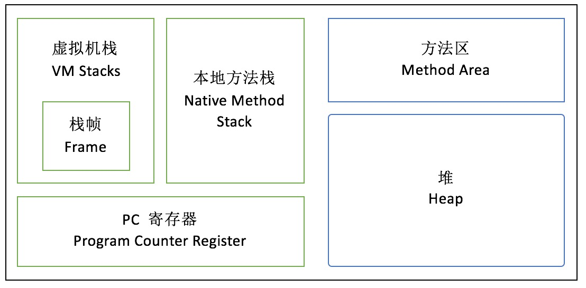

  1. **虚拟机栈** ：每个线程有一个私有的栈，随着线程的创建而创建。栈里面存着的是一种叫“栈帧”的东西，每个方法会创建一个栈帧，栈帧中存放了局部变量表（基本数据类型和对象引用）、操作数栈、方法出口等信息。栈的大小可以固定也可以动态扩展。当栈调用深度大于JVM所允许的范围，会抛出StackOverflowError的错误
  2. **本地方法栈** ：这部分主要与虚拟机用到的 Native 方法相关
  3. **PC寄存器** ：也叫程序计数器。JVM支持多个线程同时运行，每个线程都有自己的程序计数器，任何时候一个线程只能运行一个方法的代码。如果方法不是native的，pc寄存器包含当前正在被执行的jvm指令地址，如果方法是native的，pc寄存器的值是未定义的。
  4. **堆** ：堆内存是 JVM 所有线程共享的部分，在虚拟机启动的时候就已经创建。所有的对象和数组都在堆上进行分配。这部分空间可通过 GC 进行回收。当申请不到空间时会抛出 OutOfMemoryError
  5. **方法区** ：方法区也是所有线程共享。主要用于存储类的信息、常量池、方法数据、方法代码等。方法区逻辑上属于堆的一部分，但是为了与堆进行区分，通常又叫“非堆”

JVM的数据结构

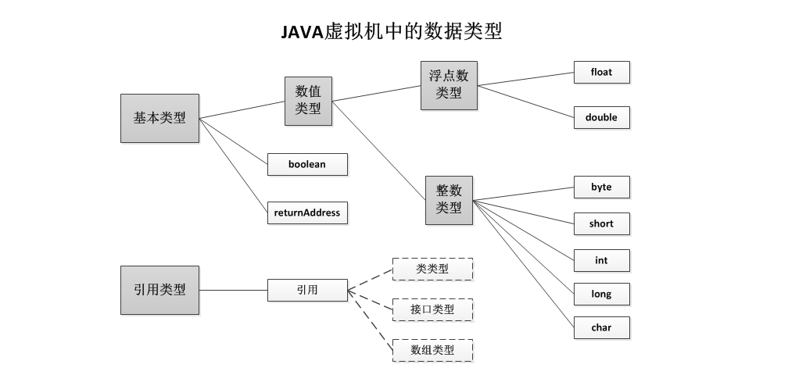

JVM的数据类型分为两种基本类型和引用类型

基本类型包括数值类型、boolean类型、returnAddress类型。

其中数值类型浮点类型和整数类型，这两个就是Java基础的7个类型

boolean类型只有true和false。但是boolean有点特别，虽然JVM也把boolean看成是基本类型，但是指令集对boolean只有有限的支持，当编译器把Java源代码编译成字节码时，他会用int或者byte来表示boolean。在JVM中boolean类型的操作会被转化为int类型的操作进行，boolean数组会当成byte数组去操作。1表示true，0表示false。

returnAddress类型是一个指针，指向JVM指令的操作码，在Java中没有与之对应的类型

引用类型包含三种：类类型、接口类型、数组类型。类类型的值是对类实例的引用；数组类型的值是对数组对象的引用，在Java虚拟机中，数组是个真正的对象；而接口类型的值，则是对实现了该接口的某个类实例的引用。还有一种特殊的引用值是null，它表示该引用变量没有引用任何对象。

### 永久代

在自定义类加载器还不是很常见的时候，类大多是“static”的，很少被卸载或收集，因此被称为“永久的”，同时，由于类class是JVM实现的一部分，并不是由应用创建的，所以又被认为是“非堆”内存，JDK8以前的HotSpot中存放这些“永久的”的区域叫做永久代。永久代是一片连续的堆空间，在JVM启动之前通过命令行设置参数-XX:MaxPermSize来设置永久代最大可分配的内存空间，默认大小是64M（64位JVM由于指针膨胀默认是85M）。永久代的垃圾收集是和老年代捆绑在一起，因此无论谁满了，都会触发永久代和老年代的垃圾收集。不过，一个明显的问题是，当JVM加载的类信息容量超过了设置的参数值，应用将会报OOM的错误

永久代空间是JVM规范的一种实现，并且只有HotSpot才有，对于其他虚拟机如：JRockit（Oracle）、J9（IBM）并没有永久代空间，由于方法区主要存储类的相关信息，所以对于动态生成类的情况比较容易出现永久代的内存溢出。

在HotSpot中，设计者将方法区纳入GC分代收集。Hotspot虚拟机内存被分为新生代和老年代，对堆内存进行管理，但要注意：**方法区并不是老年代**。方法区（JDK7 及以前由永久代实现、JDK8 起由元空间实现）是独立于堆的内存区域，只是它的回收时机跟 Full GC 绑在一起，才容易被误当成"老年代"

方法区和永久代的关系就像Java中的接口和类的关系，类实现了接口，而永久代就是HotSpot虚拟机对虚拟机规范中方法区的一种实现方式

### 元空间（metaspace）

移除永久代从JDK7就开始了，JDK7中存储在永久代的部分数据已经转移到堆中，但永久代仍存在于JDK7并没有完全移除，如符号引用转移到本地堆中，字面量（interned strings）转移到了Java的堆中，类的静态变量转移到了Java堆中

JDK8中已经不存在永久代，元空间的本质和永久代类似，都是JVM规范中方法区的实现，不过元空间与永久代之间最大的区别在于：元空间并不在虚拟机中，而是使用本地内存，因此，默认情况下元空间的大小仅受本地内存限制，可以通过参数来指定元空间的大小

-XX:MetaspaceSize，初始空间大小，达到该值就会触发垃圾收集进行类型卸载，同时GC会对该值进行调整：如果释放了大量的空间，就适当降低该值；如果释放了很少的空间，那么在不超过MaxMetaspaceSize时，适当提高该值。

-XX:MaxMetaspaceSize，最大空间，默认是没有限制的。

除了上面两个指定大小的选项以外，还有两个与 GC 相关的属性：

-XX:MinMetaspaceFreeRatio，在GC之后，最小的Metaspace剩余空间容量的百分比，减少为分配空间所导致的垃圾收集

-XX:MaxMetaspaceFreeRatio，在GC之后，最大的Metaspace剩余空间容量的百分比，减少为释放空间所导致的垃圾收集

### JDK8中永久代向元空间转换的原因

     1. 字符串存储在永久代中容易出现性能问题和内存溢出
     2. 类及方法的信息等比较难确定其大小，因此对于永久代的大小指定比较困难，太小容易出现永久代溢出，太大容易导致老年代溢出
     3. 永久代会为GC带来不必要的复杂度，并且回收效率偏低
     4. Oracle可能会将Hotspot与JRockit合二为一

### 元空间的特点

  1. 每个加载器有专门的存储空间
  2. 不会单独回收每个类
  3. 元空间里的对象的位置固定
  4. 如果发现某个加载器不在存在了，会把相关的空间整个回收

### 怎么判断对象是否可以被回收

垃圾收集器在做垃圾回收的时候，首先需要判定的是哪些内存是需要被回收的，哪些对象是“存活的”（不可以被回收），哪些对象已经“死掉”（需要被回收）

一般判断对象是否能被回收需要两种方法

  * 引用计数法：为每个对象创建一个引用计数，有对象引用时计数器+1，引用被释放时计数-1，当计数器为0时就可以被回收，他有一个缺点不能解决循环引用的问题
  * 可达性分析算法：从GC Roots开始向下搜索，搜索 所走过的路径称为引用链。当一个对象到GC Roots没有任何引用链相连时，则证明此对象是可以被回收的

可作为GCRoots的对象有

      * 虚拟机栈（栈帧中的本地变量表）中引用的对象
      * 方法区中的类静态属性引用的对象
      * 方法区中常量引用的对象
      * 本地方法栈中JNI（native方法）中引用的对象

### JVM有哪些垃圾回收算法

  * 标记-清除算法：标记无用对象，然后进行清除回收
  * 复制算法：按照容量划分两个大小相等的内存区域，当一块用完的时候将活着的对象复制到另一块上，然后再将已使用的内存空间一次清理掉
  * 标记-整理算法：标记无用对象，让所有存活的对象都向一段移动，然后直接清除掉端边界以外的内存
  * 分代算法：根据对象存活周期的不同将内存划分为几块，一般是新生代和老年代，新生代基本采用复制算法、老年代采用标记整理算法

### 标记-清除算法

标记无用对象，然后进行清除回收，标记-清除算法是一种常见的基础垃圾收集算法，他将垃圾收集分为两个阶段

1.标记阶段：标记出可以回收的对象

2.清除阶段：回收别标记的对象所占用的空间

优点：实现简单，不需要对象进行移动

缺点：标记、清除过程效率低，产生大量不连续的内存碎片，提高了垃圾回收的效率

标记-清除算法执行流程如下

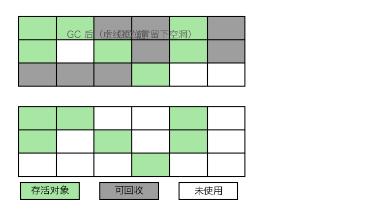

### 复制算法

为了解决标记-清除算法的效率不高的问题，产生了复制算法。它把内存空间划分为两个相等的区域，每次只使用其中一个区域。垃圾收集时，遍历当前使用的区域，把存活对象复制到另一个区域中，最后将当前使用的区域的可回收对象进行回收

优点：按顺序分配内存即可，实现简单、运行高效，不用考虑内存碎片

缺点：可用的内存大小缩小为原来的一半，对象存活率高时会频繁进行复制

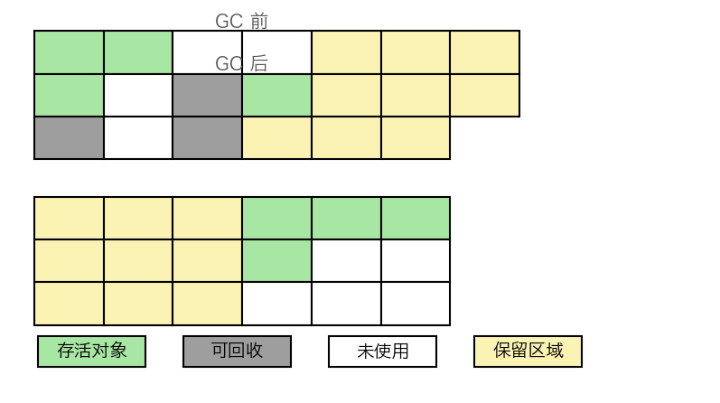

### 标记-整理算法

在新生代中可以使用复制算法，但是在老年代就不能选择复制算法了，因为老年代的对象存活率会较高，这样会有较多的复制操作，导致效率变低。标记-清除算法应该可以应用在老年代中，但是它效率不高，在内存回收后容易产生大量内存碎片。因此就出现了一种标记-整理算法，与标记-清除不同的是，在标记可回收的对象后将所有存活的对象压缩到内存的一端，使他们紧凑的排列在一起，然后对端边界以外的内存进行回收。回收后，已用和未用的内存都各自一边

优点：解决了标记-清除算法存在内存碎片问题

缺点：仍需要进行局部对象移动，一定程度上降低了效率

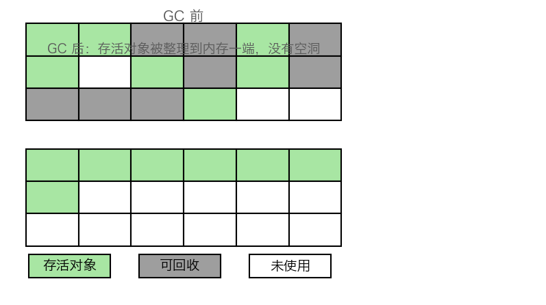

### 分代收集算法

当前商用虚拟机都采用分代收集的垃圾收集算法。分代收集就是根据对象的存活周期将内存划分成几块。一般包括新生代、老年代、永久代

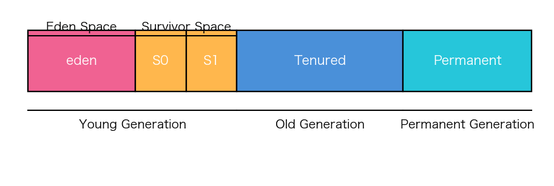

### 新生代、老年代

虚拟机（HotSpot JDK7）中共划分了三个区：新生代（Young Generation）、老年代（Old Generation）、永久代 （Permanent Generation）。其中永久代主要存放的是就Java类信息与垃圾收集要收集的Java对象关系不大。新生代和老年代的划分对垃圾回收影响比较大

### 新生代

大部分新生成的对象首先都会放到新生代中，新生代的目标就是尽可能快速的收集掉那些生命周期短的对象。新生代一般分为一个Eden区，两个Survivor区。大部分对象在Eden区生成。当Eden区满时，还存活的对象将被复制到其中一个Survivor区，当这个Survivor区也满的时候，从第一个Survivor区复制过来并且此时还存活的对象，将被复制到另一个Survivor区。需要注意的是：两个Survivor区是对称的，没有先后关系，所以同一个区可能同时存在从Eden区复制过来的对象以及从另一个Survivor区复制过来的对象。并且Survivor区总有一个是空的，HotSpot 中 Survivor 固定为两个，`-XX:SurvivorRatio` 只能调整 Eden 与单个 Survivor 的比例，不能增加 Survivor 的数量。调大 Survivor 可以延长对象在新生代停留的时间，减少过早晋升到老年代。

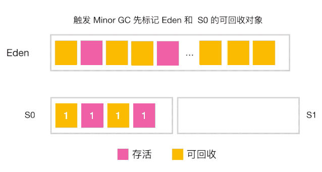

### 老年代

在新生代中经历了N（最多15）次垃圾回收后仍然存活的对象会被放到老年代中。因此，可以认为老年代中存放的都是一些生命周期较长的对象

新生代空间不足会触发minor gc、minor gc会引发STW（stop the world 停止其他用户线程，只有垃圾回收线程工作，等垃圾回收线程结束后用户线程开始恢复工作）full gc也会触发STW

HotSpot中存在三种垃圾回收现象：minor GC、major GC、full GC。

  * Minor GC：指发生在新生代的GC，因为Java对象大多都是朝生夕死，所以Minor GC非常频繁，一般回收速度也非常快
  * Major GC：指发生在老年代的GC，出现了Major GC通常会伴随至少一次Minor GC。Major GC的速度通常会比Minor GC慢10倍以上
  * Full GC：同时对新生代、老年代、永久代进行垃圾收集的GC

许多major GC是由minor GC触发的，所以很难将这两种垃圾回收分开，major GC和full GC通常是等价的，收集整个GC堆

### 什么时候对象进入老年代

  1. **大对象直接进入老年代** ：虚拟机提供了一个阈值参数，令大于这个设置值的对象直接在老年代中分配。如果大对象进入新生代，新生代采用的复制算法收集内存，会导致Eden区和两个Survivor区之间发生大量的内存复制，应该避免这种情况（**-XX:PretenureSizeThreshold 设置大对象的大小**，注意该参数**只对 Serial 和 ParNew 生效**，JDK8 默认的 Parallel Scavenge 会忽略它；单位只能写字节数）
  2. **长期存活的对象进入老年代** ：虚拟机给给个对象定义了一个年龄计数器，对象在Eden区出生，经过一个minor GC后仍然存活，并且能被Survivor区容纳的话，将被移动到Survivor区中，此时对象年龄设为1.然后对象在Survivor中每熬过一个minor GC，年龄就增加1，当年龄超过设定的阈值时，就会被移动到老年代中
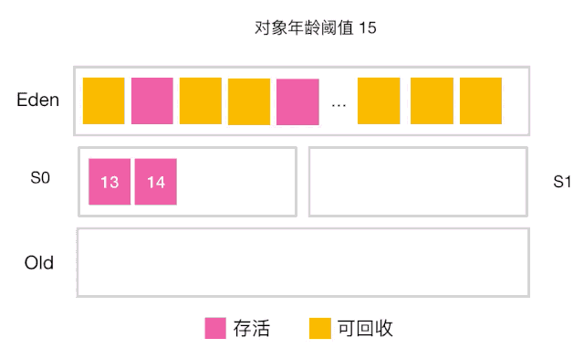
  3. **动态对象年龄判定** ：如果在Survivor区中所有相同年龄的对象，大小总和大于Survivor空间的一半，那么年龄大于或等于该年龄的对象直接进入老年代，无需等到阈值中要求的年龄
  4. **空间分配担保** ：如果老年代中最大可用的连续空间大于新生代所有对象的总空间，那么minor GC是安全的，如果老年代中最大可用连续空间大于历代晋升到老年代的对象的平均大小，就进行一次有风险的minor GC，如果小于平均值，就进行full GC来让老年代腾出更多的空间。因为新生代使用的是复制算法，为了内存利用率，只使用其中一个Survivor区来做轮换备份，因此如果大量对象在minor GC后仍存活，导致Survivor区空间不够用，就会通过分配担保机制，将多出来的对象提前转到老年代，但老年代要进行担保的前提是自己本身还有容纳这些对象的剩余空间，由于无法提前知道会有多少对象存活下来，所以取之前每次晋升到老年代的平均大小作为经验值，与老年代的剩余空间作比较

### Java中有哪些引用类型

  * 强引用：发生gc的时候不会被回收，类似Object object = new Object(),只要对象有强引用有之关联，JVM就不会回收这个对象，即使内存不足的情况下，宁愿抛出OutOfMemory错误也不会回收这种对象
  * 软引用：有用但不是必须的对象，在发生内存溢出之前会被回收，对于软引用关联着的对象，只有在内存不足的时候JVM才会回收该对象。因此，这一点可以很好地用来解决OOM的问题，并且这个特性很适合用来实现缓存：比如网页缓存、图片缓存等。
  * 弱引用：有用但不是必须的对象，当JVM进行垃圾回收时，无论内存是否充足，都会回收被弱引用关联的对象
  * 虚引用：无法通过虚引用获得对象，用PhantomReference实现虚引用，虚引用的用途是在gc时返回一个通知

对比 | 强引用 | 软引用 | 弱引用 | 虚引用
---|---|---|---|---
引用强度 | 最强 | 第二 | 第三 | 最弱
如何使用 | new Object() | SoftReference | WeakReference | PhantomReference

### 直接内存

Java中的内存其实分为两部分，除了JVM中内存，还有另一部分内存不需要JVM管理的直接内存，也叫堆外内存。堆外内存就是把对象分配在JVM堆以外的内存区域，这部分内存不是虚拟机管理，而是由操作系统来管理，这样可以减少垃圾回收对应用程序的影响。

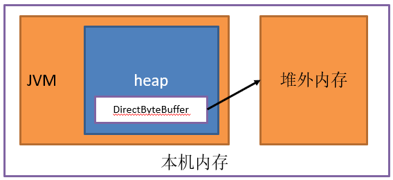

NIO（New input/output）是JDK1.4中新加入的类，引入了一种基于通道（channel）和缓冲区（buffer）的I/O方式，它可以使用Native函数库直接分配堆外内存，然后通过堆上的DirectByteBuffer对象对这块内存进行引用和操作。可以看出直接内存的大小并不受Java堆的限制，甚至不受JVM进程内存大小的限制。他只受本机内存大小以及处理器寻址空间的限制

直接内存出现OutOfMemoryError的原因是对该区域进行内存分配时，其内存与其他内存加起来超过最大物理内存限制（包括物理的和操作系统级的限制），从而导致OutOfMemoryError。另外，若我们通过参数“-XX:MaxDirectMemorySize”指定了直接内存的最大值，其超过指定的最大值时，也会抛出内存溢出异常。

直接内存的特点有3个

  1. 常见于NIO操作时，用于数据缓冲区
  2. 分配回收成本较高，但读写性能高

  3. 不受JVM内存回收管理

在堆、栈、方法区制造OOM？

要使堆溢出，只需要创建大量对象即可，并且保证对象在使用，直接new对象

栈里面主要是方法，递归调用方法就可以把栈耗尽；或者使局部变量表长度超过限制，还有一种方法是创建大量的线程

方法区主要放着类相关的信息和常量池。所以不断创建类或者不断增加常量池内容，都可以使其溢出（不断增加类即可。注意：JDK7 起字符串常量池已从永久代移到堆中，创建大量 String 造成的是**堆溢出**，不再是方法区/元空间溢出）

## 二、对象内存分配（TLAB）

> 来源：`Java内存分配（TLAB）.md`

对象的内存分配过程中，主要是对象的引用指向这个内存区域，然后进行初始化操作。但是，因为堆是全局共享的，因此在同一时间，可能有多个线程在堆上申请空间，那么，在并发场景中，如果两个线程先后把对象引用指向了同一个内存区域，怎么办。

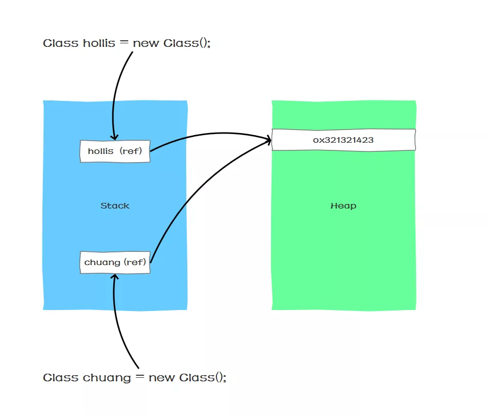

为了解决这个并发问题，对象的内存分配过程就必须进行同步控制。但是我们都知道，无论是使用哪种同步方案（实际上虚拟机使用的可能是CAS），都会影响内存的分配效率。

而Java对象的分配是Java中的高频操作，所有，人们想到另外一个办法来提升效率。这里我们重点说一个HotSpot虚拟机的方案：每个线程在Java堆中预先分配一小块内存，然后再给对象分配内存的时候，直接在自己这块”私有”内存中分配，当这部分区域用完之后，再分配新的”私有”内存。这种方案被称之为TLAB分配，即Thread Local Allocation Buffer。这部分Buffer是从堆中划分出来的，但是是本地线程独享的。

TLAB是虚拟机在堆内存的eden划分出来的一块专用空间，是线程专属的。在虚拟机的TLAB功能启动的情况下，在线程初始化时，虚拟机会为每个线程分配一块TLAB空间，只给当前线程使用，这样每个线程都单独拥有一个空间，如果需要分配内存，就在自己的空间上分配，这样就不存在竞争的情况，可以大大提升分配效率。正因为有了TLAB技术，堆内存并不是完完全全的线程共享，其eden区域中还是有一部分空间是分配给线程独享的。

值得注意的是，我们说TLAB是线程独享的，但是只是在“分配”这个动作上是线程独享的，至于在读取、垃圾回收等动作上都是线程共享的。而且在使用上也没有什么区别。

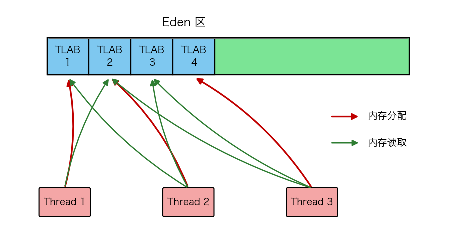

也就是说，虽然每个线程在初始化时都会去堆内存中申请一块TLAB，并不是说这个TLAB区域的内存其他线程就完全无法访问了，其他线程的读取还是可以的，只不过无法在这个区域中分配内存而已。并且，在TLAB分配之后，并不影响对象的移动和回收，也就是说，虽然对象刚开始可能通过TLAB分配内存，存放在Eden区，但是还是会被垃圾回收或者被移到Survivor Space、Old Gen等。

还有一点需要注意的是，我们说TLAB是在eden区分配的，因为eden区域本身就不太大，而且TLAB空间的内存也非常小，TLAB 占 Eden 的比例并不是固定的 1%（`-XX:TLABWasteTargetPercent` 的 1% 指的是**允许浪费的上限**）；TLAB 的实际大小由 Eden 大小和线程数自适应决定。所以，必然存在一些大对象是无法在TLAB直接分配。遇到TLAB中无法分配的大对象，对象还是可能在eden区或者老年代等进行分配的，但是这种分配就需要进行同步控制，这也是为什么我们经常说：小的对象比大的对象分配起来更加高效。

TLAB带来的问题：

因为TLAB内存区域并不是很大，所以，有可能会经常出现不够的情况。比如一个线程的TLAB空间有100KB，其中已经使用了80KB，当需要再分配一个30KB的对象时，就无法直接在TLAB中分配，遇到这种情况时，有两种处理方案：

1.如果一个对象需要的空间大小超过TLAB中剩余的空间大小，则直接在堆内存中对该对象进行内存分配。

2.如果一个对象需要的空间大小超过TLAB中剩余的空间大小，则废弃当前TLAB，重新申请TLAB空间再次进行内存分配。

上面两种方案都有各自的优缺点：如果采用方案1，那么就可能存在着一种极端情况，就是TLAB只剩下1KB，就会导致后续需要分配的大多数对象都需要在堆内存直接分配。如果采用方案2，也有可能存在频繁废弃TLAB，频繁申请TLAB的情况，而我们知道，虽然在TLAB上分配内存是线程独享的，但是TLAB内存自己从堆中划分出来的过程确实可能存在冲突的，所以，TLAB的分配过程其实也是需要并发控制的。而频繁的TLAB分配就失去了使用TLAB的意义。

为了解决这两个方案存在的问题，虚拟机定义了一个refill_waste的值，这个值可以翻译为“最大浪费空间”。

当请求分配的内存大于refill_waste的时候，会选择在堆内存中分配。若小于refill_waste值，则会废弃当前TLAB，重新创建TLAB进行对象内存分配。

前面的例子中，TLAB总空间100KB，使用了80KB，剩余20KB，如果设置的refill_waste的值为25KB，那么如果新对象的内存大于25KB，则直接堆内存分配，如果小于25KB，则会废弃掉之前的那个TLAB，重新分配一个TLAB空间，给新对象分配内存。

TLAB功能是可以选择开启或者关闭的，可以通过 `-XX:+UseTLAB` 开启、`-XX:-UseTLAB` 关闭（**默认开启**）。注意布尔参数只能写 `+` 或 `-`，没有 `+/-` 这种写法。

TLAB 占 Eden 的比例可以用 `-XX:TLABWasteTargetPercent` 调整，但它的默认值 1% 指的是**允许浪费的比例上限**，不是"TLAB 只占 Eden 的 1%"。

默认情况下，TLAB的空间会在运行时不断调整，使系统达到最佳的运行状态。如果需要禁用自动调整TLAB的大小，可以使用-XX:-ResizeTLAB来禁用，并且使用 `-XX:TLABSize` 手工指定 TLAB 的大小。

TLAB的refill_waste也是可以调整的，`-XX:TLABRefillWasteFraction` 默认值为 64，含义是**当本次分配请求超过 TLAB 容量的 1/64 时，就放弃在当前 TLAB 里分配，改为申请新的 TLAB**。注意参数名里的冒号是**半角** `:`，写成全角会启动失败。

如果想要观察TLAB的使用情况，可以使用参数 `-XX:+PrintTLAB` 进行跟踪。

TLAB的空间其实并不大，所以大对象还是可能需要在堆内存中直接分配。对象分配的实际顺序是：先尝试在**当前线程的 TLAB** 里分配；TLAB 放不下（或请求超过 `TLABRefillWasteFraction` 的门槛）时，先判断是否为**大对象**（超过 `PretenureSizeThreshold`，注意仅 Serial/ParNew 有效）——是大对象就直接进老年代，否则到 **Eden 区走加锁的慢路径**分配。

注意：TLAB是hotspot虚拟机一种优化方案，不代表其他虚拟机都有这个特性
