# 垃圾收集与收集器

> 合并自：`GC收集器.md`、`young gc很频繁以及运行很慢的原因可能是什么.md`。原文未删改，仅按主题归并。

## 一、各代垃圾收集器（CMS / G1 / ZGC）

> 来源：`GC收集器.md`

### 垃圾回收器

  * 新生代回收器：Serial、ParNew、Parallel Scavenge
  * 老年代回收器：Serial Old、Parallel Old、CMS
  * 整堆回收器：G1、ZGC

新生代垃圾回收器一般采用复制算法，复制算法优点是效率高，缺点是内存利用率低

老年代垃圾回收器一般采用标记-整理算法进行垃圾回收

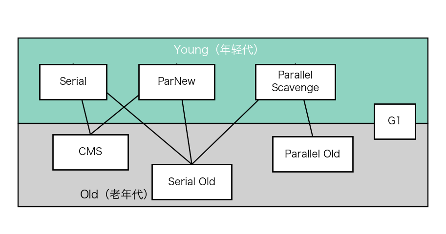

  * **Serial收集器（复制算法):**

它是一个单线程收集器，它在工作时必须暂停其他所有的工作线程，直到收集结束。这里要知道一个很严重的问题就是暂停一切线程的结果就是当前运行在这个JDK的所有用户线程全部暂停，也就是说这一瞬间都是死掉的，用户看到的现象就是页面无任何响应，如果这种这种现象出现的时间长且频繁用户就奔溃了。

**不同收集器追求的目标并不相同**：有的追求最短停顿（CMS、G1、ZGC），有的追求吞吐量（Parallel Scavenge）。不存在"停顿一定更短"的单调优劣关系，需要按业务场景选型。

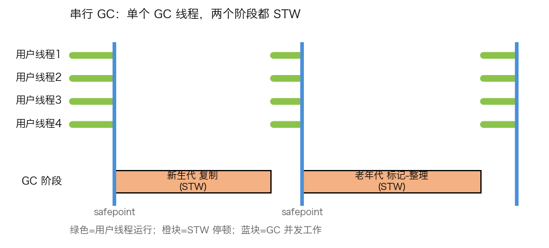

  * **ParNew收集器 (复制算法):**

新生代收并行集器，实际上是Serial收集器的多线程版本。在单CPU环境下ParNew的性能没办法超过Serial，在多核CPU环境下有着比Serial更好的表现；ParNew还可以和CMS搭配使用

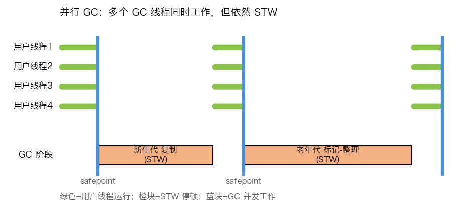

  * **Parallel Scavenge收集器 (复制算法):**

新生代并行收集器，追求高吞吐量，高效利用 CPU。吞吐量 = 用户线程时间/(用户线程时间+GC线程时间)，例如虚拟机运行100分钟，其中垃圾收集时间使用1分钟，那么吞吐量就是99%，高吞吐量可以高效率的利用CPU时间，尽快完成程序的运算任务，适合后台应用等对交互相应要求不高的场景；

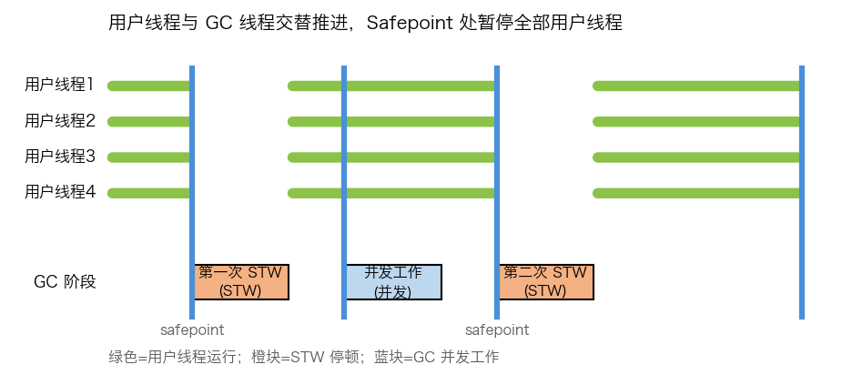

  * **Serial Old收集器 (标记-整理算法)：**

老年代单线程收集器，Serial收集器的老年代版本；

  * **Parallel Old收集器 (标记-整理算法)：**

老年代并行收集器，吞吐量优先，Parallel Scavenge收集器的老年代版本；

并行：多条垃圾收集线程并行工作，但此时用户线程仍然处于等待状态。如：ParNew、Parallel Scavenge、Parallel Old

并发：用户线程与垃圾收集线程同时执行（但不一定是并行的，可能会交替执行），用户程序在继续运行，而垃圾收集程序运行在另一个CPU上。如：CMS、G1

  * **CMS(Concurrent Mark Sweep)收集器（标记-清除算法）：**

老年代并行收集器，以获取最短回收停顿时间为目标的收集器，具有高并发、低停顿的特点，追求最短GC回收停顿时间。它采用标记-清除算法，因此会产生大量空间碎片。为了解决这个问题，CMS可以通过配置以下两种参数解决：

           1. -XX:+UseCMSCompactAtFullCollection：参数，强制JVM在Full GC完成后対老年代迸行圧縮，执行一次空间碎片整理，但是空间碎片整理阶段也会引发STW。为了减少STW次数，CMS还可以通过配置
           2. -XX:+CMSFullGCsBeforeCompaction=n ：参数，在执行了n次Full GC后, JVM再在老年代执行空间碎片整理

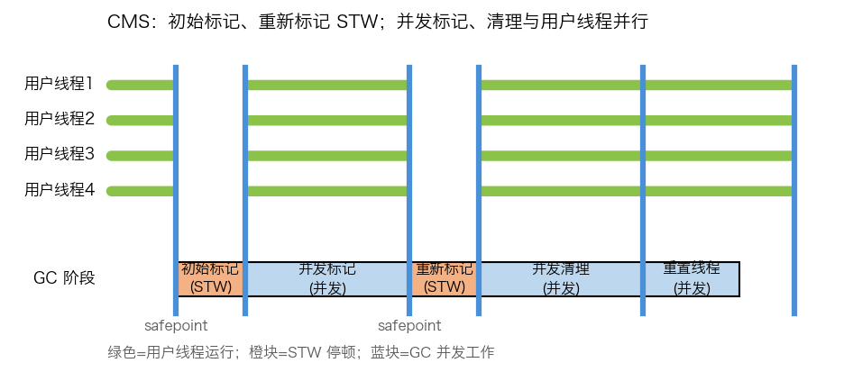

初始标记：停止一切用户线程，仅使用一条初始化标记线程对所有与GC Roots直接关联的老年代对象进行标记，速度很快

并发标记：使用多条并发标记线程并行执行，并与用户线程并发执行，此过程进行可达性分析，标记所有这些对象可达的存活对象，速度很慢

重新标记：因为并发标记时有用户线程在执行，标记结果可能有变化，停止一切用户线程，并使用多条重新标记线程并行执行，重新遍历所有在并发期间有变化的对象进行最后的标记，这个过程的运行时间介于初始标记和并发标记之间

并发清除：使用多条并发清除线程（由 `-XX:ConcGCThreads` 控制，默认约为并行 GC 线程数的 1/4），与用户线程并发执行，清除刚才标记的对象

  * **G1(Garbage First)收集器 (复制、标记-整理算法)：**

#### G1收集器的特点

    * 并行与并发
      * 能充分利用多CPU、多核环境下的硬件优势
      * 可以并行来缩短STW停顿时间
      * 可以并发让垃圾收集与用户程序同时进行
    * 分代收集、收集范围包含新生代和老年代
      * 能独立管理整个GC堆（新生代和老年代），不需要其他收集器配合
      * 能够采用不同方式处理不同时期的对象
      * 虽然保留分代概念，单Java堆的内存布局有很大差别
      * 将整个堆划分成多个大小相等的独立区域（Region）
      * 新生代和老年代不再是物理隔离，他们都是一部分独立Region的集合（不需要连续）
    * 结合多种垃圾收集算法，空间整合，不产生碎片
      * 从整体看是基于标记-整理算法
      * 从局部看（两个Region）看，是基于复制算法
      * 不会产生内存碎片，有利于长时间运行
    * 可预测的停顿：低停顿的同时实现高吞吐量
      * G1除了追求低停顿还能建立可预测的停顿时间模型
      * 可以明确指定M毫秒内，垃圾收集消耗的时间不超过N毫秒

### G1的内存模型

G1将Java堆空间分割成若干相同大小的的区域，即Region,Humongous 是**独立的区域类型**，专门放置大型对象（超过半个 Region 的对象），既不属于新生代也不属于老年代；JDK9 起 G1 成为默认垃圾回收器

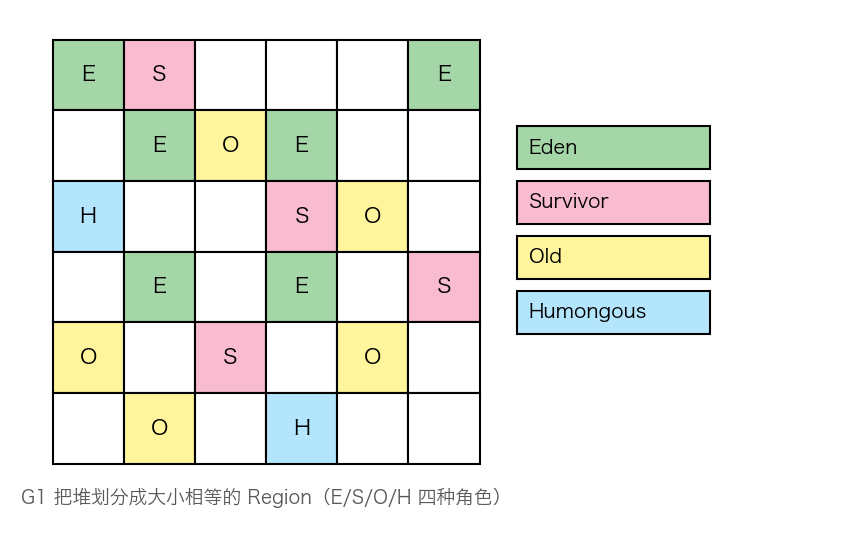

### G1垃圾收集过程

  1. 初始标记：标记与GC Roots直接关联的对象，停止所有用户线程，只启动一条初始标记线程，这个过程很快
  2. 并发标记：进行全面的可达性分析，开启一条并发标记线程与用户线程并行执行，这个过程比较长
  3. 最终标记：标记出并发标记过程中用户线程新产生的垃圾，停止用户线程，并使用多条最终标记线程并行执行
  4. 筛选回收：回收废弃的对象，此时也需要停止一切用户线程，并使用多条筛选回收线程并行执行（G1会根据设置的系统暂停时间回收尽可能多的垃圾）

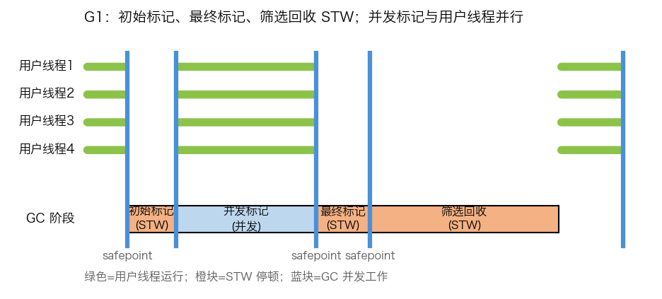

G1最大的特点就是可以让我们设置一个垃圾回收的预期停顿时间，也就是说比如我们可以指定：希望 G1 **每一次**垃圾回收的停顿时间（STW）不超过指定毫秒数（`-XX:MaxGCPauseMillis`，默认 200ms）。注意这是**单次停顿目标**，不是某个时间段内的累计停顿；而且它是"尽力而为"的软目标，不保证一定达成。G1要做到这一点就必须追踪每个Region里的回收价值（它必须搞清楚每个Region里的对象有多少是垃圾，如果这个Region进行垃圾回收需要耗费多少时间，可以回收多少垃圾）

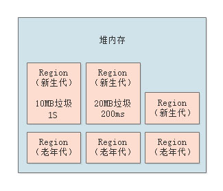

如图，G1通过追踪发现，1个Region中的垃圾对象有10M，回收他们需要耗费1秒，另一个Region中的垃圾对象有20M，回收他们需要200毫秒，然后在垃圾回收的时候，G1会发现在最近的一个时间段内，垃圾已经导致了几百毫秒的系统停顿，现在又要执行一次垃圾回收，那么必须是回收图中那个只需要200毫秒就能回收掉的20M垃圾的Region，于是G1触发了一次垃圾回收，虽然可能会导致系统停顿了200毫秒，但是一下子回收了更多垃圾，如下图

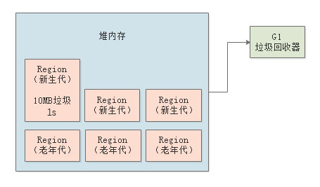

简单来说，G1可以做到让你来设定垃圾回收对系统的影响，它自己通过把内存拆分成大量小Region，以及追踪每个Region中可以回收的对象大小和预估时间，最后在垃圾回收的时候，尽量把垃圾回收对系统造成的影响控制在你指定的时间范围内，同时在有限的时间内尽量回收尽可能多的垃圾对象，这就是G1的核心设计思路

在G1中新生代和老年代只是逻辑概念，每一个Region可能属于新生代也可能属于老年代，刚开始Region可能谁都不属于，然后接着分配给新生代，然后放了很多属于新生代的对象，接着就触发了垃圾回收这个Region，如下图：

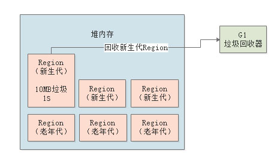

然后下次同一个Region可能又被分配给了老年代，如下图：

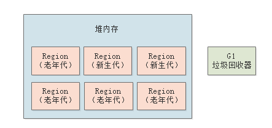

所以，其实在G1对应的内存模型中，Region随时会属于新生代也会属于老年代，所以没有所谓新生代分配多少内存，老年代分配多少内存的说法，实际上新生代和老年代各自的内存区域是不停的变动的，由G1自动控制

### G1设置对应的内存

G1的堆内存对应的是一大堆Region内存区域，而且每个Region的大小是一致的，这时需要思考两个问题：1.到底有多少Region，2.每个Region大小是多少，这个其实默认情况下自动计算和设置的，我们可以给整个堆内存设置一个大小，比如用“-Xms”和“-Xmx”来设置堆内存的大小。然后JVM启动的时候一旦发现你使用的是G1垃圾回收器（可以使用“-XX:+UseG1GC”指定），此时会自动用堆大小除以2048。因为JVM最多可以有2048个Region，每个 Region 的大小必须是 **2 的幂**（1M、2M、4M、8M…最大 32M），因为对象寻址要用位运算；堆大小不能被 2048 整除时，会取最接近的 2 的幂。

假如堆大小是4G，那么就是4096M，此时除以2048个Region，每个Region的大小就是2M。大概就是这样子来决定Region的数量和大小，一般保持默认的计算方式就可以

我们还可以手动指定Region的大小，使用“-XX:G1HeapRegionSize”，假设堆内存分配了 8G，按默认算法 8G ÷ 2048 = 4M，于是 Region 会自动取 4M，正好铺满整个堆。**Region 大小是由堆大小反推出来的，不会出现"只能用一半、另一半浪费"的情况**；需要手动干预时可用 `-XX:G1HeapRegionSize`（要求是 2 的幂、且在 1M~32M 之间），如图

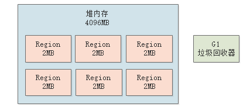

刚开始的时候，默认新生代对堆内存的占比是5%，也就是占据200M左右的内存，对应大概100个Region，这个是可以通过“-XX:G1NewSizePercent”来设置新生代初始占比的，其实维持这个默认值即可，因为在系统运行中，JVM其实会不停的给新生代增加更多的Region，但是新生代的占比不会超过60%，可以通过“-XX:G1MaxNewSizePercent”设置，也就是说，新生代默认内存区间是5%-60%，而且一旦Region进行了垃圾回收，此时新生代的Region数量还在减少，这些其实都是动态的

G1的新生代对于Eden和Survivor的概念

G1中虽然把内存划分为了很多的Region，但是其实还是有新生代、老年代的区分（都是逻辑上的概念，他们可能分散在各个Region，并不是连续的一块内存）。并且新生代里还是有Eden和Survivor区的划分，新生代参数“-XX:SurvivorRatio=8”说明Eden:Survivor1:Survivor2=8:1:1，假如新生代初始时有100个Region，那么可能80个是Eden，两个Survivor各占10个，这里的Eden和Survivor各自占据着不同的Region，随着对象不断在新生代中分配，属于新生代的Region会不断增加，Eden和Survivor对应的Region也会不断增加

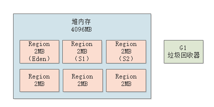

### G1新生代垃圾回收触发点和如何设置回收时间

当新生代的Eden对应的Region中不停放对象，JVM会不停的给新生代加入更多的Region，直到新生代占据堆大小的最大比例60%，一旦新生代达到了设定的占据堆内存的最大大小60%，比如都有1200个Region了，里面的Eden可能占据了1000个Region，每个Survivor是100个Region，而且Eden区还占满了对象，此时如下图所示。

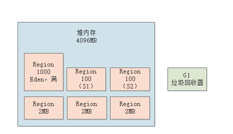

这个时候还是会触发新生代的GC，G1就会用之前说过的复制算法来进行垃圾回收，进入一个“Stop the World”状态。（但是stw的的时间是可以控制的），然后把Eden对应的Region中的存活对象放入S1对应的Region中，接着回收掉Eden对应的Region中的垃圾对象，如下图。

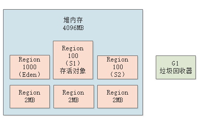

但是这个过程跟之前是有区别的，因为G1是可以设定目标GC停顿时间的，也就是G1执行GC的时候最多可以让系统停顿多长时间，那么也就意味着，GC完成之后，肯定存在某些region 的垃圾是不能回收的，因为需要在设定的时间内进行回收垃圾。可以通过“-XX:MaxGCPauseMillis”参数来设定，默认值是200ms。那么G1就会通过之前说的，对每个Region追踪回收他需要多少时间，可以回收多少对象来选择回收一部分的Region，保证GC停顿时间控制在指定范围内，尽可能多的回收掉一些对象。

在G1中对象从新生代进入老年代和其他收集器一样有下面几个条件

  1. 对象在新生代躲过多次垃圾回收，达到了一定的年龄（-XX:MaxTenuringThreshold设置年龄）
  2. 动态年龄判定规则：一旦发现某次新生代GC过后，存活的对象超过Survivor的50%，此时就会判断。如年龄为1岁、2岁、3岁、4岁的对象大小总和超过Survivor的50%，此时4岁以上的对象全部会进入老年代，这就是动态年龄判断

### 大对象处理

注意G1提供了专门的Region来存放大对象，而不是让大对象进入老年代的Region中。在G1中，大对象的判定规则就是一个大对象超过一个Region大小的50%，比如按照上面算的，每个Region是2M，只要一个大对象超过1M，就会被放入大对象专门的Region中，而且如果一个大对象太大，可能会横跨多个Region来存放

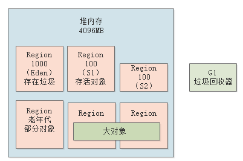

这里大对象既不属于新生代也不属于老年代，不过在新生代和老年代进行回收时会顺带待着大对象一起回收

### G1新生代和老年代混合垃圾回收

G1有一个参数，是“-XX:InitiatingHeapOccupancyPercent”，他的默认值是45%。也就是说如果老年代占据了堆内存的45%的Region（不是说，新生代占据了百分之60么？老年代怎么会有百分之四十五？那是新生代最多占据%60，所以老年代是有可能到%45）的时候，此时就会尝试触发一个新生代+老年代一起回收的混合回收阶段。

“-XX:G1MixedGCCountTarget”参数，就是在一次混合回收的过程中，最后一个阶段执行几次混合回收，默认值是8次， 意味着最后一个阶段，先停止系统运行，混合回收一些Region，再恢复系统运行，接着再次禁止系统运行，混合回收一些Region，反复8次。假设一次混合回收预期要回收掉一共有160个Region，那么此时第一次混合回收，会回收掉一些Region，比如就是 20个Region。停止系统一会儿，回收掉一些Region，再让系统运行一会儿，然后再次停止系统一会儿，再次回收掉一些Region，这样可以尽可能让系统不要停顿时间过长，可以在多次回收的间隙，也运行一下。

“-XX:G1HeapWastePercent”，默认值是5%。 他的意思就是说，在混合回收的时候，对Region回收都是基于复制算法进行的，都是把要回收的Region里的存活对象放入其他Region，然后这个Region中的垃圾对象全部清理掉。 这样的话在回收过程就会不断空出来新的Region，一旦空闲出来的Region数量达到了堆内存的5%，此时就会 立即停止混合回收，意味着本次混合回收就结束了。

“-XX:G1MixedGCLiveThresholdPercent”，他的默认值是85%，意思就是确定要回收的Region的时候，必须是存活对象低于85%的Region才可以进行回收， 否则要是一个Region的存活对象多余85%，你还回收他干什么？这个时候要把85%的对象都拷贝到别的Region，这个成本是很高的。

G1回收失败时的Full GC

如果在进行Mixed回收的时候，无论是年轻代还是老年代都基于复制算法进行回收，都要把各个Region的存活对象拷贝到别的Region里去，此时万一出现拷贝的过程中发现没有空闲Region可以承载自己的存活对象了，就会触发 一次失败。 一旦失败，立马就会切换为停止系统程序，然后采用单线程进行标记、清理和压缩整理，空闲出来一批Region，这个过程是极慢极慢的。

### ZGC（JDK11 引入的低延迟收集器）

ZGC（Z Garbage Collector）是一款由Oracle公司研发的，以低延迟为首要目标的一款垃圾收集器。它是基于动态Region内存布局，（暂时）不设年龄分代，使用了读屏障、染色指针和内存多重映射等技术来实现可并发的标记-整理算法的收集器。在JDK 11新加入，还在实验阶段，主要特点是：回收TB级内存（最大4T），停顿时间不超过10ms。

### 动态Region

ZGC的Region可以具有如图所示的大、中、小三类容量：

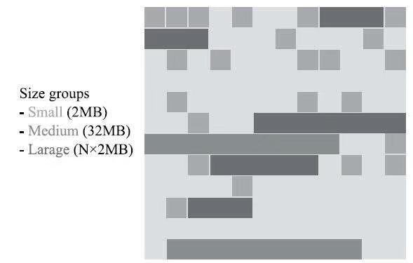

  * 小型Region（Small Region）：容量固定为2MB，用于放置小于256KB的小对象。
  * 中型Region（Medium Region）：容量固定为32MB，用于放置大于等于256KB但小于4MB的对象。
  * 大型Region（Large Region）：容量不固定，可以动态变化，但必须为2MB的整数倍，用于放置4MB或以上的大对象。每个大型Region中只会存放一个大对象，最小容量可低至4MB，所有大型Region可能小于中型Region。大型Region在ZGC的实现中是不会被重分配的，因为复制一个大对象的代价非常高昂。

### ZGC关键技术：着色指针、读屏障

ZGC通过着色指针和读屏障技术，解决了转移过程中准确访问对象的问题，实现了并发转移。大致原理描述如下：并发转移中“并发”意味着GC线程在转移对象的过程中，应用线程也在不停地访问对象。假设对象发生转移，但对象地址未及时更新，那么应用线程可能访问到旧地址，从而造成错误。而在ZGC中，应用线程访问对象将触发“读屏障”，如果发现对象被移动了，那么“读屏障”会把读出来的指针更新到对象的新地址上，这样应用线程始终访问的都是对象的新地址。那么，JVM是如何判断对象被移动过呢？就是利用对象引用的地址，即着色指针。（着色指针是一种将信息存储在指针上的技术）

### 染色指针技术

染色指针是一种直接将少量额外的信息存储在指针上的技术。目前在Linux下64位的操作系统中高18位是不能用来寻址的，但是剩余的46为却可以支持64T的空间，到目前为止我们几乎还用不到这么多内存。于是ZGC将46位中的高4位取出，用来存储4个标志位，剩余的42位可以支持4T的内存，如图所示：

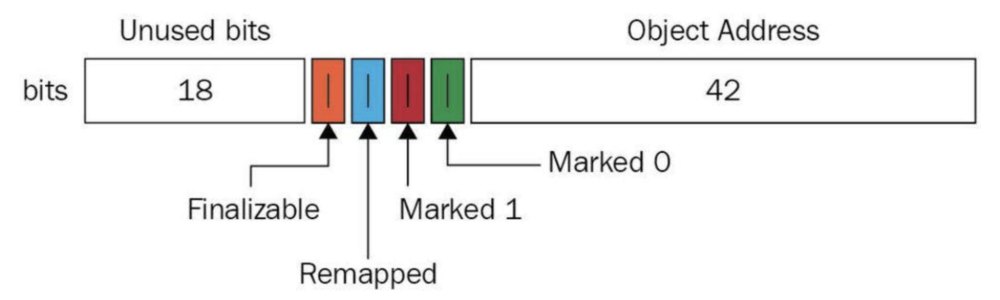

HotSpot虚拟机的标记实现方案有如下几种：

  * 把标记直接记录在对象头上（如Serial收集器）
  * 把标记记录在与对象相互独立的数据结构上（如G1、Shenandoah使用了一种相当于堆内存的1/64大小的，称为BitMap的结构来记录标记信息）

  * 直接把标记信息记在引用对象的指针上（如ZGC）

原理

  * Linux下64位指针的高18位不能用来寻址，所有不能使用；
  * Finalizable：表示是否只能通过finalize()方法才能被访问到，其他途径不行；
  * Remapped：表示是否进入了重分配集（即被移动过）；

  * Marked1、Marked0：表示对象的三色标记状态；

  * 最后42用来存对象地址，最大支持4T；

### 三色标记

在并发的可达性分析算法中我们使用三色标记（Tri-color Marking）来标记对象是否被收集器访问过：

  * 白色：表示对象尚未被垃圾收集器访问过。显然在可达性分析刚刚开始的阶段，所有的对象都是白色的，若在分析结束的阶段，仍然是白色的对象，即代表不可达。
  * 黑色：表示对象已经被垃圾收集器访问过，且这个对象的所有引用都已经扫描过。黑色的对象代表已经扫描过，它是安全存活的，如果有其他对象引用指向了黑色对象，无须重新扫描一遍。黑色对象不可能直接（不经过灰色对象）指向某个白色对象。
  * 灰色：表示对象已经被垃圾收集器访问过，但这个对象上至少存在一个引用还没有被扫描过。

可达性分析的扫描过程，其实就是一股以灰色为波峰的波纹从黑向白推进的过程，但是在并发的推进过程中会产生“对象消失”的问题，如图：

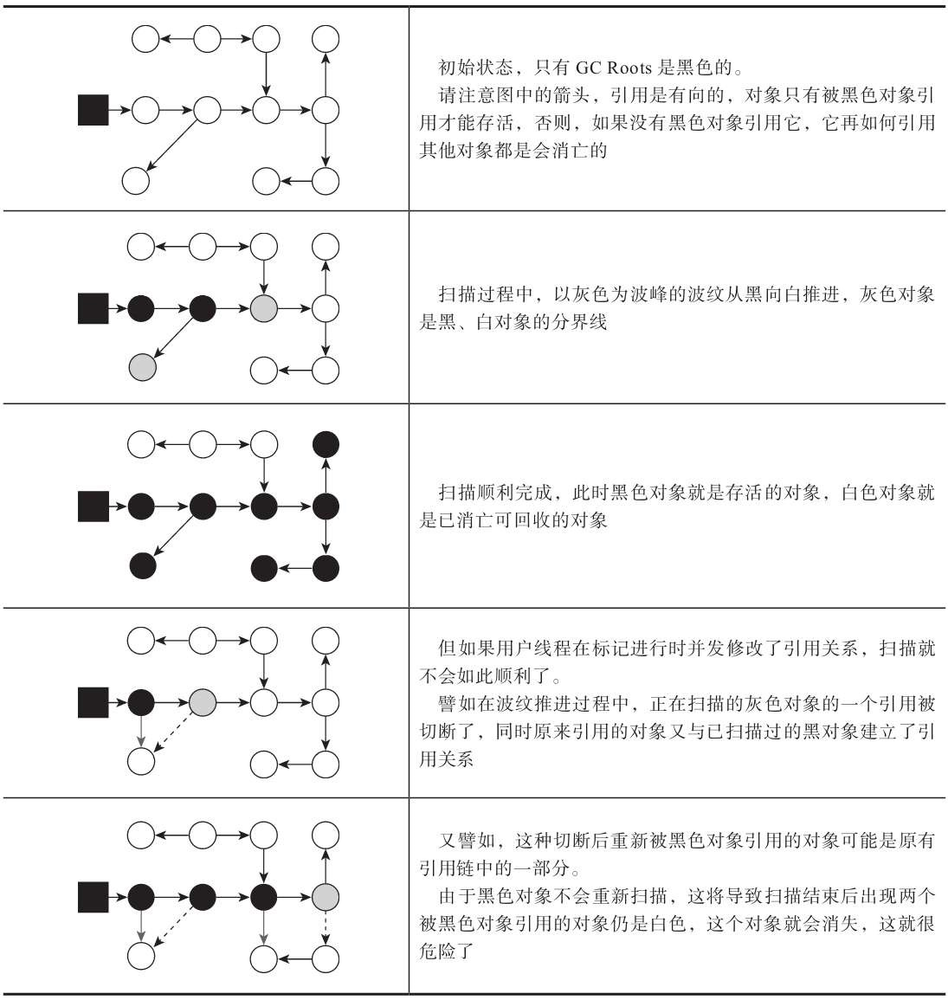

对象消失理论，只有同时满足才会发生对象消失：

  * 赋值器插入了一条或多条从黑色对象到白色对象的新引用；
  * 赋值器删除了全部从灰色对象到该白色对象的直接或间接引用；

要解决对象消失问题只需要破坏其中一条就行了，目前常用有两种方案：

  * 增量更新（Incremental Update）:增量更新要破坏的是第一个条件，当黑色对象插入新的指向白色对象的引用关系时，就将这个新插入的引用记录下来，等并发扫描结束之后，再将这些记录过的引用关系中的黑色对象为根，重新扫描一次。这可以简化理解为，黑色对象一旦新插入了指向白色对象的引用之后，它就变回灰色对象了。
  * 原始快照（Snapshot At TheBeginning，SATB）:原始快照要破坏的是第二个条件，当灰色对象要删除指向白色对象的引用关系时，就将这个要删除的引用记录下来，在并发扫描结束之后，再将这些记录过的引用关系中的灰色对象为根，重新扫描一次。这也可以简化理解为，无论引用关系删除与否，都会按照刚刚开始扫描那一刻的对象图快照来进行搜索。

以上无论是对引用关系记录的插入还是删除，虚拟机的记录操作都是通过写屏障实现的。CMS是基于增量更新来做并发标记的，G1、Shenandoah则是用原始快照来实现。

### 染色指针的三大优势

  1. 一旦某个Region的存活对象被移走之后，这个Region立即就能够被释放和重用掉，而不必等待整个堆中所有指向该Region的引用都被修正后才能清理，这使得理论上只要还有一个空闲Region，ZGC就能完成收集。而Shenandoah需要等到更新阶段结束才能释放回收集中的Region，如果Region里面对象都存活的时候，需要1:1的空间才能完成收集。
  2. 染色指针可以大幅减少在垃圾收集过程中内存屏障的使用数量，ZGC只使用了读屏障。
  3. 染色指针具备强大的扩展性，它可以作为一种可扩展的存储结构用来记录更多与对象标记、重定位过程相关的数据，以便日后进一步提高性能。

### 内存多重映射

ZGC使用了内存多重映射（Multi-Mapping）将多个不同的虚拟内存地址映射到同一个物理内存地址上，这是一种多对一映射，意味着ZGC在虚拟内存中看到的地址空间要比实际的堆内存容量来得更大。把染色指针中的标志位看作是地址的分段符，那只要将这些不同的地址段都映射到同一个物理内存空间，经过多重映射转换后，就可以使用染色指针正常进行寻址了，如图：

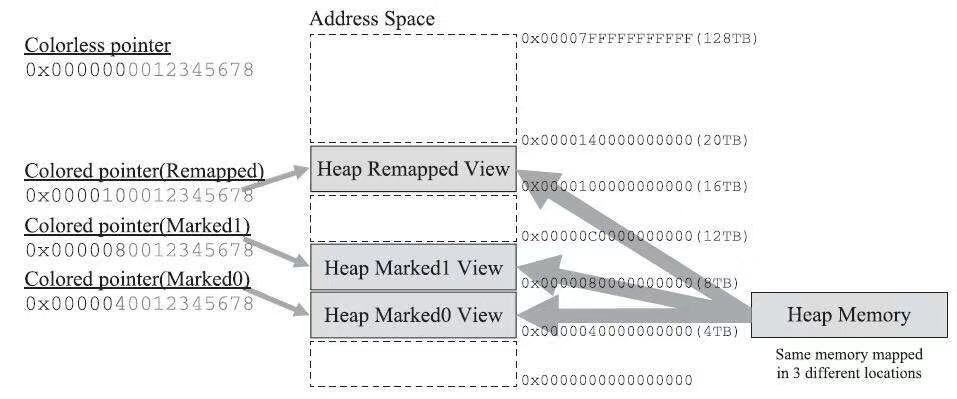

ZGC仅支持64位系统，它把64位虚拟地址空间划分为多个子空间，如下图所示：

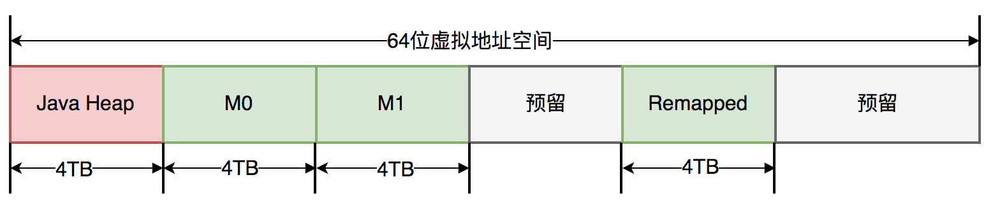

其中，[0~4TB) 对应Java堆，[4TB ~ 8TB) 称为M0地址空间，[8TB ~ 12TB) 称为M1地址空间，[12TB ~ 16TB) 预留未使用，[16TB ~ 20TB) 称为Remapped空间。

当应用程序创建对象时，首先在堆空间申请一个虚拟地址，但该虚拟地址并不会映射到真正的物理地址。ZGC同时会为该对象在M0、M1和Remapped地址空间分别申请一个虚拟地址，且这三个虚拟地址对应同一个物理地址，但这三个空间在同一时间有且只有一个空间有效。ZGC之所以设置三个虚拟地址空间，是因为它使用“空间换时间”思想，去降低GC停顿时间。“空间换时间”中的空间是虚拟空间，而不是真正的物理空间。后续章节将详细介绍这三个空间的切换过程。与上述地址空间划分相对应，ZGC实际仅使用64位地址空间的第0~41位，而第42~45位存储元数据，第47~63位固定为0。

### 读屏障

当对象从堆中加载的时候，就会使用到读屏障（Load Barrier）。这里使用读屏障的主要作用就是检查指针上的三色标记位，根据标记位判断出对象是否被移动过，如果没有可以直接访问，如果移动过就需要进行“自愈”（对象访问会变慢，但也只会有一次变慢），当“自愈”完成后，后续访问就不会变慢了。

ZGC特点：

     1. 停顿时间不超过10ms
     2. 停顿时间不会随着堆的大小或者活跃对象的大小而增加
     3. 支持8M~4T级别的堆

### ZGC原理

与CMS中的ParNew和G1类似，ZGC也采用标记-复制算法，不过ZGC对该算法做了重大改进：ZGC在标记、转移和重定位阶段几乎都是并发的，这是ZGC实现停顿时间小于10ms目标的最关键原因。

ZGC垃圾回收周期如下图所示：

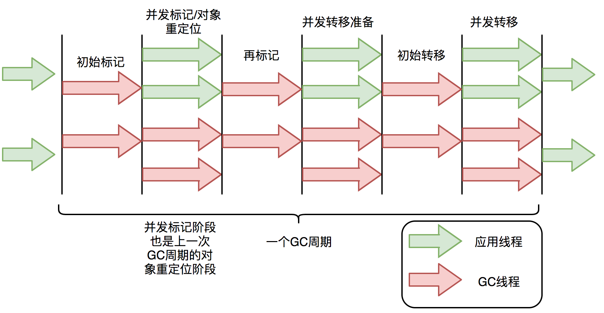

ZGC只有三个STW阶段：初始标记，再标记，初始转移。其中，初始标记和初始转移分别都只需要扫描所有GC Roots，其处理时间和GC Roots的数量成正比，一般情况耗时非常短；再标记阶段的 STW 时间极短（通常在 1ms 级别）；如果这一阶段耗时过长，ZGC 会退回并发标记阶段继续处理，而不是无限期停顿。即，ZGC几乎所有暂停都只依赖于GC Roots集合大小，停顿时间不会随着堆的大小或者活跃对象的大小而增加。与ZGC对比，G1的转移阶段完全STW的，且停顿时间随存活对象的大小增加而增加。

  * **初始标记** ：与G1一样标记与GC Roots直接关联的对象，停止所有用户线程
  * **并发标记** ：使用多条并发标记线程并行执行，并与用户线程并发执行，此过程进行可达性分析，标记所有这些对象可达的存活对象，速度很慢
  * **重新标记** ：因为并发标记时有用户线程在执行，标记结果可能有变化，停止一切用户线程，并使用多条重新标记线程并行执行，重新遍历所有在并发期间有变化的对象进行最后的标记，这个过程的运行时间介于初始标记和并发标记之间，这几个标记阶段只会更新染色体指针中的M0和M1标志位
  * **并发预备重分配** （并发转移准备）：这个阶段需要根据特定的查询条件统计得出本次收集过程要清理哪些Region，将这些Region组成重分配集（Relocation Set）。ZGC每次回收都会扫描所有的Region，用范围更大的扫描成本换取省去G1中记忆集的维护成本。
  * **并发重分配** ：重分配是ZGC执行过程中的核心阶段，这个过程要把重分配集中的存活对象复制到新的Region上，并为重分配集中的每个Region维护一个转发表（Forward Table），记录从旧对象到新对象的转向关系。ZGC收集器能仅从引用上就明确得知一个对象是否处于重分配集之中，如果用户线程此时并发访问了位于重分配集中的对象，这次访问将会被预置的内存屏障所截获，然后立即根据Region上的转发表记录将访问转发到新复制的对象上，并同时修正更新该引用的值，使其直接指向新对象，ZGC将这种行为称为指针的“自愈”（Self-Healing）能力。
  * **并发重映射** ：重映射所做的就是修正整个堆中指向重分配集中旧对象的所有引用，但是ZGC中对象引用存在“自愈”功能，所以这个重映射操作并不是很迫切。ZGC很巧妙地把并发重映射阶段要做的工作，合并到了下一次垃圾收集循环中的并发标记阶段里去完成，反正它们都是要遍历所有对象的，这样合并就节省了一次遍历对象图的开销。

ZGC的染色指针因为“自愈”（Self-Healing）能力，所以只有第一次访问旧对象会变慢，而Shenandoah的Brooks转发指针是每次都会变慢。一旦重分配集中某个Region的存活对象都复制完毕后，这个Region就可以立即释放用于新对象的分配，但是转发表还得留着不能释放掉，因为可能还有访问在使用这个转发表。

### ZGC存在的问题

ZGC最大的问题是浮动垃圾，ZGC的停顿时间是在10ms以下，但是ZGC的执行时间还是远远大于这个时间的。假如ZGC全过程需要执行10分钟，在这个期间由于对象分配速率很高，将创建大量的新对象，这些对象很难进入当次GC，所以只能在下次GC的时候进行回收，这些只能等到下次GC才能回收的对象就是浮动垃圾。目前唯一的办法是增大堆的容量，使得程序得到更多的喘息时间，但是这个也是一个治标不治本的方案。如果需要从根本上解决这个问题，还是需要引入分代收集，让新生对象都在一个专门的区域中创建，然后专门针对这个区域进行更频繁、更快的收集。

### ZGC触发时机

ZGC有多种GC触发机制，总结如下：

  1. 阻塞内存分配请求触发：当垃圾来不及回收，垃圾将堆占满时，会导致部分线程阻塞。我们应当避免出现这种触发方式。日志中关键字是“Allocation Stall”。
  2. 基于分配速率的自适应算法：最主要的GC触发方式，其算法原理可简单描述为”ZGC根据近期的对象分配速率以及GC时间，计算出当内存占用达到什么阈值时触发下一次GC”。自适应算法的详细理论可参考彭成寒《新一代垃圾回收器ZGC设计与实现》一书中的内容。通过ZAllocationSpikeTolerance参数控制阈值大小，该参数默认2，数值越大，越早的触发GC。我们通过调整此参数解决了一些问题。日志中关键字是“Allocation Rate”。
  3. 基于固定时间间隔：通过ZCollectionInterval控制，适合应对突增流量场景。流量平稳变化时，自适应算法可能在堆使用率达到95%以上才触发GC。流量突增时，自适应算法触发的时机可能会过晚，导致部分线程阻塞。我们通过调整此参数解决流量突增场景的问题，比如定时活动、秒杀等场景。日志中关键字是“Timer”。
  4. 主动触发规则：类似于固定间隔规则，但时间间隔不固定，是ZGC自行算出来的时机，我们的服务因为已经加了基于固定时间间隔的触发机制，所以通过-XX:-ZProactive参数将该功能关闭，以免GC频繁，影响服务可用性。 日志中关键字是“Proactive”。
  5. 预热规则：服务刚启动时出现，一般不需要关注。日志中关键字是“Warmup”。
  6. 外部触发：代码中显式调用System.gc()触发。 日志中关键字是“System.gc()”。
  7. 元数据分配触发：元数据区不足时导致，一般不需要关注。 日志中关键字是“Metadata GC Threshold”。

## 二、Young GC 频繁与变慢的排查

> 来源：`young gc很频繁以及运行很慢的原因可能是什么.md`

young gc频繁的原因

  1. 产生了很多朝生夕死的对象导致频繁的young gc
  2. 新生代空间设置的比较小

young gc运行很慢的原因

  1. 新生代设置过大，单次要复制的存活对象变多，单次停顿变长
  2. 存活对象多、对象图复杂，扫描和复制存活对象耗时（young GC 用的是复制算法）
  3. Survivor 区设置过小，清理后幸存对象装不下，只能提前晋升到老年代——代价不是"移动开销"，而是**对象过早晋升**导致老年代迅速膨胀、更早触发 Full GC
  4. 晋升时老年代剩余空间不足（空间担保失败），退化为 Full GC
  5. 采用的垃圾收集器效率较低
