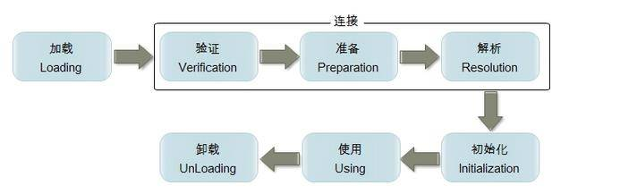
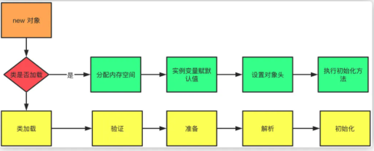
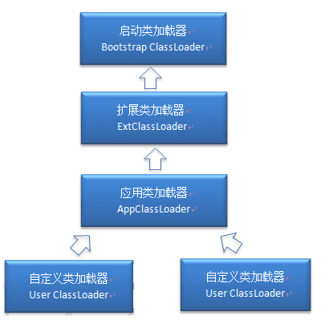
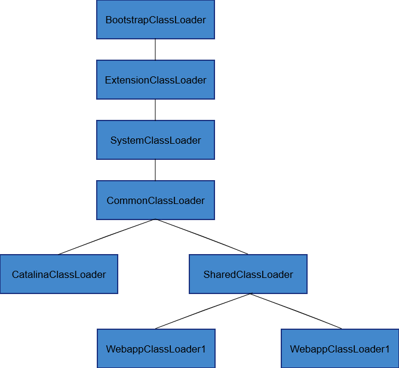
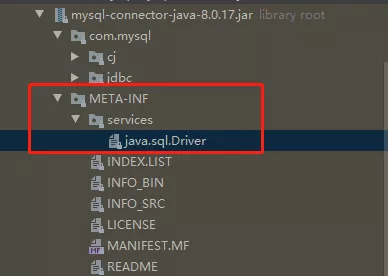
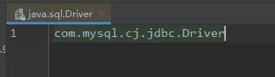

# 类加载

> 来源：`类加载.md`

## 类加载概念

：Java虚拟机把描述类的数据从Class文件加载到内存，并对数据进行校验、转换解析和初始化，最终形成可以被虚拟机直接使用的Java类型，这就是虚拟机的加载机制。

Class文件由类装载器装载后，在JVM中将形成一份描述Class结构的元信息对象，通过该元信息对象可以获知Class的结构信息：如构造函数，属性和方法等，Java允许用户借由这个Class相关的元信息对象间接调用Class对象的功能,这里就是我们经常能见到的Class类。

## 类加载过程



类装载器把一个类装入JVM中必须经过一下步骤：

```java
  (1) 装载：查找和导入Class文件；

  (2) 链接：把类的二进制数据合并到JRE中；

     (a)校验：检查载入Class文件数据的正确性；

     (b)准备：给类的静态变量分配存储空间；

     (c)解析：将符号引用转成直接引用；

  (3) 初始化：对类的静态变量，静态代码块执行初始化操作
```

其中类加载的过程包括了加载、验证、准备、解析、初始化五个阶段。在这五个阶段中，加载、验证、准备和初始化这四个阶段发生的顺序是确定的，而解析阶段则不一定，它在某些情况下可以在初始化阶段之后开始，这是为了支持Java语言的运行时绑定（也成为动态绑定或晚期绑定）。另外注意这里的几个阶段是按顺序开始，而不是按顺序进行或完成，因为这些阶段通常都是互相交叉地混合进行的，通常在一个阶段执行的过程中调用或激活另一个阶段。



  * **装载（加载）**

类的装载指的是将类的.class文件中的二进制数据读入到内存中，将其放在运行时数据区的方法区内，然后在堆区创建一个java.lang.Class对象，用来封装类在方法区内的数据结构。类的加载的最终产品是位于堆区中的Class对象，Class对象封装了类在方法区内的数据结构，并且向Java程序员提供了访问方法区内的数据结构的接口。

类加载器并不需要等到某个类被“首次主动使用”时再加载它，JVM规范允许类加载器在预料某个类将要被使用时就预先加载它，如果在预先加载的过程中遇到了.class文件缺失或存在错误，类加载器必须在程序首次主动使用该类时才报告错误（LinkageError错误）如果这个类一直没有被程序主动使用，那么类加载器就不会报告错误。

加载class文件的方式有

  1. 从本地系统中直接加载
  2. 通过网络下载.class文件
  3. 从zip、jar等归档文件中加载class文件
  4. 从专有数据库中提取class文件
  5. 将Java源文件动态编译成class文件

JVM在加载过程中步骤

  1. 通过一个类的全限定名称来获取定义此类的二进制字节流
  2. 将这个字节流所代表的静态存储结构转换成方法区的运行时数据结构
  3. 在JVM堆中生成一个代表这个类的java.lang.Class对象，作为方法区这些数据的访问入口

相对于类加载过程的其他阶段，加载阶段是开发期相对来说可控性比较强，该阶段既可以使用系统提供的类加载器完成，也可以由用户自定义的类加载器来完成，开发人员可以通过定义自己的类加载器去控制字节流的获取方式。

加载阶段完成后，虚拟机外部的二进制字节流就按照虚拟机所需的格式存储在方法区之中，而且在Java堆中也创建一个java.lang.Class类的对象，这样便可以通过该对象访问方法区中的这些数据。

  * **链接**

     * **校验**

验证是连接阶段的第一步，这一阶段的目的是为了确保Class文件的字节流中包含的信息符合当前虚拟机的要求，并且不会危害虚拟机自身的安全。验证阶段大致会完成4个阶段的检验动作：

        1. 文件格式的验证：验证字节流是否符合Class文件格式的规范，并且能被当前版本的虚拟机处理，该验证的主要目的是保证输入的字节流能正确地解析并存储于方法区之内。经过该阶段的验证后，字节流才会进入内存的方法区中进行存储，后面的三个验证都是基于方法区的存储结构进行的。
        2. 元数据验证：对类的元数据信息进行语义校验（其实就是对类中的各数据类型进行语法校验），保证不存在不符合Java语法规范的元数据信息。

        3. 字节码验证：该阶段验证的主要工作是进行数据流和控制流分析，对类的方法体进行校验分析，以保证被校验的类的方法在运行时不会做出危害虚拟机安全的行为。
        4. 符号引用验证：这是最后一个阶段的验证，它发生在虚拟机将符号引用转化为直接引用的时候（解析阶段中发生该转化），主要是对类自身以外的信息（常量池中的各种符号引用）进行匹配性的校验。

验证阶段是非常重要的，但不是必须的，它对程序运行期没有影响，如果所引用的类经过反复验证，那么可以考虑采用-Xverify:none参数来关闭大部分的类验证措施，以缩短虚拟机类加载的时间。

     * **准备**

准备阶段是为了类的静态变量分配内存，并将其初始化为默认值。这些内存都将在方法区中进行分配，但是要注意下面几点

        * 这时候进行内存分配的仅包括类变量（static），而不包括实例变量，实例变量会在对象实例化时随着对象一块分配在Java堆中
        * 这里所设置的初始化值通常情况下是数据类型的默认的零值（如：0、0L、null、false），而不是在Java代码中被显示的赋的值

假设一个类的变量的定义为：public static int value = 3

那么变量value在准备阶段过后的初始值为0，而不是3，因为这时候尚未开始执行任何Java方法，而把value赋值为3的public static指令是在程序编译后，存放于\<clinit\>()方法之中的，所以把value赋值为3的动作将在初始化阶段才会执行

1.对基本数据类型来说，对于类变量（static）和全局变量，如果不显式地对其赋值而直接使用，则系统会为其赋予默认的零值，而对于局部变量来说，在使用前必须显式地为其赋值，否则编译时不通过。

2.对于同时被static和final修饰的常量，必须在声明的时候就为其显式地赋值，否则编译时不通过；而只被final修饰的常量则既可以在声明时显式地为其赋值，也可以在类初始化时显式地为其赋值，总之，在使用前必须为其显式地赋值，系统不会为其赋予默认零值。

3.对于引用数据类型reference来说，如数组引用、对象引用等，如果没有对其进行显式地赋值而直接使用，系统都会为其赋予默认的零值，即null。

4.如果在数组初始化时没有对数组中的各元素赋值，那么其中的元素将根据对应的数据类型而被赋予默认的零值。

* 如果类字段的字段属性表中存在ConstantValue属性（同时被final和static修饰），那么在准备阶段变量value就会被初始化为ConstValue属性所指定的值

假设上面的类变量value被定义为：public static final int value = 3，编译时Javac将会为value生成ConstantValue属性，在准备阶段虚拟机就会根据ConstantValue的设置将value赋值为3。我们可以理解为static final常量在编译期就将其结果放入了调用它的类的常量池中
如果static变量是final的，但是属于引用类型，那么赋值也会在初始化阶段完成

     * **解析**

解析阶段是虚拟机将常量池内的符号引用替换为直接引用的过程，解析动作主要针对类或接口、字段、类方法、接口方法、方法类型、方法句柄和调用点限定符7类符号引用进行。

符号引用（Symbolic Reference）：符号引用以一组符号来描述所引用的目标，符号引用可以是任何形式的字面量，只要使用时能无歧义的定位到目标即可。符号引用与虚拟机实现的内存布局无关，引用的目标并不一定已经在内存中。各个虚拟机实现的内存布局可以各不相同，但是他们能接受的符号引用必须是一致的，因为符号引用的字面量形式明确定义在Java虚拟机规范的class文件格式中

直接引用（Direct Reference）：直接引用可以是直接指向目标的指针、相对偏移量或是一个能间接定位到目标的句柄。直接引用是与虚拟机实现的内存布局相关的，同一个符号引用在不同的虚拟机实例上翻译出来的直接引用一般都不相同，如果有了直接引用，那引用的目标必定已经在内存中存在。

           1. 类或接口的解析：判断所要转化成的直接引用是对数组类型，还是普通的对象类型的引用，从而进行不同的解析。
           2. 字段解析：对字段进行解析时，会先在本类中查找是否包含有简单名称和字段描述符都与目标相匹配的字段，如果有，则查找结束；如果没有，则会按照继承关系从上往下递归搜索该类所实现的各个接口和它们的父接口，还没有，则按照继承关系从上往下递归搜索其父类，直至查找结束。
           3. 类方法解析：对类方法的解析与对字段解析的搜索步骤差不多，只是多了判断该方法所处的是类还是接口的步骤，而且对类方法的匹配搜索，是先搜索父类，再搜索接口。

           4. 接口方法解析：与类方法解析步骤类似，只是接口不会有父类，因此，只递归向上搜索父接口就行了。

  * **初始化**

类初始化阶段是类加载过程的最后一步，前面的类加载过程中，除了加载（Loading）阶段用户应用程序可以通过自定义类加载器参与之外，其余动作完全由虚拟机主导和控制。到了初始化阶段，才真正开始执行类中定义的Java程序代码。

初始化，为类的静态变量赋予正确的初始值，JVM负责对类进行初始化，主要对类变量进行初始化。在Java中对类变量进行初始值设定有两种方式：

     1. 声明类变量时指定初始值
     2. 使用静态代码块为类静态变量指定初始值

JVM初始化步骤

     1. 假如这个类还没有被加载和连接，则程序先加载并连接该类
     2. 假如该类的直接父类还没有被初始化，则先初始化其直接父类

     3. 假如类中有初始化语句，则系统依次执行这些初始化语句

初始化阶段执行类构造器方法过程

     1. \<clinit\>()方法是由编译器自动收集类中的所有类变量的赋值动作和静态语句块（static{}块）中的语句合并产生的，编译器收集的顺序由语句在源文件中出现的顺序所决定。静态代码块中只能访问到定义在静态代码块之前的变量，定义在它之后的变量，在前面的静态代码块可以赋值，但是不能访问

```java
public class Test{
    static {
        i = 0;                            //给变量赋值可以正常编译通过
        System.out.print(i);            //这句话编译器会提示“非法向前引用”
    }
    public static int i = 1;
}
```

2. \<clinit\>()方法与实例构造器\<init\>()不同，它不需要显式地调用父类构造器，虚拟机会保证在子类的类构造器方法执行之前，父类的类构造器方法已经执行完毕，因此在虚拟机中第一个执行的类构造器方法的类一定是java.lang.Object。

     3. 由于父类的\<clinit\>()方法先执行，也就意味着父类中定义的静态语句块要优先于子类的变量赋值操作。

     4. \<clinit\>()方法对于类或者接口来说并不是必需的，如果一个类中没有静态语句块也没有对变量的赋值操作，那么编译器可以不为这个\<clinit\>()方法。

     5. 接口中不能使用静态代码块，但接口中可能会有变量赋值操作，因此接口也会生成\<clinit\>()方法。但是接口与类不同，执行接口的\<clinit\>()方法不需要先执行父接口的\<clinit\>()方法。只有当父接口中定义的变量被使用时，父接口才会被初始化。另外，接口的实现类在初始化时也不会执行接口的\<clinit\>()方法。

     6. 虚拟机会保证一个类的\<clinit\>()方法在多线程环境中被正确地加锁和同步。如果有多个线程去同时初始化一个类，那么只会有一个线程去执行这个类的类构造器方法，其它线程都需要阻塞等待，直到活动线程执行\<clinit\>()方法完毕。如果在一个类的类构造器方法中有耗时很长的操作，那么就可能造成多个进程阻塞。

需要注意的是：其他线程虽然会被阻塞，但如果执行\<clinit\>()方法的那条线程退出\<clinit\>()方法后，其他线程唤醒之后不会再次进入\<clinit\>方法。同一个类加载器下，一个类型只会初始化一次

## init和clinit比较：

init是对象构造器方法，也就是说在程序执行 new 一个对象调用该对象类的 constructor 方法时才会执行init方法，而clinit是类构造器方法，也就是在jvm进行类**加载—–验证—-解析—–初始化** ，中的初始化阶段jvm会调用clinit方法

**init是instance实例构造器，对非静态变量解析初始化** ，而**clinit是class类构造器对静态变量，静态代码块进行初始化**

```java
class X {

   static Log log = LogFactory.getLog(); // <clinit>

   private int x = 1;   // <init>

   X(){
      // <init>
   }

   static {
      // <clinit>
   }

}
```

* **结束生命周期**

在以下情况下Java虚拟机会结束生命周期

    * 执行了`System.exit()`方法
    * 程序正常执行结束
    * 程序在执行过程中遇到了异常或错误而异常终止
    * 由于操作系统出现错误而导致Java虚拟机进程终止

## 类初始化时机

对于加载过程JVM规范中并没有强行约束，可以交给虚拟机的具体实现自由把握，但是对于初始化阶段JVM规范是严格规定了几种情况会对类进行初始化

  1. 创建类的实例
  2. 访问类的静态变量(除常量【被final修辞的静态变量】原因:常量一种特殊的变量，因为编译器把他们当作值(value)而不是域(field)来对待。如果你的代码中用到了常变量(constant variable)，编译器并不会生成字节码来从对象中载入域的值，而是直接把这个值插入到字节码中。这是一种很有用的优化，但是如果你需要改变final域的值那么每一块用到那个域的代码都需要重新编译。
  3. 访问类的静态方法

  4. 反射如(Class.forName("my.xyz.Test"))

  5. 当初始化一个类时，发现其父类还未初始化，则先触发父类的初始化

  6. 虚拟机启动时，定义了main()方法的那个类先初始化

## 类的初始化顺序

```java
 public class Print {

     public Print(String s){
         System.out.print(s + " ");
     }
 }
```

```java
 public class Parent{

     public static Print obj1 = new Print("1");

     public Print obj2 = new Print("2");

     public static Print obj3 = new Print("3");

     static{
         new Print("4");
     }

     public static Print obj4 = new Print("5");

     public Print obj5 = new Print("6");

     public Parent(){
         new Print("7");
     }

 }
```

```java
 public class Child extends Parent{

     static{
         new Print("a");
     }

     public static Print obj1 = new Print("b");

     public Print obj2 = new Print("c");

     public Child (){
         new Print("d");
     }

     public static Print obj3 = new Print("e");

     public Print obj4 = new Print("f");

     public static void main(String [] args){
         Parent obj1 = new Child ();
         Parent obj2 = new Child ();
     }
 }
```

```java
执行main方法，程序输出顺序为： 1 3 4 5 a b e 2 6 7 c f d 2 6 7 c f d
```

如果类还没有被加载：

  1. 先执行父类的静态代码块和静态变量初始化，并且静态代码块和静态变量的执行顺序只跟代码中出现的顺序有关。
  2. 执行子类的静态代码块和静态变量初始化。
  3. 执行父类的实例变量初始化
  4. 执行父类的构造函数
  5. 执行子类的实例变量初始化
  6. 执行子类的构造函数

如果类已经被加载：

则静态代码块和静态变量就不用重复执行，再创建类对象时，只执行与实例相关的变量初始化和构造方法。

```java
public class Base {

    public static int s;

    private int a;

    static {
        System.out.println("基类静态代码块，s:" + s);
        s = 1;
    }

    {
        System.out.println("基本实例代码块，a:" + a);
        a = 1;
    }

    public Base() {
        System.out.println("基类构造方法，a:" + a);
        a = 2;
    }

    protected void step() {
        System.out.println("base s:" + s + ",a:" + a);
    }

    public void action() {
        System.out.println("start");
        step();
        System.out.println("end");
    }
}
```

```java
public class Child extends Base {

    public static int s;

    private int a;

    static {
        System.out.println("子类静态代码块，s:" + s);
        s = 10;
    }

    {
        System.out.println("子类实例代码块，a:" + a);
        a = 10;
    }

    public Child() {
        System.out.println("子类构造方法，a:" + a);
        a = 20;
    }

    @Override
    protected void step() {
        System.out.println("child s:" + s + ",a:" + a);
    }
}
```

```java
public static void main(String[] args) {
    System.out.println("---------- new Child()");
    Child c = new Child();
    System.out.println("---------- c.action");
    c.action();
    Base b = c;
    System.out.println("---------- b.action");
    b.action();
}
```

```java
---------- new Child()
基类静态代码块，s:0
子类静态代码块，s:0
基本实例代码块，a:0
基类构造方法，a:1
子类实例代码块，a:0
子类构造方法，a:10
---------- c.action
start
child s:10,a:20
end
---------- b.action
start
child s:10,a:20
end
```

```java
public class TestStatic {
    public static TestStatic t1 = new TestStatic();
    public static TestStatic t2 = new TestStatic();
    {
        System.out.println("构造块");
    }
    static{
        System.out.println("静态块");
    }

    public static void main(String[] args) {
        TestStatic t = new TestStatic();
    }
}
```

输出结果

```java
构造块
构造块
静态块
构造块
```

执行顺序要看**声明位置**：静态字段赋值与静态块按源码顺序在类初始化（`<clinit>`）阶段执行；之后 `main()` 里 `new` 对象时，才依次执行构造块 → 构造方法。上面例子里 `static TestStatic t1 = new TestStatic();` 写在静态块之前，所以先打印两次"构造块"、再打印"静态块"，最后 main 里再打印一次"构造块"。

## 动态绑定与静态绑定

绑定：一个方法的调用与方法所在的类关联起来。Java中的绑定分为静态绑定和动态绑定，又被称作前期绑定和后期绑定。

静态绑定：（final、static、private）在程序执行前已经被绑定，也就是说在编译过程中就已经知道这个方法是哪个类的方法，此时由编译器获取其他连接程序实现。

动态绑定：是在程序运行的时候判断调用哪个类的方法，一般用多态就会用到动态绑定。在程序编译器不知道要调用哪个方法，只有当程序运行起来的时候才发现原来是调用这个

区别比较

  * 静态绑定发生在编译时期，动态绑定发生在运行时
  * 使用private或static或final修饰的变量或者方法，使用静态绑定。而虚方法（可以被子类重写的方法）则会根据运行时的对象进行动态绑定
  * 静态绑定使用类信息来完成，而动态绑定则需要使用对象信息来完成

  * 重载(Overload)的方法使用静态绑定完成，而重写(Override)的方法则使用动态绑定完成

Java中静态绑定的三种类型的分析：

  * private：首先一点它不能被继承，既然不能被继承那么就没办法通过它子类的对象来调用，而只能通过这个类自身的对象来调用。因此就可以说private方法和定义这个方法的类绑定在了一起
  * static：static方法可以被子类继承，但是不能被子类重写（覆盖），但是可以被子类隐藏。（这里意思是说如果父类里有一个static方法，它的子类里如果没有对应的方法，那么当子类对象调用这个方法时就会使用父类中的方法。而如果子类中定义了相同的方法，则会调用子类的中定义的方法。唯一的不同就是，当子类对象上转型为父类对象时，不论子类中有没有定义这个静态方法，该对象都会使用父类中的静态方法。因此这里说静态方法可以被隐藏而不能被覆盖。这与子类隐藏父类中的成员变量是一样的。隐藏和覆盖的区别在于，子类对象转换成父类对象后，能够访问父类被隐藏的变量和方法，而不能访问父类被覆盖的方法）
  * final：final方法虽然可以被继承，但是不能被重写（覆盖），虽然子类对象可以调用，但是调用的都是父类中的final方法（因此可以看出当类中的方法声明为final的时候，一是为了防止方法被覆盖，而是为了有效关闭java的动态绑定）

动态绑定分析：

若一种语言实现了后期绑定，同时必须提供一些机制，可在运行期间判断对象的类型，并分别调用适当的方法。调用的方法依赖于隐式参数的实际类型，并且在运行时实现动态绑定。动态绑定的过程分为以下几个环节：

  1. 编译器查看对象的声明类型和方法名
  2. 编译器查看调用方法时提供的参数类型。例如x.f("hello")，编译器将会挑选f(String)，而不是f(int)，由于存在类型转换（int转换为double），所以可能会更复杂。如果编译器没找到参数类型匹配的方法，或者发现有多个方法与之匹配，就会报告一个错误。至此，编译器获得了需要调用的方法名字和参数类型
  3. 采用动态绑定调用方法的时候，一定调用与所引用对象的实际类型最合适的类的方法。如果x的实际类型是D，它是C类的子类，如果D定义了一个方法f(String)，就直接调用它，否则将在D类的超类中寻找f(String)，以此类推

每次调用方法都要进行搜索，时间开销太大，所以虚拟机预先为每个类创建一个方法表（method table），其中列出了所有方法的签名和实际调用的方法。这样在调用方法的时候，只需要查找这个表即可

下面举个例子来分析

```java
public class Base {

    public String name = "base";

    public String getName() {
        return name;
    }

    public String method(){
        return "base method";
    }
}
```

```java
public class Child extends Base{

    public String name = "child";

    @Override
    public String getName() {
        return name;
    }

    public String method() {
        return "child method";
    }

}
```

```java
public class Main {
    public static void main(String[] args) {
        Base base = new Child();
        System.out.println(base.method());
        System.out.println(base.name);
        System.out.println(base.getName());
    }
}
```

上面有一个基类有一个子类，子类隐式重写了基类的method方法，他们都有name属性，在测试的代码中使用多态进行向上转型，将父类对象指向子类对象，我们下面打印出这几个结果，并依次分析

```java
child method
base
child
```

我们看到一个是调用method，这里子类是隐式的重写了基类的方法，这里肯定是使用动态绑定，直接使用子类的方法，所以打印的是“child method”。第二个结果是直接打印对象的属性，在Java中只会对类的方法进行动态绑定，不会对属性进行动态绑定，所以这里打印出来的就是基类的属性。最后一个其实一样是动态绑定调用的子类的属性，只不过这里是为了突出在子类的方法中使用的是子类的属性。

Java因为什么对属性要采取静态的绑定方法。这是因为静态绑定是有很多的好处，它可以让我们在编译期就发现程序中的错误，而不是在运行期。这样就可以提高程序的运行效率！而对方法采取动态绑定是为了实现多态，多态是java的一大特色。多态也是面向对象的关键技术之一，所以java是以效率为代价来实现多态这是很值得的

## 类加载器

JVM设计者把类加载阶段中的“通过'类全名'来获取定义此类的二进制字节流”这个动作放到Java虚拟机外部去实现，以便让应用程序自己决定如何去获取所需要的类。实现这个动作的代码模块称为“类加载器”。对于任何一个类，都需要由加载它的类加载器和这个类来确立其在JVM中的唯一性。也就是说，两个类来源于同一个Class文件，并且被同一个类加载器加载，这两个类才相等。

类加载的三种方式

  * 1、命令行启动应用时候由JVM初始化加载
  * 2、通过Class.forName()方法动态加载
  * 3、通过ClassLoader.loadClass()方法动态加载

### JVM类加载机制

  * **全盘负责** ，当一个类加载器负责加载某个Class时，该Class所依赖的和引用的其他Class也将由该类加载器负责载入，除非显示使用另外一个类加载器来载入
  * **父类委托** ，先让父类加载器试图加载该类，只有在父类加载器无法加载该类时才尝试从自己的类路径中加载该类
  * **缓存机制** ，缓存机制将会保证所有加载过的Class都会被缓存，当程序中需要使用某个Class时，类加载器先从缓存区寻找该Class，只有缓存区不存在，系统才会读取该类对应的二进制数据，并将其转换成Class对象，存入缓存区。这就是为什么修改了Class后，必须重启JVM，程序的修改才会生效

从虚拟机的角度来说，只存在两种不同的类加载器：一种是启动类加载器（Bootstrap ClassLoader），该类加载器使用C++语言实现，属于虚拟机自身的一部分。另外一种就是所有其它的类加载器，这些类加载器是由Java语言实现，独立于JVM外部，并且全部继承自抽象类java.lang.ClassLoader。

从Java开发人员的角度来看，大部分Java程序一般会使用到以下三种系统提供的类加载器：

  1. 启动类加载器（Bootstrap ClassLoader）：负责加载JAVA_HOME\lib目录中并且能被虚拟机识别的类库到JVM内存中，如果名称不符合的类库即使放在lib目录中也不会被加载。该类加载器无法被Java程序直接引用。

  2. 扩展类加载器（Extension ClassLoader）：该加载器主要是负责加载JAVA_HOME\lib\ext，该加载器可以被开发者直接使用。

  3. 应用程序类加载器（Application ClassLoader）：该类加载器也称为系统类加载器，它负责加载用户类路径（Classpath）上所指定的类库，开发者可以直接使用该类加载器，如果应用程序中没有自定义过自己的类加载器，一般情况下这个就是程序中默认的类加载器。



如上图所示的类加载器之间的这种层次关系，就称为类加载器的双亲委派模型（Parent Delegation Model）。该模型要求除了顶层的启动类加载器外，其余的类加载器都应当有自己的父类加载器。子类加载器和父类加载器不是以继承（Inheritance）的关系来实现，而是通过组合（Composition）关系来复用父加载器的代码。

双亲委派模型的工作过程为：如果一个类加载器收到了类加载的请求，它首先不会自己去尝试加载这个类，而是把这个请求委派给父类加载器去完成，每一个层次的加载器都是如此，因此所有的类加载请求都会传给顶层的启动类加载器，只有当父加载器反馈自己无法完成该加载请求（该加载器的搜索范围中没有找到对应的类）时，子加载器才会尝试自己去加载。

使用这种模型来组织类加载器之间的关系的好处是Java类随着它的类加载器一起具备了一种带有优先级的层次关系。例如java.lang.Object类，无论哪个类加载器去加载该类，最终都是由启动类加载器进行加载，因此Object类在程序的各种类加载器环境中都是同一个类。否则的话，如果不使用该模型的话，如果用户自定义一个java.lang.Object类且存放在classpath中，那么系统中将会出现多个Object类，应用程序也会变得很混乱。如果我们自定义一个 `java.*` 核心包里的同名类（例如 `java.lang.Object`），编译能通过，但加载时会抛 `SecurityException: Prohibited package name`，永远无法被加载；而对 `javax.*` 或 rt.jar 里非 `java.` 开头的类，用自定义类加载器是可以加载出独立 Class 对象的。

在rt.jar包中的java.lang.ClassLoader类中，我们可以查看类加载实现过程的代码，具体源码如下：

```java
protected synchronized Class loadClass(String name, boolean resolve)
        throws ClassNotFoundException {
    // 首先检查该name指定的class是否有被加载
    Class c = findLoadedClass(name);
    if (c == null) {
        try {
            if (parent != null) {
                // 如果parent不为null，则调用parent的loadClass进行加载
                c = parent.loadClass(name, false);
            } else {
                // parent为null，则调用BootstrapClassLoader进行加载
                c = findBootstrapClass0(name);
            }
        } catch (ClassNotFoundException e) {
            // 如果仍然无法加载成功，则调用自身的findClass进行加载
            c = findClass(name);
        }
    }
    if (resolve) {
        resolveClass(c);
    }
    return c;
}
```

通过上面代码可以看出，双亲委派模型是通过loadClass()方法来实现的，根据代码以及代码中的注释可以很清楚地了解整个过程其实非常简单：先检查是否已经被加载过，如果没有则调用父加载器的loadClass()方法，如果父加载器为空则默认使用启动类加载器作为父加载器。如果父类加载器加载失败，则先抛出ClassNotFoundException，然后再调用自己的findClass()方法进行加载。

双亲委派机制的作用

  1. 防止重复加载同一个.class。通过委托去向上面问一问，加载过了，就不用再加载一遍。保证数据安全。
  2. 保证核心.class不能被篡改。通过委托方式，不会去篡改核心.class，即使篡改也不会去加载，即使加载也不会是同一个.class对象了。不同的加载器加载同一个.class也不是同一个Class对象。这样保证了Class执行安全。

双亲委派加载机制的破坏

  * 双亲委派模型第一次被破坏是重写自定义加载器的loadClass，JDK不推荐。一般都只是重写findClass()，这样可以保持双亲委派机制，而loadClass方法加载规则由自己定义，就可以随心所欲的加载类了
  * 双亲委派模型的第二次被打破是ServiceLoader和Thread.setContextClassLoader()，双亲委派模型的这个模型存在一些缺陷，双亲委派模型很好的解决了各个类加载器的基础类统一问题（越基础的类由越上层的加载器进行加载），基础类之所以被称为基础是因为他们总是作为被调用代码调用的API。但是如果基础类又要调用用户代码就比较麻烦，但是这也不是不可能的事情，一个典型的例子就是JNDI服务，它的代码由启动类加载器去加载，但JNDI的目的就是对资源进行集中管理和查找，它需要调用独立厂商实现部署在应用程序的classpath下的JNDI接口提供者（SPI service provider interface）的代码，但启动类加载器不可能知道这些代码，为了解决这个问题，Java设计团队只好引入一个不太优雅的设计：线程上下文类加载器（Thread Context ClassLoader），这个类加载器可以通过java.lang.Thread类的setContextClassLoader()方法进行设置，如果创建线程时还未设置，它将会从父线程中继承一个；如果在应用程序的全局范围内都没有设置过，那么这个类加载器默认就是应用程序类加载器。有了线程上下文类加载器，JNDI服务使用这个线程上下文类加载器去加载所需要的SPI代码，也就是父类加载器请求子类加载器去完成类加载动作，这个行为实际上就是打通了双亲委派模型的层次结构来逆向使用类加载器。已经违背了双亲委派模型。Java中所有涉及SPI的加载动作基本上都采用这种方式如：JNDI、JDBC、JBI等

以JDBC为例

```java
//传统加载方式1
Class.forName("com.mysql.jdbc.Driver");
Connection connection = DriverManager.getConnection("jdbc:mysql://127.0.0.1:3306","root","123456")
```

```java
//传统加载方式2
System.setProperty("jdbc.drivers","com.mysql.jdbc.Driver")
Connection connection = DriverManager.getConnection("jdbc:mysql://127.0.0.1:3306","root","123456")
```

```java
//SPI加载方式
Connection connection = DriverManager.getConnection("jdbc:mysql://127.0.0.1:3306","root","123456")
```

在SPI加载机制中，不需要手动设置驱动为com.mysql.jdbc.Driver。DriverManager有一个静态代码块，这会在执行getConnection前运行，即loadInitDrivers()，此方法会调用ServiceLoader.load(Class\<S\> service,ClassLoader loader)寻找ClassPath:META-INF/services文件夹下面java.sql.Driver的内容，即实现类。由于ServiceLoader位于rt.jar包下面（并没有继承ClassLoader）是启动类加载器加载的，所以是无法看见厂商的实现类jdbc.Driver，由于父加载器加载的类是看不见子类加载器加载的类。所以此时采用自己传入的loader结合Thread.setContextLoader()，将jdbc.Driver偷偷加载到内存，并通过以下详细基本原理，进而实现SPI机制

  * 双亲委派模型的第三次被破坏是由于用户对程序动态性的追求导致的，动态性是指代码热替换、模块热部署等。OSGI实现模块化热部署的关键就是它自定义的类加载器机制的实现。每一个程序模块（Bundle）都有一个自己的类加载器，当需要更换一个模块时，就把模块连同类加载器一起换掉以实现代码的热替换。在OSGI环境中，类加载器不再是双亲委派模型中的树状结构，而是进一步发展为更加复杂的网状结构，当受到类加载请求时，OSGI将会按照下面的顺序进行类搜索
1.将java.*开头的类委派给父类加载器加载
2.否则，将委派列表名单内的类委派给父类加载器加载
3.否则，将import列表中的类委派给export这个类的Bundle的类加载器加载
4.否则，查找当前Bundle的ClassPath，使用自己的类加载器加载
5.否则，查找类是否在自己的Fragment Bundle，如果在，则委派给Fragment Bundle的类加载器加载
6.否则，查抄Dynamic import列表的Bundle，委派给对应Bundle的类加载器加载
7.否则，类加载器失败

## JDBC、Tomcat为什么要破坏双亲委派模型

## JDBC破坏双亲委派

在JDBC4.0之后实际上我们不需要再调用Class.forName来加载驱动程序了，我们只需要把驱动的jar包放到工程的类加载路径里，那么驱动就会被自动加载。

这个自动加载采用的技术叫做SPI，数据库驱动厂商也都做了更新。可以看一下jar包里面的META-INF/services目录，里面有一个java.sql.Driver的文件，文件里面包含了驱动的全路径名。

使用上，我们只需要通过下面一句就可以创建数据库的连接：

```java
Connection con = DriverManager.getConnection(url , username , password ) ;
```

因为类加载器受到加载范围的限制，在某些情况下父类加载器无法加载到需要的文件，这时候就需要委托子类加载器去加载class文件。

JDBC的Driver接口定义在JDK中，其实现由各个数据库的服务商来提供，比如MySQL驱动包。DriverManager 类中要加载各个实现了Driver接口的类，然后进行管理，但是DriverManager位于 JAVA_HOME中jre/lib/rt.jar 包，由BootStrap类加载器加载，而其Driver接口的实现类是位于服务商提供的 Jar 包，**根据类加载机制，当被装载的类引用了另外一个类的时候，虚拟机就会使用装载第一个类的类装载器装载被引用的类。** 也就是说BootStrap类加载器还要去加载jar包中的Driver接口的实现类。我们知道，BootStrap类加载器默认只负责加载 JAVA_HOME中jre/lib/rt.jar 里所有的class，所以需要由子类加载器去加载Driver实现，这就破坏了双亲委派模型。

查看DriverManager类的源码，看到在使用DriverManager的时候会触发其静态代码块，调用 loadInitialDrivers() 方法，并调用ServiceLoader.load(Driver.class) 加载所有在META-INF/services/java.sql.Driver 文件里边的类到JVM内存，完成驱动的自动加载。

```java
 static {
        loadInitialDrivers();
        println("JDBC DriverManager initialized");
    }

    private static void loadInitialDrivers() {

        AccessController.doPrivileged(new PrivilegedAction<Void>() {
            public Void run() {

                ServiceLoader<Driver> loadedDrivers = ServiceLoader.load(Driver.class);
                Iterator<Driver> driversIterator = loadedDrivers.iterator();

                try{
                    while(driversIterator.hasNext()) {
                        driversIterator.next();
                    }
                } catch(Throwable t) {
                // Do nothing
                }
                return null;
            }
        });

    }
```

```java
 public static <S> ServiceLoader<S> load(Class<S> service) {
        ClassLoader cl = Thread.currentThread().getContextClassLoader();
        return ServiceLoader.load(service, cl);
    }
```

这个子类加载器是通过 Thread.currentThread().getContextClassLoader() 得到的线程上下文加载器。

```java
public Launcher() {
    ...
    try {
        this.loader = Launcher.AppClassLoader.getAppClassLoader(var1);
    } catch (IOException var9) {
        throw new InternalError("Could not create application class loader", var9);
    }
    Thread.currentThread().setContextClassLoader(this.loader);
    ...
}
```

可以看到，在 sun.misc.Launcher 初始化的时候，会获取AppClassLoader，然后将其设置为上下文类加载器，所以**线程上下文类加载器默认情况下就是Application ClassLoader** 。

## Tomcat破坏双亲委派模型

Tomcat类加载器：



Tomcat如何破坏双亲委派模型的呢？

每个Tomcat的webappClassLoader加载自己的目录下的class文件，不会传递给父类加载器。

事实上，tomcat之所以造了一堆自己的classloader，大致是出于下面三类目的：

  1. 对于各个 webapp中的 class和 lib，需要相互隔离，不能出现一个应用中加载的类库会影响另一个应用的情况，而对于许多应用，需要有共享的lib以便不浪费资源。
  2. 与 jvm一样的安全性问题。使用单独的 classloader去装载 tomcat自身的类库，以免其他恶意或无意的破坏；
  3. 热部署。相信大家一定为 tomcat修改文件不用重启就自动重新装载类库而惊叹吧。

## 什么是 SPI

首先我们得先知道什么叫 SPI。

SPI (Service Provider Interface)，主要是用来在框架中使用的，最常见和莫过于我们在访问数据库时候用到的`java.sql.Driver`接口了。

你想一下首先市面上的数据库五花八门，不同的数据库底层协议的大不相同，所以首先需要

### 定制一个接口

，来约束一下这些数据库，使得 Java 语言的使用者在调用数据库的时候可以方便、统一的面向接口编程。

数据库厂商们需要根据接口来开发他们对应的实现，那么问题来了，真正使用的时候到底用哪个实现呢？从哪里找到实现类呢？

这时候 Java SPI 机制就派上用场了，不知道到底用哪个实现类和找不到实现类，我们告诉它不就完事了呗。

**大家都约定好将实现类的配置写在一个地方，然后到时候都去哪个地方查一下不就知道了吗？**

Java SPI 就是这样做的，约定在 Classpath 下的 META-INF/services/ 目录里创建一个**以服务接口命名的文件** ，然后**文件里面记录的是此 jar 包提供的具体实现类的全限定名** 。

这样当我们引用了某个 jar 包的时候就可以去找这个 jar 包的 META-INF/services/ 目录，再根据接口名找到文件，然后读取文件里面的内容去进行实现类的加载与实例化。

比如我们看下 MySQL 是怎么做的。



再来看一下文件里面的内容。



类构造方法

Java类的构造方法在编译器中可以分为两类，一个是\<init\>，一个是\<clinit\>

```java
public class Main8 {
    public static void main(String[] args) {
        String a = Sett.getA();
        String b = Sett.getB();

        System.out.println("a = " + a);
        System.out.println("b = " + b);
    }
}

class Sett {
    private static String a = "0";

    private static String b = "00";

    static {
        a = "10";
        b = "20";
    }

    static {
        a = "a";
        b = "b";
    }

    public static String getA() {
        return a;
    }

    public static void setA(String a) {
        Sett.a = a;
    }

    public static String getB() {
        return b;
    }

    public static void setB(String b) {
        Sett.b = b;
    }
}
```

上述代码中运行结果 a = "a" b = "b"，这里的是因为java编译器的底层使用\<clinit\>,编译期间它会将所有的静态变量的赋值从上到下合并，构成一个新的方法，所以最后的结果是最后一个赋值的结果

编译器的另一种赋值方法\<init\>是针对成员变量进行的初始化

```javascript
public class Main8 {
    public static void main(String[] args) {
        Riven riven = new Riven(1000,2000);
        System.out.println(riven.getA());
        System.out.println(riven.getB());
    }
}

class Riven {
    private Integer a = 1;

    private Integer b = 2;

    {
        a = 10;
        b = 20;
    }

    {
        a = 100;
        b = 200;
    }

    public Riven(Integer a, Integer b) {
        this.a = a;
        this.b = b;
    }

    public Integer getA() {
        return a;
    }

    public void setA(Integer a) {
        this.a = a;
    }

    public Integer getB() {
        return b;
    }

    public void setB(Integer b) {
        this.b = b;
    }
}
```

隐式加载：指在当前类中所有new的对象，如果没有被加载，则使用当前类的类加载器加载
