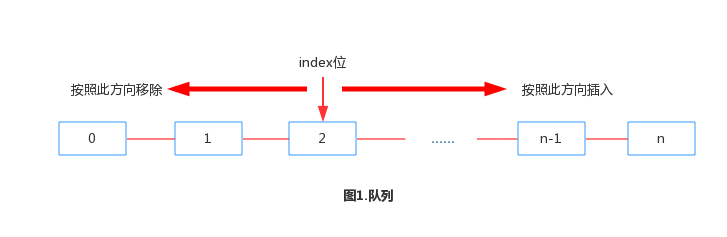
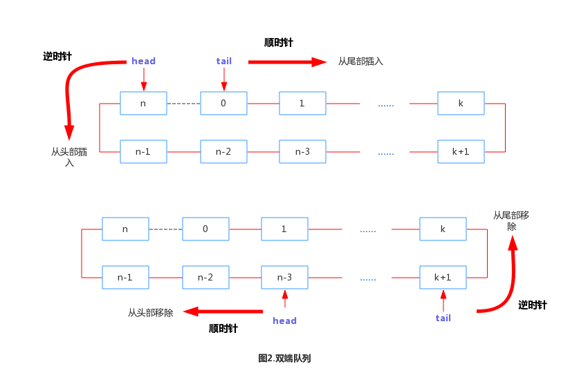
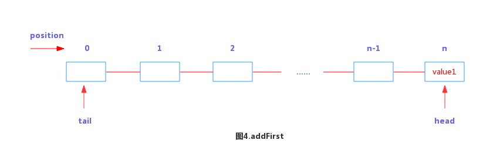
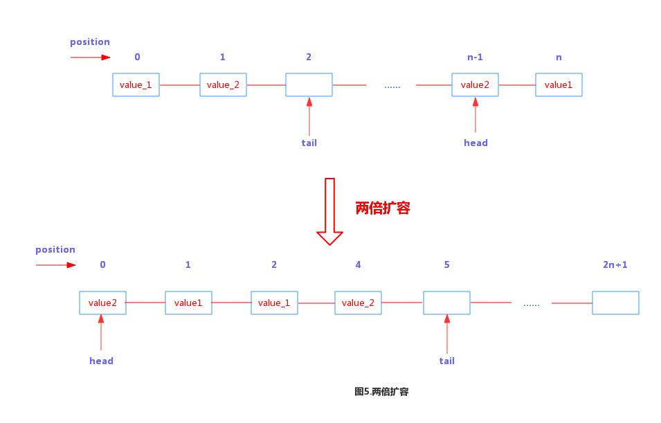

# ArrayDeque

> 来源：`ArrayDeque.md`

## 一、ArrayDeque 的特性

ArrayDeque是双端队列的线性实现，他是Deque的子类，可以实现LinkedList和Stack的功能，并且效率更高

ArrayDeque有下面特性

  1. 无容量大小限制，容量按需增长（默认大小是16，最小大小是8，每次扩容为原来的两倍）
  2. 非线程安全队列，无同步策略，不支持多线程安全访问
  3. 用作栈时，性能优于Stack，用作队列时性能优于LinkedList
  4. 两端都可以操作
  5. 迭代器为faill-fast
  6. 不能存储null
  7. 支持双向迭代器遍历

## 二、线性数组实现队列与循环队列

为了更好的理解使用线性数组实现的双端队列，这里我们先来图解线性数组实现基本数据结构-队列：



如上图所示，head指向队头，入队加元素时，tail队尾向后移动，出队时从head出取出元素并移除，这样就利用了线性数组实现先进先出的队列数据结构，当head等于tail时，则表示队列为空。

但是这样存在问题：当不断出队时，head向后移动，前面空出来的空间就被浪费，导致不断入队时，需要数组扩容，出队时造成大量空间无法使用，空间利用率低下！假设，如果能将前面空出来的空间也利用起来进行存储末尾的元素，则空间使用率将提高，这里就需要有个循环的思维，把这种线性的弯曲成一个圆环，这样就可以反复使用空出来的空间，入队时使用出队空余出来的空间，就解决以上的问题，图解如下：



当head等于tail时，则表示循环队列为空。head和tail也是循环的，像钟表中的时针，具有周期性。这里head和tail需要对长度lenth取模，这样head和tail将一直在长度范围内，可以作为数组的下标。

## 三、源码解析

### 核心成员变量

```java
 transient Object[] elements; // non-private to simplify nested class access

    /**
     * The index of the element at the head of the deque (which is the
     * element that would be removed by remove() or pop()); or an
     * arbitrary number equal to tail if the deque is empty.
     */
    transient int head;

    /**
     * The index at which the next element would be added to the tail
     * of the deque (via addLast(E), add(E), or push(E)).
     */
    transient int tail;

    /**
     * The minimum capacity that we'll use for a newly created deque.
     * Must be a power of 2.
     */
    private static final int MIN_INITIAL_CAPACITY = 8;
```

ArrayDeque的成员最核心的是elements、head、tail

  * elements: 该数组用于存储队列元素，且是大小总是2的幂次方。这个数组不会满容量，会在`add`方法中扩容，使得头head和tail不会缠绕在一起（即head增长或不会超过tail，head减小时不会溢出到tail）；
  * head: 双端队列的头位置，出队时或者弹出栈时的元素位置，加入双端队列头端元素位置，表示当前头元素位置；
  * tail:双端队列的尾，入队和进栈时的元素位置，加入双端队列尾端的下个元素的索引，tail位总是空的；
  * MIN_INITIAL_CAPACITY:最小的初始化容量

### 构造方法

```java
 public ArrayDeque() {
        elements = new Object[16];
    }

    /**
     * Constructs an empty array deque with an initial capacity
     * sufficient to hold the specified number of elements.
     *
     * @param numElements  lower bound on initial capacity of the deque
     */
    public ArrayDeque(int numElements) {
        allocateElements(numElements);
    }

    /**
     * Constructs a deque containing the elements of the specified
     * collection, in the order they are returned by the collection's
     * iterator.  (The first element returned by the collection's
     * iterator becomes the first element, or <i>front</i> of the
     * deque.)
     *
     * @param c the collection whose elements are to be placed into the deque
     * @throws NullPointerException if the specified collection is null
     */
    public ArrayDeque(Collection<? extends E> c) {
        allocateElements(c.size());
        addAll(c);
    }

private static int calculateSize(int numElements) {
        int initialCapacity = MIN_INITIAL_CAPACITY;
        // Find the best power of two to hold elements.
        // Tests "<=" because arrays aren't kept full.
        if (numElements >= initialCapacity) {
            initialCapacity = numElements;
            initialCapacity |= (initialCapacity >>>  1);
            initialCapacity |= (initialCapacity >>>  2);
            initialCapacity |= (initialCapacity >>>  4);
            initialCapacity |= (initialCapacity >>>  8);
            initialCapacity |= (initialCapacity >>> 16);
            initialCapacity++;

            if (initialCapacity < 0)   // Too many elements, must back off
                initialCapacity >>>= 1;// Good luck allocating 2 ^ 30 elements
        }
        return initialCapacity;
    }

    /**
     * Allocates empty array to hold the given number of elements.
     *
     * @param numElements  the number of elements to hold
     */
    private void allocateElements(int numElements) {
        elements = new Object[calculateSize(numElements)];
    }
```

根据源码可知，在默认的构造方法中，默认的长度是16，如果传入的容量大小小于8，则初始化队列的长度为8。如果大于8则初始化大小为大于输入值的最小的2次幂，如：输入17，则初始化大小为32（与HashMap原理一致）

插入源码

```java
public void addFirst(E e) {
        if (e == null)
            throw new NullPointerException();
        elements[head = (head - 1) & (elements.length - 1)] = e;
        if (head == tail)
            doubleCapacity();
    }
```

首先判断插入元素是否为空，再计算即将插入的位置，计算出后将元素赋值给相应的槽位，最后再判断队列容量进行扩容。

head = (head - 1) & (elements.length - 1)



在数组的高位端作为双端队列的头部，将低位作为双端队列的尾部。每次从头部插入一个元素，head头逆时针向tail尾方向移动一个位置。head = (head - 1) & (elements.length - 1)就是计算head的坐标。当head等于tail时表示队列已经满了需要扩容

```java
private void doubleCapacity() {
        assert head == tail;
        int p = head;
        int n = elements.length;
        int r = n - p; // number of elements to the right of p
        int newCapacity = n << 1;
        if (newCapacity < 0)
            throw new IllegalStateException("Sorry, deque too big");
        Object[] a = new Object[newCapacity];
        System.arraycopy(elements, p, a, 0, r);
        System.arraycopy(elements, 0, a, r, p);
        elements = a;
        head = 0;
        tail = n;
    }
```

ArrayDeque的扩容是将创建一个原来数组2倍大小的新的数组再将原数组中的值复制过去。扩容后，将原队列中从头部插入的元素即head右边元素从扩容后新数组的0位置开始排放，然后将左边的元素紧接着排放进新数组。将head置0，tail置成扩容前数组长度。



ArrayDeque的offer()、add()最终调用的都是addLast()是在队尾插入元素、push是队首插入元素

ArrayDeque的poll()调用了pollFirst()移除队首的数据，移除队尾的数据可以直接调用pollLast()

remove()调用了removeFirst()，这个方法内部也是调用 pollFirst()，不过如果没有结果不会返回null而是抛出异常
