# SkipList 与堆

> 合并自：`SkipList.md`、`堆.md`。原文未删改（仅修正已知错误），按主题归并。

## 一、SkipList（跳表）

> 来源：`SkipList.md`

Skip List ，称之为跳表，它是一种可以替代平衡树的数据结构，其数据元素默认按照key值升序，天然有序。Skip list让已排序的数据分布在多层链表中，以0-1随机数决定一个数据的向上攀升与否，通过“空间来换取时间”的一个算法，在每个节点中增加了向前的指针，在插入、删除、查找时可以忽略一些不可能涉及到的结点，从而提高了效率。

我们先看一个简单的链表，如下：

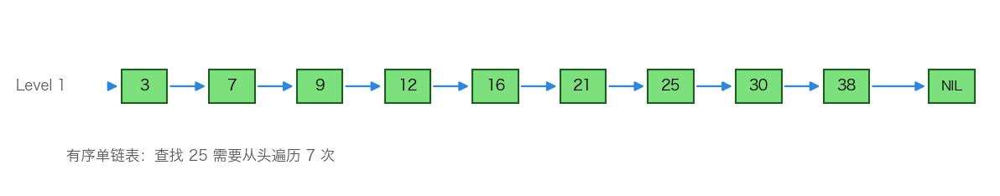

如果我们需要查询9、21、30，则需要比较次数为3 + 6 + 8 = 17 次，那么有没有优化方案呢？有！我们将该链表中的某些元素提炼出来作为一个比较“索引”，如下：

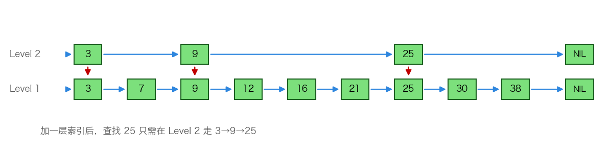

我们先与这些索引进行比较来决定下一个元素是往右还是下走，由于存在“索引”的缘故，导致在检索的时候会大大减少比较的次数。当然元素不是很多，很难体现出优势，当元素足够多的时候，这种索引结构就会大显身手。

### SkipList的特性

SkipList具备如下特性：

  1. 由很多层结构组成，level是通过一定的概率随机产生的
  2. 每一层都是一个有序的链表，默认是升序，也可以根据创建映射时所提供的Comparator进行排序，具体取决于使用的构造方法
  3. 最底层(Level 1)的链表包含所有元素
  4. 如果一个元素出现在Level i 的链表中，则它在Level i 之下的链表也都会出现
  5. 每个节点包含两个指针，一个指向同一链表中的下一个元素，一个指向下面一层的元素

我们将上图再做一些扩展就可以变成一个典型的SkipList结构了

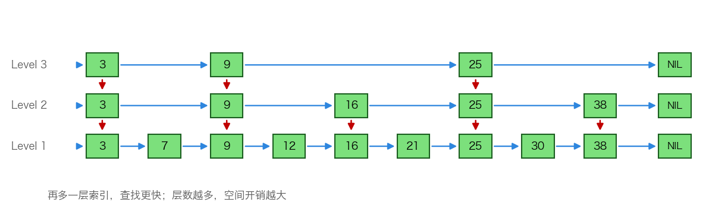

### SkipList的查找

SkipListd的查找算法较为简单，对于上面我们我们要查找元素21，其过程如下：

  1. 比较3，大于3，往后找（9），
  2. 比9大，继续往后找（25），但是比25小，则从9的下一层开始找（16）
  3. 16的后面节点依然为25，则继续从16的下一层找
  4. 找到21

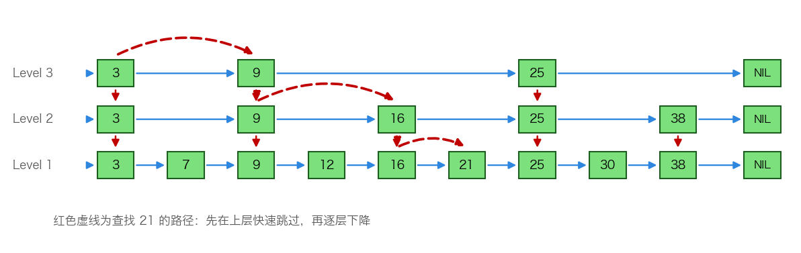

红色虚线代表路径。

### SkipList的插入

SkipList的插入操作主要包括：

  1. 查找合适的位置。这里需要明确一点就是在确认新节点要占据的层次K时，采用丢硬币的方式，完全随机。如果占据的层次K大于链表的层次，则重新申请新的层，否则插入指定层次
  2. 申请新的节点
  3. 调整指针

假定我们要插入的元素为23，经过查找可以确认她是位于25前，9、16、21后。当然需要考虑申请的层次K。

如果层次K \> 3

需要申请新层次（Level 4）

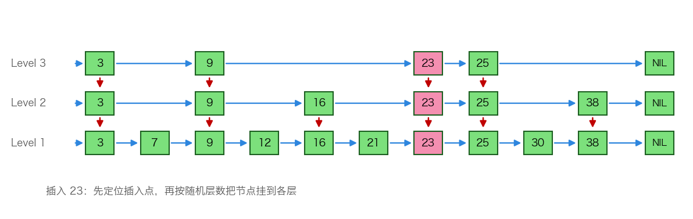

如果层次 K = 2

直接在Level 2 层插入即可

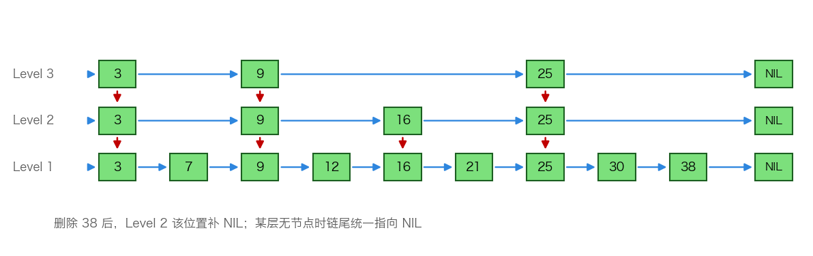

这里会涉及到以个算法：通过丢硬币决定层次K，该算法我们通过后面ConcurrentSkipListMap源码来分析。还有一个需要注意的地方就是，在K层插入元素后，需要确保所有小于K层的层次都应该出现新节点。

### SkipList的删除

删除节点和插入节点思路基本一致：找到节点，删除节点，调整指针。

比如删除节点9，如下：

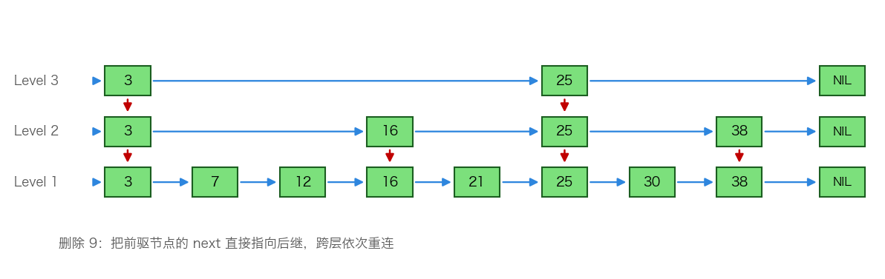

## 二、堆（Heap）

> 来源：`堆.md`

heap(堆)其实是一个抽象的数据结构，或者说是逻辑上的数据结构，并不是一个物理上真正存在的数据结构。heap 其实有很多种实现方式，比如 binomial heap, Fibonacci heap 等等。但是面试最常考的，也是最经典的，就是 binary heap 二叉堆，也就是用一棵完全二叉树来实现的。

完全二叉树其实使用数组来实现的，所以binary heap/PriorityQueue 实际上是用数组来实现的。这个数组的排列方式有点特别，因为它总会维护你定义的（或者默认的）优先级最高的元素在数组的首位，所以不是随便一个数组都叫「堆」，实际上，它在你心里，应该是一棵「完全二叉树」。这棵完全二叉树，实际在在内存里，就是数组罢了。

堆的特性

1.堆是一棵完全二叉树

2.堆序性：任意节点都优于它的所有孩子

a.如果是任意节点都大于它的所有孩子，这样的堆叫大根堆，Max Heap;

b.如果是任意节点都小于它的所有孩子，这样的堆叫小根堆，Min Heap;

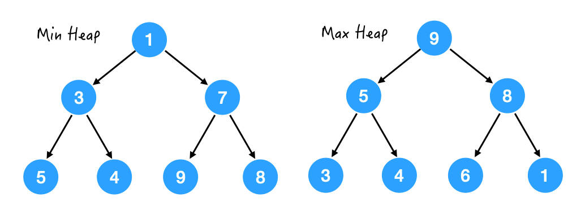

3.既然堆是用数组来实现的，那么我们可以找到每个节点和它的父母/孩子之间的关系，从而可以直接访问到它们。

如果某个节点的index=n，那么他的左孩子坐标为2*n+1,右孩子的坐标为2*n+2

我们操作堆时必须要维护堆的大小顺序，加入新元素或者删除元素之后他仍然是一个堆

假如我们在刚才的小根堆中加入一个新的元素

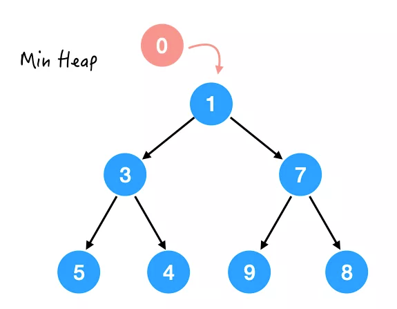

保持堆性质操作如下：

1.先把这个节点放到最后的节点上

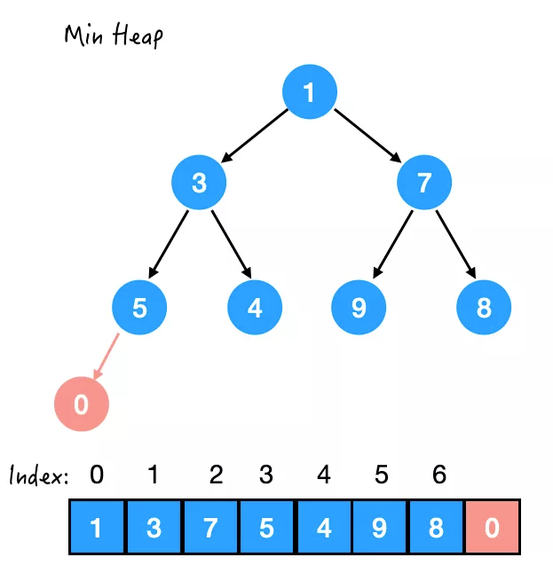

后面其实都是相同的操作只需要与自己的父节点比较大小，如果比自己的父节点小就交换两个节点，否则达到目标结束流程即可

2.交换0-5两个节点

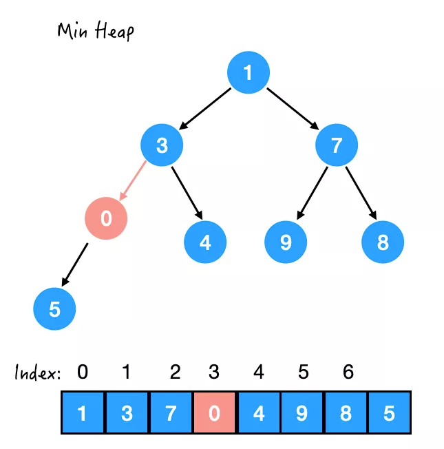

3.交换0-3两个节点

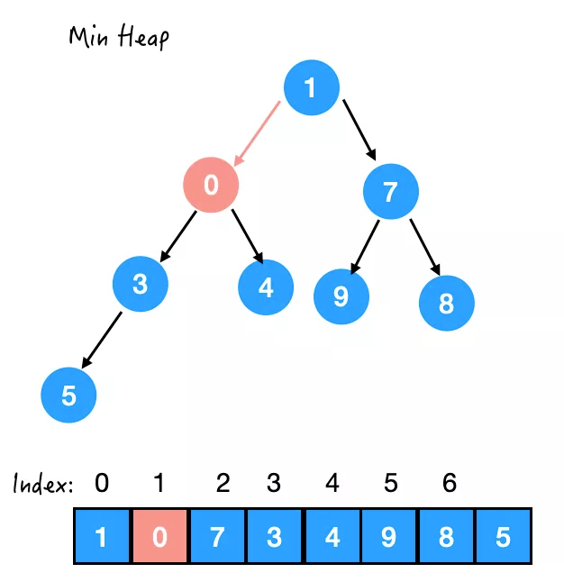

4.交换0-1两个节点

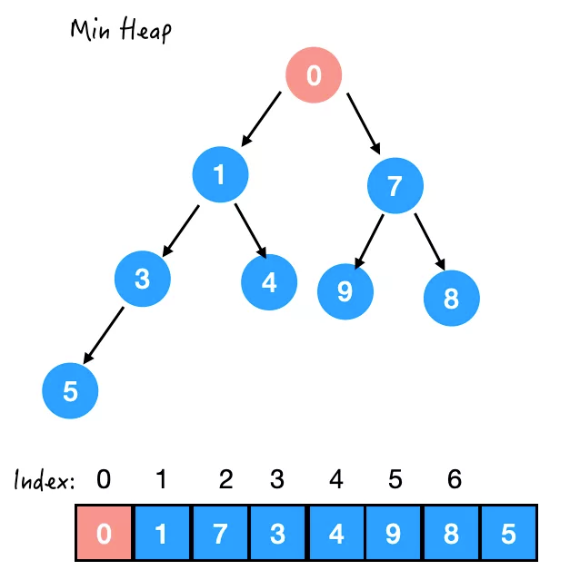

时间复杂度

这里不难发现，其实我们只交换了一条支路上的元素，

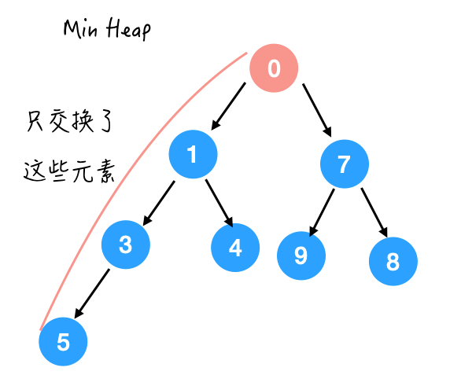

也就是最多交换 O(height) 次。那么对于完全二叉树来说，除了最后一层都是满的，O(height) = O(logn)。所以 offer(E e) 的时间复杂度就是 O(logn) 啦。

这个过程叫上浮，实现代码如下（显然这里用到了递归）：

```java
/**
     * 上浮，堆尾插入数据，维护堆的性质，小根堆，父节点小于等于子节点
     */
    private void up(int[] array, int i) {
        int parent = (i - 1) / 2;
        if (parent >= 0 && array[i] < array[parent]) {
            swap(array, parent, i);
            up(array, parent);
        }
    }
```

对于堆顶的删除，我们将二叉树的最后一个节点替换到根节点，然后自顶向下递归调整

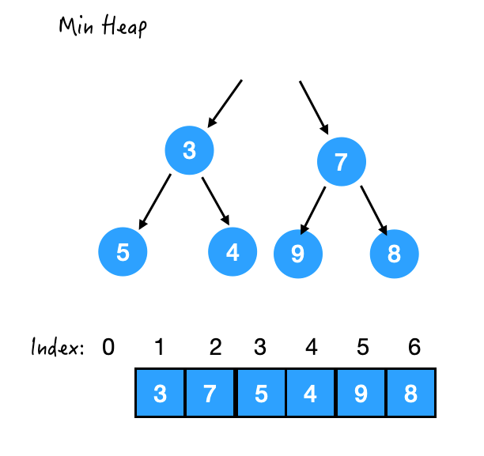

1.末尾元素上位

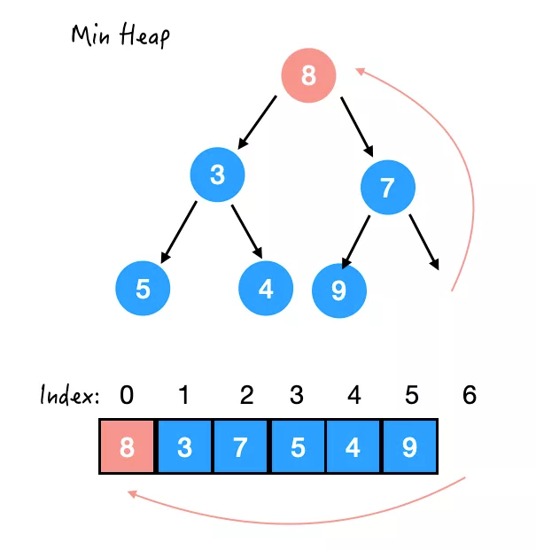

2.和左右孩子中最小的进行交换，与3交换

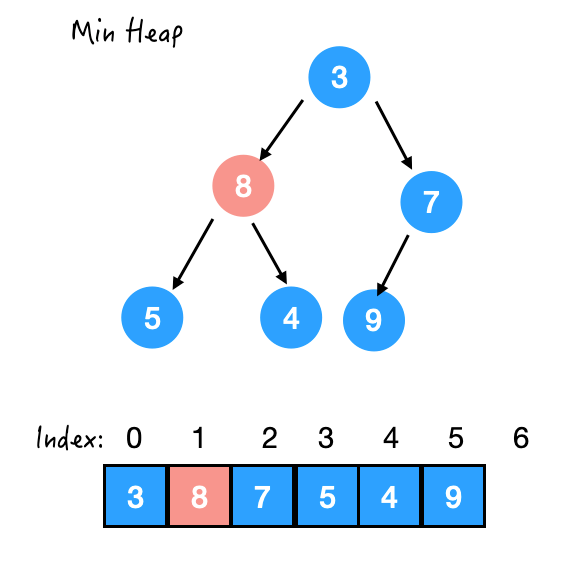

3.与4交换

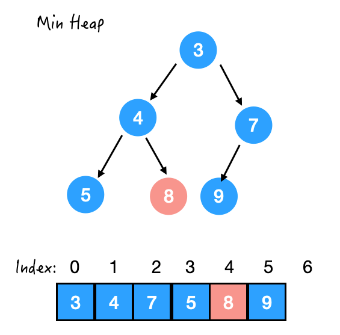

这个流程叫做下沉，代码如下

```java
/**
     * 下沉,弹出堆顶时，维护堆的性质，小根堆，父节点小于等于子节点
     */
    private void down(int[] array, int n, int i) { //维护小根堆
        //左孩子
        int lson = i * 2 + 1;

        //右孩子
        int rson = i * 2 + 2;
        int smallest = i;
        if (lson < n && array[lson] < array[smallest]) {
            smallest = lson;
        }
        if (rson < n && array[rson] < array[smallest]) {
            smallest = rson;
        }
        //保证父节点是最小的
        if (smallest != i) {
            swap(array, i, smallest);
            down(array, n, smallest);
        }
    }
```
