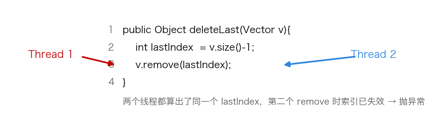

# 同步容器与并发问题

> 来源：`同步容器并发问题.md`

## 一、同步容器的线程安全边界

同步容器如Vector、Hashtable都是线程安全的，他们实现线程安全的方法是因为他们的内部全部使用了synchronized关键字修饰方法，这就导致我们在多线程场景中放心的单独使用这些方法，因为这些方法本身是线程安全的。但是如果碰到复合操作还是无法保证其线程安全性。需要客户端通过主动加锁来保证

```java
public Object deleteLast(Vector v){
    int lastIndex  = v.size()-1;
    v.remove(lastIndex);
}
```

上面的方法是一个复合方法，包括size、remove这些都是线程安全的，但是如果多线程调用该方法的时候remove方法可能会抛出ArrayIndexOutOfBoundsException

我们上面贴了remove的源码，我们可以分析得出：当index \>= elementCount时，会抛出ArrayIndexOutOfBoundsException ，也就是说，当当前索引值不再有效的时候，将会抛出这个异常。因为removeLast方法，有可能被多个线程同时执行，当线程2通过 `size()-1` 获得索引值，在尝试通过remove()删除该索引位置的元素之前，线程1把该索引位置的值删除掉了，这时线程一在执行时便会抛出异常。
## 二、解决办法：对复合操作加锁

为了避免出现类似问题，可以尝试加锁：

```java
public void deleteLast() {
    synchronized (v) {
        int index = v.size() - 1;
        v.remove(index);
    }
}
```

如上，我们在deleteLast中，对v进行加锁，即可保证同一时刻，不会有其他线程删除掉v中的元素。

## 三、循环删除同样要注意

另外，如果以下代码会被多线程执行时，也要特别注意：

```java
for (int i = 0; i < v.size(); i++) {
    v.remove(i);
}
```

由于，不同线程在同一时间操作同一个Vector，其中包括删除操作，那么就同样有可能发生线程安全问题。所以，在使用同步容器的时候，如果涉及到多个线程同时执行删除操作，就要考虑下是否需要加锁。
