# 集合框架与 ArrayList

> 合并自：`Collection.md`、`ArrayList.md`、`ArrayList和Vector的比较.md`。原文未删改（仅修正已知错误），按主题归并。

## 一、Collection 集合框架总览

> 来源：`Collection.md`

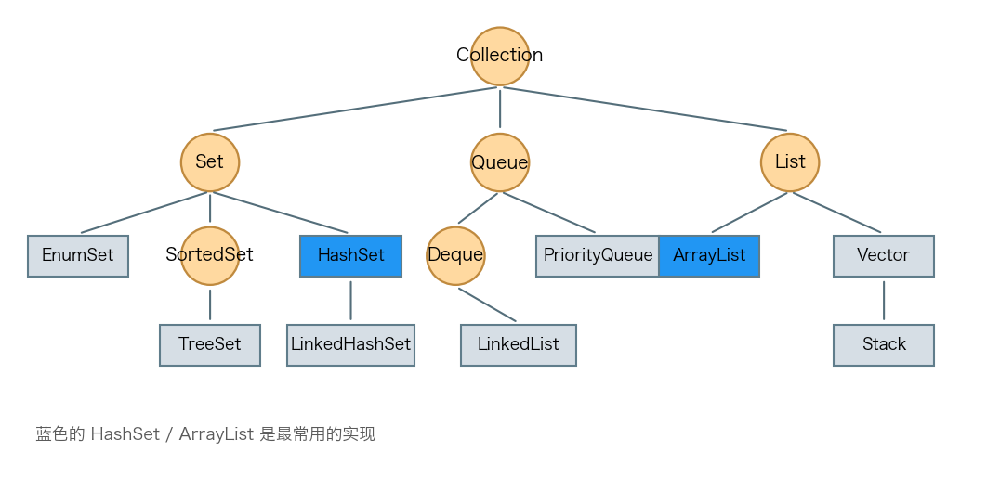

上面是collection的子类图

通常说 List 有序、可重复；Queue 按入队顺序进出；Set 不可重复。但"Set 无序"只是对 `HashSet` 成立——`LinkedHashSet` 保持插入顺序，`TreeSet` 按大小排序，所以更准确的说法是"Set 不保证插入顺序，具体取决于实现"

Queue是一端进另一端出的线性数据结构，和Deque是两端都可以进出的。

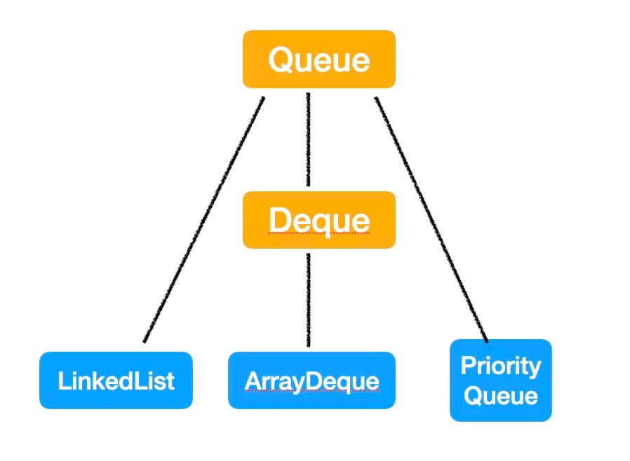

Java 中的 这个 Queue 接口稍微有点坑，一般来说队列的语义都是

### 先进先出

（FIFO）的。

但是这里有个例外，就是 PriorityQueue，也叫 heap，并不按照进去的时间顺序出来，而是按照规定的优先级出去，并且它的操作并不是 O(1) 的，时间复杂度的计算稍微有点复杂

对于Queue有两组功能相同的API，但是一组会抛异常，另一组会返回一个特殊值

功能| 抛异常| 返回值
---|---|---
增| add(e)| offer(e)
删| remove()| poll()
查| element()| peek()

**为什么会抛异常呢？**

  * 比如队列空了，那 remove() 就会抛异常，但是 poll() 就返回 null；element() 就会抛异常，而 peek() 就返回 null 就好了。

**那 add(e) 怎么会抛异常呢？**

有些 Queue 它会有容量的限制，比如

### BlockingQueue

，那如果已经达到了它最大的容量且不会扩容的，就会抛异常；但如果 offer(e)，就会 return false.

Deque 是两端都可以进出的，那自然是有针对 First 端的操作和对 Last 端的操作，那每端都有两组，一组抛异常，一组返回特殊值：

功能| 抛异常| 返回值
---|---|---
增| addFirst(e)/ addLast(e)| offerFirst(e)/ offerLast(e)
删| removeFirst()/ removeLast()| pollFirst()/ pollLast()
查| getFirst()/ getLast()| peekFirst()/ peekLast()

Queue 的常用非阻塞实现有 `LinkedList`、`ArrayDeque`、`PriorityQueue`；除此之外还有 `BlockingQueue` 家族（`ArrayBlockingQueue`、`LinkedBlockingQueue`、`PriorityBlockingQueue`、`DelayQueue`、`SynchronousQueue` 等）和 `ConcurrentLinkedQueue`，所以不能说"只有三个"

  * 如果想实现「普通队列 - 先进先出」的语义，就使用 LinkedList 或者 ArrayDeque 来实现；
  * 如果想实现「优先队列」的语义，就使用 PriorityQueue；
  * 如果想实现「栈」的语义，就使用 ArrayDeque。

在实现普通队列时我们优先会使用 ArrayDeque，因为效率高，而 LinkedList 还会有其他的额外开销

ArrayDeque和LinkedList比较

  1. ArrayDeque 是一个可扩容的数组，LinkedList 是链表结构；
  2. ArrayDeque 里不可以存 null 值，但是 LinkedList 可以；
  3. ArrayDeque 在操作头尾端的增删操作时更高效，但是 LinkedList 只有在当要移除中间某个元素且已经找到了这个元素后的移除才是 O(1) 的；
  4. ArrayDeque 在内存使用方面更高效。

tips：ArrayDeque是jdk1.6出现的，在此之前对于栈和队列的选择只能选择stack和LinkedList

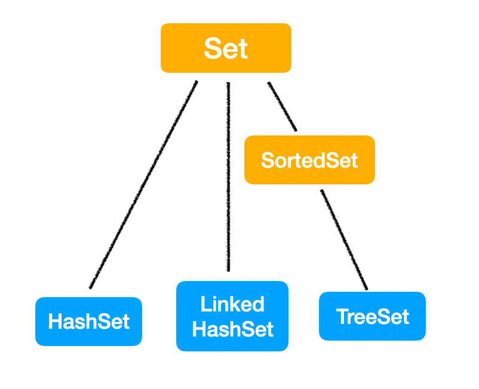

Set的数据特点是无序不重复的，他的实现类主要有三个

### HashSet

: 采用 HashMap 的 key 来储存元素，主要特点是无序的，基本操作都是 O(1) 的时间复杂度，很快。

### LinkedHashSet

: 这个是一个 HashSet + LinkedList 的结构，特点就是既拥有了 O(1) 的时间复杂度，又能够保留插入的顺序。

### TreeSet

: 采用红黑树结构，特点是可以有序，可以用自然排序或者自定义比较器来排序；缺点就是查询速度没有 HashSet 快。

那每个 Set 的**底层实现** 其实就是对应的 Map：**数值放在 map 中的 key 上，value 上放了个 PRESENT，是一个静态的 Object，相当于 place holder，每个 key 都指向这个 object。**

## 二、ArrayList 底层实现与扩容

> 来源：`ArrayList.md`

ArrayList底层是一个数组，LikedList底层是链表

ArrayList 的默认容量是 10，但要严格区分**容量（capacity）**和**元素个数（size）**：`new ArrayList<>()` 时 `elementData` 先指向一个空数组，容量 10 要等第一次 `add` 时才分配；而 `new ArrayList<>(n)` 会**立刻**创建长度为 n 的数组。无论哪种，此时 size 都还是 0。

还不明白的话，那就看下elementData的注释，elementData作为存储ArrayList元素的数组缓冲区，当使用ArrayList（int initialCapacity）的时候，只是指定了缓冲区数组的大小，的容量是这个数组缓冲区的长度。注意，这里提到的是容量capacity，而size则是：the size of the ArrayList (the number of elements it contains).数组中包含元素的个数。

```java
public class ListExample {
    public static void main(String[] args) {
        List<String> list = new ArrayList<>(5);
        list.add("w");
        System.out.println(list.size());
        list.set(2,"q");
        System.out.println(list);
    }
}
```

```java
1
Exception in thread "main" java.lang.IndexOutOfBoundsException: Index: 2, Size: 1
    at java.util.ArrayList.rangeCheck(ArrayList.java:657)
    at java.util.ArrayList.set(ArrayList.java:448)
    at com.wjx.osiris.lucian.collect.ListExample.main(ListExample.java:17)
```

由上面代码可知，`set(2, "q")` 抛 `IndexOutOfBoundsException` 的原因是**当前 size 只有 1**（只 add 过一个元素），与容量无关——`set()` 检查的是 `index >= size` 就抛异常（见 `rangeCheck`），而不是 `index >= capacity`。这正好体现了容量与 size 的区别；本例中 `new ArrayList<>(5)` 已经把数组初始化成容量 5 了

ArrayList的扩容方式是将容量扩大为原来的1.5倍。具体方法如下：

比如说有一个长度为10的数组，我们需要新增一个元素，但是已经满了，

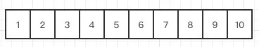

这时他会重新定一个一个10+10/2=15的数组，

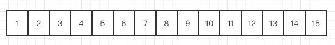

然后把原数组的数据，原封不动的复制到新数组中，这个时候再把指向原数的地址换到新数组，ArrayList就这样完成了一次改头换面。

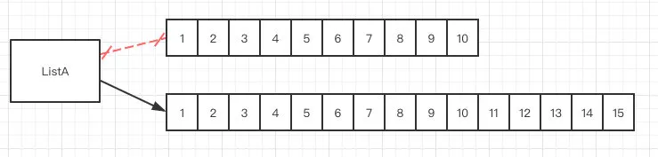

ArrayList增删操作很慢是因为他的增删都是元素的复制

1.新增：首先每次新增元素都要先判断新增元素之后数组的大小是否超过超过容量，如果超过需要进行上述的扩容操作。而他的新增操作也是通过复制数组完成的。假设我们有一个数组

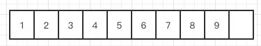

我们在index为5的位置新增一个元素，他的操作其实是复制了一个数组，是从index 5的位置开始的，然后把它放在了index 5+1的位置

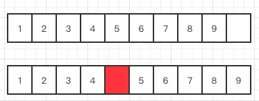

给我们要新增的元素腾出了位置，然后在index的位置放入元素A就完成了新增的操作了

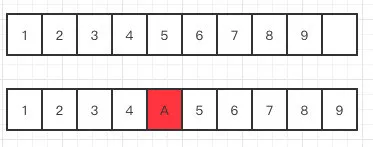

```java
public void add(int index, E element) {
        rangeCheckForAdd(index);

        ensureCapacityInternal(size + 1);  // Increments modCount!!
        System.arraycopy(elementData, index, elementData, index + 1,
                         size - index);
        elementData[index] = element;
        size++;
    }
```

上述就是ArrayList新增的源码

2.删除:删除其实和新增一样也是复制数组

```java
public E remove(int index) {
        rangeCheck(index);

        modCount++;
        E oldValue = elementData(index);

        int numMoved = size - index - 1;
        if (numMoved > 0)
            System.arraycopy(elementData, index+1, elementData, index,
                             numMoved);
        elementData[--size] = null; // clear to let GC do its work

        return oldValue;
    }
```

假设我们有一个数组

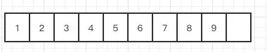

我们需要删除index为5的元素，那代码他就复制一个index5+1开始到最后的数组，然后把它放到index开始的位置

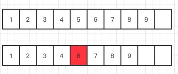

index5的位置就成功被”删除“了其实就是被覆盖了，给了你被删除的感觉。

如果我们删除的索引越靠近数组末尾越快，因为复制数组的数量越少。

vector是线程安全的list因为他的方法都是synchronized修饰的

当ArrayList与LinkedList遍历来说的话ArrayList会快一点，因为ArrayList遍历最大的优势在于内存的连续性，CPU的内部缓存结构会缓存连续的内存片段，可以大幅降低读取内存的性能开销。

## 三、ArrayList 与 Vector 的比较

> 来源：`ArrayList和Vector的比较.md`

对于ArrayList和Vector都是继承了AbstractList，底层是使用数组实现的，

他们的初始化容量都是10，使用的迭代器都是iterator

他们的区别有下面几点

1.Vector是线程安全的，因为Vector中的方法是用synchronized修饰的

2.Vector线程扩容是扩容为原来的2倍，而ArrayList是原来的1.5倍
