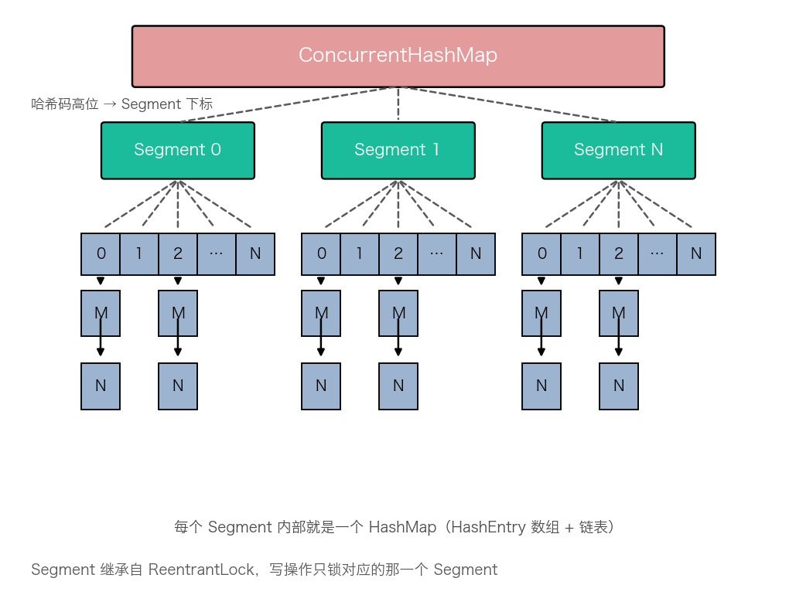
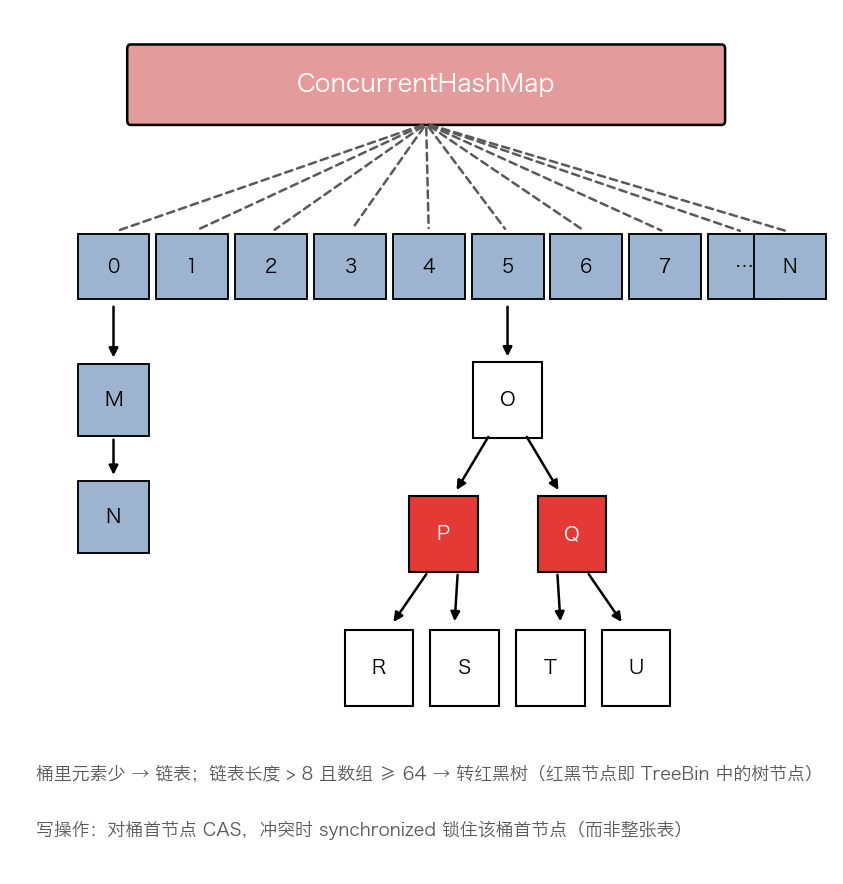

# ConcurrentHashMap 与线程安全的 Map

> 合并自：`ConcurrentHashMap.md`、`线程安全的Map比较.md`。原文未删改（仅修正已知错误）。

## 一、ConcurrentHashMap 原理（JDK7 分段锁 / JDK8 CAS+synchronized）

> 来源：`ConcurrentHashMap.md`

ConcurrentHashMap是线程安全的，可以规避上面的问题，但是JDK的版本不同，解决的方式也不同，在JDK8之前都是使用分段锁的方式来处理，而在JDK8中是基于CAS算法（Compare And Swap）

Java7中ConcurrentHashMap的最外层不是一个大数组而是一个Segment的数组，每个Segment包含一个与HashMap数据结构差不多的链表数组



在读写某个Key时，先取该Key的哈希值。并将哈希值的高N位对Segment个数取模从而得到该Key应该属于哪个Segment，接着如同操作HashMap一样操作这个Segment

Segment继承自ReentrantLock，所以我们可以很方便的对每一个Segment上锁

对于读操作，获取Key所在的Segment时，需要保证可见性（可以使用锁或者volatile），为了避免锁带来的大量开销以及volatile导致的每次读写是CPU内缓存失效的问题，ConcurrentHashMap使用了UNSAFE类的getObjectVolatile（从对象的指定偏移量处获取变量的引用，使用volatile的加载语义）

对于写操作，先获取该Key-Value对所在的Segment的锁，获取成功后就可以像操作一个普通的HashMap一样操作该Segment，并保证该Segment的安全性

在计算size时，需要关心所有的segment才能算出整个Map的大小，ConcurrentHashMap的解决方法是：在不上锁的前提逐个Segment计算3次size，如果某相邻两次计算获取的所有Segment的更新次数（每个Segment都与HashMap一样通过modCount跟踪自己的修改次数，Segment每修改一次其modCount加一）相等，说明这两次计算过程中无更新操作，则这两次计算出的总size相等，可直接作为最终结果返回。如果这三次计算过程中Map有更新，则对所有Segment加锁重新计算Size

ConcurrentHashMap与HashMap相比，有以下不同点

  * ConcurrentHashMap线程安全，而HashMap非线程安全
  * HashMap允许Key和Value为null，而ConcurrentHashMap不允许
  * HashMap 不允许在 Iterator 遍历期间修改（会抛 `ConcurrentModificationException`），ConcurrentHashMap 允许遍历期间并发修改**且不抛异常**——但它的迭代器是**弱一致**的：遍历过程中能否看到别的线程新写入的元素，是不保证的（可能看到、也可能看不到），不要依赖"更新对后续遍历可见"

Java8中ConcurrentHashMap放弃了分段锁，使用CAS和sychronized来保证多线程并发安全，结构和HashMap类似



ConcurrentHashMap的put操作如果是null，则通过CAS操作设置为当前值，如果Key对应的数组元素（也即链表表头或者树的根元素）不为null，则对该元素使用synchronized关键字申请锁，然后进行操作。如果该put操作使得当前链表长度超过一定阈值，则将该链表转换为树，从而提高寻址效率。（Java8之后synchronized使用锁升级方案不会像之前那么消耗资源）

对于读操作，由于数组被volatile关键字修饰，因此不用担心数组的可见性问题。同时每个元素是一个Node实例（Java 7中每个元素是一个HashEntry），它的Key值和hash值都由final修饰，不可变更，无须关心它们被修改后的可见性问题。而其Value及对下一个元素的引用由volatile修饰，可见性也有保障。

```java
static class Node<K,V> implements Map.Entry<K,V> {
  final int hash;
  final K key;
  volatile V val;
  volatile Node<K,V> next;
}
```

对于Key对应的数组元素的可见性，由Unsafe的getObjectVolatile方法保证

```java
static final <K,V> Node<K,V> tabAt(Node<K,V>[] tab, int i) {
  return (Node<K,V>)U.getObjectVolatile(tab, ((long)i << ASHIFT) + ABASE);
}
```

put方法和remove方法都会通过addCount方法维护Map的size。size方法通过sumCount获取由addCount方法维护的Map的size。

## 二、HashMap、Hashtable、ConcurrentHashMap 的比较

> 来源：`线程安全的Map比较.md`

由于HashMap在多线程下存在线程安全问题我们一般可以使用下面的三种方法来代替

  * 使用Collections.synchronizedMap(Map)创建线程安全的map集合
  * Hashtable
  * ConcurrentHashMap

```java
private static class SynchronizedMap<K,V>
        implements Map<K,V>, Serializable {
        private static final long serialVersionUID = 1978198479659022715L;

        private final Map<K,V> m;     // Backing Map
        final Object      mutex;        // Object on which to synchronize

        SynchronizedMap(Map<K,V> m) {
            this.m = Objects.requireNonNull(m);
            mutex = this;
        }

        SynchronizedMap(Map<K,V> m, Object mutex) {
            this.m = m;
            this.mutex = mutex;
        }

        public int size() {
            synchronized (mutex) {return m.size();}
        }
        public boolean isEmpty() {
            synchronized (mutex) {return m.isEmpty();}
        }
        public boolean containsKey(Object key) {
            synchronized (mutex) {return m.containsKey(key);}
        }
        public boolean containsValue(Object value) {
            synchronized (mutex) {return m.containsValue(value);}
        }
        public V get(Object key) {
            synchronized (mutex) {return m.get(key);}
        }

        public V put(K key, V value) {
            synchronized (mutex) {return m.put(key, value);}
        }
        public V remove(Object key) {
            synchronized (mutex) {return m.remove(key);}
        }
        public void putAll(Map<? extends K, ? extends V> map) {
            synchronized (mutex) {m.putAll(map);}
        }
        public void clear() {
            synchronized (mutex) {m.clear();}
        }
```

上面是Collections.SynchronizedMap的源码，根据源码我们可以知道SynchronizedMap内部维护了一个普通对象Map，还有排斥锁mutex。

我们在调用这个方法的时候就需要传入一个Map，可以看到有两个构造器，如果你传入了mutex参数，则将对象排斥锁赋值为传入的对象。

如果没有，则将对象排斥锁赋值为this，即调用synchronizedMap的对象，就是上面的Map。

创建出synchronizedMap之后，再操作map的时候，就会对方法上锁

Hashtable相对于HashMap而言是线程安全的，但是他的效率先对比较低，因为他的操作都是加锁的，所有的操作都是使用了synchronized进行修饰

Hashtable与HashMap的区别

  1. **实现方式不同** ：Hashtable 继承了 Dictionary类，而 HashMap 继承的是 AbstractMap 类。
  2. **初始化容量不同** ：HashMap 的初始容量为：16，Hashtable 初始容量为：11，两者的负载因子默认都是：0.75。
  3. **扩容机制不同** ：当现有容量大于总容量 * 负载因子时，HashMap 扩容规则为当前容量翻倍，Hashtable 扩容规则为当前容量翻倍 + 1。

  4. **迭代器不同** ：HashMap 的 Iterator 是 fail-fast 的；Hashtable 提供两种迭代器——`Enumeration` 不检查 `modCount`（并发修改时不会抛异常，但这不是"安全"，只是没检测），`Iterator` 则是 fail-fast 的。

ConcurrentHashMap相对于HashMap线程安全，比上述的Hashtable性能更好

ConcurrentHashMap和Hashtable都是不允许键和值为null的，具体原因为：ConcurrentHashmap和Hashtable都是支持并发的，这样会有一个问题，当你通过get(k)获取对应的value时，如果获取到的是null时，你无法判断，它是put（k,v）的时候value为null，还是这个key从来没有做过映射。HashMap是非并发的，可以通过contains(key)来做这个判断。而支持并发的Map在调用m.contains（key）和m.get(key),m可能已经不同了
