# HashMap 原理

> 来源：`Map.md`

Map的实现类主要有HashMap、Hashtable、LinkedHashMap、TreeMap

## 继承关系如下

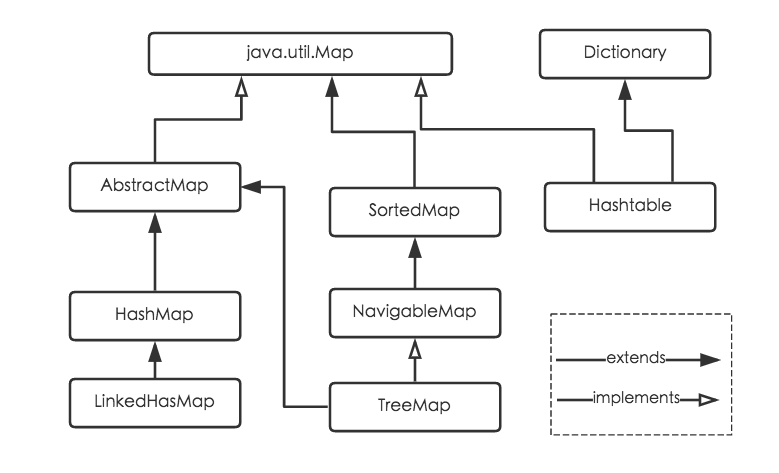

(1) HashMap：它根据键的hashCode值存储数据，大多数情况下可以直接定位到它的值，因而具有很快的访问速度，但遍历顺序却是不确定的。 HashMap最多只允许一条记录的键为null，允许多条记录的值为null。HashMap非线程安全，即任一时刻可以有多个线程同时写HashMap，可能会导致数据的不一致。如果需要满足线程安全，可以用 Collections的synchronizedMap方法使HashMap具有线程安全的能力，或者使用ConcurrentHashMap。

(2) Hashtable：Hashtable是遗留类，很多映射的常用功能与HashMap类似，不同的是它承自Dictionary类，并且是线程安全的，任一时间只有一个线程能写Hashtable，并发性不如ConcurrentHashMap，因为ConcurrentHashMap引入了分段锁。Hashtable不建议在新代码中使用，不需要线程安全的场合可以用HashMap替换，需要线程安全的场合可以用ConcurrentHashMap替换。

(3) LinkedHashMap：LinkedHashMap是HashMap的一个子类，保存了记录的插入顺序，在用Iterator遍历LinkedHashMap时，先得到的记录肯定是先插入的，也可以在构造时带参数，按照访问次序排序。

(4) TreeMap：TreeMap实现SortedMap接口，能够把它保存的记录根据键排序，默认是按键值的升序排序，也可以指定排序的比较器，当用Iterator遍历TreeMap时，得到的记录是排过序的。如果使用排序的映射，建议使用TreeMap。在使用TreeMap时，key必须实现Comparable接口或者在构造TreeMap传入自定义的Comparator，否则会在运行时抛出java.lang.ClassCastException类型的异常。

Hashtable继承自Dictionary，而其他都是继承自AbstractMap。HashTable默认的初始大小为11，之后每次扩充为原来的2n+1。

## Java8中HashMap的结构是数组+链表+红黑树

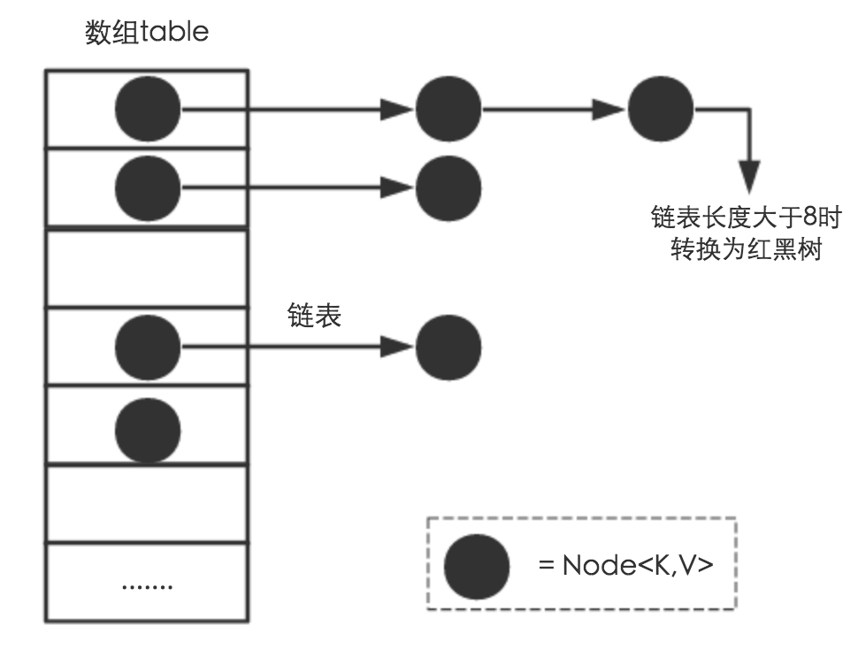

HashMap默认的初始化桶的长度为16，负载因子为0.75，他所能容纳的极限为长度*负载因子，当HashMap的容量达到这个值的时候就会扩容，将容量扩大为现在的2倍，当**链表长度大于 8 且数组长度不小于 64** 时，才会把链表转换成红黑树；如果数组长度还不到 64（即 `MIN_TREEIFY_CAPACITY`），则优先扩容而不是树化

HashMap对于key使用计算hash值后为了在桶中分布均匀使用取余的方式来实现尽量的分布均匀，一般取余会使用模运算来实现，但是模运算的消耗比较大，HashMap中使用h & (table.length -1)来得到该对象的保存位，而HashMap底层数组的长度总是2的n次方，这是HashMap在速度上的优化。当length总是2的n次方时，h& (length-1)运算等价于对length取模，也就是h%length，但是&比%具有更高的效率（主要原因是位运算避开了除法器——`%` 走的是整数除法指令，而 `&` 是一条位运算指令；"不需要转成十进制"不是原因，二进制/十六进制对两者没有区别。）

根据源码可以看出，HashMap获取key的下标是有三步：1、取key的hash值 2、高位运算 3、取模运算

```java
static final int hash(Object key) {   //jdk1.8 & jdk1.7
     int h;
     // h = key.hashCode() 为第一步 取hashCode值
     // h ^ (h >>> 16)  为第二步 高位参与运算(h为int类型32位右移16位使高位全部置为0)
     return (key == null) ? 0 : (h = key.hashCode()) ^ (h >>> 16);
}

h & (length-1);  //第三步 取模运算
```

## HashMap的put方法主要流程如下

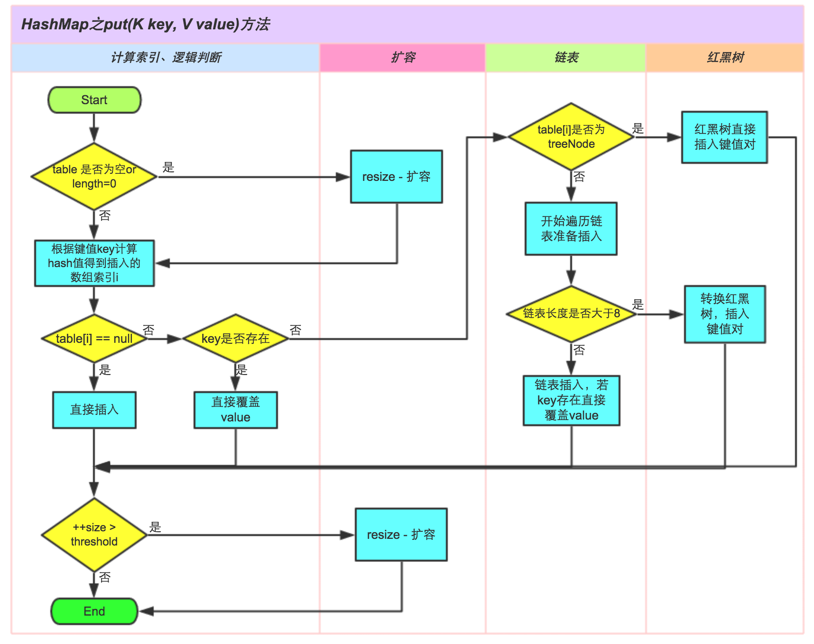

## JDK8源码如下

```java
final V putVal(int hash, K key, V value, boolean onlyIfAbsent,
                   boolean evict) {
        Node<K,V>[] tab; Node<K,V> p; int n, i;
        // 步骤①：tab为空则创建
        if ((tab = table) == null || (n = tab.length) == 0)
            n = (tab = resize()).length;
        // 步骤②：计算index，并对null做处理
        if ((p = tab[i = (n - 1) & hash]) == null)
            tab[i] = newNode(hash, key, value, null);
        else {
            Node<K,V> e; K k;
            // 步骤③：节点key存在，直接覆盖value
            if (p.hash == hash &&
                ((k = p.key) == key || (key != null && key.equals(k))))
                e = p;
            // 步骤④：判断该链为红黑树
            else if (p instanceof TreeNode)
                e = ((TreeNode<K,V>)p).putTreeVal(this, tab, hash, key, value);
            // 步骤⑤：该链为链表
            else {
                for (int binCount = 0; ; ++binCount) {
                    if ((e = p.next) == null) {
                        p.next = newNode(hash, key, value, null);
                        //链表长度大于8转换为红黑树进行处理
                        if (binCount >= TREEIFY_THRESHOLD - 1) // -1 for 1st
                            treeifyBin(tab, hash);
                        break;
                    }
                    // key已经存在直接覆盖value
                    if (e.hash == hash &&
                        ((k = e.key) == key || (key != null && key.equals(k))))
                        break;
                    p = e;
                }
            }
            if (e != null) { // existing mapping for key
                V oldValue = e.value;
                if (!onlyIfAbsent || oldValue == null)
                    e.value = value;
                afterNodeAccess(e);
                return oldValue;
            }
        }
        ++modCount;
        // 步骤⑥：超过最大容量 就扩容
        if (++size > threshold)
            resize();
        afterNodeInsertion(evict);
        return null;
    }
```

HashMap的key只能有一个为null，这个一定放在桶的第一个位置

LinkedHashMap是HashMap的子类，可以看成是一个HashMap加上一个双向链表实现，由于使用了链表所以可以保持key的顺序，默认是按照插入的顺序，可以修改为按照查询的顺序

## Java7使用头插法，Java8使用尾插法

HashMap是线程不安全的，主要会在put和resize以及快速失败(++modCount，++操作不是原子性操作，本身就存在线程安全问题），多线程的环境下容易造成死循环，在JDK7中可能会因为多个线程在resize过程中使用链表导致数据循环，当HashMap的size超过Capacity*loadFactor时，需要对HashMap进行扩容。具体方法是，创建一个新的，长度为原来Capacity两倍的数组，保证新的Capacity仍为2的N次方，从而保证上述寻址方式仍适用。同时需要通过如下transfer方法将原来的所有数据全部重新插入（rehash）到新的数组中。

源码如下

```java
void transfer(Entry[] newTable, boolean rehash) {
  int newCapacity = newTable.length;
  for (Entry<K,V> e : table) {
    while(null != e) {
      Entry<K,V> next = e.next;
      if (rehash) {
        e.hash = null == e.key ? 0 : hash(e.key);
      }
      int i = indexFor(e.hash, newCapacity);
      e.next = newTable[i];
      newTable[i] = e;
      e = next;
    }
  }
}
```

该方法并不保证线程安全，而且在多线程并发调用时，可能出现死循环。其执行过程如下。从步骤2可见，转移时链表顺序反转。

  1. 遍历原数组中的元素
  2. 对链表上的每一个节点遍历：用next取得要转移那个元素的下一个，将e转移到新数组的头部，使用头插法插入节点
  3. 循环2，直到链表节点全部转移
  4. 循环1，直到所有元素全部转移

### 单线程rehash

单线程情况下，rehash无问题。下图演示了单线程条件下的rehash过程
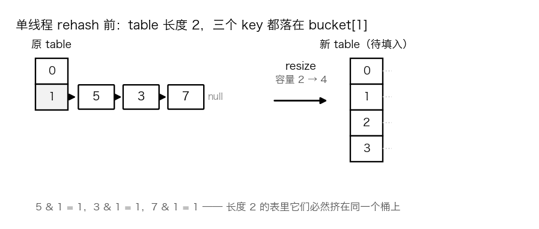

单线程环境下结果是：

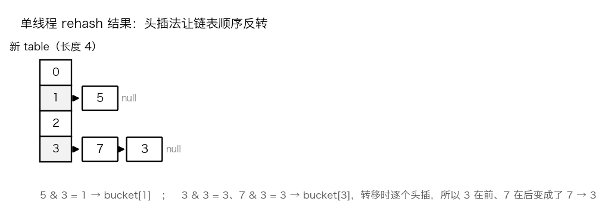

### 多线程并发下的rehash

这里假设有两个线程同时执行了put操作并引发了rehash，执行了transfer方法，并假设线程一进入transfer方法并执行完next = e.next后，因为线程调度所分配时间片用完而“暂停”，此时线程二完成了transfer方法的执行。此时状态如下。

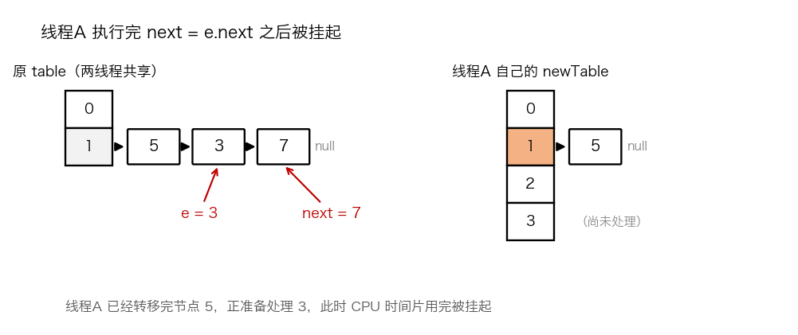

线程二（B）运行结束后的结果（主存中的最新值）

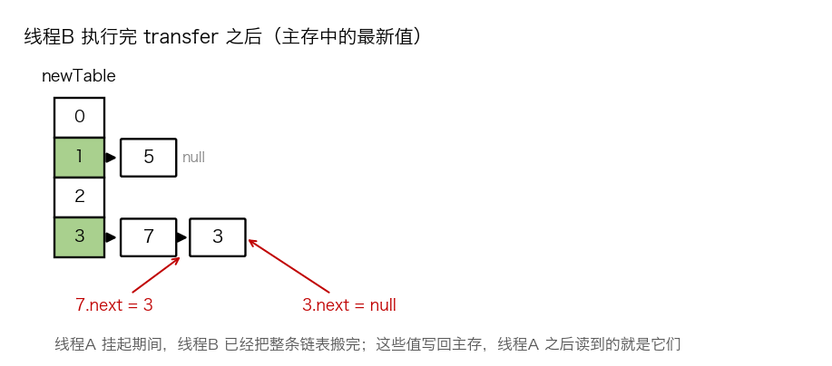

线程A挂起后，此时线程B正常执行，并完成resize操作，结果如下：

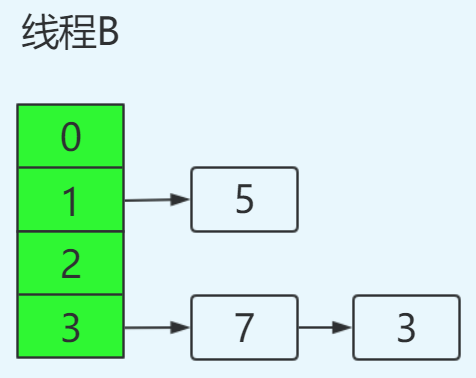

**这里需要特别注意的点：由于线程B已经执行完毕，根据Java内存模型，现在newTable和table中的Entry都是主存中最新值：7.next=3，3.next=null。**

此时切换到线程A上，在线程A挂起时内存中值如下：e=3，next=7，newTable[3]=null，代码执行过程如下：

```java
newTable[3]=e ----> newTable[3]=3
e=next ----> e=7
```

结果如下图所示

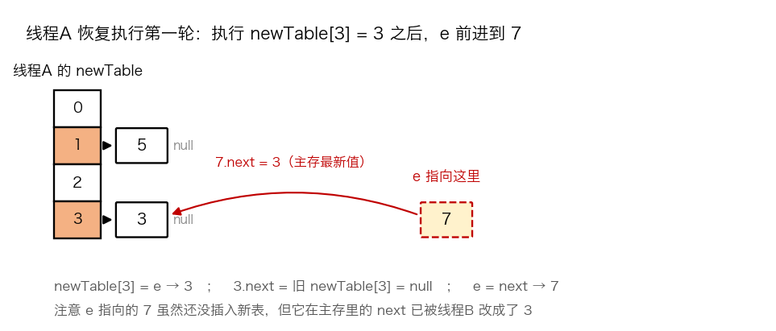

接着执行下一轮循环，代码运行结果是：

```java
e=7
next=e.next ----> next=3【从主存中取值】
e.next=newTable[3] ----> e.next=3【从主存中取值】
newTable[3]=e ----> newTable[3]=7
e=next ----> e=3
```

结果状态图如下所示
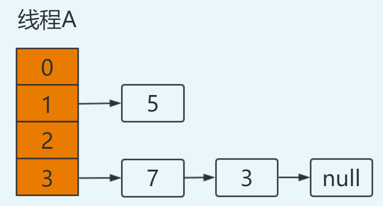

继续下一轮循环，

```java
e=3
next=e.next ----> next=null
e.next=newTable[3] ----> e.next=7 即：3.next=7
newTable[3]=e ----> newTable[3]=3
e=next ----> e=null
```

注意此次循环：e.next=7，而在上次循环中7.next=3，出现环形链表，并且此时e=null循环结束

结果状态图如下所示
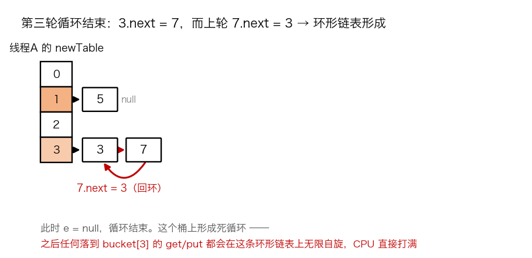

此时循环链表形成，并且key(11)无法加入到线程1的新数组。在下一次访问该链表时会出现死循环。

注意在Hashmap进行扩容时还有可能会造成数据丢失的情况

在HashMap扩容时1.8对代码进行了优化，因为我们使用的是2次幂的扩展（长度为原来的2倍），所以元素的位置要么是原位置，要么是原位置再移动2次幂的位置。他的原来是：由于扩容数组的长度是 2 倍关系，所以对于假设初始 tableSize = 4 要扩容到 8 来说就是 0100 到 1000 的变化（左移一位就是 2 倍），**在扩容中只用判断原来的 hash 值与左移动的一位（newtable 的值）按位与操作是 0 或 1 就行，0 的话索引就不变，1 的话索引变成原索引加上扩容前数组**

JDK8中虽然不会出现这个死循环的问题但是会导致数据丢失等其他问题（如需要判断++size，如果大于8需要转成红黑树，但是++这个操作不是原子性的存在线程安全问题）

Java8 的 HashMap 在**链表长度大于 8 且数组长度不小于 64** 这两个条件同时满足时，才会把链表转成红黑树；数组长度不足 64 时是先扩容，因为链表的特点是插入数据快，但是数据的查询速度慢，时间复杂度是O(N),而红黑树的时间复杂度是log(N),那么为什么要使用红黑树而不使用完全平衡二叉树呢？

红黑树是自平衡二叉查找树每个节点增加一个存储位表示节点的颜色，可以是红或黑（非红即黑）。通过对任何一条从根到叶子的路径上各个节点着色的方式的限制，红黑树确保没有一条路径会比其它路径长出两倍，因此，红黑树是一种弱平衡二叉树（由于是弱平衡，可以看到，在相同的节点情况下，AVL树的高度低于红黑树），相对于要求严格的AVL树来说，它的旋转次数少，所以对于搜索，插入，删除操作较多的情况下，我们就用红黑树。

HashMap的默认初始化容量是16，如果我们通过构造方法传入一个长度，HashMap不会完全按照我们传入的值作为默认容量，因为他必须要求HashMap的容量值为2的幂，所以实际HashMap的实际容量是比我们传入的值大的2的最小次幂，比如传入 16 得到 16，传入 17 才得到 32——是**大于等于**传入值的最小 2 的幂，而不是"比它大"

在 JDK 1.7 和 JDK 1.8 中，HashMap 初始化容量的时机**正好相反**：JDK 1.8 的构造函数只记录 `threshold`（并按 2 的幂向上取整），真正的 `table` 数组要等到**第一次 put** 时才由 `resize()` 分配；而 JDK 1.7 的构造函数会调用 `inflateTable()`，**在构造时就**把 table 建好。
