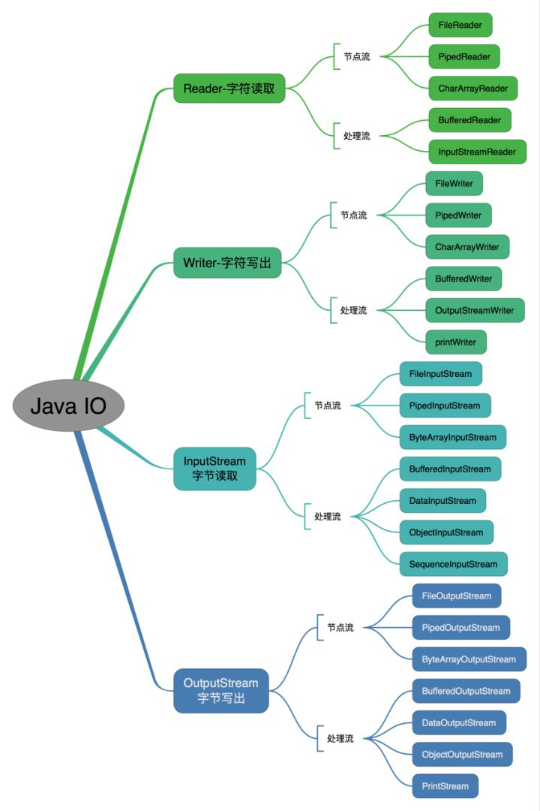
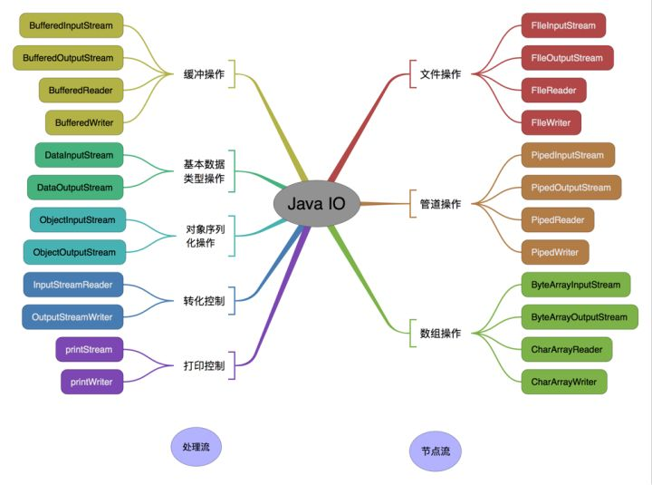
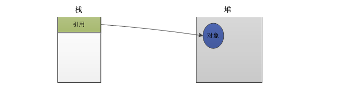
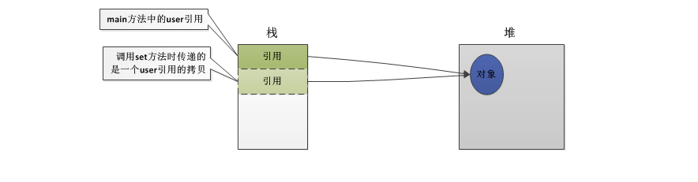
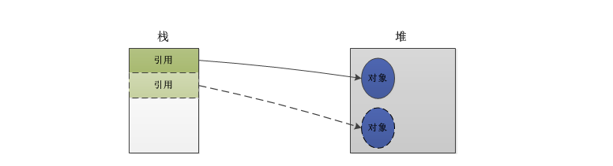

# Java 语言基础

> 合并自：`Java.md`、`引用类型在Java中的使用.md`。原文未删改，仅按主题归并，各节以分隔线隔开。

---

## 一、Java

### 编译器和解释器

编译器是一个将一种编程语言的代码翻译(translate)为另外一种编程语言的代码的计算机程序. 通常指将高级语言的代码翻译为低级语言的代码.

解释器是一种直接执行高级语言代码的计算机程序, 而无需将代码编译成机器码.

  * 优点：消除了编译整个程序的负担，程序可以拆分成多个部分来模块化.
  * 缺点：解释器像是一位“中间人”,每次运行程序时都要先将代码转成另一种语言的代码,然后再作运行,因此解释器的程序运行速度比较缓慢.

解释器执行代码的策略一般有下面三种

* 直接运行高级编程语言的代码(如Shell内置的解释器).
* 先将代码转换成高效的中间码(如:Bytecode),然后马上执行(不输出中间码).
* 由解释器中内置的编译器先将高级语言的代码编译成中间码,然后再执行.(输出中间码,相当于两个阶段,如Java的执行)

Java编译器负责读取java原文件（*.java）并将它们编译为字节码文件（*.class）

Java解释器负责执行字节码

JIT编译器（Just In Time Compile 即时编译器）

Java程序最初是通过解释器进行解释执行的，当虚拟机发现某个方法或代码块运行的特别频繁时，会把这些代码认定为“热点代码”（Hot Spot Code，如循环，高频度使用的方法等）。为了提高热点代码的执行效率，在运行时，虚拟机会把这些代码编译成本地机器码，并进行各种层次的优化，完成这个任务的编译器称为JIT编译器。JIT编译器是JRE的一部分。

简单来说，Java解释器一行一行的运行java字节码还是太慢了，而机器码运行起来最快。JIT编译器把被多次调用的方法和被多次执行的循环体相关的字节码编译成本地机器码并运行，就可以大大提高运行效率。

### 即时编译器（JIT）与解释器的区别

1 解释器是将字节码解释为机器码，下次即使遇到相同的字节码，仍会执行重复的解释

2 JIT是将一些字节码编译为机器码，并存入Code Cache，下次遇到相同的代码，直接执行，无需再编译

3 解释器不产出可复用的机器码，而是逐条取指、解码并执行；同一份字节码在不同平台上由各自的解释器处理

4 JIT会根据平台类型，生成平台特定的机器码

对于占据大部分的不常用的代码，我们无需耗费时间将其编译成机器码，而是采取解释执行的方式运行；另一方面，对于仅占小部分的热点代码，我们则可以将其编译成机器码已达到理想的运行速度。

HotSpot虚拟机中内置了两个即时编译器：Client Complier和Server Complier，简称为C1、C2编译器，分别用在客户端和服务端。目前主流的HotSpot虚拟机中默认是采用解释器与其中一个编译器直接配合的方式工作。程序使用哪个编译器，取决于虚拟机运行的模式。HotSpot虚拟机会根据自身版本与宿主机器的硬件性能自动选择运行模式，用户也可以使用“-client”或“-server”参数去强制指定虚拟机运行在Client模式或Server模式。

用Client Complier获取更高的编译速度，用Server Complier 来获取更好的编译质量，提供多个即使编译器是为了适应不同的应用场景

在 HotSpot 实现中有多种选择：C1、C2 和 C1 + C2，分别对应 client、server 和分层编译。

  1. C1 编译速度快，优化方式比较保守；
  2. C2 编译速度慢，优化方式比较激进；
  3. C1 + C2 在开始阶段采用 C1 编译，当代码运行到一定热度之后采用 C2 重新编译；

分层编译从 JDK7 起就是默认开启的；JDK7 之前的版本才需要显式加 -XX:+TieredCompilation 开启

### 热点代码定义

  * 被多次调用的方法：方法调用的多了，代码执行次数也多，成为热点代码很正常
  * 被多次执行的循环体：假如一个方法被调用的次数少，只有一次或两次，但方法内有个循环，一旦涉及到循环，部分代码执行的次数肯定多，这些多次执行的循环体内代码也被认为“热点代码”。

### final 可以修饰类、属性、方法

  * 被final修饰的类不可以被继承
  * 被final修饰的方法不可以被重写
  * 被final修饰的变量不可以被改变，被final修饰不可变的是变量的引用，而不是引用指向的内容，引用指向的内容是可以改变的

当final修饰一个类时，表明这个类不能被继承。成员变量可以根据需要设为final，但是final类中的所有成员方法都会被隐式的指定为final方法

> **注意**：private 方法并不是 final 方法——它在字节码层面通过 invokespecial 直接调用，本就不参与虚方法分派，也就不需要靠 final 来禁止重写

this和super不能同时出现在一个构造函数里面，因为this必然会调用其它的构造函数，其它的构造函数必然也会有super语句的存在，所以在同一个构造函数里面有相同的语句，就失去了语句的意义，编译器也不会通过。

### 面向对象的五大原则

  * 单一职责原则SRP(Single Responsibility Principle)
类的功能要单一，不能包罗万象，跟杂货铺似的。
  * 开放封闭原则OCP(Open－Close Principle)
一个模块对于拓展是开放的，对于修改是封闭的，想要增加功能热烈欢迎，想要修改，哼，一万个不乐意。
  * 里式替换原则LSP(the Liskov Substitution Principle LSP)
子类可以替换父类出现在父类能够出现的任何地方。比如你能代表你爸去你姥姥家干活。哈哈~~
  * 依赖倒置原则DIP(the Dependency Inversion Principle DIP)
高层次的模块不应该依赖于低层次的模块，他们都应该依赖于抽象。抽象不应该依赖于具体实现，具体实现应该依赖于抽象。就是你出国要说你是中国人，而不能说你是哪个村子的。比如说中国人是抽象的，下面有具体的xx省，xx市，xx县。你要依赖的抽象是中国人，而不是你是xx村的。
  * 接口分离原则ISP(the Interface Segregation Principle ISP)
设计时采用多个与特定客户类有关的接口比采用一个通用的接口要好。就比如一个手机拥有打电话，看视频，玩游戏等功能，把这几个功能拆分成不同的接口，比在一个接口里要好的多

### Java 中定义无参构造方法的作用

Java 程序在执行子类的构造方法之前，如果没有用super()来调用父类特定的构造方法，则会调用父类中无参构造方法。因此如果父类中只定义了有参构造方法，而在子类的构造方法中又没有用super()来调用父类中的特定构造方法，则会在编译时将发生错误，因为java程序在父类中找不到无参构造可以执行，所以一般我们会在父类中添加一个无参构造方法

局部内部类访问局部变量的时候为什么需要加上final

```java
public class Outer {

    void outMethod(){
        final int a =10;
        class Inner {
            void innerMethod(){
                System.out.println(a);
            }
        }
    }
}
```

之所以局部内部类访问局部变量需要加上final，是因为生命周期不一致，局部变量直接存储在栈中，当方法执行结束后，非final的局部变量就被销毁。而局部内部类对局部变量的引用依旧存在，如果局部内部类要调用局部变量时就会出错。加上了final可以确保局部内部类使用的变量与外部的局部变量区分开（加上final这个变量的值在编译器就可以确认，那么编译器会默认在局部内部类的常量池中添加一个内容相等的字面量或直接将相应的字节码嵌入到执行字节码中）

为什么内部类可以访问外部类的成员，包括私有数据

编译器在创建内部类时会为它加上一个指向外部类的引用，并且编译器会为内部类的构造方法添加一个参数进行初始化，参数的类型就是外部类的类型，这样内部类就可以随意访问外部类的成员

### 流分类





### BIO、NIO、AIO 的区别

  * **BIO (Blocking I/O):** 同步阻塞I/O模式，数据的读取写入必须阻塞在一个线程内等待其完成。在活动连接数不是特别高（小于单机1000）的情况下，这种模型是比较不错的，可以让每一个连接专注于自己的 I/O 并且编程模型简单，也不用过多考虑系统的过载、限流等问题。线程池本身就是一个天然的漏斗，可以缓冲一些系统处理不了的连接或请求。但是，当面对十万甚至百万级连接的时候，传统的 BIO 模型是无能为力的。因此，我们需要一种更高效的 I/O 处理模型来应对更高的并发量。
  * **NIO (New I/O):** NIO是一种同步非阻塞的I/O模型，在Java 1.4 中引入了NIO框架，对应 java.nio 包，提供了 Channel , Selector，Buffer等抽象。NIO中的N可以理解为Non-blocking，不单纯是New。它支持面向缓冲的，基于通道的I/O操作方法。 NIO提供了与传统BIO模型中的 `Socket` 和 `ServerSocket` 相对应的 `SocketChannel` 和 `ServerSocketChannel` 两种不同的套接字通道实现,两种通道都支持阻塞和非阻塞两种模式。阻塞模式使用就像传统中的支持一样，比较简单，但是性能和可靠性都不好；非阻塞模式正好与之相反。对于低负载、低并发的应用程序，可以使用同步阻塞I/O来提升开发速率和更好的维护性；对于高负载、高并发的（网络）应用，应使用 NIO 的非阻塞模式来开发
  * **AIO (Asynchronous I/O):** AIO 也就是 NIO 2。在 Java 7 中引入了 NIO 的改进版 NIO 2,它是异步非阻塞的IO模型。异步 IO 是基于事件和回调机制实现的，也就是应用操作之后会直接返回，不会堵塞在那里，当后台处理完成，操作系统会通知相应的线程进行后续的操作。AIO 是异步IO的缩写，虽然 NIO 在网络操作中，提供了非阻塞的方法，但是 NIO 的 IO 行为还是同步的。对于 NIO 来说，我们的业务线程是在 IO 操作准备好时，得到通知，接着就由这个线程自行进行 IO 操作，IO操作本身是同步的。

阻塞和非阻塞，体现在当前进程是否可执行，是否能获取到CPU。

当阻塞和非阻塞的概念体现在IO模型上：

  * 阻塞IO：从开始发起IO操作开始就阻塞，直到IO完成才返回，所以进程会立即进入睡眠态
  * 非阻塞IO：发起IO操作时，如果当前数据已就绪，则切换到内核态由内核完成数据拷贝(从kernel buffer拷贝到app buffer)，此时进程被阻塞，因为它的CPU已经被内核抢走了。如果发起IO操作时数据未就绪，则立即返回而不阻塞，即进程继续享有CPU，可以继续任务。但进程不知道数据何时就绪，所以通常会采用轮循代码(比如while循环)不断判断数据是否就绪，当数据最终就绪后，切换到内核态，进程仍然被阻塞

同步和异步，考虑的是两边数据是否同步(比如kernel buffer和app buffer之间数据是否同步)。同步和异步的区别体现在两边数据尚未完成同步时的行为：

  * 同步：在保持两边数据同步的过程中，进程被阻塞，由内核抢占其CPU去完成数据同步，直到两边数据同步，进程才被唤醒
  * 异步：在保持两边数据同步的过程中，由内核默默地在后台完成数据同步(如果不理解，可认为是单独开了一个内核线程负责数据同步)，内核不会抢占进程的CPU，所以进程自身不被阻塞，当内核完成两端数据同步时，通知进程已同步完成

泛型理解参数化类型，arraylist这种容器类（支持数据增删查询的），我们写了支持String类型的，后面还需要写支持Integer类型的。然后呢？Doubel、Float、各种自定义类型？这样重复代码太多了，而且这些容器的算法都是一致的。我们可以通过泛指一种类型T,来代替我们之前需要的所有类型，把我们需要的类型作为参数传递到容器里面，这样我们算法只需要写一套就可以适应所有的类型。最典型的的例子就是ArrayList了。如果使用object容易出现类似的转换问题，但是我们无法在编译器发现，只有在运行期会发生ClassCastException。使用泛型规定了只能往集合中添加一种类型的数据，同时可以让我们在编译期就发现这些错误，避免运行时异常的发生，提升代码的健壮性。

在编译器编译的时候会去掉，这个过程成为类型擦除。

如在代码中定义List\<Object\>和List\<String\>等类型，在编译后都会变成List，JVM看到的只是List

---

## 二、引用类型在Java中的使用

```java
@Data
@NoArgsConstructor
@AllArgsConstructor
public class User {
    private String name;
}
```

```java
public class ClassExample {

    public void set(User user){
        user.setName("hello world");
        user = new User();
        user.setName("change");
    }

    public static void main(String[] args) {
        User user = new User();
        ClassExample classExample = new ClassExample();
        classExample.set(user);
        System.out.println(user.getName());
    }
}
```

运行上述代码打印的结果不是我们预期的"change"而是"hello world"，下面来分析一下这个代码

```java
User user = new User();
```

这行代码在堆中创建了一个对象，并在栈中创建了一个引用，此引用指向该对象，如下图：



```java
classExample.set(user);
```

这里的代码是将引用user作为参数传递到set方法，这实际上是**按值传递**——Java 中只有值传递，传递的并不是引用本身，而是引用的一份拷贝。也就是说这时有两个引用（引用和引用的拷贝）同时指向堆中的对象，如下图：



```java
user.setName("hello world");
```

在set()方法中，"user引用的拷贝"操作堆中的User对象，给name属性设置字符串"hello world"。如下图：


```java
user = new User();
```

在set()方法中，又创建了一个User对象，并将“user引用的拷贝”指向这个在堆中新创建的对象，如下图：



```java
user.setName("change");
```

在set()方法中，“user引用的拷贝”操作的是堆中新创建的User对象。


set()方法执行完毕，目光再回到mian()方法

    

### 结论

Java 中**只有值传递**：方法拿到的是实参值的一份拷贝，没有"引用传递"这种调用方式。

- **基本类型**：拷贝的就是数值本身，方法内怎么改都不影响外部变量。
- **引用类型**：拷贝的是"引用的值"（对象的地址）。由此分两种情况：

| 方法内的操作 | 是否影响外部 | 原因 |
|---|---|---|
| 通过引用**修改对象内容**（`user.setName("hello world")`）| **会** | 两份引用指向同一个堆对象 |
| 让引用**重新指向新对象**（`user = new User()`）| **不会** | 只改了方法内的那份拷贝，外部的引用仍指向原对象 |

对回上面的例子：`set()` 里先执行 `user.setName("hello world")`，改的是双方共享的那个对象，所以 main 里能看到；接着 `user = new User()` 让拷贝改指向新对象，再 `user.setName("change")` 只作用在新对象上，所以 main 里打印出来仍然是 `hello world` 而不是 `change`。

一句话记法：**Java 传的是引用的副本——能改对象内容，改不了引用本身。**
