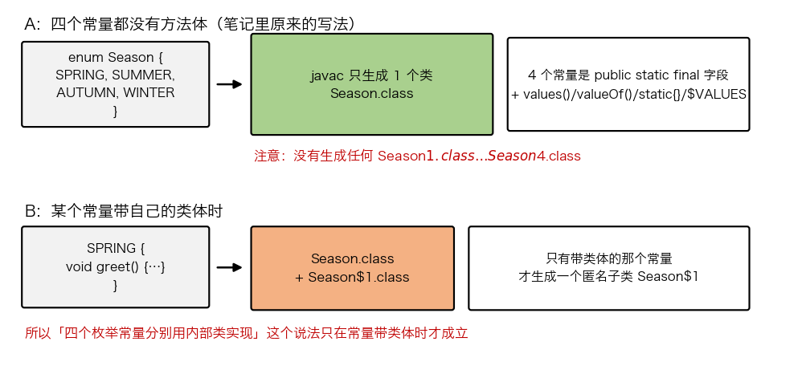

# Java 语言特性与底层实现

> 合并自：`枚举.md`、`Java代码底层实现.md`、`Java序列化.md`。原文未删改，仅按主题归并，各节以分隔线隔开。

---

## 一、枚举

枚举我们一般会用在定义常量上，有一些枚举的api需要关注一下

valueOf()

这个方法的作用是传来一个字符串，然后将它转换为对应的枚举常量。不过传入的字符串和定义枚举的字符串需要一模一样， 须区分大小写。如果传入了一个不存在的字符串，那么会抛出异常。

values()

该方法会将枚举定义的所有数据以数组的形式返回

ordinal()

返回对应枚举的序列

toString() name()

```java
public abstract class Enum<E extends Enum<E>>
        implements Comparable<E>, Serializable {
        ...
        public final String name() {
         return name;
     }
     public String toString() {
         return name;
     }
     ...
    }
```

根据代码可知这两个方法返回其实是一样的，但是区别在于toString可以被重写，但是name是final修饰的不能重写

compareTo()

用于比较两个枚举之间的次序，返回次序相减之后的结果

switch是可以支持case为枚举，他的底层是生成了一个合成类，利用ordinal来判断是否符合枚举的要求

定义一个枚举

```java
public enum Season {
    SPRING, SUMMER, AUTUMN, WINTER
}
```

反编译一下这个代码

```java
public abstract class Season extends java.lang.Enum<Season> {
  public static final Season SPRING;
  public static final Season SUMMER;
  public static final Season AUTUMN;
  public static final Season WINTER;
  public static Season[] values();
  public static Season valueOf(java.lang.String);
  Season(java.lang.String, int, Season$1);
  static {};
}
```

经过编译器编译之后，**Season是一个继承了Enum类的抽象类** ，而且枚举中定义的**枚举变量变成了相应的public static final属性** ，**其类型为抽象类Season类型** ，名字就是枚举变量的名字。

而编译产物其实只有一个 Season.class，并没有 Season$1.class 这类内部类：



也就是说，**这四个枚举常量只是 Season 类里的 public static final 字段，并没有各自的内部类** 。同时还**添加了两个方法values()和valueOf(String s)** 。我们使用的是默认的无参构造函数，但**现在的构造函数有两个参数** 。还**生成了一个静态代码块**

静态代码块部分做的工作，就是分别设置生成的四个公共静态常量字段的值，同时编译器还生成一个静态字段$VALUES，保存的是枚举类型定义的所有枚举常量。

values()方法是一个公共的静态方法，所以我们可以直接调用该方法，返回枚举的数组。而这个方法实现的是，将静态代码块中初始化的$VALUES字段的值克隆出来，并且强制转换成Season[]类型返回，就相当于以下代码：

```java
public static Season[] values(){
 return (Season[])$VALUES.clone();
}
```

valueOf()也是一个公共的静态方法，所以可以直接调用这个方法并返回参数字符串表示的枚举变量，另外，这个方法的实现是调用Enum.valueOf()方法，并把类型强制转换为Season，它相当于如下的代码

```java
public static Season valueOf(String s){
 return (Season)Enum.valueOf(Season.class, s);
}
```

下面看一下：当某个枚举常量带自己的类体时，编译器才会生成怎样的内部类（这是另一个例子）

```java
final class Season$1 extends Season {
  Season$1(java.lang.String, int);
  public Season getNextSeason();
}
```

可以看到，Season1继承了Season，但是为什么Season1的构造函数有两个入参呢？

关于这个问题，我们还是得从Season的父类Enum说起。

```java
public abstract class Enum<E extends Enum<E>>
        implements Comparable<E>, Serializable {

    private final String name;

    public final String name() {
        return name;
    }

    private final int ordinal;

    public final int ordinal() {
        return ordinal;
    }

    protected Enum(String name, int ordinal) {
        this.name = name;
        this.ordinal = ordinal;
    }
    ......
}
```

从Enum中我们可以看到，每个枚举都定义了两个属性，name和ordinal，name表示枚举变量的名称，而ordinal则是根据变量定义的顺序授予的整型值，从0开始。

### 在枚举变量初始化的时候，会自动初始化这两个字段，设置相应的值

，所以会在Season()的构造方法中添加两个参数。

而且我们可以从Enum的源码中看到，大部分的方法都是 final 修饰的。其中 **clone()** 和 **readObject()** 分别抛出 CloneNotSupportedException 和 InvalidObjectException，阻止了通过克隆或反序列化复制枚举。需要澄清两点：一是 Enum 并没有 writeObject 方法，枚举的序列化由 ObjectOutputStream 特殊处理（只写 name）；二是枚举的不可变与单例，根本上来自“常量是 public static final + 构造器私有”，而不是这几个方法。

总结一下，其实**枚举本质上也是通过普通的类来实现的** ，只是编译器为我们进行了处理。每个枚举类型都继承自**Enum** 类，并由**编译器自动添加了values()和valueOf()方法** ，**每个枚举变量是一个静态常量字段** ；只有某个常量带自己的类体时，编译器才会为它生成一个匿名子类（如 Season$1），该子类继承此枚举类。

### 所有的枚举变量都是通过静态代码块进行初始化

，也就是说在类加载期间就实现了。

另外，**通过把clone、readObject、writeObject这三个方法定义为final，保证了每个枚举类型及枚举常量都是不可变的** ，也就是说，可以用枚举实现线程安全的单例。

枚举类实现单例模式相当硬核，因为枚举类型是线程安全的（static类型的属性会在类被加载之后被初始化，当一个Java类第一次被真正使用到的时候静态资源被初始化、Java类的加载和初始化过程都是线程安全的），且只会装载一次。使用枚举类来实现单例模式，是所有的单例实现中唯一一种不会被破坏的单例模式实现。

```java
public class SingletonObject {

    private SingletonObject() {
    }

    private enum Singleton {
        INSTANCE;

        private final SingletonObject instance;

        Singleton() {
            instance = new SingletonObject();
        }

        private SingletonObject getInstance() {
            return instance;
        }
    }

    public static SingletonObject getInstance() {
        return Singleton.INSTANCE.getInstance();
    }
}
```

---

## 二、Java代码底层实现

### finally 的代码实现

如果catch中有return语句，finally里面的代码还会执行吗，如果会，那是在return之前还是return之后

```java
public static int method() {
        int a = 10;
        try {
            a = a / 0;
            System.out.println("this is try code");
        }catch (Exception e) {
            a = 20;
            System.out.println("this is catch code");
            return a; //☆
        }finally {
            a = 30;
            System.out.println("this is finally code");
        }
        return a;
    }
```

执行结果

```java
this is catch code
this is finally code
20
```

在☆处return a在程序执行到这一步的时候这里不是return a,而是return 20，形成一条返回路径，但是它发现后面还有finally的内容，所以继续执行finally的内容，a = 30，再次回到以前的路径，继续走return 20，所以结果是20，（简单来说就是在catch的return后面再次执行了finally的内容，但是return的值没有变）

finally中的代码一定会被执行的底层原理是编译器将finally中的代码复制了3份，分别放入了try、catch流程、catch剩余的异常类型流程

不要在finally中使用return，如果finally代码块在执行期间抛出一个新值，finally子句中止，整个try-catch-finally语句块立即返回，将这个新值抛给上层调用者,而finally语句块中的return抛出异常的优先级最高，程序会优先返回finally语句块中的立即结束的结果，此时try-catch语句块中的return或者抛出的异常会被抛弃，所以我们在将捕获的异常抛出给调用的上层方法处理时，如果被finally语句块中的return语句覆盖掉了，那么这个导致异常的错误情况将很难发现和定位。

### switch 对于 String 类型的底层实现

Java 5 起 switch 支持枚举，Java 7 起支持 String，二者的底层实现不同

  * 对于String的支持

```java
    public static void main(String[] args) {
        String str = "hello";
        switchMethod(str);
    }

    public static void switchMethod(String str){
        switch (str){
            case "hello":
                System.out.println("str is hello");
                break;
            case "world":
                System.out.println("str is world");
                break;
            default:
                System.out.println("none");
        }
    }
}
```

编译后的代码如下

```java
public class Main8 {
    public Main8() {
    }

    public static void main(String[] args) {
        String str = "hello";
        switchMethod(str);
    }

    public static void switchMethod(String str) {
        byte var2 = -1;
        switch(str.hashCode()) {
        case 99162322:
            if (str.equals("hello")) {
                var2 = 0;
            }
            break;
        case 113318802:
            if (str.equals("world")) {
                var2 = 1;
            }
        }

        switch(var2) {
        case 0:
            System.out.println("str is hello");
            break;
        case 1:
            System.out.println("str is world");
            break;
        default:
            System.out.println("none");
        }
    }
}
```

可以看到底层其实是将一个switch拆分成了两个，第一个是利用String的哈希值和equals来判断，将结果暂存到临时变量中，第二个是对临时变量的判断，实现真正switch中需要实现的代码，这里第一个判断第一次使用哈希值是为了避免每次需要equals，第二次使用equals是为了防止哈希碰撞

  * 对于枚举的实现

```java
public class Main9 {
    public static void main(String[] args) {
        HuMan huMan = HuMan.MAN;
        switchMethod(huMan);
    }

    public static void switchMethod(HuMan huMan){
        switch (huMan){
            case MAN:
                System.out.println("man");
                break;
            case WOMAN:
                System.out.println("woman");
                break;
            default:
                System.out.println("none");
        }
    }
}
```

编译器实现代码大致如下

```java
public class Main9 {
    /**
     * 定义了一个合成类（仅JVM使用，对我们不可见），使用枚举的ordinal与数组元素关系
     */
    static class $MAP {
        static int[] map = new int[2];

        static {
            map[HuMan.MAN.ordinal()] = 1;
            map[HuMan.WOMAN.ordinal()] = 2;
        }
    }

    public static void switchMethod(HuMan huMan) {
        int x = $MAP.map[huMan.ordinal()];
        switch (x) {
            case 1:
                System.out.println("man");
                break;
            case 2:
                System.out.println("woman");
                break;
        }
    }
}
```

在JVM内部生成了一个合成类，它有一个数组，使用枚举的ordinal作为数组的下标，在生成的switch中使用数组的下标来进行int类型的判断

switch不能支持long类型的数据，因为switch的编译会用到两个指令，tableswitch和lookupswitch。而这两个指令只会运行在int指令下，小于 int 的整型类型（byte、short、char）会被提升为 int，而这一点和short、byte等类型在计算时会被转为int来处理的表现是一致的。

### 匿名内部类

匿名内部类示例

```java
public class Main11 {
    public void method(final String str) {
        Runnable runnable = new Runnable() {
            @Override
            public void run() {
                System.out.println("print str is :" + str);
            }
        };
    }
}
```

在编译器真正编译期间会生成一个额外的类代码类似下面代码（这个代码只有JVM可见）

```javascript
final class $Main11 implements Runnable{

        String $value;

        $Main11(String $value){
            this.$value = $value;
        }

        @Override
        public void run() {
            System.out.println("print str is :" + $value);
        }
    }
```

生成一个类实现Runnable接口，并重写run(),生成的类中有一个变量用来接收run()使用的变量

调用代码类似

```javascript
public void method(final String str){
        Runnable runnable = new $Main11(str);
    }
```

这里也解释了匿名内部类引用局部变量时，局部变量必须是final的，因为在创建$Main对象时，将str的值赋值给了$Main对象的$value属性，所以$value不应该在发生变化了，如果变化，那么$value属性就没有机会再跟着一起变化

### 方法内联与常量折叠

```javascript
public static int square(final i) {
        return i * i;
    }
```

```javascript
System.out.println(square(9));
```

上面代码编译器如果发现square()是热点方法，并且长度不太长时，会进行内联，所谓内联就是把方法内代码进行拷贝、粘贴到调用者的位置

```java
System.out.println(9*9);
```

还能进行常量折叠的优化

```java
System.out.println(81);
```

---

## 三、Java序列化

Serializable 是 java.io 包中定义的、用于实现Java类的序列化操作而提供的一个语义级别的接口。Serializable序列化接口没有任何方法或者字段，只是用于标识可序列化的语义。实现了Serializable接口的类可以被ObjectOutputStream转换为字节流，同时也可以通过ObjectInputStream再将其解析为对象。

我们可以将序列化对象写入文件后，再次从文件中读取它并反序列化成对象，也就是说，可以使用表示对象及其数据的类型信息和字节在内存中重新创建对象。

无论什么编程语言，其底层涉及IO操作的部分还是由操作系统其帮其完成的，而底层IO操作都是以字节流的方式进行的，所以写操作都涉及将编程语言数据类型转换为字节流，而读操作则又涉及将字节流转化为编程语言类型的特定数据类型。而Java作为一门面向对象的编程语言，对象作为其主要数据的类型载体，为了完成对象数据的读写操作，也就需要一种方式来让JVM知道在进行IO操作时如何将对象数据转换为字节流，以及如何将字节流数据转换为特定的对象，而Serializable接口就承担了这样一个角色。

序列化：把对象转换为字节序列的过程，也可以说把内存中的这些对象变成一连串的字节(bytes)描述的过程。

反序列化：把持久化的字节文件数据恢复为对象的过程

serialVersionUID：对于JVM来说，要进行持久化的类必须要有一个标记，只有持有这个标记JVM才允许类创建的对象可以通过其IO系统转换为字节数据，从而实现持久化，而这个标记就是Serializable接口。而在反序列化的过程中，serialVersionUID 只用于校验版本兼容性——与本地对应类的 UID 比对，不一致就抛 InvalidClassException；具体加载哪个类，是由字节流里的类名和当前的 ClassLoader 决定的，所以我们在实现Serializable接口的时候，一般还会要去尽量显示地定义serialVersionUID，如：

```java
private static final long serialVersionUID = 1L;
```

在反序列化的过程中，如果接收方为对象加载了一个类，如果该对象的serialVersionUID与对应持久化时的类不同，那么反序列化的过程中将会导致InvalidClassException异常

如果我们在序列化中没有显示地声明serialVersionUID，则序列化运行时将会根据该类的各个方面计算该类默认的serialVersionUID值。但是，Java官方强烈建议所有要序列化的类都显示地声明serialVersionUID字段，因为如果高度依赖于JVM默认生成serialVersionUID，可能会导致其与编译器的实现细节耦合，这样可能会导致在反序列化的过程中发生意外的InvalidClassException异常。因此，为了保证跨不同Java编译器实现的serialVersionUID值的一致，实现Serializable接口的必须显示地声明serialVersionUID字段。

此外serialVersionUID字段地声明要尽可能使用private关键字修饰，这是因为该字段的声明只适用于声明的类，该字段作为成员变量被子类继承是没有用处的!有个特殊的地方需要注意的是，数组类是不能显示地声明serialVersionUID的，因为它们始终具有默认计算的值，不过数组类反序列化过程中也是放弃了匹配serialVersionUID值的要求。
