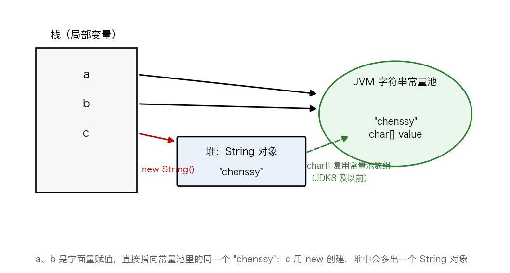
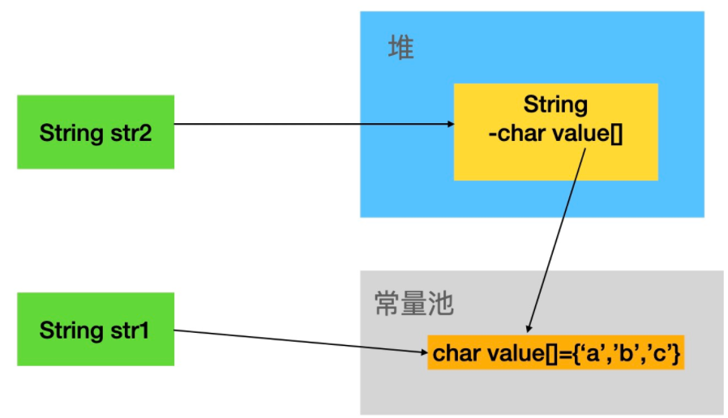
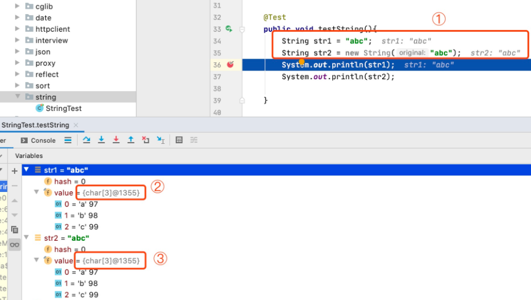
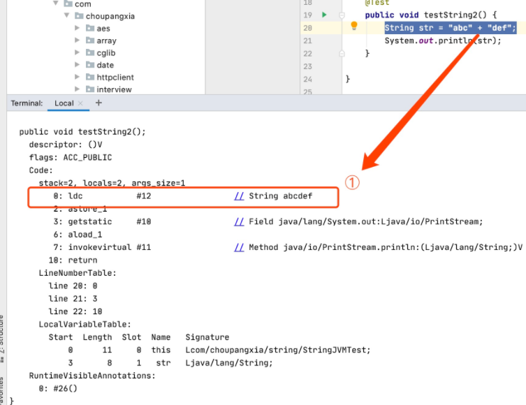
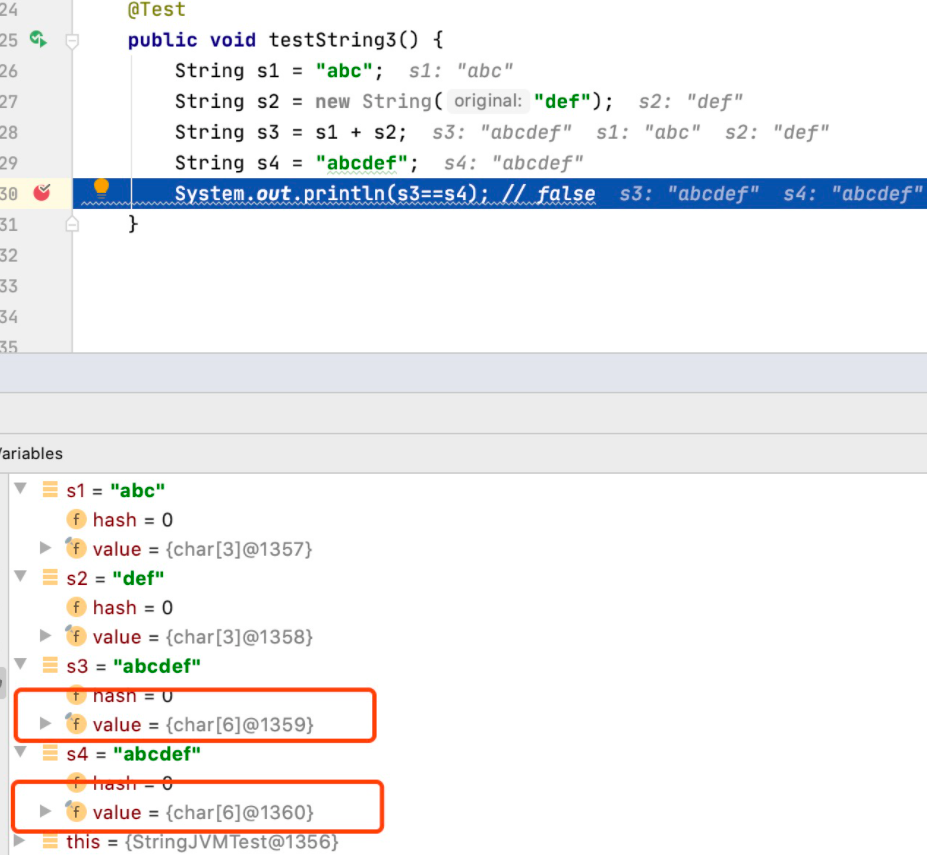

# String

## 一、字符串对象创建与 intern

```java
String str = new String("a") + new String("b");
```

假设执行这条命令之前串池为空，那么执行这条命令之后，会创建5个String对象，在串池中放入 a和b，在堆中存在 new String("a")和new String("b")，同时，"+"底层使用StringBuild的toString方法new了一个新的str对象，由于这是一个对象而不是一个常量，他在堆中而没有放入常量池中

```java
str.intern()
```

str.intern()这条命令会将这个字符串对象尝试放入串池中，如果串池中有则不会放入，如果没有则放入串池中，并将串池中的对象返回

注意：上面是基于jdk1.7之后，如果是jdk1.6那么如果串池中没有字符串对象时，不是直接将引用放入串池而是复制了一份（一个新的字符串）放入到串池中

## 二、String 为什么不可变

String类被设置成不可修改的原因有以下几点

1.字符串池：Java方法区中有一个字符串池，当我们创建新的字符串时，会先到字符串池中查找有没有这个，如果有直接返回，没有的话再new一个，如果字符串可变的话，对其中一个修改就会修改另一个

2.缓存HashCode： Java中经常会用到字符串的哈希码（hashcode）。例如，在HashMap中，字符串的不可变能保证其hashcode永远保持一致，这样就可以避免一些不必要的麻烦。这也就意味着每次在使用一个字符串的hashcode的时候不用重新计算一次，这样更加高效。

3.安全性：string被广泛使用在其他Java类中充当参数，比如网络连接、打开文件等操作。如果字符串可变，那么类似操作可能导致安全问题。因为某个方法在调用连接操作的时候，他认为会连接到某台机器，但是实际上并没有（其他引用同一String对象的值修改会导致该连接中的字符串内容被修改）。可变的字符串也可能导致反射的安全问题，因为他的参数也是字符串。

4\. 不可变对象天生就是线程安全的： 因为不可变对象不能被改变，所以他们可以自由地在多个线程之间共享。不需要任何同步处理

String被设计成不可变的主要目的是为了安全和高效。所以，使String是一个不可变类是一个很好的设计

## 三、String 源码学习

String源码学习

String表示字符串，其内部封装了char[] value,Java中所有字符串字面量都是String类的实例，例如“ABC”。 一旦一个String对象在内存(堆)中被创建出来，他就无法被修改。特别要注意的是，String类的所有方法都没有改变字符串本身的值，都是返回了一个新的对象，如果需要一个可修改的字符串可以使用StringBuffer或StringBuilder

String内部属性

```java
private final char value[]
```

从这里不难看出String其实是使用char[]实现的，并且是final不可被修改

```java
private int hash
```

缓存字符串的hashcode默认值是0

```java
private static final long serialVersionUID = -6849794470754667710L;
private static final ObjectStreamField[] serialPersistentFields = new ObjectStreamField[0];
```

因为 String 实现了 Serializable 接口，所以支持序列化和反序列化支持。Java的序列化机制是通过在运行时判断类的 serialVersionUID 来 验证版本一致性的。 在进行反序列化时，JVM会把传来的字节流中的 serialVersionUID 与本地相应实体（类）的 serialVersionUID 进行比较， 如果相同就认为是一致的，可以进行反序列化，否则就会出现序列化版本不一致的异常( InvalidCastException )。

```java
String str1 = "字符串demo";
String str2 = "字符串demo";
String str3 = new String("字符串demo");
//使用常量直接赋值使用字符串常量池中数据
System.out.println(str1 == str2);
System.out.println(str1 == str3);
```

string如果使用=进行常量赋值会使用常量池中对象，上面的代码中第一个会返回true，第二个返回false

通过StringBuilder和StringBuffer来构造String

```java
    public String(StringBuffer buffer) {
         synchronized(buffer) {
                   this.value = Arrays.copyOf(buffer.getValue(), buffer.length());
            }
    }

    public String(StringBuilder builder) {
               this.value = Arrays.copyOf(builder.getValue(), builder.length());
    }
```

很明显都是使用Arrays的copyOf方法来填充value数组，但是我们有更加简单的方法获得String，那就是直接使用这两个类的toString（）

```java
public String toString() {
// Create a copy, don't share the array
      return new String(value, 0, count);
}
```

关于效率问题，Java的官方文档有提到说使用StringBuilder的toString方法会更快一些，真正的原因是 StringBuffer 的绝大多数方法都带 synchronized 修饰（并非 toString 单独加锁），改用 StringBuilder 直接构造可以省掉这些同步开销。

在stringbuilder中使用append()拓展长度的方法是先计算当前长度乘以2+2，如果这个长度不够最小长度就是用最小长度

String的源码中有一个比较String但是忽略大小写的算法代码如下

```java
public static final Comparator<String> CASE_INSENSITIVE_ORDER = new CaseInsensitiveComparator();
    private static class CaseInsensitiveComparator implements Comparator<String>, java.io.Serializable {
    // use serialVersionUID from JDK 1.2.2 for interoperability
    private static final long serialVersionUID = 8575799808933029326L;

    public int compare(String s1, String s2) {
        int n1 = s1.length();
        int n2 = s2.length();
        int min = Math.min(n1, n2);
        for (int i = 0; i < min; i++) {
            char c1 = s1.charAt(i);
            char c2 = s2.charAt(i);
            if (c1 != c2) {
                c1 = Character.toUpperCase(c1);
                c2 = Character.toUpperCase(c2);
                if (c1 != c2) {
                    c1 = Character.toLowerCase(c1);
                    c2 = Character.toLowerCase(c2);
                    if (c1 != c2) {
                    // No overflow because of numeric promotion
                    return c1 - c2;
                }
            }
        }
    }
    return n1 - n2;
}
```

我发现里面在比较大小写的时候在比较大写之后又比较了一次小写，感觉这种操作完全没有必要，因为两个都转换成大写不相同的话那么小写肯定不相同，后来在Stack Overflow上找到答案，原来在考虑到西方有些字母存在一种小写但是存在多种大写，或者与之相反存在多种小写一种大写，这样使用两种都比较的方式就会避免这种问题

```java
public String substring(int beginIndex, int endIndex) {
    if (beginIndex < 0) {
        throw new StringIndexOutOfBoundsException(beginIndex);
    }
    if (endIndex > count) {
        throw new StringIndexOutOfBoundsException(endIndex);
    }
    if (beginIndex > endIndex) {
        throw new StringIndexOutOfBoundsException(endIndex - beginIndex);
    }
    return ((beginIndex == 0) && (endIndex == count)) ? this :
        new String(offset + beginIndex, endIndex - beginIndex, value);
}

public String concat(String str) {
    int otherLen = str.length();
    if (otherLen == 0) {
        return this;
    }
    char buf[] = new char[count + otherLen];
    getChars(0, count, buf, 0);
    str.getChars(0, otherLen, buf, count);
    return new String(0, count + otherLen, buf);
}

public String replace(char oldChar, char newChar) {
    if (oldChar != newChar) {
        int len = count;
        int i = -1;
        char[] val = value; /* avoid getfield opcode */
        int off = offset;   /* avoid getfield opcode */

        while (++i < len) {
        if (val[off + i] == oldChar) {
            break;
        }
        }
        if (i < len) {
        char buf[] = new char[len];
        for (int j = 0 ; j < i ; j++) {
            buf[j] = val[off+j];
        }
        while (i < len) {
            char c = val[off + i];
            buf[i] = (c == oldChar) ? newChar : c;
            i++;
        }
        return new String(0, len, buf);
        }
    }
    return this;
}
```

无论是substring、concat还是replace操作都不是在原有的字符串上进行的，而是重新生成了一个新的字符串对象。也就是说进行这些操作后，最原始的字符串并没有被改变。在这里要永远记住一点：“String对象一旦被创建就是固定不变的了，对String对象的任何改变都不影响到原对象，相关的任何change操作都会生成新的对象”。

## 四、常量池

字符串的分配和其他对象分配一样，是需要消耗高昂的时间和空间的，而且字符串我们使用的非常多。JVM为了提高性能和减少内存的开销，在实例化字符串的时候进行了一些优化：使用字符串常量池。每当我们创建字符串常量时，JVM会首先检查字符串常量池，如果该字符串已经存在常量池中，那么就直接返回常量池中的实例引用。如果字符串不存在常量池中，就会实例化该字符串并且将其放到常量池中。由于String字符串的不可变性我们可以十分肯定常量池中一定不存在两个相同的字符串

Java中的常量池，实际上分为两种形态：静态常量池和运行时常量池。

静态常量池： 用于存放编译器生成的各种字面量和符号引用（符号引用区别于直接引用，后者在class字节码文件被虚拟机解析之后，符号引用将被替换为直接引用）。静态常量池中的内容在类加载（这里的类加载指class字节码文件经过加载连接初始化的过程）后存放入方法区的运行时常量池中

运行时常量池：相对于静态常量池，运行时常量池具有动态性，在程序运行的时候可能将新的常量放入运行时常量池中，比如使用String类的intern方法。

对静态常量池直观的理解，它是编译器编译java代码之后所产生的常量，这里的常量跟编写代码的常量不同，指的是类、接口、方法和字段的描述信息，比如类的名称和其基类。“静态”，是因为它们只是一个class的描述信息而已，还没有具备被执行的能力。在该class文件被JVM装载完成之后，静态常量池中的内容将被解析，并放到运行时常量池中。动态常量池和静态常量池可以类比程序和进程的关系。

运行时常量池包含：

  * 类、接口、方法和类字段的表述信息
  * 字符串常量池
  * 被final所修饰的类变量
  * 自动包装类Byte,Short,Integer,Long,Character在-128到127之间值。

方法区：用于存储已被虚拟机加载的类信息、常量、静态变量、即时编译器编译之后的代码等数据。需要说清楚：静态常量池（class 文件里的 constant_pool）是编译期产物，类加载之后它**会被载入方法区的运行时常量池**，所以最终是存在于方法区中的。二者的区别在于：静态常量池的内容在编译期就固定；运行时常量池在运行期还能新增内容（例如 intern）。

```java
String a = "chenssy";
String b = "chenssy";
String c = new String("chenssy");
```

new关键字一定会产生一个对象chenssy（注意这个chenssy和上面的chenssy不同），同时这个对象是存储在堆中。所以上面应该产生了两个对象：保存在栈中的c和保存堆中chenssy。但是在Java中根本就不存在两个完全一模一样的字符串对象。故堆中的chenssy应该是引用字符串常量池中chenssy。所以c、chenssy、池chenssy的关系应该是：c---\>chenssy---\>池chenssy。



```java
public class Test {
    public static void main(String[] args)  {
        String a = "helloworld";
        final String b = "hello";
        String d = "hello";
        String c = b + "world";
        String e = d + "world";
        String f = "hello" + "world"
        String g = "hello" + new String("world");
        System.out.println((a == c));//true
        System.out.println((a == e));//false
        System.out.println((a == f));//true
        System.out.println((a == g));//false
    }
}
```

当final修饰基本数据类型或者String类型时，在编译期间能知道它的确切值，编译器会把它当成编译器常量使用。也就是说在用到该final变量的地方，相当于直接访问这个常量，不需要在运行时确定。对于final修饰的变量，它在编译时被解析为常量值的一个本地拷贝存储到自己的常量池中或嵌入到它的字节码流中。

String使用+和+=来连接字符串，Java编译器实际上会在内部转换成StringBuilder，然后使用append()来进行相加,之后使用toString()，实际会new一个新的对象，所以使用+或+=总是会产生新的对象（注意这里使用+的一定不能是两个字符串常量，必须有一个是变量，否则先去常量池中找有没有这个常量，有的话直接返回，否则在常量池中创建这个新的字符串常量）

String类中使用final关键字修饰字符数组来保存字符串，而StringBuffer和StringBuilder都是继承自AbstractStringBuilder，在AbstractStringBuilder中也是使用字符数组来保存字符串，但是没有使用final修饰，所以他们是可变的

关于线程安全，由于String是不可变的所以String是线程安全的，StringBuffer对方法加了同步锁或者对调用的方法加了同步锁，所以是线程安全的，StringBuilder没有对方法加同步锁，所以是非线程安全的

性能：每次对String类型进行改变的时候都会生成一个新的String对象，然后将指针指向新的String对象，StringBuffer和StringBuilder每次都是操作对象本身，由于StringBuffer操作使用同步锁相对性能会比StringBuilder有所下降

## 五、NEW STRING() 创建几个对象问题探讨

### 1、常见面试问题

下面代码中创建了几个对象？

    new String("abc");

答案众说纷纭，有说创建了1个对象，也有说创建了2个对象。答案对，也不对，关键是要学到问题底层的原理。

### 2、底层原理分析

String的两种初始化形式是有本质区别的

    String str1 = "abc";  // 在常量池中

    String str2 = new String("abc"); // 在堆上

当直接赋值时，字符串“abc”会被存储在常量池中，只有1份，此时的赋值操作等于是创建0个或1个对象。如果常量池中已经存在了“abc”，那么不会再创建对象，直接将引用赋值给str1；如果常量池中没有“abc”，那么创建一个对象，并将引用赋值给str1。

那么，通过new String(“abc”);的形式又是如何呢？答案是1个或2个。

当JVM遇到上述代码时，会先检索常量池中是否存在“abc”，如果不存在“abc”这个字符串，则会先在常量池中创建这个一个字符串。然后再执行new操作，会在堆内存中创建一个存储“abc”的String对象，对象的引用赋值给str2。此过程创建了2个对象。

当然，如果检索常量池时发现已经存在了对应的字符串，那么只会在堆内创建一个新的String对象，此过程只创建了1个对象。

在上述过程中检查常量池是否有相同Unicode的字符串常量时，使用的方法便是String中的intern()方法。

    public native String intern();



下面通过一个简单的示意图看一下String在内存中的两种存储模式。

上面的示意图我们可以看到在堆内创建的String对象的char value[]属性指向了常量池中的char value[]。

还是上面的示例，如果我们通过debug模式也能够看到String的char value[]的引用地址。



图中两个String对象的value值的引用均为{char[3]@1355}，也就是说，虽然是两个对象，但它们的value值均指向常量池中的同一个地址。当然，大家还可以拿一个复杂对象（Person）的字符串属性（name）相同时的debug结果进行比对，结果是一样的。

### 3、深入问法

如果面试官说程序的代码只有下面一行，那么会创建几个对象？

    new String("abc");

答案是2个？

还真不一定。之所以单独列出这个问题是想提醒大家一点：没有直接的赋值操作（str=”abc”），并不代表常量池中没有“abc”这个字符串。也就是说衡量创建几个对象、常量池中是否有对应的字符串，不仅仅由你是否创建决定，还要看程序启动时其他类中是否包含该字符串。

### 4、升级加码

以下实例我们暂且不考虑常量池中是否已经存在对应字符串的问题，假设都不存在对应的字符串。

以下代码会创建几个对象：

    String str = "abc" + "def";

上面的问题涉及到字符串常量重载“+”的问题，当一个字符串由多个字符串常量拼接成一个字符串时，它自己也肯定是字符串常量。字符串常量的“+”号连接Java虚拟机会在程序编译期将其优化为连接后的值。

就上面的示例而言，在编译时已经被合并成“abcdef”字符串，因此，只会创建1个对象。并没有创建临时字符串对象abc和def，这样减轻了垃圾收集器的压力。



我们通过javap查看class文件可以看到如下内容。

很明显，字节码中只有拼接好的abcdef。

针对上面的问题，我们再次升级一下，下面的代码会创建几个对象？

    String str = "abc" + new String("def");

创建了4个，5个，还是6个对象？

4个对象的说法：常量池中分别有“abc”和“def”，堆中对象new String(“def”)和“abcdef”。

这种说法对吗？不完全对，如果说上述代码创建了几个字符串对象，那么可以说是正确的。但上述的代码Java虚拟机在编译的时候同样会优化，会创建一个StringBuilder来进行字符串的拼接，实际效果类似：

    String s = new String("def");
    new StringBuilder().append("abc").append(s).toString();

很显然，多出了一个StringBuilder对象，那就应该是5个对象。

那么创建6个对象是怎么回事呢？有同学可能会想了，StringBuilder最后toString()之后的“abcdef”难道不在常量池存一份吗？

这个还真没有存，我们来看一下这段代码：

    @Test
    public void testString3() {
        String s1 = "abc";
        String s2 = new String("def");
        String s3 = s1 + s2;
        String s4 = "abcdef";
        System.out.println(s3==s4); // false
    }

按照上面的分析，如果s1+s2的结果在常量池中存了一份，那么s3中的value引用应该和s4中value的引用是一样的才对。下面我们看一下debug的效果。



很明显，s3和s4的值相同，但value值的地址并不相同。即便是将s3和s4的位置调整一下，效果也一样。s4很明确是存在于常量池中，那么s3对应的值存储在哪里呢？很显然是在堆对象中。

我们来看一下StringBuilder的toString()方法是如何将拼接的结果转化为字符串的：

    @Override
    public String toString() {
        // Create a copy, don't share the array
        return new String(value, 0, count);
    }

很显然，在toString方法中又新创建了一个String对象，而该String对象传递数组的构造方法来创建的：

    public String(char value[], int offset, int count)

也就是说，String对象的value值直接指向了一个已经存在的数组，而并没有指向常量池中的字符串。

因此，上面的准确回答应该是创建了4个字符串对象和1个StringBuilder对象。
