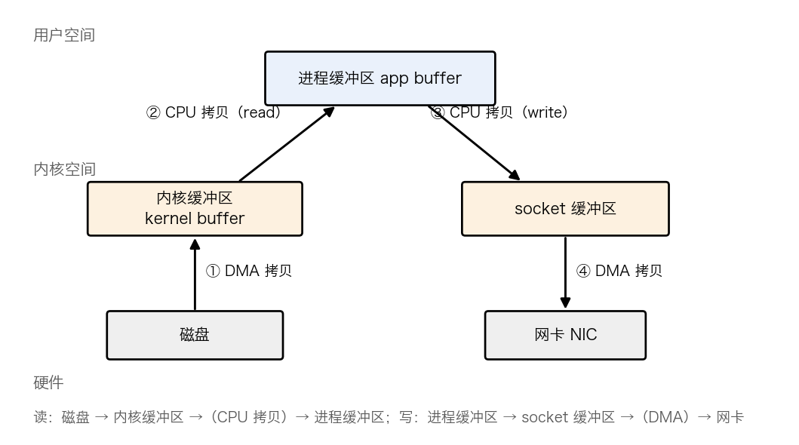
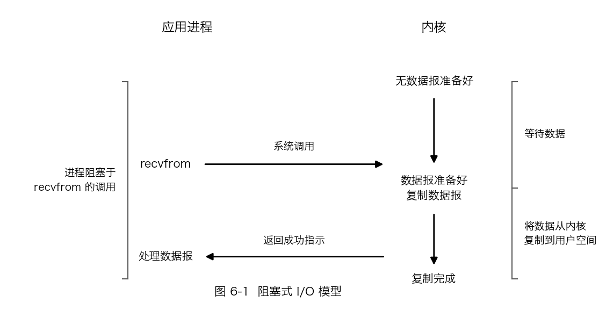
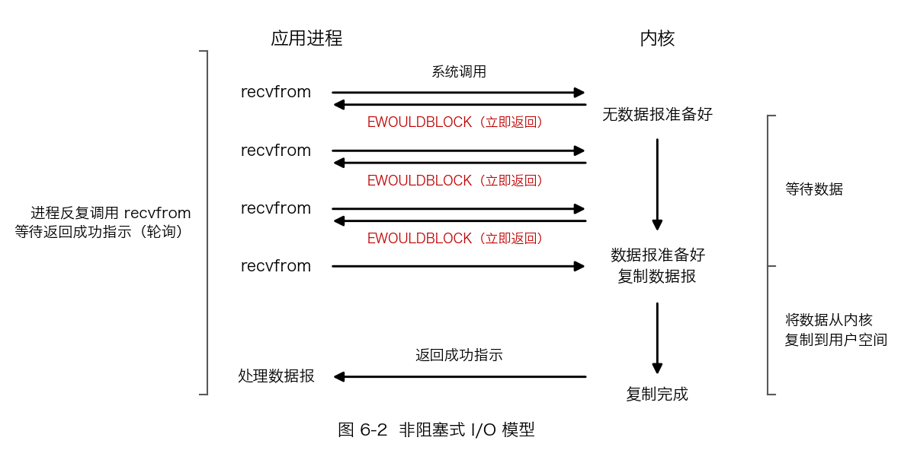
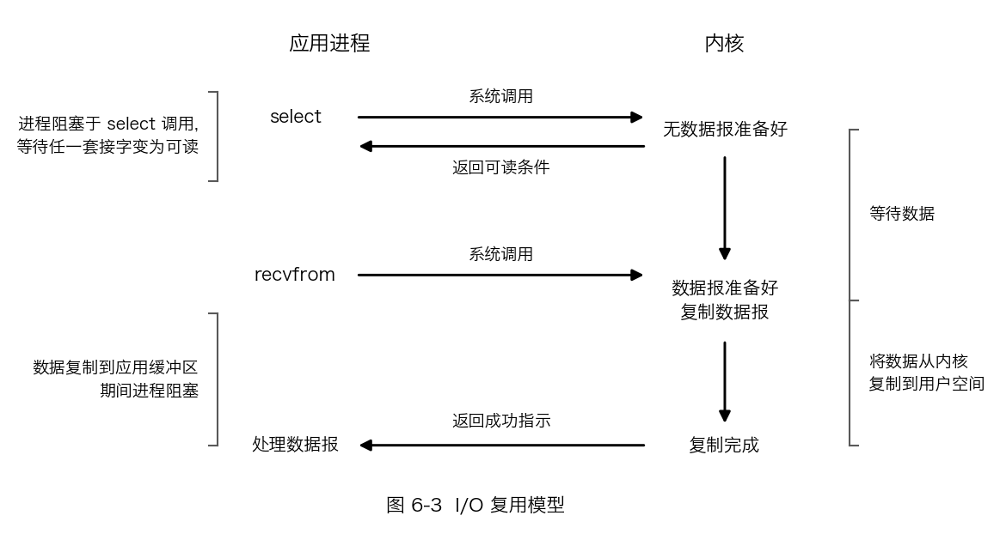
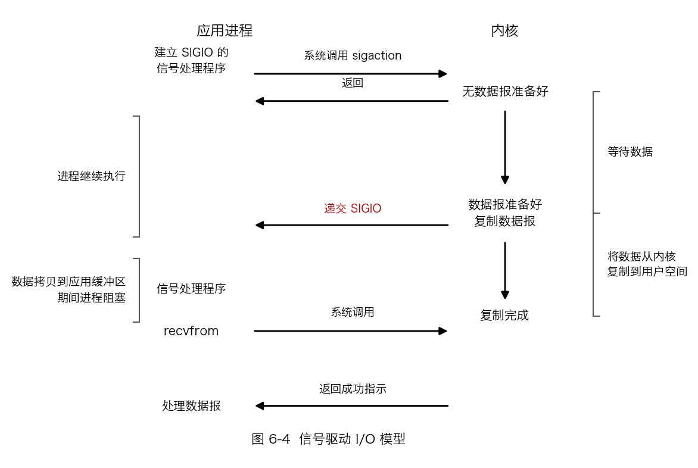
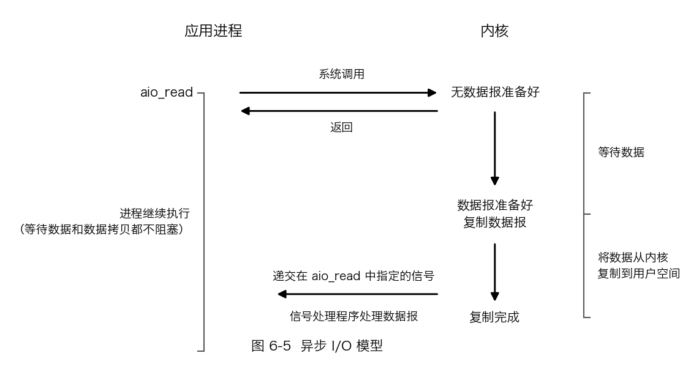

# 五大 IO 模型

当某个程序或已存在的进程/线程(后文将不加区分的只认为是进程)需要某段数据时，它只能在用户空间中属于它自己的内存中访问、修改，这段内存暂且称之为app buffer。假设需要的数据在磁盘上，那么进程首先得发起相关系统调用，通知内核去加载磁盘上的文件。但正常情况下，数据只能加载到内核的缓冲区，暂且称之为kernel buffer。数据加载到kernel buffer之后，还需将数据复制到app buffer。到了这里，进程就可以对数据进行访问、修改了。

## 一、五种 IO 模型概述

IO 模型可以分为 5 种

  * 阻塞IO（blocking IO）
  * 非阻塞IO（nonblocking IO）
  * IO多路复用（IO multiplexing）
  * 信号驱动式IO/异步阻塞（signal-driven IO）
  * 异步IO（asynchronous IO）

其中前四种（阻塞、非阻塞、多路复用、信号驱动）都属于同步IO，只有最后一种异步IO才是真正的异步,在linux里面一次io操作会涉及两个系统对象：用户进程，内核空间。其中用户进程发起io的读写操作后，数据会先被拷贝到操作系统内核的缓冲区中，然后才会从操作系统内核的缓冲区拷贝到应用程序的地址空间。所以说当一个read操作发生后，它会经历两个阶段：

第一阶段：等待数据准备 (Waiting for the data to be ready)。

第二阶段：将数据从内核拷贝到进程中 (Copying the data from the kernel to the process)。

对于socket流而言:

第一步：通常涉及等待网络上的数据分组到达，然后被复制到内核的某个缓冲区.

第二步：把数据从内核缓冲区复制到应用进程缓冲区。

## 二、阻塞 IO（blocking IO）

同步阻塞 IO 模型是最常用的一个模型，也是最简单的模型。在linux中，默认情况下所有的socket都是blocking。它符合人们最常见的思考逻辑。

在这个IO模型中，用户空间的应用程序执行一个系统调用（recvform），这会导致应用程序阻塞，什么也不干，直到数据准备好，并且将数据从内核复制到用户进程，最后进程再处理数据，在等待数据到处理数据的两个阶段，整个进程都被阻塞。不能处理别的网络IO。直到kernel返回结果，用户进程才解除block的状态，重新运行起来。

可以看出来，这两个阶段都block住了。

## 三、非阻塞 IO（nonblocking IO）
在这种模式下，用户进程发出请求后，并不会阻塞，内核会里面返回一个error状态，然后用户进程需要轮询不断的check状态，在轮询期间可以干点别的事，直到某次轮询发现数据已就绪，再由该进程发起拷贝，把数据从内核空间拷贝到用户空间。注意：非阻塞 IO 下内核并不会主动通知用户进程，“就绪”是靠自己轮询发现的。

## 四、IO 多路复用（IO multiplexing）
IO多路复用，指的是由专门的一个进程负责轮询检查IO操作的状态，而不用每个用户进程都得自己负责轮询，这样就大大节省了线程资源。那么这就是所谓的 “IO 多路复用”。UNIX/Linux 下的 select、poll、epoll 就是干这个的（epoll 比 poll、select 效率高，做的事情是一样的）。它的基本原理是：select 和 poll 每次调用都要遍历所负责的所有 socket；epoll 则依赖内核维护的就绪队列和回调，只返回已经就绪的 fd，不必每次遍历全部。当某个 socket 有数据到达时，内核把它挂进就绪队列，等待中的调用就能直接拿到。当用户进程调用了select，那么整个进程会被block，而同时，kernel会“监视”所有select负责的socket，当任何一个socket中的数据准备好了，select就会返回。这个时候用户进程再调用read操作，将数据从kernel拷贝到用户进程。 多路复用的特点是通过一种机制一个进程能同时等待IO文件描述符，内核监视这些文件描述符（套接字描述符），其中的任意一个进入读就绪状态，select， poll，epoll函数就可以返回

## 五、信号驱动 IO（signal-driven IO）
信号驱动式I/O：首先我们允许Socket进行信号驱动IO,并安装一个信号处理函数，进程继续运行并不阻塞。当数据准备好时，进程会收到一个SIGIO信号，可以在信号处理函数中调用I/O操作函数处理数据

## 六、异步 IO（asynchronous IO）
相对于同步IO，异步IO不是顺序执行。用户进程进行aio_read系统调用之后，无论内核数据是否准备好，都会直接返回给用户进程，然后用户态进程可以去做别的事情。等到socket数据准备好了，内核直接复制数据给进程，然后从内核向进程发送通知。IO两个阶段，进程都是非阻塞的。

## 七、select 与 epoll 的区别

  * select可以监听的文件描述符有限，最大值为1024，而epoll可以监听的文件描述符则是系统对整个进程限制的最大文件描述符
  * 接下来就要谈epoll和select的性能比较了，这个一般情况下应该是epoll表现好一些，否则linux也不会去特定实现epoll函数了，那么epoll为什么比select更高效呢？原因有很多，第一点，epoll通过每次有就绪事件时都将其插入到一个就绪队列中，使得epoll_wait的返回结果中只存储了已经就绪的事件，而select则返回了所有被监听的事件，事件是否就绪需要应用程序去检测，那么如果已被监听但未就绪的事件较多的话，对性能的影响就比较大了。第二点，每一次调用select获得就绪事件时都要将需要监听的事件重复传递给操作系统内核，而epoll对监听文件描述符的处理则和获得就绪事件的调用分开，这样获得就绪事件的调用epoll_wait就不需要重新传递需要监听的事件列表，这种重复的传递需要监听的事件也是性能低下的原因之一。除此之外，epoll_wait 返回时只需把就绪事件拷贝（copy_to_user）到用户传入的 epoll_event 数组，不像 select 那样每次都要重复传入整份监听集合。需要澄清的是：epoll 并没有用 mmap 做内核/用户空间共享内存，那是 io_uring 的 SQ/CQ ring 的做法。

  * 然后就是epoll提供了两种工作模式，一种是水平触发模式，这种模式和select的触发方式是一样的，要只要文件描述符的缓冲区中有数据，就永远通知用户这个描述符是可读的，这种模式对block和noblock的描述符都支持，编程的难度也比较小；而另一种更高效且只有epoll提供的模式是边缘触发模式，只支持nonblock的文件描述符，他只有在文件描述符有新的监听事件发生的时候（例如有新的数据包到达）才会通知应用程序，在没有新的监听时间发生时，即使缓冲区有数据（即上一次没有读完，或者甚至没有读），epoll也不会继续通知应用程序，使用这种模式一般要求应用程序收到文件描述符读就绪通知时，要一直读数据直到收到EWOULDBLOCK/EAGAIN错误，使用边缘触发就必须要将缓冲区中的内容读完，否则有可能引起死等,尤其是当一个listen_fd需要监听到达连接的时候，如果多个连接同时到达，如果每次只是调用accept一次，就会导致多个连接在内核缓冲区中滞留，处理的办法是用while循环抱住accept，直到其出现EAGAIN。这种模式虽然容易出错，但是性能要比前面的模式更高效，因为只需要监听是否有事件发生，发生了就直接将描述符加入就绪队列即可

## 八、epoll 的工作原理

设想一个场景：有100万用户同时与一个进程保持着TCP连接，而每一时刻只有几十个或几百个TCP连接是活跃的(接收TCP包)，也就是说在每一时刻进程只需要处理这100万连接中的一小部分连接。那么，如何才能高效的处理这种场景呢？进程是否在每次询问操作系统收集有事件发生的TCP连接时，把这100万个连接告诉操作系统，然后由操作系统找出其中有事件发生的几百个连接呢？实际上，在Linux2.4版本以前，那时的select或者poll事件驱动方式是这样做的。

这里有个非常明显的问题，即在某一时刻，进程收集有事件的连接时，其实这100万连接中的大部分都是没有事件发生的。因此如果每次收集事件时，都把100万连接的套接字传给操作系统(这首先是用户态内存到内核态内存的大量复制)，而由操作系统内核寻找这些连接上有没有未处理的事件，将会是巨大的资源浪费，然后select和poll就是这样做的，因此它们最多只能处理几千个并发连接。而epoll不这样做，它在Linux内核中申请了一个简易的文件系统，把原先的一个select或poll调用分成了3部分：

1\. 调用epoll_create建立一个epoll对象(在epoll文件系统中给这个句柄分配资源)；

2\. 调用epoll_ctl向epoll对象中添加这100万个连接的套接字；

3\. 调用epoll_wait收集发生事件的连接。

这样只需要在进程启动时建立1个epoll对象，并在需要的时候向它添加或删除连接就可以了，因此，在实际收集事件时，epoll_wait的效率就会非常高，因为调用epoll_wait时并没有向它传递这100万个连接，内核也不需要去遍历全部的连接。

当某一进程调用epoll_create方法时，Linux内核会创建一个eventpoll结构体，这个结构体中有两个成员与epoll的使用方式密切相关：

我们在调用epoll_create时，内核除了帮我们在epoll文件系统里建了个file结点，在内核cache里建了个红黑树用于存储以后epoll_ctl传来的socket外，还会再建立一个rdllist双向链表，用于存储准备就绪的事件，当epoll_wait调用时，仅仅观察这个rdllist双向链表里有没有数据即可。有数据就返回，没有数据就sleep，等到timeout时间到后即使链表没数据也返回。所以，epoll_wait非常高效。

所有添加到epoll中的事件都会与设备(如网卡)驱动程序建立回调关系，也就是说相应事件的发生时会调用这里的回调方法。这个回调方法在内核中叫做ep_poll_callback，它会把这样的事件放到上面的rdllist双向链表中

当调用epoll_wait检查是否有发生事件的连接时，只是检查eventpoll对象中的rdllist双向链表是否有epitem元素而已，如果rdllist链表不为空，则这里的事件复制到用户态内存（使用共享内存提高效率）中，同时将事件数量返回给用户。因此epoll_waitx效率非常高。epoll_ctl在向epoll对象中添加、修改、删除事件时，从rbr红黑树中查找事件也非常快，也就是说epoll是非常高效的，它可以轻易地处理百万级别的并发连接
