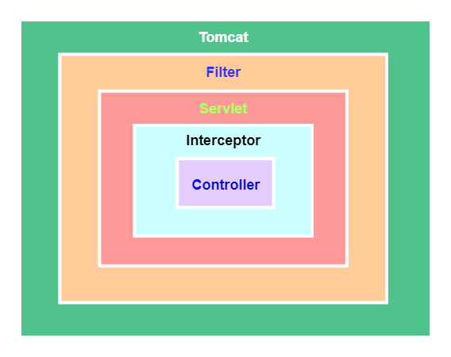

# 过滤器与拦截器

## 1. 实现原理不同

过滤器和拦截器 底层实现方式大不相同，`过滤器` 是基于函数回调的；`拦截器` 则是 Spring MVC 在 `DispatcherServlet#doDispatch` 中按顺序显式调用的（责任链 + 直接调用），并不依赖反射或动态代理——基于动态代理的是 AOP 切面

## 2. 作用范围不同

过滤器 实现的是 `javax.servlet.Filter` 接口，而这个接口是在`Servlet`规范中定义的，也就是说过滤器`Filter` 的使用要依赖于`Tomcat`等容器，导致它只能在`web`程序中使用

拦截器不依赖容器，可以在Spring、web等使用（cglib代理）

## 3. 触发机制不同

过滤器`Filter`是在请求进入容器后，但在进入`servlet`之前进行预处理，请求结束是在`servlet`处理完以后。

拦截器 `Interceptor` 是在请求进入`servlet`后，在进入`Controller`之前进行预处理的，`Controller` 中渲染了对应的视图之后请求结束

## 4. 拦截请求范围不同

Filter在Seevlet前后起作用。而拦截器能够深入到方法前后、异常抛出前后等，因此拦截器的使用具有更大的弹性。所以在Spring架构的程序中，要优先使用拦截器
