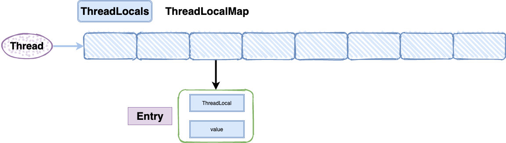
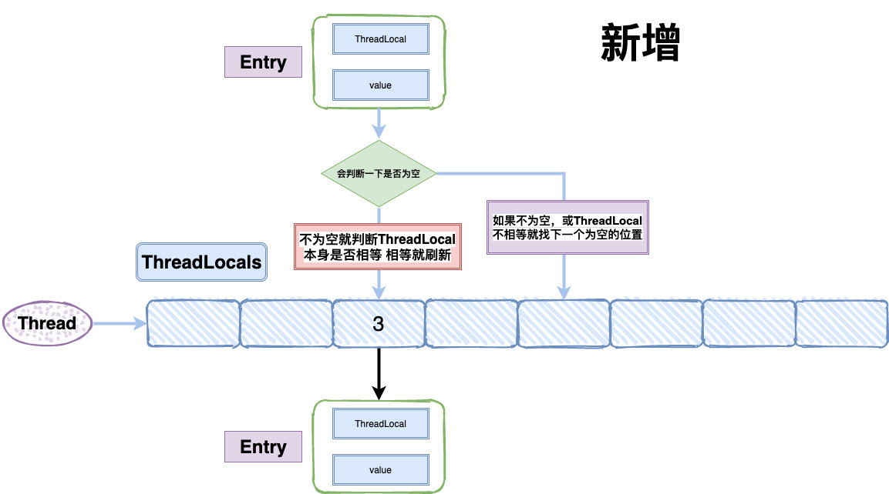
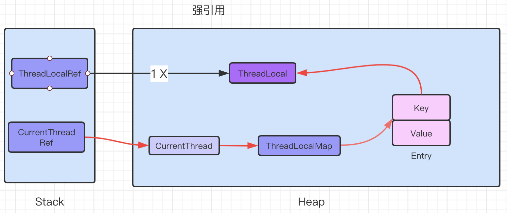
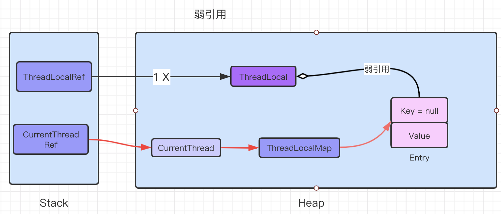

# ThreadLocal

> 来源：`ThreadLocal.md`

ThreadLocal提供了线程的局部变量，每个线程都可以通过set()和get()来对这个局部变量进行操作，但不会和其他线程的局部变量进行冲突，实现了线程的数据隔离，简要言之：往ThreadLocal中填充的变量属于当前线程，该变量对其他线程而言是隔离的。

## 实现原理

ThreadLocal的set()方法，因为我们一般使用都是new完对象，就往里边set对象

```java
public void set(T value) {
        Thread t = Thread.currentThread();
        ThreadLocalMap map = getMap(t);
        if (map != null)
            map.set(this, value);
        else
            createMap(t, value);
    }
```

ThreadLocalMap代码

```java
static class ThreadLocalMap {

        /**
         * The entries in this hash map extend WeakReference, using
         * its main ref field as the key (which is always a
         * ThreadLocal object).  Note that null keys (i.e. entry.get()
         * == null) mean that the key is no longer referenced, so the
         * entry can be expunged from table.  Such entries are referred to
         * as "stale entries" in the code that follows.
         */
        static class Entry extends WeakReference<ThreadLocal<?>> {
            /** The value associated with this ThreadLocal. */
            Object value;

            Entry(ThreadLocal<?> k, Object v) {
                super(k);
                value = v;
            }
        }

     private Entry[] table;
        //....很长
}
```

ThreadLocalMap是ThreadLocal的一个内部类。用Entry类来进行存储

内部使用table数组存储Entry，默认大小INITIAL_CAPACITY(16)，先介绍几个参数：

**size** ：table中元素的数量。
**threshold** ：table大小的2/3，当size \>= threshold时，遍历table并删除key为null的元素，
如果删除后size \>= threshold*3/4时，需要对table进行扩容。

我们的值都是存储到这个Map上的，key是当前ThreadLocal对象！



如果该Map不存在，则初始化一个：

```java
    void createMap(Thread t, T firstValue) {
        t.threadLocals = new ThreadLocalMap(this, firstValue);
    }
```

如果该Map存在，则从Thread中获取！

```java
    /**
     * Get the map associated with a ThreadLocal. Overridden in
     * InheritableThreadLocal.
     *
     * @param  t the current thread
     * @return the map
     */
    ThreadLocalMap getMap(Thread t) {
        return t.threadLocals;
    }
```

Thread维护了ThreadLocalMap变量

```java
    /* ThreadLocal values pertaining to this thread. This map is maintained
     * by the ThreadLocal class. */
    ThreadLocal.ThreadLocalMap threadLocals = null
```

从上面又可以看出，ThreadLocalMap是在ThreadLocal中使用内部类来编写的，但对象的引用是在Thread中！

于是我们可以总结出：Thread为每个线程维护了ThreadLocalMap这么一个Map，而ThreadLocalMap的key是ThreadLocal对象本身，value则是要存储的对象

get()代码如下

```java
    public T get() {
        Thread t = Thread.currentThread();
        ThreadLocalMap map = getMap(t);
        if (map != null) {
            ThreadLocalMap.Entry e = map.getEntry(this);
            if (e != null) {
                @SuppressWarnings("unchecked")
                T result = (T)e.value;
                return result;
            }
        }
        return setInitialValue();
    }
```

## ThreadLocal原理总结

  1. 每个Thread维护着一个ThreadLocalMap的引用
  2. ThreadLocalMap是ThreadLocal的内部类，用Entry来进行存储
  3. 调用ThreadLocal的set()方法时，实际上就是往ThreadLocalMap设置值，key是ThreadLocal对象，值是传递进来的对象
  4. 调用ThreadLocal的get()方法时，实际上就是往ThreadLocalMap获取值，key是ThreadLocal对象
  5. **ThreadLocal本身并不存储值** ，它只是**作为一个key来让线程从ThreadLocalMap获取value** 。

## ThreadLocalMap如何解决hash冲突

ThreadLocalMap底层使用数组，没有链表怎么解决hash冲突

用数组是因为开发过程中可以一个线程可以有多个ThreadLocal来存放不同类型的对象，但是他们都将放到当前线程的ThreadLocalMap中，所以要使用数组来存

根据set源码

```java
private void set(ThreadLocal<?> key, Object value) {

            // We don't use a fast path as with get() because it is at
            // least as common to use set() to create new entries as
            // it is to replace existing ones, in which case, a fast
            // path would fail more often than not.

            Entry[] tab = table;
            int len = tab.length;
            int i = key.threadLocalHashCode & (len-1);

            for (Entry e = tab[i];
                 e != null;
                 e = tab[i = nextIndex(i, len)]) {
                ThreadLocal<?> k = e.get();

                if (k == key) {
                    e.value = value;
                    return;
                }

                if (k == null) {
                    replaceStaleEntry(key, value, i);
                    return;
                }
            }

            tab[i] = new Entry(key, value);
            int sz = ++size;
            if (!cleanSomeSlots(i, sz) && sz >= threshold)
                rehash();
        }
```

从源码中可以看到ThreadLocalMap在存储的时候会每一个ThreadLocal对象一个ThreadLocalHashCode，在插入过程中，根据ThreadLocal对象的hash值，定位到table中的位置i，int i = key.threadLocalHashCode & (len-1);

如果位置为空，就会初始化一个Entry对象放到位置i上

```java
            tab[i] = new Entry(key, value);
```

如果位置i不为空，如果这个Entry对象的key正好是即将设置的key，那么就会刷新Entry中的value

```java
                if (k == key) {
                    e.value = value;
                    return;
                }
```

如果位置i不为空，而且key不等于entry，那就找下一个空位置，直到为空为止



这样的话，在get的时候，也会根据ThreadLocal对象的hash值，定位到table中的位置，然后判断该位置Entry对象中的key是否和get的key一致，如果不一致就会判断下一个位置，set和get如果严重冲突的话，效率还是很低的

get()方法依赖getEntry和getEntryAfterMiss两个方法查找目标Entry，源码如下

```java
 private Entry getEntry(ThreadLocal<?> key) {
            int i = key.threadLocalHashCode & (table.length - 1);
            Entry e = table[i];
            if (e != null && e.get() == key)
                return e;
            else
                return getEntryAfterMiss(key, i, e);
        }
```

```java
private Entry getEntryAfterMiss(ThreadLocal<?> key, int i, Entry e) {
            Entry[] tab = table;
            int len = tab.length;

            while (e != null) {
                ThreadLocal<?> k = e.get();
                if (k == key)
                    return e;
                if (k == null)
                    expungeStaleEntry(i);
                else
                    i = nextIndex(i, len);
                e = tab[i];
            }
            return null;
        }
```

## ThreadLocal内存泄露

内存溢出（out of memory）程序在申请内存时，没有足够的内存空间供其使用，出现out of memory

内存泄露（memory leak）程序申请内存后，无法释放已经申请的内存空间，一次内存泄露危害可以忽略，但内存泄露堆积之后容易导致内存溢出

Entry为什么设计成弱引用，ThreadLocal内存泄露和弱引用有关吗

弱引用的概念：一些有用（程度比软引用更低）但是并非必需，用弱引用关联的对象，只能生存到下一次垃圾回收之前，GC发生时，不管内存够不够，都会被回收。

首先我们假设key是强引用

  1. 如果在业务代码中使用完ThreadLocal则此时，Stack中的ThreadLocalRef就会被回收了。
  2. 但是此时ThreadLocalMap中的Entry中的Key是强引用ThreadLocal的，会造成ThreadLocal实例无法回收。
  3. 如果我们没有删除Entry并且CurrentThread依然运行的情况下，强引用链如下图红色，会导致Entry内存泄漏。



由上可以看出强引用无法避免内存泄露

如果key是弱引用

  1. 如果在业务代码中使用完来ThreadLocal则此时，Stack中的ThreadLocalRef就会被回收了。
  2. 但是此时ThreadLocalMap中的Entry中的Key是弱引用ThreadLocal的，会造成ThreadLocal实回收，此时Entry中的key = null。
  3. 但是当我们没有手动删除Entry以及CurrentThread依然运行的时候还是存在强引用链，因为ThreadLocalRef已经被回收了，那么此时的value就无法访问到了，导致value内存泄漏！



我们发现弱引用也是无法避免内存泄露

内存泄露原因

  1. ThreadLocalRef用完后Entry没有手动删除。
  2. ThreadLocalRef用完后CurrentThread依然在运行ing。

  * 第一点表明当我们在使用完毕`ThreadLocal`后，调用其对应的`remove`方法删除对应的`Entry`就可以避免内存泄漏。
  * 第二点是由于`ThreadLocalMap`是`CurrentThread`的一个属性，被当前线程引用，生命周期跟`CurrentThread`一样，如果当前线程结束`ThreadLocalMap`被回收，自然里面的Entry也被回收了，但问题是如果此时的线程不一定会被回收，如果是线程池呢，用完就放回池子里了。

结论：`ThreadLocal`内存泄漏根源是由于`ThreadLocalMap`生命周期跟`Thread`一样，如果用完`ThreadLocal`没有手动删除就会内存泄漏。

在针对上面两种可能造成内存泄漏的原因中，第一个解决方式就是ThreadLocal使用完毕之后调用remove方法来删除对应的Entry，第二种不容易处理，尤其是从线程池拿出来的还要放回线程池不会被销毁。事实上在ThreadLocalMap中set/getEntry方法中，我们会对key进行判断是否为null，如果key = null,则系统认为value没用了也会设置为null。这意味着我们使用完ThreadLocal，Thread仍然运行的前提下即使我们忘记调用remove，弱引用也会比强引用多一层保障，弱引用的ThreadLocal会被收回然后key就是null了，对应的value会在我们下一次调用ThreadLocal的set/get/remove任意一个方法的时候都会调用到底层ThreadLocalMap中的对应方法。无用的value会被清除从而避免内存泄漏。对应的具体函数为expungeStaleEntry。
