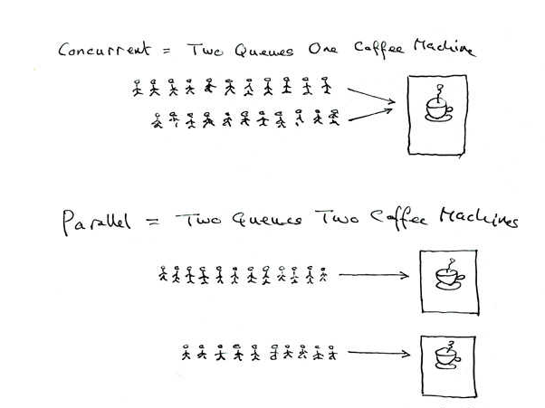
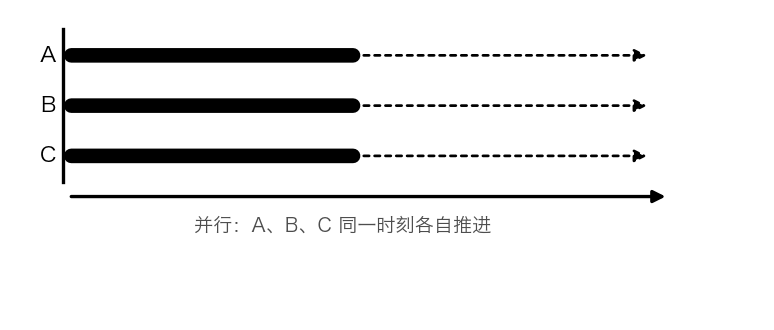
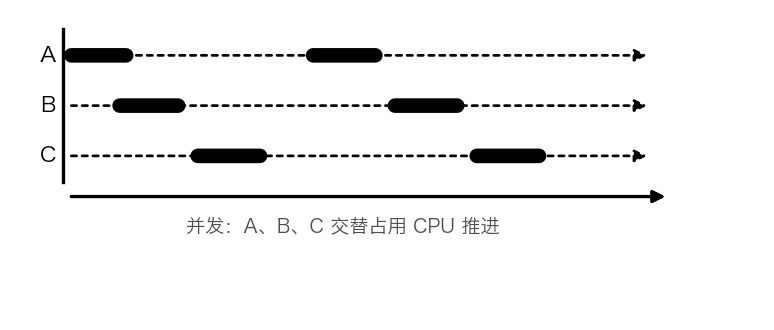
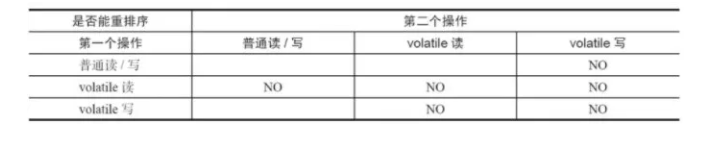
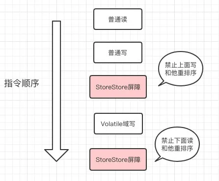
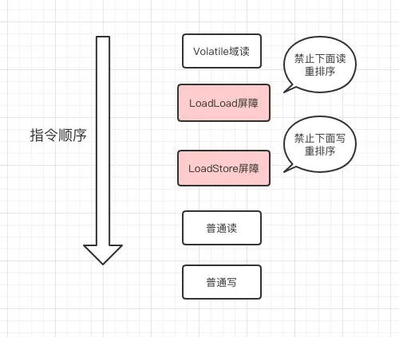

# 多线程基础

> 合并自：`多线程.md`、`无状态bean和有状态bean.md`。原文未删改（仅修正已知错误），按主题归并。

## 一、并发与并行的基础概念

> 来源：`多线程.md`

### 并行与并发



**并行(parallel)** ：指在同一时刻，有多条指令在多个处理器上同时执行。就好像两个人各拿一把铁锨在挖坑，一小时后，每人一个大坑。所以无论从微观还是从宏观来看，二者都是一起执行的。



**并发(concurrency)** ：指在同一时刻只能有一条指令执行，但多个进程指令被快速的轮换执行，使得在宏观上具有多个进程同时执行的效果，但在微观上并不是同时执行的，只是把时间分成若干段，使多个进程快速交替的执行。这就好像两个人用同一把铁锨，轮流挖坑，一小时后，两个人各挖一个小一点的坑，要想挖两个大一点得坑，一定会用两个小时。



严格意义上来说，并行的多个任务是真实的同时执行，而对于并发来说，这个过程只是交替的，一会运行任务一,一会儿又运行任务二，系统会不停地在两者间切换。但对于外部观察者来说，即使多个任务是串行并发的，也会造成是多个任务并行执行的错觉。

实际上，如果系统内只有一个CPU，而现在而使用多线程或者多线程任务，那么真实环境中这些任务不可能真实并行的，毕竟一个CPU一次只能执行一条指令，这种情况下多线程或者多线程任务就是并发的，而不是并行，操作系统会不停的切换任务。真正的并行也只能够出现在拥有多个CPU的系统中（多核CPU）。

### 死锁的必要条件

造成死锁的原因有四个，破坏其中一个即可破坏死锁

  * 互斥条件：指进程对所分配到的资源进行排它性使用，即在一段时间内某资源只由一个进程占用。如果此时还有其它进程请求资源，则请求者只能等待，直至占有资源的进程释放。
  * 请求和保持条件：指进程已经保持至少一个资源，但又提出了新的资源请求，而该资源已被其它进程占有，此时请求进程阻塞，但又对自己已获得的其它资源保持占有。
  * 不剥夺条件：指进程已获得的资源，在未使用完之前，不能被剥夺，只能在使用完时由自己释放。
  * 循环等待：指在发生死锁时，必然存在一个进程对应的环形链。

### CPU缓存与缓存一致性

CPU的执行速度是远快于内存的读写速度，为了解决速度不匹配问题CPU中设置了高速缓存，在线程运行过程中会将运算需要的数据从主存中复制一份到CPU的高速缓存中，直接利用高速缓存中的数据进行读写，当运算结束后再将高速缓存中的数据刷新到主存中，在多线程并发中如果一个变量在多个CPU中都存在缓存，那么就可能存在缓存不一致的问题。

为了解决缓存不一致问题在硬件层面上通常有两种做法

1.通过在总线上加LOCK#锁的方式（在软件层面，效果等价于synchronized关键字）

2.通过缓存一致性协议（在软件层面，效果等价于使用volatile关键字）

在早期的CPU中是通过在总线上加LOCK#锁的形式来解决缓存不一致的问题。因为CPU和其他部件进行通信都是通过总线来进行的，如果对总线上加LOCK#锁的话，也就是说阻塞了其他CPU对其他部件的访问（如内存），从而使得只能有一个CPU能使用这个变量的内存。但是由于在锁住总线期间，其他CPU无法访问内存导致效率低下。

缓存一致性协议，其中最出名的就是 Intel 的 MESI 协议。MESI 协议保证了每个缓存中使用的共享变量的副本是一致的。它核心的思想是：**当 CPU 写数据时，如果发现操作的变量是共享变量，即在其他 CPU 中也存在该变量的副本，会发出信号通知其他 CPU 将该变量的缓存行置为无效状态。因此，当其他 CPU 需要读取这个变量时，发现自己缓存中缓存该变量的缓存行是无效的，那么它就会从内存重新读取。**

### 指令重排与内存屏障

JVM的指令重排：处理器为了提高程序运行效率，可能会对输入代码进行优化，它不保证程序中各个语句的执行先后顺序同代码中顺序一致，但是在单线程情形下它会保证程序最终执行结果和代码顺序执行的结果是一致的，但是在多线程中会影响线程并发执行的正确性。所以要想并发程序正确的执行，必须要保证原子性、可见性、顺序性，只要有一个没有被保证就有可能导致程序运行不正确

指令重排分为3类（1属于编译器重排序 2，3属于处理器重排序）：

1.编译器优化的重排序。编译器在不改变单线程程序语义的前提下，可以重新安排语句的执行顺序

2.指令级并行的重排序。现代处理器采用了指令级并行技术（Instruction-LevelParallelism，ILP）来将多条指令重叠执行。如果不存在数据依赖性，处理器可以改变语句对应机器指令的执行顺序

3.内存系统的重排序。由于处理器使用缓存和读/写缓冲区，这使得加载和存储操作看上去可能是在乱序执行

内存屏障

java编译器会在生成指令系列时在适当的位置会插入内存屏障指令来禁止特定类型的处理器重排序

为了实现volatile的内存语义，JMM会限制特定类型的编译器和处理器重排序，JMM会针对编译器制定volatile重排序规则表：



需要注意的是：volatile写是在前面和后面**分别插入内存屏障** ，而volatile读操作是在**后面插入两个内存屏障**

写



读



### happens-before与内存可见性

从jdk5开始，出现happens-before的概念，通过这个概念来阐述操作之间的内存可见性。

如果一个操作执行的结果需要对另一个操作可见，那么这两个操作之间必须存在happens-before关系

volatile域规则：对一个volatile域的写操作，happens-before于任意线程后续对这个volatile域的读。

volatile除了可以保证变量的可见性，还可以禁止进行指令重排序。除了volatile外，synchronized也能保证可见性：某一个线程进入synchronized代码块前后，线程会获得锁，清空工作内存，从主内存拷贝共享变量最新的值到工作内存成为副本，执行代码，将修改后的副本的值刷新回主内存中，线程释放锁，而获取不到锁的线程会阻塞等待，所以变量的值肯定一直都是最新的。也就是说，synchronized 同时具备可见性、原子性和有序性（monitor 的进入/退出具有 full barrier 语义，能禁止指令重排）；volatile 只保证可见性和有序性，不保证复合操作的原子性——这才是二者真正的差异。这里要注意除了volatile、synchronized还有final也能实现可见性，final关键字的可见性是指：被final修饰的字段是构造器一旦初始化完成，并且构造器没有把this引用传递出去，那么在其他线程就能看见final字段的值。

### volatile与原子性

volatile不能保证原子性操作，如自增等操作均不是原子操作，因此volatile不能替代synchronized，对于使用volatile关键字有下面两个条件

1.对变量的写操作不依赖当前值

2.该变量没有包含在具体其他变量的不变式中

上面两个条件就是保证该volatile变量是原子性操作，一般我们会使用volatile变量作为状态标记量及作为双重检查使用

```java
状态标记变量
volatile boolean inited = false;

//线程1:
context = loadContext();
inited = true;

//线程2:
while(!inited ){
    sleep()
}
doSomethingwithconfig(context);
```

```java
双重检查
class Singleton{
    private volatile static Singleton instance = null;

    private Singleton() {

    }

    public static Singleton getInstance() {
        if(instance==null) {
            synchronized (Singleton.class) {
                if(instance==null)
                    instance = new Singleton();
            }
        }
        return instance;
    }
}
```

JMM不保证对64位的long型和double型变量的写操作具有原子性解释：对于32位操作系统来说每次操作的最长长度是32bit，而long类型和double类型都是8字节64位，JVM在这种处理器上运行时会把一个64位long/double型的写操作拆分为两个32位的写操作来执行。这两个32位的写操作可能会被分配到不同的总线事务中执行，此时对这个64位变量的写操作将不再具有原子性。但是对于64位环境来说，单次操作可以操作64位数据，即可以以一次性读写long或double的整个64bit，因此在64位JVM中long和double操作都是原子性的

## 二、有状态 Bean 与无状态 Bean

> 来源：`无状态bean和有状态bean.md`

有状态就是有数据存储功能。有状态对象(Stateful Bean)，就是有实例变量的对象，可以保存数据，是非线程安全的。

无状态就是一次操作，在不同方法调用间不保留任何状态，不能保存数据。无状态对象(Stateless Bean)，就是没有实例变量的对象，不能保存数据，是不变类，是线程安全的。

对于无状态的bean一个例子就是servlet

```java
public class StatelessFactorizer implements Servlet {

    public void service(ServletRequest req, ServletResponse resp) {
        BigInteger i = extractFromRequest(req);
        BigInteger[] factors = factor(i);
        encodeIntoResponse(resp, factors);
    }

}
```

它没有字段和引用，没有其他类的字段等等。它们是无状态(stateless)的。

### 有状态bean例子

```java
 public   class  StatefulBean {

     public   int  state;

     public   int  getState() {
         return  state;
    }

     public   void  setState( int  state) {
         this .state = state;
    }

     public  User getUser() {
         return  user;
    }

     public   void  setUser(User user) {
         this .user = user;
   }
}
```

单例类可以是有状态的（stateful），也可以是无状态的。无状态的单例模式，是线程安全的。有状态的单例模式，是非线程安全的。

### Spring中的有状态(Stateful)和无状态(Stateless)

1.通过上面的分析，相信大家已经对有状态和无状态有了一定的理解。无状态的Bean适合用不变模式，技术就是单例模式，这样可以共享实例，提高性能。有状态的Bean，多线程环境下不安全，那么适合用Prototype原型模式。Prototype: 每次对bean的请求都会创建一个新的bean实例。

2.默认情况下，从Spring bean工厂所取得的实例为singleton（scope属性为singleton）,容器只存在一个共享的bean实例。

3.理解了两者的关系，那么scope选择的原则就很容易了：有状态的bean都使用prototype作用域，而对无状态的bean则应该使用singleton作用域。

4.如Service层、Dao层用默认singleton就行，虽然Service类也有dao这样的属性，但dao这些类都是没有状态信息的，也就是 相当于不变(immutable)类，所以不影响
