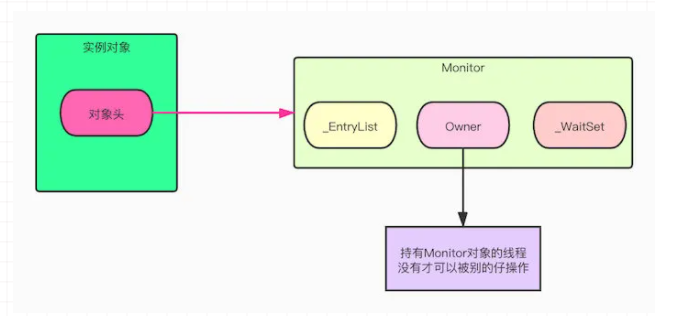
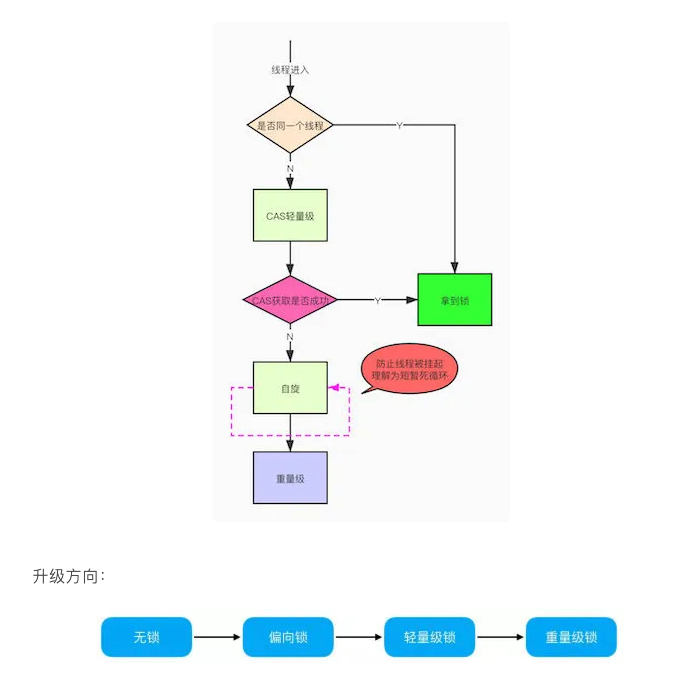
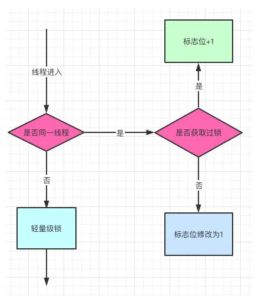
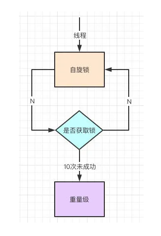
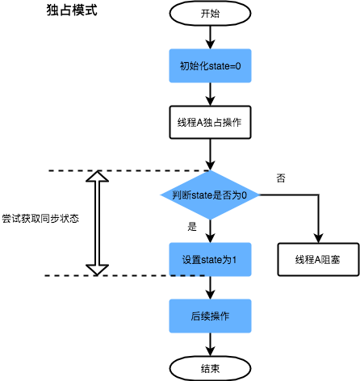
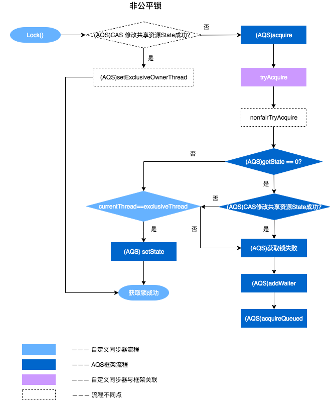
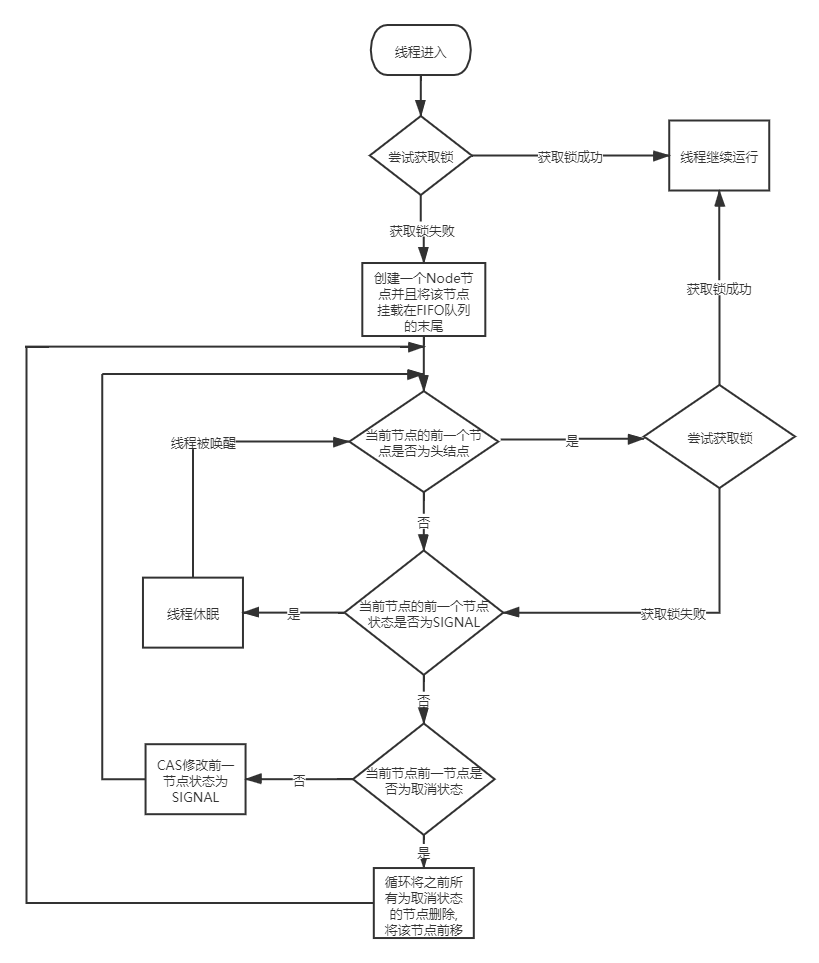
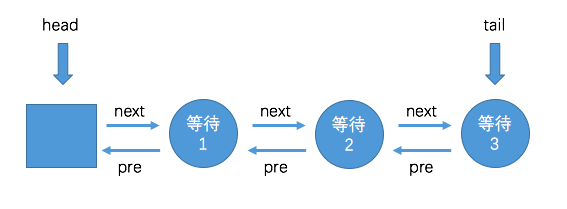

# 线程安全与锁

> 合并自：`Synchronized.md`、`CAS存在的问题.md`、`AQS.md`、`同步器.md`。原文未删改（仅修正已知错误），按主题归并。

## 一、synchronized 原理与锁升级

> 来源：`Synchronized.md`

### Synchronized

synchronized对对象进行加锁，在JVM中，对象在内存中分为三块区域：对象头（Header）、实例数据（Instance Data）、对齐填充（Padding）


对象头：以HotSpot为例，HotSpot的对象头主要包括两部分数据：标记字段（Mark Word）、类型指针（Klass Pointer）



当 Monitor 被某个线程持有后，就会处于锁定状态，如图中的 Owner 部分，会指向持有 Monitor 对象的线程。

另外 Monitor 中还有两个队列分别是EntryList和WaitList，主要是用来存放进入及等待获取锁的线程。

如果线程进入，则得到当前对象锁，那么其他线程在该对象实例上的任何同步操作都不能进行，但并不影响其他线程访问同一个类的其他对象实例。

Mark Word：默认存储对象的哈希码、GC 分代年龄、锁状态标志、线程持有的锁、偏向线程 ID、偏向时间戳。它会根据对象的状态复用自己的存储空间，也就是说运行期间Mark Word里存储的数据会随着锁标志位的变化而变化

Klass Point：对象指向它的类元数据的指针，虚拟机通过这个指针来确定这个对象是哪个类的实例

### synchronized关键字最主要的三种使用方式

  * 修饰实例方法: 作用于当前对象实例加锁，进入同步代码前要获得当前对象实例的锁
  * 修饰静态方法: 也就是给当前类加锁，会作用于类的所有对象实例，因为静态成员不属于任何一个实例对象，是类成员（ static 表明这是该类的一个静态资源，不管new了多少个对象，只有一份）。所以如果一个线程A调用一个实例对象的非静态 synchronized 方法，而线程B需要调用这个实例对象所属类的静态 synchronized 方法，是允许的，不会发生互斥现象，因为访问静态 synchronized 方法占用的锁是当前类的锁，而访问非静态 synchronized 方法占用的锁是当前实例对象锁。
  * 修饰代码块: 指定加锁对象，对给定对象加锁，进入同步代码库前要获得给定对象的锁。

### synchronized原理

  * 方法
synchronized 应用在方法上时，在字节码中是通过方法的 ACC_SYNCHRONIZED 标志来实现的。反正其他线程进这个方法就看看是否有这个标志位，有就代表有别的仔拥有了他，你就别碰了。
  * 同步代码块
synchronized 同步语句块的实现使用的是 monitorenter 和 monitorexit 指令，其中 monitorenter 指令指向同步代码块的开始位置，monitorexit 指令则指明同步代码块的结束位置。 当执行 monitorenter 指令时，线程试图获取锁也就是获取 monitor(monitor对象存在于每个Java对象的对象头中，synchronized 锁便是通过这种方式获取锁的，也是为什么Java中任意对象可以作为锁的原因) 的持有权。当计数器为0则可以成功获取，获取后将锁计数器设为1也就是加1。相应的在执行 monitorexit 指令后，将锁计数器设为0，表明锁被释放。如果获取对象锁失败，那当前线程就要阻塞等待，直到锁被另外一个线程释放为止。
1.每个monitor维护着一个记录着拥有次数的计数器。未被拥有的monitor的该计数器为0，当一个线程获得monitor（执行monitorenter）后，该计数器自增变为 1 （当同一个线程再次获得该monitor的时候，计数器再次自增，当不同线程想要获得该monitor的时候，就会被阻塞）
2.当同一个线程释放 monitor（执行monitorexit指令）的时候，计数器再自减。当计数器为0的时候，monitor将被释放，其他线程便可以获得monitor。

### JDK6对Synchronized优化

在jdk6中优化了synchronized的获取锁的方式，并为了减少获得锁和释放锁带来的性能消耗引入了偏向锁和轻量锁。针对synchronized 获取锁的方式，JVM 使用了锁升级的优化方式，就是先使用偏向锁优先同一线程然后再次获取锁，如果失败，就升级为 CAS 轻量级锁，如果失败就会短暂自旋，防止线程被系统挂起。最后如果以上都失败就升级为重量级锁



锁升级是不可逆的过程，锁只能升级不能降级

在现在版本中，锁的状态总共有四种：

  1. 无锁
  2. 偏向锁
  3. 轻量锁（自旋锁）
  4. 重量锁

无锁比较容易理解就是没有加锁的状态

偏向锁：由于对象头是由Mark Word和Klass pointer 组成，锁争夺也就是对象头指向的Monitor对象的争夺，一旦某个线程第一次获取这个对象锁，就把 Mark Word 的锁标志位置为 01（偏向模式），并把该线程的 ID 记到 Mark Word 里，这一步是用 CAS 完成的。此后同一线程再次进入，虚拟机不再做任何同步操作，只是比较 Mark Word 里记录的偏向线程 ID 是不是自己——是就直接进入，既不加锁也不 CAS。只有出现竞争时，才会走撤销偏向锁的流程（需要 STW），再升级为轻量级锁。



轻量级锁：当偏向锁发生线程竞争之后马上会升级为轻量锁，轻量锁也叫自旋锁，利用CAS原理，进行自旋，老版本中当自旋超过10次之后就会升级为重量级锁。目前版本是一个自适应自旋，由JVM决定自旋次数转换成重量级锁



#### 为什么要升级为重量级锁，重量级锁为什么“重”？

轻量级锁没有获得锁的线程全部处于自旋状态，这个状态的线程会消耗CPU资源，转换成重量级锁之后操作系统会将等待的线程挂起，这样就会减少CPU资源的消耗。所以一般轻量级锁比较适用于自旋次数少或者竞争线程少的情况了。对于重量级锁会发生内核态和用户态之间的状态切换，大量消耗资源，所以重量级锁效率比较低。

### synchronized和ReentrantLock区别

  1. 两者都是可重入锁
两者都是可重入锁。“可重入锁”概念是：自己可以再次获取自己的内部锁。比如一个线程获得了某个对象的锁，此时这个对象锁还没有释放，当其再次想要获取这个对象的锁的时候还是可以获取的，如果不可锁重入的话，就会造成死锁。同一个线程每次获取锁，锁的计数器都自增1，所以要等到锁的计数器下降为0时才能释放锁。

  2. synchronized依赖于JVM而ReentrantLock依赖于API
  3. ReentrantLock比synchronized增加了一些高级功能
ReentrantLock提供了一种能够中断等待锁的线程的机制，通过lock.lockInterruptibly()来实现这个机制。也就是说正在等待的线程可以选择放弃等待，改为处理其他事情。
ReentrantLock可以指定是公平锁还是非公平锁。而synchronized只能是非公平锁。所谓的公平锁就是先等待的线程先获得锁。 ReentrantLock默认情况是非公平的，可以通过 ReentrantLock类的ReentrantLock(boolean fair)构造方法来制定是否是公平的。
synchronized关键字与wait()和notify()/notifyAll()方法相结合可以实现等待/通知机制，ReentrantLock类当然也可以实现，但是需要借助于Condition接口与newCondition() 方法。

## 二、CAS 及其问题

> 来源：`CAS存在的问题.md`

CAS存在的问题

1.ABA问题

2.自旋消耗CPU资源

ABA问题是说当一个线程去修改值时，要修改的值和原先相同，但是可能另一个线程已经将这个值进行了修改，但是后面又将值改了回来，好像是线程安全没有其他线程操作过，但其实已经被其他线程修改了

对于ABA问题解决方法可以是加上一个标志位：每次除了判断值是否发生变化之外还要判断标志位是否发生了变化。标志位可以是int值，每次操作自增或者使用时间戳

## 三、AQS 原理

> 来源：`AQS.md`

AQS核心思想是，如果被请求的共享资源空闲，那么就将当前请求资源的线程设置为有效的工作线程，将共享资源设置为锁定状态；如果共享资源被占用，就需要一定的阻塞等待唤醒机制来保证锁分配。这个机制主要用的是CLH队列（双向队列）的变体实现的，将暂时获取不到锁的线程加入到队列中。

AQS使用一个Volatile的int类型的成员变量来表示同步状态，通过内置的FIFO队列来完成资源获取的排队工作，通过CAS完成对State值的修改。

先来看下AQS中最基本的数据结构——Node，Node即为上面CLH变体队列中的节点。

### 解释一下几个方法和属性值的含义：

方法和属性值| 含义
---|---
waitStatus| 当前节点在队列中的状态
thread| 表示处于该节点的线程
prev| 前驱指针
predecessor| 返回前驱节点，没有的话抛出npe
nextWaiter| 指向下一个处于CONDITION状态的节点（由于本篇文章不讲述Condition Queue队列，这个指针不多介绍）
next| 后继指针

### 线程两种锁的模式：

模式| 含义
---|---
SHARED| 表示线程以共享的模式等待锁
EXCLUSIVE| 表示线程正在以独占的方式等待锁

### waitStatus有下面几个枚举值：

枚举| 含义
---|---
0| 当一个Node被初始化的时候的默认值
CANCELLED| 为1，表示线程获取锁的请求已经取消了
CONDITION| 为-2，表示节点在等待队列中，节点线程等待唤醒
PROPAGATE| 为-3，当前线程处在SHARED情况下，该字段才会使用
SIGNAL| 为-1，表示线程已经准备好了，就等资源释放了

AQS中维护了一个名为state的字段，意为同步状态，是由Volatile修饰的，用于展示当前临界资源的获锁情况。



下面是非公平锁中线程的流程





### 加锁：

  * 通过ReentrantLock的加锁方法Lock进行加锁操作。
  * 会调用到内部类Sync的Lock方法，由于Sync#lock是抽象方法，根据ReentrantLock初始化选择的公平锁和非公平锁，执行相关内部类的Lock方法，本质上都会执行AQS的Acquire方法。
  * AQS的Acquire方法会执行tryAcquire方法，但是由于tryAcquire需要自定义同步器实现，因此执行了ReentrantLock中的tryAcquire方法，由于ReentrantLock是通过公平锁和非公平锁内部类实现的tryAcquire方法，因此会根据锁类型不同，执行不同的tryAcquire。
  * tryAcquire是获取锁逻辑，获取失败后，会执行框架AQS的后续逻辑，跟ReentrantLock自定义同步器无关。

### 解锁：

  * 通过ReentrantLock的解锁方法Unlock进行解锁。
  * Unlock会调用内部类Sync的Release方法，该方法继承于AQS。
  * Release中会调用tryRelease方法，tryRelease需要自定义同步器实现，tryRelease只在ReentrantLock中的Sync实现，因此可以看出，释放锁的过程，并不区分是否为公平锁。
  * 释放成功后，所有处理由AQS框架完成，与自定义同步器无关。

### 加锁流程详解

1.多线程抢占资源

```java
static final class NonfairSync extends Sync {

    final void lock() {
        if (compareAndSetState(0, 1))
            setExclusiveOwnerThread(Thread.currentThread());
        else
            acquire(1);
    }

    protected final boolean tryAcquire(int acquires) {
        return nonfairTryAcquire(acquires);
    }
}

protected final boolean compareAndSetState(int expect, int update) {
    return unsafe.compareAndSwapInt(this, stateOffset, expect, update);
}

protected final void setExclusiveOwnerThread(Thread thread) {
    exclusiveOwnerThread = thread;
}
```

由上面代码（使用了ReentrantLock的非公平锁）可以看出

首先线程进来使用CAS尝试抢占锁，如果抢占成功state值会被改为1，并且设置对象独占锁线程设置为当前线程

假设已经有一个线程抢占成功之后另一个线程开始抢占资源，此时通过CAS修改state失败，进入acquire()

```java
public final void acquire(int arg) {
    if (!tryAcquire(arg) &&
        acquireQueued(addWaiter(Node.EXCLUSIVE), arg))
        selfInterrupt();
}
```

通过代码可以看出acquire()方法中会首先调用tryAcquire()，如果该方法返回false则会执行acquireQueued(addWaiter(Node.EXCLUSIVE), arg)，先看下acquire()源码

```java
final boolean nonfairTryAcquire(int acquires) {
    final Thread current = Thread.currentThread();
    int c = getState();
    if (c == 0) {
        if (compareAndSetState(0, acquires)) {
            setExclusiveOwnerThread(current);
            return true;
        }
    }
    else if (current == getExclusiveOwnerThread()) {
        int nextc = c + acquires;
        if (nextc < 0)
            throw new Error("Maximum lock count exceeded");
        setState(nextc);
        return true;
    }
    return false;
}
```

这个代码首先会再次判断state是否为0，如果是0再次尝试获取锁（判断此时资源是否已经空闲，如果空闲尝试再次获取资源）。如果锁被其他线程占有，接着判断占有锁的线程是否为当前线程，如果是当前线程，则累加state（可重入锁）

下面开始分析addWaiter(Node.EXCLUSIVE)

```java
private Node addWaiter(Node mode) {
    Node node = new Node(Thread.currentThread(), mode);
    Node pred = tail;
    if (pred != null) {
        node.prev = pred;
        if (compareAndSetTail(pred, node)) {
            pred.next = node;
            return node;
        }
    }
    enq(node);
    return node;
}
```

这段代码首先会创建一个和当前线程绑定的node节点，等待队列为双向链表。如果此时等待队列中tail指针为空，直接调用enq(node)将当前线程加入等待队列尾部，否则插入队列尾部

```java
private Node enq(final Node node) {
    for (;;) {
        Node t = tail;
        if (t == null) {
            if (compareAndSetHead(new Node()))
                tail = head;
        } else {
            node.prev = t;
            if (compareAndSetTail(t, node)) {
                t.next = node;
                return t;
            }
        }
    }
}
```

根据上面代码如果发现尾节点为null，会创建一个新的节点作为尾节点，之后再次循环将之前的抢占锁失败的线程绑定的节点插入到队列尾部，由此我们看到其实这个队列的结构如下



队列中的第一个节点其实并不是等待的线程，它是一个空节点，我们的第一个等待的线程会在队列的第二个位置

addWaiter()方法执行结束之后会返回当前线程创建的节点信息，之后执行acquireQueued

```java
final boolean acquireQueued(final Node node, int arg) {
    boolean failed = true;
    try {
        boolean interrupted = false;
        for (;;) {
            final Node p = node.predecessor();
            if (p == head && tryAcquire(arg)) {
                setHead(node);
                p.next = null; // help GC
                failed = false;
                return interrupted;
            }
            if (shouldParkAfterFailedAcquire(p, node) &&
                parkAndCheckInterrupt())
                interrupted = true;
        }
    } finally {
        if (failed)
            cancelAcquire(node);
    }
}

private static boolean shouldParkAfterFailedAcquire(Node pred, Node node) {
    int ws = pred.waitStatus;
    if (ws == Node.SIGNAL)
        return true;
    if (ws > 0) {
        do {
            node.prev = pred = pred.prev;
        } while (pred.waitStatus > 0);
        pred.next = node;
    } else {
        compareAndSetWaitStatus(pred, ws, Node.SIGNAL);
    }
    return false;
}

private final boolean parkAndCheckInterrupt() {
    LockSupport.park(this);
    return Thread.interrupted();
}
```

acquireQueued()会先判断当前传入的node的前置节点是否为head，如果是则尝试加锁。加锁成功则会将当前节点设置为head节点，然后对前置节点信息置空便于垃圾收集器进行回收。如果加锁失败或者前置节点不是head节点会通过shouldParkAfterFailedAcquire方法将前置节点的waitStatus变为SIGNAL=-1（就绪状态），最后通过parkAndCheckInterrupt方法，调用LockSupport.park()挂起当前线程。

### 释放锁的过程

```java
public final boolean release(int arg) {
    if (tryRelease(arg)) {
        Node h = head;
        if (h != null && h.waitStatus != 0)
            unparkSuccessor(h);
        return true;
    }
    return false;
}

protected final boolean tryRelease(int releases) {
    int c = getState() - releases;
    if (Thread.currentThread() != getExclusiveOwnerThread())
        throw new IllegalMonitorStateException();
    boolean free = false;
    if (c == 0) {
        free = true;
        setExclusiveOwnerThread(null);
    }
    setState(c);
    return free;
}
```

首先是调用tryRelease()，可以看到如果该方法中state被设置为0（如果是可重入锁state一次不会被减为0）则说明线程已经完全释放，此时会将独占锁设置为null，返回true，否则返回false。如果释放锁成功就会判断等待队列中的元素来开始调用unparkSuccessor()唤醒等待的节点

```java
private void unparkSuccessor(Node node) {
    int ws = node.waitStatus;
    if (ws < 0)
        compareAndSetWaitStatus(node, ws, 0);
    Node s = node.next;
    if (s == null || s.waitStatus > 0) {
        s = null;
        for (Node t = tail; t != null && t != node; t = t.prev)
            if (t.waitStatus <= 0)
                s = t;
    }
    if (s != null)
        LockSupport.unpark(s.thread);
}
```

unparkSuccessor()先将waitStatus设置为0，之后找到后续队列中第一个仍处于等待状态的节点并唤醒该线程

唤醒的线程会从上次被park的地方继续执行，继续执行acquireQueued()方法。继续for循环中的代码

### 公平锁与非公平锁

上面是基于非公平锁来实现，ReentrantLock的默认实现就是非公平锁，下面分析一下公平锁的实现

假设线程A释放锁的时候唤醒被挂起的线程B，此时B开始执行tryAcquire()方法使用CAS来修改state，同时可能会有线程C同时过来执行tryAcquire()方法使用CAS来修改state，如果线程C获取锁成功，那么线程B则需要重新回到等待队列中被挂起，这就是非公平锁，但是如果是公平锁则会在加锁的时候先判断AQS队列中是否存在等待节点，如果存在等待节点那么直接进入等待队列中，那么原先等待队列中唤醒的线程就可以没有竞争的获取锁

```java
     final Thread current = Thread.currentThread();
        int c = getState();
        if (c == 0) {
            if (!hasQueuedPredecessors() &&
                compareAndSetState(0, acquires)) {
                setExclusiveOwnerThread(current);
                return true;
            }
        }
        else if (current == getExclusiveOwnerThread()) {
            int nextc = c + acquires;
            if (nextc < 0)
                throw new Error("Maximum lock count exceeded");
            setState(nextc);
            return true;
        }
        return false;
    }
```

根据代码不难看出公平锁和非公平锁最大的区别就是hasQueuedPredecessors()

```java
public final boolean hasQueuedPredecessors() {
    Node t = tail;
    Node h = head;
    Node s;
    return h != t &&
        ((s = h.next) == null || s.thread != Thread.currentThread());
}
```

该方法就是判断队列中是否存在等待节点

看到这里，我们理解一下h != t && ((s = h.next) == null || s.thread != Thread.currentThread());为什么要判断的头结点的下一个节点？第一个节点储存的数据是什么？

双向链表中，第一个节点为虚节点，其实并不存储任何信息，只是占位。他表示当前有线程占用了state，至于占用state的是哪个线程记录在exclusiveOwnerThread 属性里。真正的第一个有数据的节点，是在第二个节点开始的。当h != t时： 如果(s = h.next) == null，等待队列正在有线程进行初始化，但只是进行到了Tail指向Head，没有将Head指向Tail，此时队列中有元素，需要返回True（这块具体见下边代码分析）。 如果(s = h.next) != null，说明此时队列中至少有一个有效节点。如果此时s.thread == Thread.currentThread()，说明等待队列的第一个有效节点中的线程与当前线程相同，那么当前线程是可以获取资源的；如果s.thread != Thread.currentThread()，说明等待队列的第一个有效节点线程与当前线程不同，当前线程必须加入进等待队列。

非公平锁和公平锁的区别：非公平锁性能高于公平锁性能。非公平锁可以减少CPU唤醒线程的开销，整体的吞吐效率会高点，CPU也不必取唤醒所有线程，会减少唤起线程的数量。非公平锁性能虽然优于公平锁，但是会存在导致线程饥饿的情况。在最坏的情况下，可能存在某个线程一直获取不到锁。不过相比性能而言，饥饿问题可以暂时忽略，这可能就是ReentrantLock默认创建非公平锁的原因之一了。

## 四、常见同步器（CountDownLatch / CyclicBarrier）

> 来源：`同步器.md`

### CountDownLatch

CountDownLatch：它是一个同步辅助器，允许一个或多个线程一直等待，直到一组在其他线程执行的操作全部完成。

```java
public CountDownLatch(int count) {
    if (count < 0) throw new IllegalArgumentException("count < 0");
    this.sync = new Sync(count);
}
```

它的构造方法，会传入一个 count 值，用于计数。

常用的方法有两个：

```java
public void await() throws InterruptedException {
    sync.acquireSharedInterruptibly(1);
}

public void countDown() {
    sync.releaseShared(1);
}
```

当一个线程调用await方法时，就会阻塞当前线程。每当有线程调用一次 countDown 方法时，计数就会减 1。当 count 的值等于 0 的时候，被阻塞的线程才会继续运行。

### CyclicBarrier

CyclicBarrier：一组线程会互相等待，直到所有线程都到达一个同步点。这个就非常有意思了，就像一群人被困到了一个栅栏前面，只有等最后一个人到达之后，他们才可以合力把栅栏（屏障）突破。

CyclicBarrier 提供了两种构造方法:

```java
public CyclicBarrier(int parties) {
    this(parties, null);
}
public CyclicBarrier(int parties, Runnable barrierAction) {
    if (parties <= 0) throw new IllegalArgumentException();
    this.parties = parties;
    this.count = parties;
    this.barrierCommand = barrierAction;
}
```

第一个构造的参数，指的是需要几个线程一起到达，才可以使所有线程取消等待。第二个构造，额外指定了一个参数，用于在所有线程达到屏障时，优先执行 barrierAction。

### CountDownLatch与CyclicBarrier的区别

相比CountDownLatch,CyclicBarrier的本质区别是调用await()的主体不一样,CountDownLatch.await()通常是在主线程(或者叫调用线程)调用的,而CyclicBarrier.await()是在任务线程调用的，这样就导致了CyclicBarrier通常是阻塞的等待其他线程(最终调用CyclicBarrier.await()的线程),并由于是在任务线程中await().是不影响主线程的执行的; 而CountDownLatch则是主线程阻塞等待其他线程调用countDown(),由于await()是在主线程中调用的,在任务完成之前会一直阻塞主线程.当任务线程调用await()到达屏障时,CyclicBarrier的计数器会自动减一,计数减到0时屏障放行并自动重置,而CountDownLatch则需要其他线程显式地调用countDown()

  1. CountDownLatch 是一个线程等待其他线程， CyclicBarrier 是多个线程互相等待。
  2. 两者的计数都是"减"：CountDownLatch 的计数由其他线程调用 countDown() 从构造值减到 0；CyclicBarrier 内部同样是 `--count`，只是减到 0 后会自动重置（可循环使用），由到达屏障的线程自己触发。
  3. CountDownLatch 是一次性的， CyclicBarrier 可以循环利用。
  4. CyclicBarrier 可以在最后一个线程达到屏障之前，选择先执行一个操作。
