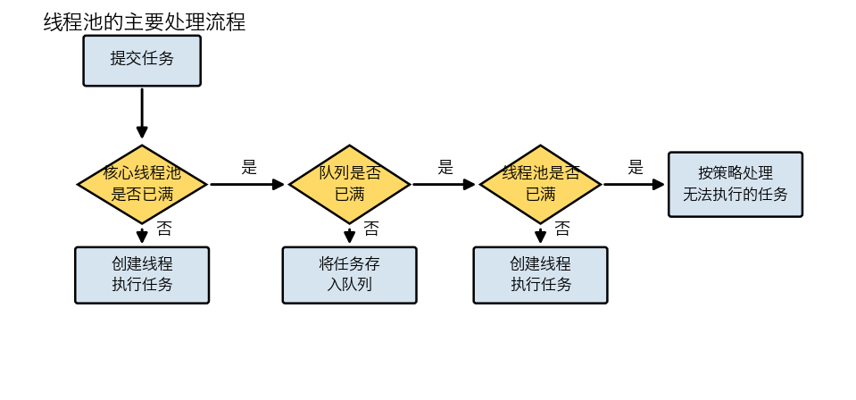
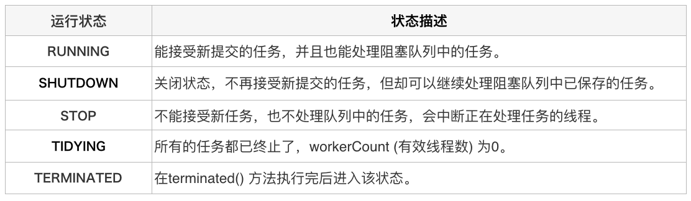
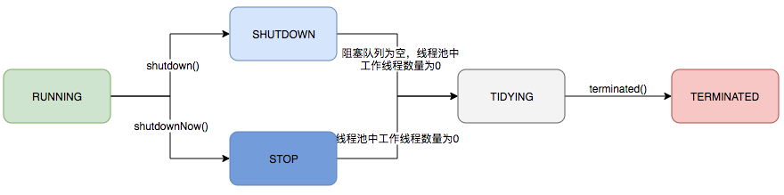

# 线程池

> 合并自：`线程池.md`、`为什么不推荐通过Executors直接创建线程池.md`。原文未删改（仅修正已知错误），按主题归并。

## 一、线程池的核心参数与执行流程

> 来源：`线程池.md`

线程池（Thread Pool）是一种基于池化思想管理线程的工具，经常出现在多线程服务器中，如MySQL。线程过多会带来额外的开销，其中包括创建销毁线程的开销、调度线程的开销等等，同时也降低了计算机的整体性能。线程池维护多个线程，等待监督管理者分配可并发执行的任务。这种做法，一方面避免了处理任务时创建销毁线程开销的代价，另一方面避免了线程数量膨胀导致的过分调度问题，保证了对内核的充分利用。

### ThreadPoolExecutor的运行机制与生命周期



ThreadPoolExecutor运行机制如图

ThreadPoolExecutor的运行状态有5种



生命周期转换如下所示



### 线程池的具体实现

一般线程池的具体实现有4种

fixedThreadPool

cachedThreadPool

scheduledThreadPool

singleThreadPool

这四种线程池都是由Executors类生成的。依次点开四个方法的内部实现发现，它们最终调用的都是同一个ThreadPoolExecutor()的构造器，而区别在于构造器的参数不同。我们来看下ThreadPoolExecutor的参数列表：

```java
public ThreadPoolExecutor(int corePoolSize,
                              int maximumPoolSize,
                              long keepAliveTime,
                              TimeUnit unit,
                              BlockingQueue<Runnable> workQueue,
                              ThreadFactory threadFactory,
                              RejectedExecutionHandler handler)
```

下面看下这几个参数的定义

  * corePoolSize：核心线程数量，常驻在线程池中的线程，即使它们是空闲的，也不会销毁，除非设置allowCoreThreadTimeOut的值。
  * maximumPoolSize：线程池最大线程数量
  * keepAliveTime：超过核心数量的额外线程也就是非核心线程，在空闲指定的最大时间后被销毁。（假设时间为5s,核心线程数为2，当前线程为4，则超过核心线程数的其余两个线程在空闲5秒后会被销毁。）
  * unit：时间单位
  * workQueue：等待队列
  * threadFactory：生成线程的工厂
  * handler：当等待队列容量满以及线程池数量达到最大时，如何处理新的任务。
    * AbortPolicy（默认）：直接抛出异常
    * CallerRunsPolicy：交给调用者所在线程执行。（假设当前调用者线程是Main，那么就交给Main处理）
    * DiscardOldestPolicy：丢弃最久未处理的任务，再执行当前任务。（最久未处理的，在队列中其实就是队列头节点，查看源码的确调用是poll()方法）
    * DiscardPolicy：丢掉该任务，并且不抛异常

线程池中使用的队列是 `BlockingQueue` 接口，常用的实现有如下几种：

  * ArrayBlockingQueue：基于数组、有界，按 FIFO（先进先出）原则对元素进行排序
  * LinkedBlockingQueue：基于链表，按FIFO （先进先出） 排序元素

    * 吞吐量通常要高于 ArrayBlockingQueue
    * Executors.newFixedThreadPool() 使用了这个队列
  * SynchronousQueue：不存储元素的阻塞队列

    * 每个插入操作必须等到另一个线程调用移除操作，否则插入操作一直处于阻塞状态
    * 吞吐量通常要高于 LinkedBlockingQueue
    * Executors.newCachedThreadPool使用了这个队列
  * PriorityBlockingQueue：具有优先级的、无限阻塞队列

### FixedThreadPool

```java
 public static ExecutorService newFixedThreadPool(int nThreads) {
        return new ThreadPoolExecutor(nThreads, nThreads,
                                      0L, TimeUnit.MILLISECONDS,
                                      new LinkedBlockingQueue<Runnable>());
    }
```

由构造方法可以看出corePoolSize核心线程数量和maximumPoolSize最大线程数量是一致的，并且keepAliveTime为0。workQueue是LinkedBlockingQueue，这是一个链表阻塞队列。可以得出结论：该线程池是一个固定数量的线程池，并且有一个无界的等待队列。

因此这个线程池执行任务的流程如下：

  1. 线程数少于核心线程数，也就是设置的线程数时，新建线程执行任务
  2. 线程数等于核心线程数后，将任务加入阻塞队列

     * 由于队列容量非常大，可以一直加加加
  3. 执行完任务的线程反复去队列中取任务执行

执行长期的任务，性能好很多

缺点：LinkedBlockingQueue 没有设置大小，默认是 Integer.MAX_VALUE，可以认为是无界的，这样最大线程数就没有意义，任务大量堆积会使内存 OOM。

### CachedThreadPool

```java
public static ExecutorService newCachedThreadPool() {
        return new ThreadPoolExecutor(0, Integer.MAX_VALUE,
                                      60L, TimeUnit.SECONDS,
                                      new SynchronousQueue<Runnable>());
    }
```

我们可以看出corePoolSize核心线程池为0，代表该线程没有核心线程池，意味着线程都是可被回收销毁的，线程池中有时会是空的。并且maximumPoolSize是int最大值，相当于代表该线程池可以无限创建线程。keepAliveTime为60，代表空闲60秒回收线程。workQueue是SynchronousQueue，该同步队列是一个没有容量队列，即一个任务到来后，要等待线程来消费，才能再继续添加任务。

它的执行流程如下：

  1. 没有核心线程，直接向 `SynchronousQueue` 中提交任务
  2. 如果有空闲线程，就去取出任务执行；如果没有空闲线程，就新建一个
  3. 执行完任务的线程有 60 秒生存时间，如果在这个时间内可以接到新任务，就可以继续活下去，否则就拜拜

执行很多短期异步的小程序或者负载较轻的服务器

缺点：maximumPoolSize 是 Integer.MAX_VALUE，相当于可以无限创建线程，大量请求过来就会创建大量的线程进行处理，随着线程的增加也有可能会造成OOM。

### ScheduledThreadPool

```java
public ScheduledThreadPoolExecutor(int corePoolSize) {
        super(corePoolSize, Integer.MAX_VALUE, 0, NANOSECONDS,
              new DelayedWorkQueue());
    }
```

这里的线程池核心参数由我们传入，最大线程数为int最大值，该线程池最大区别在于workQueue是DelayedWorkQueue。该队列是一个按延迟时间从小到大排序的堆。并且当队列头节点的延迟时间小于0的时候返回该节点。所以该线程池可以指定一个时间进行定时任务。也可以通过添加任务时递增延迟时间，来进行周期任务。

`ScheduledThreadPoolExecutor` 添加任务和执行任务的机制与`ThreadPoolExecutor` 有所不同。

`ScheduledThreadPoolExecutor` 添加任务提供了另外两个方法：

  * `scheduleAtFixedRate()` ：按某种速率周期执行
  * `scheduleWithFixedDelay()`：在某个延迟后执行

```java
public ScheduledFuture<?> scheduleAtFixedRate(Runnable command,
                                              long initialDelay,
                                              long period,
                                              TimeUnit unit) {
    if (command == null || unit == null)
        throw new NullPointerException();
    if (period <= 0L)
        throw new IllegalArgumentException();
    ScheduledFutureTask<Void> sft =
        new ScheduledFutureTask<Void>(command,
                                      null,
                                      triggerTime(initialDelay, unit),
                                      unit.toNanos(period),
                                      sequencer.getAndIncrement());
    RunnableScheduledFuture<Void> t = decorateTask(command, sft);
    sft.outerTask = t;
    delayedExecute(t);
    return t;
}
public ScheduledFuture<?> scheduleWithFixedDelay(Runnable command,
                                                 long initialDelay,
                                                 long delay,
                                                 TimeUnit unit) {
    if (command == null || unit == null)
        throw new NullPointerException();
    if (delay <= 0L)
        throw new IllegalArgumentException();
    ScheduledFutureTask<Void> sft =
        new ScheduledFutureTask<Void>(command,
                                      null,
                                      triggerTime(initialDelay, unit),
                                      -unit.toNanos(delay),
                                      sequencer.getAndIncrement());
    RunnableScheduledFuture<Void> t = decorateTask(command, sft);
    sft.outerTask = t;
    delayedExecute(t);
    return t;
}
```

这两种方法都是创建了一个 `ScheduledFutureTask` 对象，调用 `decorateTask()` 方法转成 `RunnableScheduledFuture` 对象，然后添加到队列中。

`DelayQueue` 中封装了一个优先级队列，这个队列会对队列中的 `ScheduledFutureTask` 进行排序，两个任务的执行 time 不同时，time 小的先执行；否则比较添加到队列中的顺序 sequenceNumber ，先提交的先执行。

`ScheduledThreadPoolExecutor` 的执行流程如下：

  1. 调用上面两个方法添加一个任务
  2. 线程池中的线程从 DelayQueue 中取任务
  3. 然后执行任务

缺点：DelayedWorkQueue 是一个无界队列，任务堆积容易造成OOM。

### SingleThreadPool

```java
public static ExecutorService newSingleThreadExecutor() {
        return new FinalizableDelegatedExecutorService
            (new ThreadPoolExecutor(1, 1,
                                    0L, TimeUnit.MILLISECONDS,
                                    new LinkedBlockingQueue<Runnable>()));
    }
```

可以看到该线程池的corePoolSize核心线程数量和maximumPoolSize最大线程数量都是1，代表该线程有且只有一个固定的线程，既然是单线程，所以该线程池实现的是串行操作，没有并发效果。workQueue是LinkedBlockingQueue，这是一个链表阻塞队列。所以该线程池适合执行串行执行队列中的任务

从参数可以看出来，`SingleThreadExecutor` 相当于特殊的 `FixedThreadPool`，它的执行流程如下：

  1. 线程池中没有线程时，新建一个线程执行任务
  2. 有一个线程以后，将任务加入阻塞队列，不停加加加
  3. 唯一的这一个线程不停地去队列里取任务执行

适用于一个任务接一个任务执行的时候

缺点：阻塞队列也是默认无界的 LinkedBlockingQueue，任务堆积有可能会OOM。

keepAliveTime 为 0 表示超出 corePoolSize 的多余空闲线程几乎立刻被回收（核心线程默认不回收，除非开启 `allowCoreThreadTimeOut`）

### 小结：Executors 预置线程池的风险

线程池的优点：

  1. 减少内存的开销，创建线程占用内存
  2. 创建线程需要时间，会延迟处理的请求
  3. 避免无限创建线程引起的OOM

但如上文各线程池的缺点所述，通过Executors直接创建的四种线程池都有OOM风险（无界队列或无限线程数）；另外使用Executors直接创建线程池不能自定义拒绝策略，线程也都是默认名称，不容易排查问题。

## 二、为什么不推荐直接用 Executors 创建线程池

> 来源：`为什么不推荐通过Executors直接创建线程池.md`

线程池的优点：

  1. 减少内存的开销，创建线程占用内存
  2. 创建线程需要时间，会延迟处理的请求
  3. 避免无限创建线程引起的OOM

一般使用Executors创建线程会有SingleThreadExecutor、FixedThreadPool、CachedThreadPool、ScheduledThreadPool几个线程池都有一定的缺点

FixedThreadPool，这个线程池创建时只传入一个线程数参数，核心线程数和最大线程数相同（都等于该参数），但是他默认的队列是LinkedBlockingQueue，没有设置大小，默认是Integer.MAX_VALUE，可以认为是无界的，这样最大线程数就没有意义，大量线程会使内存OOM

SingleThreadPool的核心线程数和最大线程数都是1，他的阻塞队列也是LinkedBlockingQueue，默认可以认为是无界的，有可能会OOM

CachedThreadPool没有核心线程数，他的最大线程数Integer.MAX_VALUE，阻塞队列是SynchronousQueue，这个队列不存储元素（容量为0），这样大量请求过来就会创建大量的线程进行处理，随着线程的增加也有可能会造成OOM

ScheduledThreadPool可以定时或周期性的执行任务，他的阻塞队列是DelayedWorkQueue，这个也是一个无界队列，容易造成OOM

另外使用Executors直接创建线程池不能自定义拒绝策略以及线程的命名都是默认名称不容易排查问题
