# InnoDB 存储引擎、事务与锁

> 合并自：`InnoDB.md`、`MySQL事务.md`、`锁.md`。原文未删改（仅修正已知错误、调整格式）。

## 一、InnoDB 架构（内存结构 / 磁盘结构）

> 来源：`InnoDB.md`

InnoDB架构图

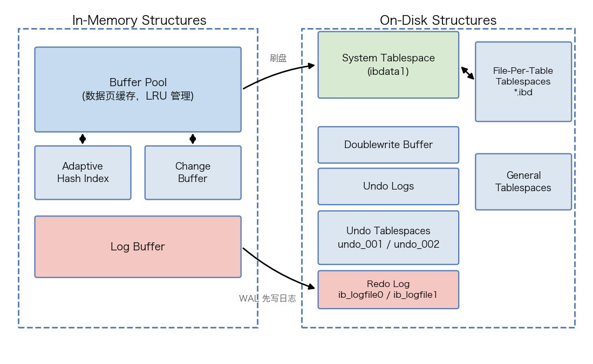

InnoDB主要分为两大块：

-   InnoDB In-Memory Structures
-   InnoDB On-Disk Structures

内存中主要有buffer pool、change buffer、Adaptive Hash Index、log Buffer

Buffer Pool：

    MySQL 不会直接去修改磁盘的数据，因为这样做太慢了，MySQL 会先改内存，然后记录 redo log，等有空了再刷磁盘，如果内存里没有数据，就去磁盘 load。而这些数据存放的地方，就是 Buffer Pool。MySQL 是以「页」（page）为单位从磁盘读取数据的，Buffer Pool 里的数据也是如此，实际上，Buffer Pool 是a linked list of pages，一个以页为元素的链表。

    为什么是链表？因为和缓存一样，它也需要一套淘汰算法来管理数据。Buffer Pool 采用基于 LRU（least recently used） 的算法来管理内存：

Change Buffer：

    如果内存里没有对应「页」的数据，MySQL 就会去把数据从磁盘里 load 出来，如果每次需要的「页」都不同，或者不是相邻的「页」，那么每次 MySQL 都要去 load，这样就很慢了
    于是如果 MySQL 发现你要修改的页，不在内存里，就把你要对页的修改，先记到一个叫 Change Buffer 的地方，同时记录 redo log，然后再慢慢把数据 load 到内存，load 过来后，再把 Change Buffer 里记录的修改，应用到内存（Buffer Pool）中，这个动作叫做 merge；而把内存里的脏页刷到磁盘的动作，叫 **flush**（page cleaner 线程在 checkpoint 时执行）：

-   **merge**：Change Buffer → Buffer Pool，把记录的修改合并进内存中的页
-   **flush**：Buffer Pool（脏页） → Disk，把脏页刷回磁盘

> 注意区分：**purge 不是刷盘**，它指的是清理 undo log 中不再被任何 read view 需要的旧版本记录（由 purge 线程完成）。

Change Buffer 只在操作「二级索引」（secondary index）时才使用，原因是「聚簇索引」（clustered indexes）必须是「唯一」的，也就意味着每次插入、更新，都需要检查是否已经有相同的字段存在，也就没有必要使用 Change Buffer 了；另外，「聚簇索引」操作的随机性比较小，通常在相邻的「页」进行操作，比如使用了自增主键的「聚簇索引」，那么 insert 时就是递增、有序的，不像「二级索引」，访问非常随机。

Change Buffer 是 Buffer Pool 中的一部分，虽然 Change Buffer 名字叫 Buffer ，但是它也是可以持久化的，在右边的 System Tablespace 中可以看到持久化 Change Buffer 的空间。触发写缓存（Change Buffer）持久化操作有以下几种情况：

1.  **数据库空闲时，后台有线程定时持久化**
2.  **数据库缓冲池不够用时**
3.  **数据库正常关闭时**
4.  **redo log 写满时**

Change Buffer 数据应用到原始数据页，得到新的数据页的过程称之为 merge。merge 过程中只会将 Change Buffer 中与原始数据页有关的数据应用到原始数据页，以下三种情况会发生 merge 操作：

1.  原始数据页加载到 Buffer Pool 时。
2.  系统后台定时触发 merge 操作。
3.  MySQL 数据库正常关闭时。

---

**InnoDB四大特性**

**写缓冲**：在MySQL5.5之前，叫插入缓冲(insert buffer)，只针对insert做了优化；现在对delete和update也有效，叫做写缓冲(change buffer)。

只对于非聚集索引（非唯一）的插入和更新有效，对于每一次的插入不是写到索引页中，而是先判断插入的非聚集索引页是否在缓冲池中，如果在则直接插入；若不在，则先放到Insert Buffer 中，再按照一定的频率进行合并操作，再写回disk。这样通常能将多个插入合并到一个操作中，目的还是为了减少随机IO带来性能损耗。

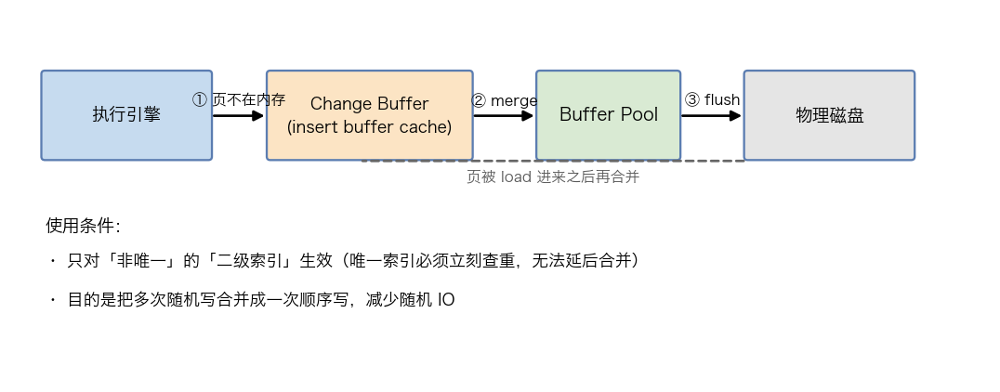

使用插入缓冲的条件：

* 非聚集索引

* 非唯一索引

上面提过在一定频率下进行合并，那所谓的频率是什么条件？

1）辅助索引页被读取到缓冲池中。正常的select先检查Insert Buffer是否有该非聚集索引页存在，若有则合并插入。

2）辅助索引页没有可用空间。空间小于1/32页的大小，则会强制合并操作。

3）Master Thread 每秒和每10秒的合并操作。

**二次写**：

部分写失效

想象这么一个场景，当数据库正在从内存向磁盘写一个数据页时，数据库宕机，从而导致这个页只写了部分数据，这就是部分写失效，它会导致数据丢失。这时是无法通过重做日志恢复的，因为重做日志记录的是对页的物理修改，如果页本身已经损坏，重做日志也无能为力。

两次写机制

从上面分析我们知道，在部分写失效的情况下，我们在应用重做日志之前，需要原始页的一个副本，两次写就是为了解决这个问题，下面是它的原理图：

两次写需要额外添加两个部分：

1）内存中的两次写缓冲（doublewrite buffer），大小为2MB

2）磁盘上共享表空间中连续的128页，大小也为2MB

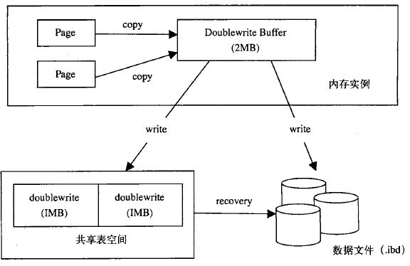

其原理是这样的：

1）当刷新缓冲池脏页时，并不直接写到数据文件中，而是先拷贝至内存中的两次写缓冲区。

2）接着从两次写缓冲区分两次写入磁盘共享表空间中，每次写入1MB

3）待第2步完成后，再将两次写缓冲区写入数据文件

这样就可以解决上文提到的部分写失效的问题，因为在磁盘共享表空间中已有数据页副本拷贝，如果数据库在页写入数据文件的过程中宕机，在实例恢复时，可以从共享表空间中找到该页副本，将其拷贝覆盖原有的数据页，再应用重做日志即可。

在InnoDB将BP中的Dirty Page刷（flush）到磁盘上时，首先会将（memcpy函数）Page刷到InnoDB tablespace的一个区域中，我们称该区域为Double write Buffer（大小为2MB，每次写入1MB，128个页，每个页16k,其中120个页为后台线程的批量刷Dirty Page，还有8个也是为了前台起的sigle Page Flash线程，用户可以主动请求，并且能迅速的提供空余的空间）。在向Double write Buffer写入成功后，第二步、再将数据分别刷到一个共享空间和真正应该存在的位置。

MySQL可以根据redolog进行恢复,而mysq在恢复的过程中是检查page"的checksum, checksum就是pgae的最后事务号,发生partial page write问题时. DageR经损坏,找不到该page中的事务号就无法恢复。

具体的流程如下图所示：

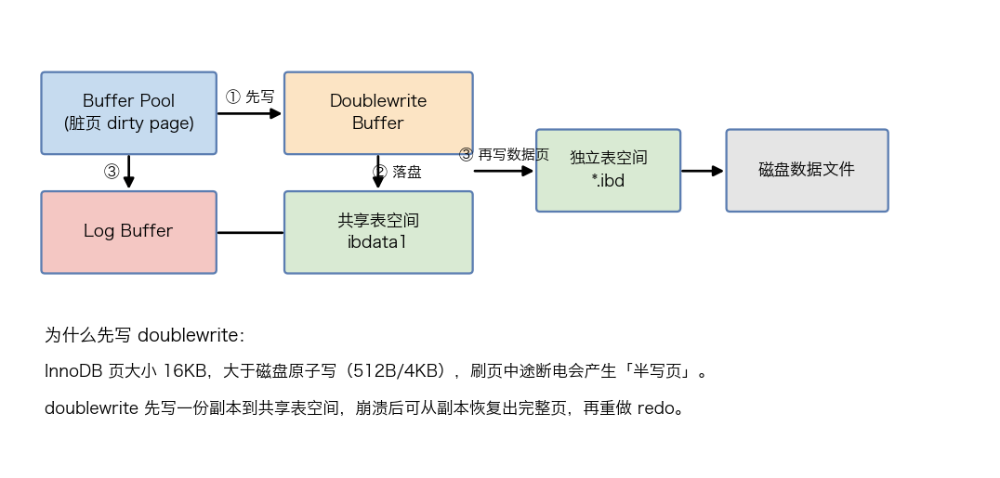

在不同的写入阶段，操作系统crash后，double write带来的保护机制：

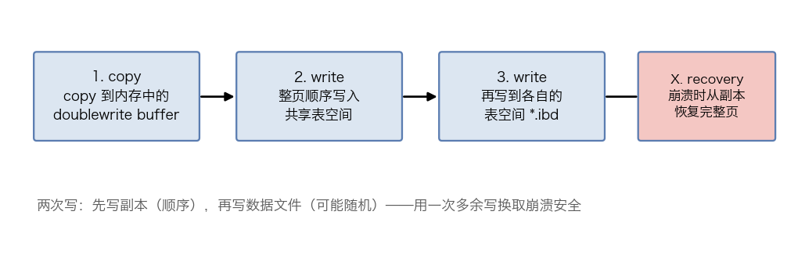

**自适应哈希：**

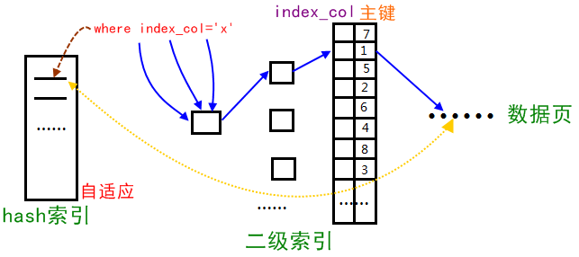

    Innodb存储引擎会监控对表上二级索引的查找，如果发现某二级索引被频繁访问，二级索引成为热数据，建立哈希索引可以带来速度的提升。经常访问的二级索引数据会自动被生成到hash索引里面去(最近连续被访问三次的数据)，自适应哈希索引通过缓冲池的B+树构造而来，因此建立的速度很快。

哈希（hash）是一种非常快的等值查找方法，在一般情况下这种查找的时间复杂度为O(1),即一般仅需要一次查找就能定位数据。而B+树的查找次数，取决于B+树的高度，在生产环境中，B+树的高度一般3-4层，故需要3-4次的查询。

    innodb会监控对表上个索引页的查询。如果观察到建立哈希索引可以带来速度提升，则自动建立哈希索引，称之为自适应哈希索引（Adaptive Hash Index，AHI）。

**预读**

    InnoDB使用两种预读算法来提高I/O性能：线性预读（linear read-ahead）和随机预读（randomread-ahead）

    为了区分这两种预读的方式，我们可以把线性预读放到以extent（一般包含64个page）为单位，而随机预读放到以extent中的page为单位。线性预读着眼于将下一个extent提前读取到buffer pool中，而随机预读着眼于将当前extent中的剩余的page提前读取到buffer pool中。

**线性预读**

    通过使用配置参数innodb_read_ahead_threshold，可以控制Innodb执行预读操作的时间。如果一个extent中的被顺序读取的page超过或者等于该参数变量时，Innodb将会异步的将下一个extent读取到buffer pool中，innodb_read_ahead_threshold可以设置为0-64的任何值，默认值为56，值越高，访问模式检查越严格
例如，如果将值设置为48，则InnoDB只有在顺序访问当前extent中的48个pages时才触发线性预读请求，将下一个extent读到内存中。如果值为8，InnoDB触发异步预读，即使程序段中只有8页被顺序访问。

**随机预读**

    随机预读方式则是表示当同一个extent中的一些page在buffer pool中发现时，Innodb会将该extent中的剩余page一并读到buffer pool中，由于随机预读方式给Innodb code带来了一些不必要的复杂性，同时在性能也存在不稳定性，在5.5中已经将这种预读方式废弃。要启用此功能，请将配置变量设置innodb_random_read_ahead为ON。

---

聚簇索引 & 非聚簇索引

    聚集索引与非聚集索引的区别是：叶节点是否存放一整行记录

    InnoDB 主键使用的是聚簇索引，MyISAM 不管是主键索引，还是二级索引使用的都是非聚簇索引。

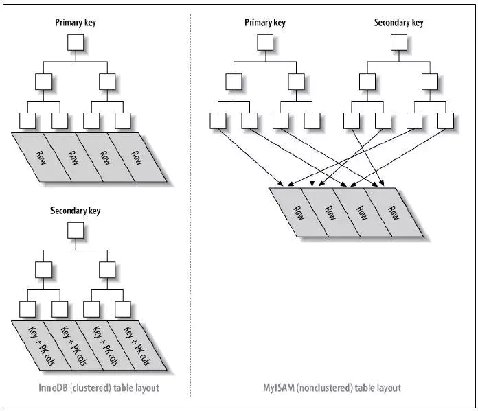

1.对于**非聚簇索引表**来说（右图），表数据和索引是分成两部分存储的，主键索引和二级索引存储上没有任何区别。使用的是B+树作为索引的存储结构，所有的节点都是索引，叶子节点存储的是索引+索引对应的记录的数据。

2.对于**聚簇索引表**来说（左图），表数据是和主键一起存储的，主键索引的叶结点存储行数据(包含了主键值)，二级索引的叶结点存储行的主键值。使用的是B+树作为索引的存储结构，非叶子节点都是索引关键字，但非叶子节点中的关键字中不存储对应记录的具体内容或内容地址。叶子节点上的数据是主键与具体记录(数据内容)。

---

**MyISAM与InnoDB区别**

|  | MyISAM | Innodb |
| --- | --- | --- |
| 存储结构 | 每张表被存放在三个文件：frm-表格定义、MYD(MYData)-数据文件、MYI(MYIndex)-索引文件 | 所有的表都保存在同一个数据文件中（也可能是多个文件，或者是独立的表空间文件），InnoDB表的大小只受限于操作系统文件的大小，一般为2GB |
| 存储空间 | MyISAM可被压缩，存储空间较小 | InnoDB的表需要更多的内存和存储，它会在主内存中建立其专用的缓冲池用于高速缓冲数据和索引 |
| 可移植性、备份及恢复 | 由于MyISAM的数据是以文件的形式存储，所以在跨平台的数据转移中会很方便。在备份和恢复时可单独针对某个表进行操作 | 免费的方案可以是拷贝数据文件、备份 binlog，或者用 mysqldump，在数据量达到几十G的时候就相对痛苦了 |
| 文件格式 | 数据和索引是分别存储的，数据`.MYD`，索引`.MYI` | 数据和索引是集中存储的，`.ibd` |
| 记录存储顺序 | 按记录插入顺序保存 | 按主键大小有序插入 |
| 外键 | 不支持 | 支持 |
| 事务 | 不支持 | 支持 |
| 锁支持（锁是避免资源争用的一个机制，MySQL锁对用户几乎是透明的） | 表级锁定 | 行级锁定、表级锁定，锁定力度小并发能力高 |
| SELECT | MyISAM更优 |  |
| INSERT、UPDATE、DELETE |  | InnoDB更优 |
| select count(*) | myisam更快，因为myisam内部维护了一个计数器，可以直接调取。 |  |
| 索引的实现方式 | B+树索引，myisam 是堆表 | B+树索引，Innodb 是索引组织表 |
| 哈希索引 | 不支持 | 支持 |
| 全文索引 | 支持 | 不支持 |

## 二、事务与隔离级别

> 来源：`MySQL事务.md`

事务的四大特性（ACID）

-   原子性(atomicity)： 事务的最小工作单元，要么全成功，要么全失败。
-   一致性(consistency)： 事务开始和结束后，数据库的完整性不会被破坏。
-   隔离性(isolation)： 不同事务之间互不影响，四种隔离级别为RU（读未提交）、RC（读已提交）、RR（可重复读）、SERIALIZABLE （串行化）。
-   持久性(durability)： 事务提交后，对数据的修改是永久性的，即使系统故障也不会丢失。

并发事务带来的问题

-   **脏读（Dirty read）:** 当一个事务正在访问数据并且对数据进行了修改，而这种修改还没有提交到数据库中，这时另外一个事务也访问了这个数据，然后使用了这个数据。因为这个数据是还没有提交的数据，那么另外一个事务读到的这个数据是“脏数据”，依据“脏数据”所做的操作可能是不正确的。
-   **丢失修改（Lost to modify）:** 指在一个事务读取一个数据时，另外一个事务也访问了该数据，那么在第一个事务中修改了这个数据后，第二个事务也修改了这个数据。这样第一个事务内的修改结果就被丢失，因此称为丢失修改。 例如：事务1读取某表中的数据A=20，事务2也读取A=20，事务1修改A=A-1，事务2也修改A=A-1，最终结果A=19，事务1的修改被丢失。
-   **不可重复读（Unrepeatableread）:** 指在一个事务内多次读同一数据。在这个事务还没有结束时，另一个事务也访问该数据。那么，在第一个事务中的两次读数据之间，由于第二个事务的修改导致第一个事务两次读取的数据可能不太一样。这就发生了在一个事务内两次读到的数据是不一样的情况，因此称为不可重复读。
-   **幻读（Phantom read）:** 幻读与不可重复读类似。它发生在一个事务（T1）读取了几行数据，接着另一个并发事务（T2）插入了一些数据时。在随后的查询中，第一个事务（T1）就会发现多了一些原本不存在的记录，就好像发生了幻觉一样，所以称为幻读。

事务的隔离级别

-   读未提交（Read UnCommitted/RU）
    又称为脏读，一个事务可以读取到另一个事务未提交的数据。这种隔离级别别最不安全的一种，因为未提交的事务是存在回滚的情况。
-   读已提交（Read Committed/RC）
    这种级别下会出现**不可重复读**：因为能读到别的事务已提交的修改，导致同一事务在不同时间读同一条数据结果不一致。

    举个例子，在下面的例子中就会发现SessionA在一个事务期间两次查询的数据不一样。原因就是在于当前隔离级别为 RC，SessionA的事务可以读取到SessionB提交的最新数据。

    | **发生时间** | **SessionA** | **SessionB** |
    | --- | --- | --- |
    | 1 | begin; |  |
    | 2 | select * from user where id=1;(张三) |  |
    | 3 |  | update user set name='李四' where id=1;(默认隐式提交事务) |
    | 4 | select * from user where id=1;(李四) |  |
    | 5 |  | update user set name='王二' where id=1;(默认隐式提交事务) |
    | 6 | select * from user where id=1;(王二) |  |

-   可重复读（Repeatable Read/RR）

    又称为**幻读**，一个事物读可以读取到其他事务提交的数据，但是在RR隔离级别下，当前读取此条数据只可读取一次，在当前事务中，不论读取多少次，数据仍然是第一次读取的值，不会因为在第一次读取之后，其他事务再修改提交此数据而产生改变。因此也成为幻读，因为读出来的数据并不一定就是最新的数据。

    举个例子：在SessionA中第一次读取数据时，后续其他事务修改提交数据，不会再影响到SessionA读取的数据值。此为**可重复读**。

    | **发生时间** | **SessionA** | **SessionB** |
    | --- | --- | --- |
    | 1 | begin; |  |
    | 2 | select * from user where id=1;(张三) |  |
    | 3 |  | update user set name='李四' where id=1;  (默认隐式提交事务) |
    | 4 | select * from user where id=1;(张三) |  |
    | 5 |  | update user set name='王二' where id=1;(默认隐式提交事务) |
    | 6 | select * from user where id=1;(张三) |  |

-   串行化（Serializable）

    所有的数据库的读或者写操作都为串行执行，当前隔离级别下只支持单个请求同时执行，所有的操作都需要队列执行。所以种隔离级别下所有的数据是最稳定的，但是性能也是最差的。数据库的锁实现就是这种隔离级别的更小粒度版本。

    | **发生时间** | **SessionA** | **SessionB** |
    | --- | --- | --- |
    | 1 | begin; |  |
    | 2 |  | begin; |
    | 3 |  | update user set name='李四' where id=1; |
    | 4 | select * from user where id=1;(等待、wait) |  |
    | 5 |  | commit； |
    | 6 | select * from user where id=1;(李四) |  |

CAID分别靠什么实现

-   A原子性由undo log日志保证，它记录了需要回滚的日志信息，事务回滚时撤销已经执行成功的sql
-   C一致性一般由代码层面来保证
-   I隔离性由MVCC来保证
-   D持久性由内存+redo log来保证，mysql修改数据同时在内存和redo log记录这次操作，事务提交的时候通过redo log刷盘，宕机的时候可以从redo log恢复

不同事务同时操作同一条数据产生的问题

示例：

| **发生时间** | **SessionA** | **SessionB** |
| --- | --- | --- |
| 1 | begin; |  |
| 2 |  | begin; |
| 3 |  | 查询余额 = 1000元 |
| 4 | 查询余额 = 1000元 |  |
| 5 |  | 存入金额 100元，修改余额为 1100元 |
| 6 | 取出现金100元，此时修改余额为900元 |  |
| 8 |  | 提交事务（余额=1100） |
| 9 | 提交事务（余额=900） |  |
| **发生时间** | **SessionA** | **SessionB** |
| --- | --- | --- |
| 1 | begin; |  |
| 2 |  | begin; |
| 3 |  | 查询余额 = 1000元 |
| 4 | 查询余额 = 1000元 |  |
| 5 |  | 存入金额 100元，修改余额为 1100元 |
| 6 | 取出现金100元，此时修改余额为900元 |  |
| 8 |  | 提交事务（余额=1100） |
| 9 | 撤销事务（余额恢复为1000元） |  |

上面的两种情况就是对于一条数据，多个事务同时操作可能会产生的问题，会出现某个事务的操作被覆盖而导致数据丢失。

### LBCC 解决数据丢失

LBCC，基于锁的并发控制，Lock Based Concurrency Control。

使用锁的机制，在当前事务需要对数据修改时，将当前事务加上锁，同一个时间只允许一条事务修改当前数据，其他事务必须等待锁释放之后才可以操作。

#### MVCC 解决不可重复读与幻读

MVCC，多版本的并发控制，Multi-Version Concurrency Control。

使用版本来控制并发情况下的数据问题，在B事务开始修改账户且事务未提交时，当A事务需要读取账户余额时，此时会读取到B事务修改操作之前的账户余额的副本数据，但是如果A事务需要修改账户余额数据就必须要等待B事务提交事务。

**MVCC使得数据库读不会对数据加锁，普通的SELECT请求不会加锁，提高了数据库的并发处理能力**。借助MVCC，数据库可以实现READ COMMITTED，REPEATABLE READ等隔离级别，用户可以查看当前数据的前一个或者前几个历史版本，保证了ACID中的I特性（隔离性)。

MVCC(Mutil-Version Concurrency Control)，就是多版本并发控制。MVCC 是一种并发控制的方法，一般在数据库管理系统中，实现对数据库的并发访问。在Mysql的InnoDB引擎中就是指在已提交读(READ COMMITTD)和可重复读(REPEATABLE READ)这两种隔离级别下的事务对于SELECT操作会访问版本链中的记录的过程。这就使得别的事务可以修改这条记录，反正每次修改都会在版本链中记录。SELECT可以去版本链中拿记录，这就实现了读-写，写-读的并发执行，提升了系统的性能。

我们先来理解一下版本链的概念。在InnoDB引擎表中，它的聚簇索引记录中有两个必要的隐藏列：

trx_id这个id用来存储的每次对某条聚簇索引记录进行修改的时候的事务id。

roll_pointer每次对哪条聚簇索引记录有修改的时候，都会把老版本写入undo日志中。这个roll_pointer就是存了一个指针，它指向这条聚簇索引记录的上一个版本的位置，通过它来获得上一个版本的记录信息。(注意插入操作的undo日志没有这个属性，因为它没有老版本)

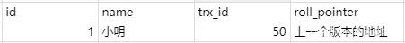

比如现在有个事务id是60的执行的这条记录的修改语句

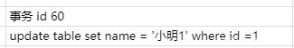

此时在undo日志中就存在版本链

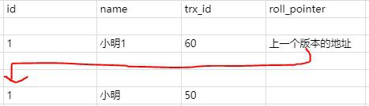

已提交读和可重复读的区别就在于它们生成ReadView的策略不同。

ReadView中主要就是有个列表来存储我们系统中当前活跃着的读写事务，也就是begin了还未提交的事务。通过这个列表来判断记录的某个版本是否对当前事务可见。假设当前列表里的事务id为[80,100]。

如果你要访问的记录版本的事务id为50，比当前列表最小的id80小，那说明这个事务在之前就提交了，所以对当前活动的事务来说是可访问的。

如果你要访问的记录版本的事务id为70,发现此事务在列表id最大值和最小值之间，那就再判断一下是否在列表内，如果在那就说明此事务还未提交，所以版本不能被访问。如果不在那说明事务已经提交，所以版本可以被访问。

如果你要访问的记录版本的事务id为110，那比事务列表最大id100都大，那说明这个版本是在ReadView生成之后才发生的，所以不能被访问。

这些记录都是去版本链里面找的，先找最近记录，如果最近这一条记录事务id不符合条件，不可见的话，再去找上一个版本再比较当前事务的id和这个版本事务id看能不能访问，以此类推直到返回可见的版本或者结束。

举个例子 ，在已提交读隔离级别下：

比如此时有一个事务id为100的事务，修改了name,使得的name等于小明2，但是事务还没提交。则此时的版本链是

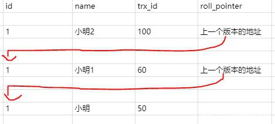

那此时另一个事务发起了select 语句要查询id为1的记录，那此时生成的ReadView 列表只有[100]。那就去版本链去找了，首先肯定找最近的一条，发现trx_id是100,也就是name为小明2的那条记录，发现在列表内，所以不能访问。

这时候就通过指针继续找下一条，name为小明1的记录，发现trx_id是60，小于列表中的最小id,所以可以访问，直接访问结果为小明1。

那这时候我们把事务id为100的事务提交了，并且新建了一个事务id为110也修改id为1的记录，并且不提交事务

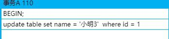

这时候版本链就是

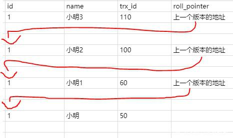

这时候之前那个select事务又执行了一次查询,要查询id为1的记录。

这个时候关键的地方来了

如果你是已提交读隔离级别，这时候你会重新一个ReadView，那你的活动事务列表中的值就变了，变成了[110]。按照上的说法，你去版本链通过trx_id对比查找到合适的结果就是小明2。

如果你是可重复读隔离级别，这时候你的ReadView还是第一次select时候生成的ReadView,也就是列表的值还是[100]。所以select的结果是小明1。所以第二次select结果和第一次一样，所以叫可重复读！也就是说已提交读隔离级别下的事务在每次查询的开始都会生成一个独立的ReadView,而可重复读隔离级别则在第一次读的时候生成一个ReadView，之后的读都复用之前的ReadView。

## 三、锁：悲观锁、乐观锁与间隙锁

> 来源：`锁.md`

悲观锁：悲观锁是基于一种悲观的态度类来防止一切数据冲突，它是以一种预防的姿态在修改数据之前把数据锁住，然后再对数据进行读写，在它释放锁之前任何人都不能对其数据进行操作，直到前面一个人把锁释放后下一个人数据加锁才可对数据进行加锁，然后才可以对数据进行操作，一般数据库本身锁的机制都是基于悲观锁的机制实现的;

特点：可以完全保证数据的独占性和正确性，因为每次请求都会先对数据进行加锁， 然后进行数据操作，最后再解锁，而加锁释放锁的过程会造成消耗，所以性能不高;

乐观锁是对于数据冲突保持一种乐观态度，操作数据时不会对操作的数据进行加锁（这使得多个任务可以并行的对数据进行操作），只有到数据提交的时候才通过一种机制来验证数据是否存在冲突(一般实现方式是通过加版本号然后进行版本号的对比方式实现);

特点：乐观锁是一种并发类型的锁，其本身不对数据进行加锁通而是通过业务实现锁的功能，不对数据进行加锁就意味着允许多个请求同时访问数据，同时也省掉了对数据加锁和解锁的过程，这种方式因为节省了悲观锁加锁的操作，所以可以一定程度的的提高操作的性能，不过在并发非常高的情况下，会导致大量的请求冲突，冲突导致大部分操作无功而返而浪费资源，所以在高并发的场景下，乐观锁的性能却反而不如悲观锁。

间隙锁（Gap Lock）是 InnoDB 在可重复读隔离级别下为了解决幻读问题时引入的锁机制，幻读的问题存在是因为新增或者更新操作，这时如果进行范围查询的时候（加锁查询），会出现不一致的问题，这时使用不同的行锁已经没有办法满足要求，需要对一定范围内的数据进行加锁，间隙锁就是解决这类问题的。在可重复读隔离级别下，数据库是通过行锁和间隙锁共同组成的（next-key lock），来实现的

当我们用范围条件而不是相等条件检索数据，并请求共享或排他锁时，InnoDB会给符合条件的已有数据记录的索引项加锁；对于键值在条件范围内但并不存在的记录，叫做“间隙（GAP)”，InnoDB也会对这个“间隙”加锁，这种锁机制就是所谓的间隙锁（Next-Key锁）。

案例数据

| id(主键) | c（普通索引） | d（无索引） |
| --- | --- | --- |
| 5 | 5 | 5 |
| 10 | 10 | 10 |
| 15 | 15 | 15 |
| 20 | 20 | 20 |
| 25 | 25 | 25 |

以上数据为了解决幻读问题，更新时不只对这五条数据加行锁，还会对中间的取值范围加锁。这里的 `(-∞,5] (5,10] (10,15] (15,20] (20,25] (25,+supremum]` 是 **next-key lock**——等于「间隙锁 + 右边界那条记录」，所以是**左开右闭**；而**纯间隙锁本身是开区间**（如 (5,10)，不含 10 这条记录）。`supremum` 是 InnoDB 中表示"最大记录"的伪记录。

### 间隙锁简单案例

| 步骤 | 事务A | 事务B |
| --- | --- | --- |
| 1 | begin; select * from t where id = 11 for update; | - |
| 2 | - | insert into user value(12,12,12) |
| 3 | commit; | - |

当有如下事务A和事务B时，事务A会对数据库表增加（10，15]这个区间锁，这时insert id = 12 的数据的时候就会因为区间锁（10，15]而被锁住无法执行。

MySQL的锁机制比较简单，其最显著的特点是不同的存储引擎支持不同的锁机制。比如，MyISAM和MEMORY存储引擎采用的是表级锁；BDB存储引擎采用的是页面锁，但也支持表级锁；InnoDB存储引擎既支持行级锁，也支持表级锁，但默认情况下采用行级锁。

**MySQL这3种锁的特性可大致归纳如下：**

**（1）表级锁**：开销小，加锁快；不会出现死锁；锁定粒度大，发生锁冲突的概率最高，并发度最低。

**（2）行级锁**：开销大，加锁慢；会出现死锁；锁定粒度最小，发生锁冲突的概率最低，并发度也最高。

**（3）页面锁**：开销和加锁时间界于表锁和行锁之间；会出现死锁；锁定粒度界于表锁和行锁之间，并发度一般。

仅从锁的角度来说，表级锁更适合于以查询为主，只有少量按索引条件更新数据的应用，如Web应用；而行级锁则更适合于有大量按索引条件并发更新少量不同数据，同时又有并发查询的应用，如一些在线事务处理系统。
