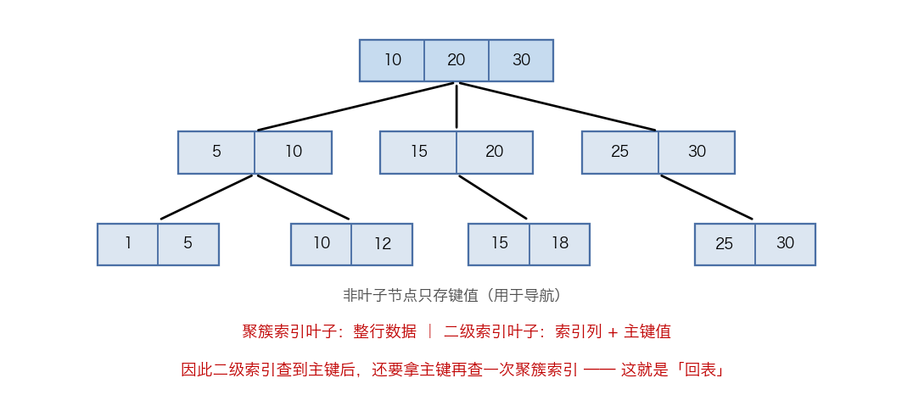
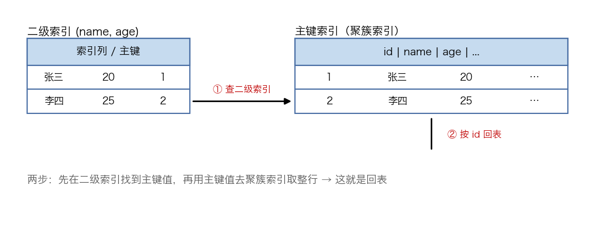
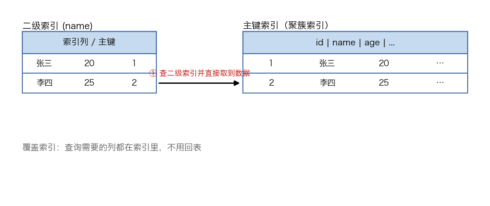
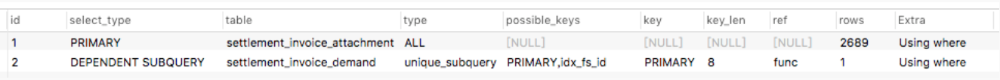

# 索引与查询优化

> 合并自：`索引.md`、`子查询效率慢的原因.md`、`MySQL limit查询数据量很大的情况下处理.md`。原文未删改（仅修正已知错误、调整格式）。

## 一、索引基础、设计原则与 explain

> 来源：`索引.md`

索引是用来快速检索出具有特定值的记录。如果没有索引，数据库就必须从第一条记录开始进行全表扫描，直到找出相关的行。数据越多，检索的代价就越高，检索时如果表的列存在索引，那么MySQL就能快速到达指定位置去搜索数据文件，而不必查看所有数据。

MySQL 中常见的索引类型有 B+Tree 和 Hash。InnoDB、MyISAM 默认且主要使用 **B+Tree** 索引（InnoDB 还内置自适应哈希索引，但不能由用户显式创建）；MEMORY/HEAP 引擎既可以建 HASH 索引也可以建 BTREE 索引；MyISAM 另外支持用于空间数据的 RTREE 索引。

索引设计原则：

1.  索引并非越多越好，一个表中如有大量的索引，不仅占用磁盘空间，而且会影响`INSERT、DELETE、UPDATE`等语句的性能，因为当表中的数据更改的同时，索引也会进行调整和更新
2.  避免对经常更新的表设计过多的索引，并且索引中的列尽可能要少，而对经常用于查询的字段应该创建索引，但要避免添加不必要的字段
3.  数据量小的表最好不要使用索引，由于数据较少，查询花费的时间可能比遍历索引时间还要短，索引可能不会产生优化效果
4.  在条件表达式中经常用到的不同值较多的列上建立索引，在不同值较少的列上不要建立索引，比如性别字段只有男和女，就没必要建立索引。如果建立索引不但不会提高查询效率，反而会严重降低更新速度
5.  当唯一性是某种数据本身的特征时，指定唯一索引。使用唯一索引需能确保定义的列的数据完整性，以提高查询速度
6.  在频繁排序或分组（即group by或order by操作）的列上建立索引，如果待排序的列有多个，可以在这些列上建立组合索引

explain分析SQL参数解析：

-   **select_type：** 指定所使用的SELECT查询类型，这里值为SIMPLE，表示简单的SELECT，不使用UNION或者子查询。其他取值有**PRIMARY、UNION、SUBQUERY、等**
-   **table：** 指定数据库读取的数据表的名字，它们按照被读取的先后顺序排列
-   **type：** 指定了本数据表与其他数据表之间的关联关系，其它取值有**system（**表只有一行，这是一个 const type 的特殊情况**）、const（**在使用主键或者唯一索引进行查询的时候只有一行匹配**）、eq_ref（**在进行联接查询的，使用主键或者唯一索引并且只匹配到一行记录的时候**）、ref（使用非唯一索引）、range（**只有在使用主键、单个字段的辅助索引、多个字段的辅助索引的最后一个字段进行范围查询才是 range**）、index和All**
-   **possible_keys：** MySQL在搜索数据记录时可选用的各个索引
-   **key：** MySQL使用的实际索引
-   **key_len：** 给出了索引按字节计算的长度，key_len数值越小，表示越快
-   **ref：** 提供了关联关系中另外一个数据表里的数据列的名字
-   **rows：** 指`MySQL`执行查询时预计从当前数据表中读出的数据行数
-   **Extra：** 提供了与关联操作有关的信息

        using where：查询使用索引的情况下，需要回表去查询所需的数据

        using index condition：查询使用了索引，但是需要回表查询数据。        using index：查询使用覆盖索引的时候会出现。        using index & using where：查询使用了索引，但是需要的数据都在索引列中能找到，不需要回表查询数据。

        using filesort：表示的就是需要排序，MySQL会给每个线程分配一块内存用于排序，称为sort_buffer

##

### 什么是覆盖索引

创建一个索引，该索引包含查询中用到的所有字段，称为“覆盖索引”。

使用覆盖索引，MySQL 只需要通过索引就可以查找和返回查询所需要的数据，而不必在使用索引处理数据之后再进行回表操作。

覆盖索引可以一次性完成查询工作，有效减少IO，提高查询效率。

---

Hash索引

哈希索引（hash index）基于哈希表实现，只有精确匹配索引所有列的查询才有效。对于每一行数据，存储引擎都会对所有的索引列计算一个哈希码（hash code），哈希码是一个较小的值，并且不同键值的行计算出来的哈希码也不一样。哈希索引将所有的哈希码存储在索引中，同时在哈希表中保存指向每个数据行的指针。

对于hash相同的，采用链表的方式解决冲突。类似于hashmap。因为索引的结构是十分紧凑的，所以hash索引的查询很快。

**hash索引的限制：**

-   哈希索引只包含哈希值和行指针，而不存储字段值，所以不能使用索引中的值来避免读取行。
-   哈希索引数据并不是按照索引值顺序存储的，所以也就无法用于排序。
-   哈希索引也不支持部分索引列匹配查找，因为哈希索引始终是使用索引列的全部内容来计算哈希值的。
-   哈希索引只支持等值比较查询，包括=、IN()、<>、<=>（注意<>和<=>是不同的操作,<=>是安全比较运算符，用来做 NULL 值的关系运算）。也不支持任何范围查询，例如WHERE price>100。
-   访问哈希索引的数据非常快，除非有很多哈希冲突（不同的索引列值却有相同的哈希值）。当出现哈希冲突的时候，存储引擎必须遍历链表中所有的行指针，逐行进行比较，直到找到所有符合条件的行。
-   如果哈希冲突很多的话，一些索引维护操作的代价也会很高。例如，如果在某个选择性很低（哈希冲突很多）的列上建立哈希索引，那么当从表中删除一行时，存储引擎需要遍历对应哈希值的链表中的每一行，找到并删除对应行的引用，冲突越多，代价越大。

BTree索引

BTree索引使用B+树存储，所有要存储的数据都存放在B+树的叶子节点中，并且每个叶子节点中都有一个指针指向相邻的下一个叶子节点，这样是为了加快检索多个相邻的叶子节点效率。

在 Innodb 存储引擎中，存在两种不同形式的索引，一种是 Cluster 形式的主键索引（ Primary Key ），另外一种则是和其他存储引擎（如 MyISAM 存储引擎）存放形式基本相同的普通 B-Tree 索引，这种索引在 Innodb 存储引擎中被称为 Secondary Index（二级索引） 。下面我们通过图示来针对这两种索引的存放

主键索引就是聚簇索引，他的叶子节点存放的是表的实际数据，不仅仅包括主键字段的数据，还包括其他字段的数据据以主键值有序的排列。而二级索引则和其他普通的 B-Tree 索引没有太大的差异，叶子节点除了存放索引键的相关信息外，还存放了 Innodb 的主键值。所以，在 Innodb 中如果通过主键来访问数据效率是非常高的，而如果是通过 Secondary Index 来访问数据的话， Innodb 首先通过 Secondary Index 的相关信息，通过相应的索引键检索到 Leaf Node之后，需要再通过 Leaf Node 中存放的主键值再通过主键索引来获取相应的数据行。MyISAM 存储引擎的主键索引和非主键索引差别很小，只不过是主键索引的索引键是一个唯一且非空的键而已。而且 MyISAM 存储引擎的索引和 Innodb 的 Secondary Index 的存储结构也基本相同，主要的区别只是 MyISAM 存储引擎在 Leaf Nodes 上面出了存放索引键信息之外，再存放能直接定位到 MyISAM 数据文件中相应的数据行的信息（如 Row Number ），但并不会存放主键的键值信息。

 InnoDB必须要有，且只有一个聚集索引：

（1）如果表定义了PK，则PK就是聚集索引；

（2）如果表没有定义PK，则第一个not NULL unique列是聚集索引；

（3）否则，InnoDB会创建一个隐藏的row-id作为聚集索引；

在InnoDB使用二级索引查找时，先要找到主键，通过扫描主键索引树来找到数据，这样查询了两棵索引树，这就是回表

我们可以使用覆盖索引来避免回表，覆盖索引就是从非主键索引中直接查到数据，而不需要查询主键索引中的记录，避免了回表的产生减少了书的搜索次数，显著提升性能。一般会建立联合索引来完成覆盖索引

最左匹配原则：

-   索引可以简单如一个列 (a)，也可以复杂如多个列 (a,b,c,d)，即联合索引。

-   如果是联合索引，那么key也由多个列组成，同时，索引只能用于查找key是否存在（相等），遇到范围查询 (>、<、between、like左匹配)等就不能进一步匹配了，后续退化为线性查找。

因此，列的排列顺序决定了可命中索引的列数。

例子：

如有索引 (a,b,c,d)，查询条件 a=1 and b=2 and c>3 and d=4，则会在每个节点依次命中a、b、c，无法命中d。(c已经是范围查询了，d肯定是排不了序了)

我们的主键一般都使用自增长id，不建议使用业务id，因为使用自增id可以避免页分裂。mysql 在底层又是以数据页为单位来存储数据的，一个数据页大小默认为 16k，当然你也可以自定义大小，也就是说如果一个数据页存满了，mysql 就会去申请一个新的数据页来存储数据，如果主键为自增 id 的话，mysql 在写满一个数据页的时候，直接申请另一个新数据页接着写就可以了。如果主键是非自增 id，为了确保索引有序，mysql 就需要将每次插入的数据都放到合适的位置上。当往一个快满或已满的数据页中插入数据时，新插入的数据会将数据页写满，mysql 就需要申请新的数据页，并且把上个数据页中的部分数据挪到新的数据页上。这就造成了页分裂，这个大量移动数据的过程是会严重影响插入效率的。其实对主键 id 还有一个小小的要求，在满足业务需求的情况下，尽量使用占空间更小的主键 id，因为普通索引的叶子节点上保存的是主键 id 的值，如果主键 id 占空间较大的话，那将会成倍增加 mysql 空间占用大小。

---

### 最左匹配原则的原理

我们都知道索引的底层是一颗 B+ 树，那么联合索引当然还是一颗 B+ 树，只不过联合索引的键值数量不是一个，而是多个。构建一颗 B+ 树只能根据一个值来构建，因此数据库依据联合索引最左的字段来构建 B+ 树。例子：假如创建一个（a,b,c)的联合索引，那么它的索引树是这样的：



该图就是一个形如(a,b,c)联合索引的 b+ 树，其中的非叶子节点存储的是第一个关键字的索引 a，而叶子节点存储的是三个关键字的数据。这里可以看出 a 是有序的，而 b，c 都是无序的。但是当在 a 相同的时候，b 是有序的，b 相同的时候，c 又是有序的。通过对联合索引的结构的了解，那么就可以很好的了解为什么最左匹配原则中如果遇到范围查询就会停止了。以 select * from t where a=5 and b>0 and c =1; #这样a,b可以用到（a,b,c），c不可以 为例子，当查询到 b 的值以后（这是一个范围值），c 是无序的。所以就不能根据联合索引来确定到底该取哪一行。

最左匹配原则你可以定义一个联合索引，但是使得多数查询条件都可以用到该索引。 值得注意的是，当遇到范围查询(>、<、between、like)就会停止匹配

在 InnoDB 中联合索引只有先确定了前一个（左侧的值）后，才能确定下一个值。如果有范围查询的话，那么联合索引中使用范围查询的字段后的索引在该条 SQL 中都不会起作用。值得注意的是，in 和 = 都可以乱序，比如有索引（a,b,c），语句 select * from t where c =1 and a=1 and b=1，这样的语句也可以用到最左匹配，因为 [MySQL](https://cloud.tencent.com/product/cdb?from=10680) 中有一个优化器，他会分析 SQL 语句，将其优化成索引可以匹配的形式，即 select * from t where a =1 and a=1 and c=1

---

索引下推

索引下推（index condition pushdown ）简称ICP，在Mysql5.6的版本上推出，用于优化查询。在不使用ICP的情况下，在使用非主键索引（又叫普通索引或者二级索引）进行查询时，存储引擎通过索引检索到数据，然后返回给MySQL服务器，服务器然后判断数据是否符合条件 。在使用ICP的情况下，如果存在某些被索引的列的判断条件时，MySQL服务器将这一部分判断条件传递给存储引擎，然后由存储引擎通过判断索引是否符合MySQL服务器传递的条件，只有当索引符合条件时才会将数据检索出来返回给MySQL服务器 。索引条件下推优化可以减少存储引擎查询基础表的次数，也可以减少MySQL服务器从存储引擎接收数据的次数。

-   在开始之前先先准备一张用户表(user)，其中主要几个字段有：id、name、age、address。建立联合索引（name，age）。
-   假设有一个需求，要求匹配姓名第一个为陈的所有用户，sql语句如下：

```sql
SELECT * from user where  name like '陈%'
```

-   根据 "最佳左前缀" 的原则，这里使用了联合索引（name，age）进行了查询，性能要比全表扫描肯定要高。
-   问题来了，如果有其他的条件呢？假设又有一个需求，要求匹配姓名第一个字为陈，年龄为20岁的用户，此时的sql语句如下：

```sql
SELECT * from user where  name like '陈%' and age=20
```

-   这条sql语句应该如何执行呢？下面对Mysql5.6之前版本和之后版本进行分析。

#### Mysql5.6之前的版本

-   5.6之前的版本是没有索引下推这个优化的，因此执行的过程如下图：



-   会忽略age这个字段，直接通过name进行查询，在(name,age)这课树上查找到了两个结果，id分别为2,1，然后拿着取到的id值一次次的回表查询，因此这个过程需要**回表两次**。

#### Mysql5.6及之后版本

-   5.6版本添加了索引下推这个优化，执行的过程如下图：



InnoDB并没有忽略age这个字段，而是在索引内部就判断了age是否等于20，对于不等于20的记录直接跳过，因此在(name,age)这棵索引树中只匹配到了一个记录，此时拿着这个id去主键索引树中回表查询全部数据，这个过程只需要回表一次。

## 二、子查询为什么慢

> 来源：`子查询效率慢的原因.md`

```
DELETE FROM settlement_invoice_attachment g1 WHERE demand_id in (SELECT id FROM settlement_invoice_demand g2 WHERE statement_id = 1802065000000074956)
```

乍眼一看，上述SQL如此简单，且demand_id和statement_id字段都是建了索引，即使是Review也会认为是OK没问题的。

然而，实际情况却是个慢查询，情况如下：

**explain明细**



settlement_invoice_attachment是全表查

注：rows 2689 是因为用的测试环境，真线环境数据是几十万级别

### 子查询 原理分析(上述SQL子查询为什么这么慢)

#### `经验之谈`

-   当看到SQL执行计划中select_type字段出现“DEPENDENT SUBQUERY”的时候，要打起精神了！着重分析下潜在风险！

##### 基础知识：Dependent SubQuery意味着什么？

-   官方含义为：
    1.  SUBQUERY: 子查询中的第一个SELECT；
    2.  DEPENDENT SUBQUERY: 子查询中的第一个SELECT， 取决于外面的查询。

换句话说，就是`子查询的g2查询执行方式依赖于外层g1的查询结果`
什么意思呢？它以为着两步走：

-   第一步：【先执行外部SQL查询】MySQL根据”DELETE FROM settlement_invoice_attachment g1 WHERE” 得到一个大结果集t1，其数据量就是全表所有行了，假设是85万行。
-   第二步：【后执行内部SQL子查询】第一步的大结果集t1中的每一条记录，都将与子查询SQL组成新的查询语句：SELECT id FROM settlement_invoice_demand g2 WHERE statement_id = 1802065000000074956 AND id = %t1.demand_id%。等于说，子查询要执行85万次……即使这两部查询都用到了索引，也是巨慢的。

##### 优化策略

-   改写SQL为JOIN的方式

```
DELETE ah FROM settlement_invoice_attachment ah INNER JOIN settlement_invoice_demand de
ON ah.demand_id = de.id WHERE de.statement_id = 1802065000000074956;
```

-   拆成独立SQL多次执行

##### 数据库原理

1.  MySQL处理子查询时，会(优化)改写子查询，但优化的不是很友好，一直受业界批评比较多
    -   有时候优化的挺糟糕的，特别是WHERE从句中的IN（）子查询
2.  MySQL 子查询的弱点
    -   mysql 在处理子查询时，会改写子查询。通常情况下，我们希望由内到外，先完成子查询的结果，然后再用子查询来驱动外查询的表，完成查询。

例如：select * from test where tid in(select fk_tid from sub_test where gid=10)
通常我们会感性地认为该 sql 的执行顺序是：

1、sub_test 表中根据 gid 取得 fk_tid(2,3,4,5,6)记录。
2、然后再到 test 中，带入 tid=2,3,4,5,6，取得查询数据。

但是实际mysql的处理方式为：
select *from test where exists (select* from sub_test where gid=10 and sub_test.fk_tid=test.tid)
mysql 将会扫描 test 中所有数据，每条数据都将会传到子查询中与 sub_test 关联，子查询不会先被执行，所以如果 test 表很大的话，那么性能上将会出现问题。

---

MySQL优化器可能会出现索引误判的情况

    优化器选择索引的目的，是找到一个最优的执行方案，并用最小的代价去执行语句。在数据库里面，扫描行数是影响执行代价的因素之一。扫描的行数越少，意味着访问磁盘数据的次数越少，消耗的CPU资源越少。当然，扫描行数并不是唯一的判断标准，优化器还会结合是否使用临时表、是否排序等因素进行综合判断
    MySQL在真正开始执行语句之前，并不能精确地知道满足这个条件的记录有多少条，而只能根据统计信息来估算记录数。这个统计信息就是索引的“区分度”。显然，一个索引上不同的值越多，这个索引的区分度就越好。而一个索引上不同的值的个数，我们称之为“基数”（cardinality）。也就是说，这个基数越大，索引的区分度越好

    MySQL会根据扫描行数和是否回表来决定使用的索引，有可能会出现索引误判的情况，没有按照我们的预期走索引导致查询变慢。我们可以使用force index 这种方式来强制走我们期望的索引。也可以重建更加合理的索引

## 三、大偏移量 limit 分页的优化

> 来源：`MySQL limit查询数据量很大的情况下处理.md`

MySQL的limit m n工作原理就是先读取前面m+n条记录，然后抛弃前m条，读后面n条想要的，所以m越大，偏移量越大，性能就越差

对于分页数据特别大的查询可以通过join进行优化

symptom_id是主键，表里面221W数据

**优化前（42s）**

```sql
select * from symptom ORDER BY create_date desc limit 2210000, 15
```

**内连接优化后（7s）**

```sql
SELECT t1.* FROM symptom t1 INNER JOIN ( SELECT symptom_id FROM symptom ORDER BY create_date DESC LIMIT 2210000, 15 ) t2 ON t1.symptom_id = t2.symptom_id
```

7秒钟的时间大多花费在排序字段上，在create_date上建立索引后总耗时 0.5s !!!!!!!!!!!!!

优化的原理是减少回表（原表要回表m+n条，join的方法只需要回表n条）

### order by和limit

如果你order by和limit一起使用，那么mysql在排序结果中找到最初的row_count行之后就会完成这条语句，而不是对整个结果集进行排序。如果使用了索引排序，它就非常快地完成。如果整个filesort必须都做完的话，那么在找到最初的row_count行之前，匹配该查询的所有行都将被select，并且做sort操作。如果这些行找到了，mysql将不会对剩余的结果集进行排序

### Order by和Limit混合使用引起的问题

如果在order by语句中返回的结果集有很多行，那么非排序的列的返回结果是不确定的，即随机的，所以如果配合limit的话每次返回的结果集的顺序是不固定的，比如下面这个例子

```
mysql> SELECT * FROM ratings ORDER BY category;
```

+----+----------+--------+

| id | category | rating |

+----+----------+--------+

| 1 | 1 | 4.5 |
| 5 | 1 | 3.2 |
| 3 | 2 | 3.7 |
| 4 | 2 | 3.5 |
| 6 | 2 | 3.5 |
| 2 | 3 | 5.0 |
| 7 | 3 | 2.7 |

+----+----------+--------+

使用了limit以后，可发现id列和rating列和之前的结果集顺序有出入：

```
mysql> SELECT * FROM ratings ORDER BY category LIMIT 5;
```

+----+----------+--------+

| id | category | rating |

+----+----------+--------+

| 1 | 1 | 4.5 |
| 5 | 1 | 3.2 |
| 4 | 2 | 3.5 |
| 3 | 2 | 3.7 |
| 6 | 2 | 3.5 |

+----+----------+--------+

### Order by和limit一起使用的优化原理

从MySQL5.6.2版本以后，优化器将更加智能地处理下面形式的查询了

排序缓存有一个参数是sort_buffer_size，如果这个参数大小足够上面范例中的N行的排序结果集(如果M也被定义，那就是M+N行的结果集大小)，那么[服务器](https://cloud.tencent.com/product/cvm?from=10680)将会避免一个文件排序操作，使得排序完全在内存中完成。

(1)内存排序+limit原理

1 扫描表，在内存中插入那些被选择排序的列的数据到一个排好序的队列中，比如order by col1，col2，则插入col1和col2列的数据。如果队列满了，则挤出排序在末尾的数据。

2 返回队列中的前N行记录，如果M也被定义，则调到第M行开始返回后续的N行记录。

(2)文件排序+limit原理

1扫描表，重复步骤2和3，直到表的结尾

2选中这些行数直到排序缓存被填满

3在排序缓存中写入第一个N行（如果M被定义，则M+N行）到一个排序文件中。

(3)两者比较

在内存中排序和使用文件排序相比，扫描表的代价几乎是一样的，不同的是其他的开销：

内存排序的方法在插入数据到一个有序队列中会牵扯到更多的cpu资源，而文件排序会消耗更多的磁盘IO，优化器在考虑两者的平衡性上会主要考虑N的值大小
