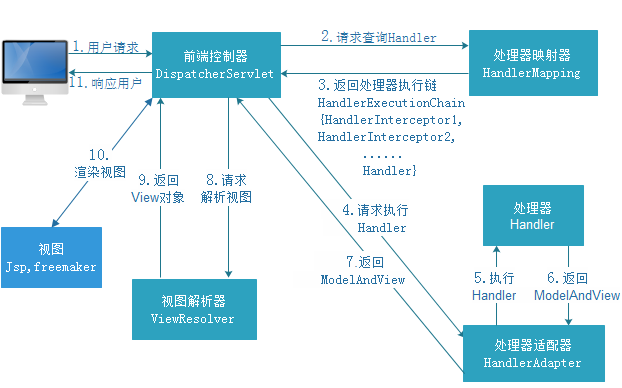
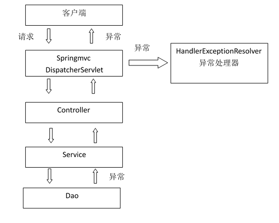

# Spring MVC

> 来源：`Spring/SpringMVC.md`

## 一、请求处理流程




用户发送请求至前端控制器DispatcherServlet

1. DispatcherServlet收到请求调用HandlerMapping处理器映射器。
2. 处理器映射器根据请求url找到具体的处理器，生成处理器对象及处理器拦截器(如果有则生成)一并返回给DispatcherServlet。
3. DispatcherServlet通过HandlerAdapter处理器适配器调用处理器
4. 执行处理器(Controller，也叫后端控制器)。
5. Controller执行完成返回ModelAndView
6. HandlerAdapter将controller执行结果ModelAndView返回给DispatcherServlet
7. DispatcherServlet将ModelAndView传给ViewReslover视图解析器
8. ViewReslover解析后返回具体View
9. DispatcherServlet对View进行渲染视图（即将模型数据填充至视图中）。
10. DispatcherServlet响应用户

## 二、前端控制器与三大组件


- DispatcherServlet：前端控制器

用户请求到达前端控制器，它就相当于mvc模式中的c，dispatcherServlet是整个流程控制的中心，由它调用其它组件处理用户的请求，dispatcherServlet的存在降低了组件之间的耦合性。

DispatcherServlet的配置在web.xml中

```xml
<!--配置springmvc核心过滤器，就是前端控制器-->
<servlet>
    <servlet-name>springmvc</servlet-name>
    <servlet-class>org.springframework.web.servlet.DispatcherServlet</servlet-class>
    <init-param>
    <!--不配置这项的话默认会加载/WEB-INF下 <servlet-name>-servlet.xml的文件，这里的话就会自动加载springmvc-servlet.xml的文件-->
        <param-name>contextConfigLocation</param-name>
        <param-value>classpath:springmvc.xml</param-value>
    </init-param>
</servlet>

<servlet-mapping>
    <servlet-name>springmvc</servlet-name>
    <!--
        1. /* 拦截所有 jsp js png .css 真的全拦截 建议不使用
        2. *.action *.do 拦截以do action 结尾的请求 肯定能使用 ERP
        3. / 拦截所有 （不包括jsp) (包含.js .png.css) 强烈建议使用 /对静态资源放行
    -->
    <url-pattern>/</url-pattern>
</servlet-mapping>
```

其他的三大组件都是在前端控制器springmvc.xml（名称随意）中进行配置

三大组件分别是：

处理器映射器： HandlerMapping HandlerMapping负责根据用户请求url找到Handler即处理器，springmvc提供了不同的映射器实现不同的映射方式，例如：配置文件方式，实现接口方式，注解方式等。

## 三、web.xml 配置


```xml
<!--配置映射器解析器-->
<bean class="org.springframework.web.servlet.mvc.method.annotation.RequestMappingHandlerMapping"/>
```

处理器适配器： HandlAdapter  通过HandlerAdapter对处理器进行执行，这是适配器模式的应用，通过扩展适配器可以对更多类型的处理器进行执行。

处理器适配器配置：

```xml
<!--配置映射器适配器-->
<bean class="org.springframework.web.servlet.mvc.method.annotation.RequestMappingHandlerAdapter"/>
```

视图解析器： ViewResolver   View Resolver负责将处理结果生成View视图，View Resolver首先根据逻辑视图名解析成物理视图名即具体的页面地址，再生成View视图对象，最后对View进行渲染将处理结果通过页面展示给用户

视图解析器配置

```xml
<!--配置视图解析器-->
<bean class="org.springframework.web.servlet.view.InternalResourceViewResolver">
    <property name="prefix" value="/"/>
    <property name="suffix" value=".jsp"/>
</bean>
```

### 注解驱动配置

对于处理器映射器和处理器适配器可以使用注解的方式直接配置

```xml
<!--配置注解驱动后可以不用配置上面的映射器解析器和映射器适配器-->
<mvc:annotation-driven/>
```

对于提交的中文乱码问题可以在web.xml中配置过滤器进行处理

```xml
<!--处理POST中文乱码-->
<servlet>
    <servlet-name>encoding</servlet-name>
    <servlet-class>org.springframework.web.filter.CharacterEncodingFilter</servlet-class>
    <init-param>
        <param-name>encoding</param-name>
        <param-value>UTF-8</param-value>
    </init-param>
</servlet>

<servlet-mapping>
    <servlet-name>encoding</servlet-name>
    <url-pattern>*.actiom</url-pattern>
</servlet-mapping>
```

在springmvc和mybatis整合过程中web.xml中不仅要配置上面的前端控制器 还要配置applicationContext.xml的监听器

```xml
<!--设置applicationContext.xml的文件位置-->
<context-param>
    <param-name>contextConfigLocation</param-name>
    <param-value>classpath:applicationContext.xml</param-value>
</context-param>

<!--配置监听器加载applicationContext.xml-->
<listener>
    <listener-class>org.springframework.web.context.ContextLoaderListener</listener-class>
</listener>
```

在遇到日期转换问题时可以配置Converter转换，配置的位置在之前配置处理器映射器和处理器适配器的注解位置

```xml
<bean id="conversionServiceFactoryBean" class="org.springframework.context.support.ConversionServiceFactoryBean">
    <property name="converters">
        <list>
            <bean class="com.wjx.springmvc01.convert.DateConverter"/>
        </list>
    </property>
</bean>
```

```java
public class DateConverter implements Converter<String, Date> {
        @Override
        public Date convert(String source) {
            SimpleDateFormat format = new SimpleDateFormat("yyyy-MM-dd HH:mm:ss");
            try {
                if (!StringUtils.isEmpty(source)) {
                    Date date = format.parse(source);
                    return date;
                }
            } catch (ParseException e) {
                e.printStackTrace();
            }
            return null;
        }
}
```

在最后测试的时候遇到问题，使用@Responsebody转换成json输出的时候提示转换出错，使用输入也是同样的问题，提示错误是415，之前碰到415的错误是因为请求头不是json，这次选择json仍然报错，后来发现可能是json转换的jar包没有，引进fastjson发现没用，后来使用gson解决

对于springmvc中Controller返回的string可以使用转发和重定向来跳转页面

## 四、重定向与转发


```java
    // 重定向相当于执行了新的request和response，所以之前的请求参数都会丢失
    return "redirect:/itemEdit.action?itemId=" + item.getId();
```

转发

```java
     // 使用转发的方式实现。转发后浏览器地址栏还是原来的请求地址，
     // 转发并没有执行新的request和response，所以之前的请求参数都存在
     return "forward:/itemEdit.action";
```

在springmvc的开发中异常可以交由异常处理器进行统一处理

系统的dao、service、controller出现异常都通过throws Exception向上抛出，最后由springmvc前端控制器交由异常处理器进行异常处理



## 五、异常处理


```java
public class ExceptionHandle implements HandlerExceptionResolver {
    private Logger logger = LoggerFactory.getLogger(ExceptionHandle.class);
    @Override
    public ModelAndView resolveException(HttpServletRequest request, HttpServletResponse response, Object handler,Exception ex) {
        logger.info(ex.getMessage());
        ModelAndView modelAndView = new ModelAndView();
        modelAndView.setViewName("/WEB-IBF/error.html");
        return modelAndView;
    }
}
```

我们定义的异常处理器要继承 HandlerExceptionResolver ，并实现resolveException（），因为返回值是ModelAndView，我们必须通过ModelAndView的setViewName来返回视图

完成异常处理器代码后要在springmvc.xml中进行配置，配置方法就是注册一个bean即可

## 六、文件上传


springmvc上传文件要在springmvc.xml中配置上传解析器

```xml
<!--配置文件上传-->
<bean id="multipartResolver" class="org.springframework.web.multipart.commons.CommonsMultipartResolver">
    <!--默认编码-->
    <property name="defaultEncoding" value="UTF-8"/>
    <!--设置文件大小-->
    <property name="maxUploadSize" value="52428800"/>
</bean>
```

配置上传解析器后再controller的方法中要注意必须使用MultipartFile来接收参数

```java
@RequestMapping(value = "/springmvc/upload", method = RequestMethod.POST)
public String upload(MultipartFile file) {
    try {
        String s = UUID.randomUUID().toString();
        //取文件拓展名
        String originalFilename = file.getOriginalFilename();
        String extName = originalFilename.substring(originalFilename.lastIndexOf(".") + 1);
        String url = s + "." + extName;
        file.transferTo(new File("E:/upload/" + url));
    } catch (IOException e) {
        e.printStackTrace();
    }
    return "index";
}
```

在Controller中自定义的转换器，不过这个不是全局的只能在此controller中使用

```java
@InitBinder
protected void initBinder(HttpServletRequest request, ServletRequestDataBinder binder) throws Exception {
    //向springmvc内部注入一个自定义的类型转换器
    //参数一：将String转成什么类型的字节码
    //参数二：自定义转换规则
    //true表示该日期字段可以为空
    binder.registerCustomEditor(
    Date.class,
    new CustomDateEditor(new SimpleDateFormat("yyyy-MM-dd"),false)
    );
}
```

使用@RequestParam可以处理传参与形参名称不一致的问题，不过这样要求传的参数必须不能为null，此时我们可以配置 required = false；这样就可以处理为null的问题，defaultValue可以设置参数的默认值

```java
@RequestParam(value = "u",required = false, defaultValue = "xxx") User user)
```

SpringMVC 的处理器拦截器类似于Servlet 开发中的过滤器Filter，用于对处理器进行预处理和后处理。

自定义的拦截器要实现一个接口HandlerInterceptor

```java
public class MyInterceptor implements HandlerInterceptor {
    //方法前执行
    @Override
    public boolean preHandle(HttpServletRequest request, HttpServletResponse response, Object handler) throws Exception {
        //false就不放行，后面的无法执行
        return false;
    }

    //方法后执行
    @Override
    public void postHandle(HttpServletRequest request, HttpServletResponse response, Object handler, ModelAndView modelAndView) throws Exception {

    }

    //页面渲染后执行
    @Override
    public void afterCompletion(HttpServletRequest request, HttpServletResponse response, Object handler, Exception ex) throws Exception {

    }
}
```

其中preHandle是在执行controller的方法之前执行的代码，我们可以将例如是否登录等验证放在这里，当他的返回值是false的情况下，就会被拦截不会执行controller中的代码，postHandle是controller执行结束后执行的代码，afterCompletion是页面渲染结束后执行的代码

拦截器的执行顺序（拦截器1先拦截）：

当有两个拦截器同时执行，并且都是放行状态 执行顺序是：preHandle（）1->preHandle（）2->postHandle（）2->postHandle（）1->afterCompletion（）2->afterCompletion（）1     当拦截器1的preHandle（）先执行，后面两个方法都会是拦截器2的先执行

当拦截器1的preHandle（）返回false，拦截的话执行是：preHandle（）1        当拦截器1拦截后后面的拦截器都不会执行

当拦截器1的preHandle（）返回true放行，拦截器2返回false，拦截器的执行顺序是：preHandle（）1->preHandle（）2->afterCompletion（）1   拦截器2返回false后面的不会执行，但是拦截器1的preHandle（）已经执行了，所以会执行后面的afterCompletion（）
