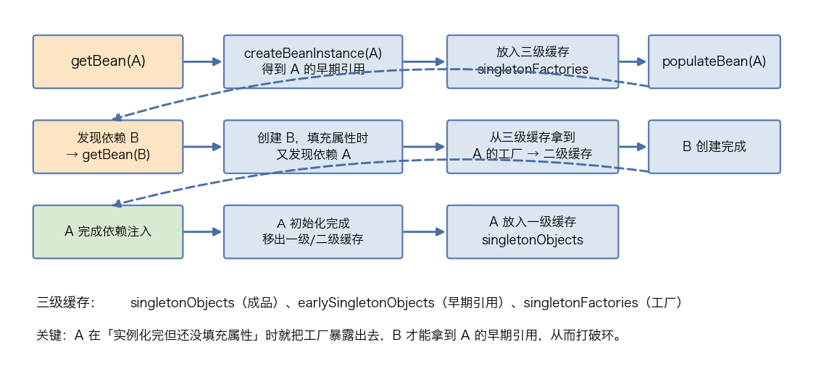
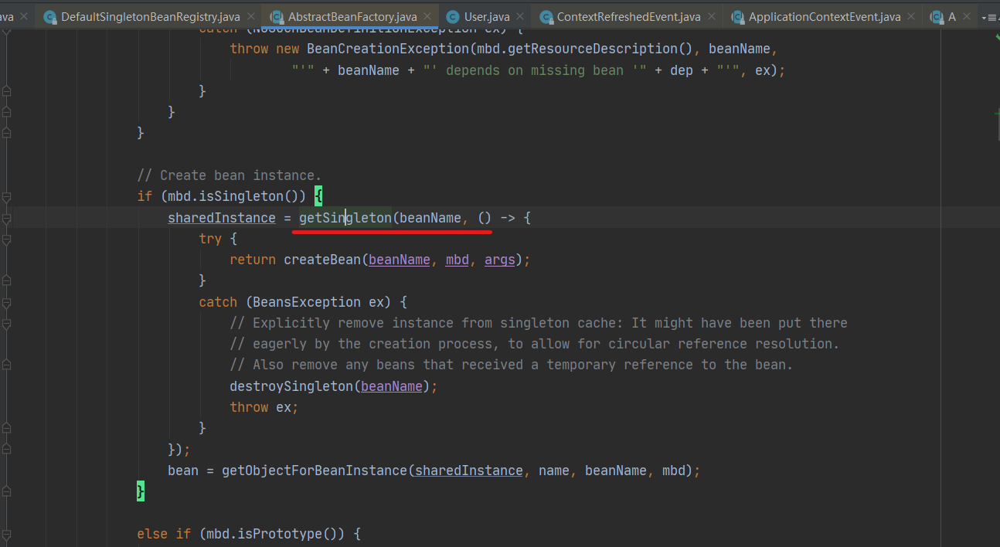
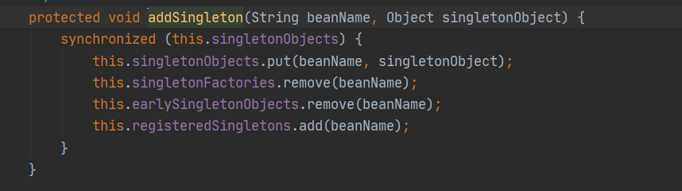

# Spring 循环依赖

> 来源：`Spring/Spring循环依赖.md`

循环依赖就是N个类中循环嵌套引用，如果在日常开发中我们new对象的方式发生这种循环依赖的话程序会在运行时一直循环调用，直至内存溢出报错。Spring对于这种情况有三种情况处理循环嵌套。

Spring对循环依赖的处理有三种情况：

1. 构造器的循环依赖：直接抛出BeanCurrentlyInCreationException
2. 单例模式下的setter循环依赖：通过三级缓存处理循环依赖
3. 非单例循环依赖：无法处理

## 二、解决循环依赖的前置条件

Spring解决循环依赖是有前置条件的

1. 出现循环依赖的Bean必须要是单例
2. 依赖注入的方式不能全是构造器注入的方式（很多博客上说，只能解决setter方法的循环依赖，这是错误的）

其中第一点应该很好理解，第二点：不能全是构造器注入是什么意思呢？我们还是用代码说话

```java
@Component
public class A {
// @Autowired
// private B b;
 public A(B b) {

 }
}

@Component
public class B {

// @Autowired
// private A a;

 public B(A a){

 }
}
```

在上面的例子中，A中注入B的方式是通过构造器，B中注入A的方式也是通过构造器，这个时候循环依赖是无法被解决，如果你的项目中有两个这样相互依赖的Bean，在启动时就会报出以下错误：

```java
Caused by: org.springframework.beans.factory.BeanCurrentlyInCreationException: Error creating bean with name 'a': Requested bean is currently in creation: Is there an unresolvable circular reference?
```

为了测试循环依赖的解决情况跟注入方式的关系，我们做如下四种情况的测试
依赖情况依赖注入方式循环依赖是否被解决AB相互依赖（循环依赖）均采用setter方法注入是AB相互依赖（循环依赖）均采用构造器注入否AB相互依赖（循环依赖）A中注入B的方式为setter方法，B中注入A的方式为构造器是AB相互依赖（循环依赖）B中注入A的方式为setter方法，A中注入B的方式为构造器否Spring在创建Bean时默认会根据自然排序进行创建，所以A会先于B进行创建（所以第四种不行）
具体的测试代码很简单，我就不放了。从上面的测试结果我们可以看到，不是只有在setter方法注入的情况下循环依赖才能被解决，即使存在构造器注入的场景下，循环依赖依然被可以被正常处理掉。

## 三、单例 Bean 的初始化步骤与三级缓存

Spring单例对象的初始化分为3步

1. createBeanInstance：实例化，也就是调用对象的构造方法实例化对象
2. populateBean：填充属性，这一步主要是多bean的依赖属性进行填充
3. initializeBean：调用Spring的init方法

根据单例bean初始化步骤可以看出循环依赖主要发生在第一二步

**构造器循环依赖**

this .singletonsCurrentlylnCreation.add(beanName）将当前正要创建的bean记录在缓存中Spring容器将每一个正在创建的bean 标识符放在一个“当前创建bean 池”中，在创建过程中将一直保持在这个池中，因此如果在创建bean 过程中发现自己已经在“当前创建bean 池” 里时，将抛出BeanCurrentlylnCreationException 异常表示循环依赖；而对于创建完毕的bean 将从“ 当前创建bean 池”中清除掉。

**setter循环构造**

Spring为了解决单例的循环依赖问题使用了三级缓存分别是：

```java
public class DefaultSingletonBeanRegistry extends SimpleAliasRegistry implements SingletonBeanRegistry {
	...
	// 从上至下 分表代表这“三级缓存”
	private final Map<String, Object> singletonObjects = new ConcurrentHashMap<>(256); //一级缓存
	private final Map<String, Object> earlySingletonObjects = new HashMap<>(16); // 二级缓存
	private final Map<String, ObjectFactory<?>> singletonFactories = new HashMap<>(16); // 三级缓存
	...

	/** Names of beans that are currently in creation. */
	// 这个缓存也十分重要：它表示bean创建过程中都会在里面呆着~
	// 它在Bean开始创建时放值，创建完成时会将其移出~
	private final Set<String> singletonsCurrentlyInCreation = Collections.newSetFromMap(new ConcurrentHashMap<>(16));

	/** Names of beans that have already been created at least once. */
	// 当这个Bean被创建完成后，会标记为这个 注意：这里是set集合 不会重复
	// 至少被创建了一次的  都会放进这里~~~~
	private final Set<String> alreadyCreated = Collections.newSetFromMap(new ConcurrentHashMap<>(256));
}
```

这三级缓存的作用分别是：

singletonFactories ： 进入实例化阶段的单例对象工厂的cache （三级缓存）

earlySingletonObjects ：完成实例化但是尚未初始化的，提前暴光的单例对象的Cache （二级缓存）

singletonObjects：完成初始化的单例对象的cache（一级缓存）

最开始使用下列方法获取对象

```java
org.springframework.beans.factory.support.AbstractBeanFactory#doGetBean

protected <T> T doGetBean(final String name, @Nullable final Class<T> requiredType,
                              @Nullable final Object[] args, boolean typeCheckOnly) throws BeansException {
    //1.查看缓存中是否已经有这个bean了
    Object sharedInstance = getSingleton(beanName); //@1
    if (sharedInstance != null && args == null) {
        bean = getObjectForBeanInstance(sharedInstance, name, beanName, null);
    }else {
        //若缓存中不存在，准备创建这个bean
        if (mbd.isSingleton()) {
            //2.下面进入单例bean的创建过程
            sharedInstance = getSingleton(beanName, () -> {
                try {
                    return createBean(beanName, mbd, args);
                }
                catch (BeansException ex) {
                    throw ex;
                }
            });
            bean = getObjectForBeanInstance(sharedInstance, name, beanName, mbd);
        }
    }
    return (T) bean;
}
```

我们在创建bean的时候，会首先从cache中获取这个bean，这个缓存就是sigletonObjects。主要的调用方法是：

```java
public Object getSingleton(String beanName) {
    return getSingleton(beanName, true);
}
```

然后进入下面方法，会依次尝试从3级缓存中查找bean，注意下面的第2个参数，为ture的时候，才会从第3级中查找，否则只会查找1、2级缓存

```java
//allowEarlyReference:是否允许从三级缓存singletonFactories中通过getObject拿到bean
protected Object getSingleton(String beanName, boolean allowEarlyReference) {
    //1.先从一级缓存中找
    Object singletonObject = this.singletonObjects.get(beanName);
    if (singletonObject == null && isSingletonCurrentlyInCreation(beanName)) {
        synchronized (this.singletonObjects) {
            //2.从二级缓存中找
            singletonObject = this.earlySingletonObjects.get(beanName);
            if (singletonObject == null && allowEarlyReference) {
                //3.二级缓存中没找到 && allowEarlyReference为true的情况下,从三级缓存中找
                ObjectFactory<?> singletonFactory = this.singletonFactories.get(beanName);
                if (singletonFactory != null) {
                    //三级缓存返回的是一个工厂，通过工厂来获取创建bean
                    singletonObject = singletonFactory.getObject();
                    //将创建好的bean丢到二级缓存中
                    this.earlySingletonObjects.put(beanName, singletonObject);
                    //从三级缓存移除
                    this.singletonFactories.remove(beanName);
                }
            }
        }
    }
    return singletonObject;
}
```

刚开始3层缓存都找不到返回null，执行下面代码

```java
if (mbd.isSingleton()) {
    sharedInstance = getSingleton(beanName, () -> { //@1
        try {
            return createBean(beanName, mbd, args);
        }
        catch (BeansException ex) {
            destroySingleton(beanName);
            throw ex;
        }
    });
}
```

从上面三级缓存的分析，我们可以知道，Spring解决循环依赖的诀窍就在于singletonFactories这个三级cache。这个cache的类型是ObjectFactory，定义如下：

```java
public interface ObjectFactory<T> {
    T getObject() throws BeansException;
}
```

这个接口在AbstractBeanFactory里实现，并在核心方法doCreateBean（）引用下面的方法

```java
protected void addSingletonFactory(String beanName, ObjectFactory<?> singletonFactory) {
    Assert.notNull(singletonFactory, "Singleton factory must not be null");
    synchronized (this.singletonObjects) {
        if (!this.singletonObjects.containsKey(beanName)) {
            this.singletonFactories.put(beanName, singletonFactory);
            this.earlySingletonObjects.remove(beanName);
            this.registeredSingletons.add(beanName);
        }
    }
}
```

这段代码发生在createBeanInstance之后，populateBean（）之前，也就是说单例对象此时已经被创建出来(调用了构造器)。这个对象已经被生产出来了，此时将这个对象提前曝光出来，让大家使用。

这样做有什么好处呢？让我们来分析一下“A的某个field或者setter依赖了B的实例对象，同时B的某个field或者setter依赖了A的实例对象”这种循环依赖的情况。A首先完成了初始化的第一步，并且将自己提前曝光到singletonFactories中，此时进行初始化的第二步，发现自己依赖对象B，此时就尝试去get(B)，发现B还没有被create，所以走create流程，B在初始化第一步的时候发现自己依赖了对象A，于是尝试get(A)，尝试一级缓存singletonObjects(肯定没有，因为A还没初始化完全)，尝试二级缓存earlySingletonObjects（也没有），尝试三级缓存singletonFactories，由于A通过ObjectFactory将自己提前曝光了，所以B能够通过ObjectFactory.getObject拿到A对象(虽然A还没有初始化完全，但是总比没有好呀)，B拿到A对象后顺利完成了初始化阶段1、2、3，完全初始化之后将自己放入到一级缓存singletonObjects中。此时返回A中，A此时能拿到B的对象顺利完成自己的初始化阶段2、3，最终A也完成了初始化，进去了一级缓存singletonObjects中，而且更加幸运的是，由于B拿到了A的对象引用，所以B现在hold住的A对象完成了初始化。

**非单例循环依赖**

只有单例的bean会通过三级缓存提前暴露来解决循环依赖的问题，而非单例的bean，每次从容器中获取都是一个新的对象，都会重新创建，所以非单例的bean是没有缓存的，不会将其放到三级缓存中。

## 四、为什么要三级缓存而不是二级缓存


这样做是可以解决：早期暴露给其他依赖者的bean和最终暴露的bean不一致的问题。

若将刚刚实例化好的bean直接丢到二级缓存中暴露出去，如果后期这个bean对象被更改了，比如可能在上面加了一些拦截器，将其包装为一个代理了，那么暴露出去的bean和最终的这个bean就不一样的，将自己暴露出去的时候是一个原始对象，而自己最终却是一个代理对象，最终会导致被暴露出去的和最终的bean不是同一个bean的，将产生意想不到的效果，而三级缓存就可以发现这个问题，会报错。

## 五、解决了循环依赖后还有哪些问题


循环依赖的情况下，由于注入的是早期的bean，此时早期的bean中还未被填充属性，初始化等各种操作，也就是说此时bean并没有被完全初始化完毕，此时若直接拿去使用，可能存在有问题的风险。

三级缓存为什么要使用工厂而不是直接使用引用？换而言之，为什么需要这个三级缓存，直接通过二级缓存暴露一个引用不行吗？

答：**这个工厂的目的在于延迟对实例化阶段生成的对象的代理，只有真正发生循环依赖的时候，才去提前生成代理对象，否则只会创建一个工厂并将其放入到三级缓存中，但是不会去通过这个工厂去真正创建对象**

我们思考一种简单的情况，就以单独创建A为例，假设AB之间现在没有依赖关系，但是A被代理了，这个时候当A完成实例化后还是会进入下面这段代码：

```java
// A是单例的，mbd.isSingleton()条件满足
// allowCircularReferences：这个变量代表是否允许循环依赖，默认是开启的，条件也满足
// isSingletonCurrentlyInCreation：正在在创建A，也满足
// 所以earlySingletonExposure=true
boolean earlySingletonExposure = (mbd.isSingleton() && this.allowCircularReferences &&
                                  isSingletonCurrentlyInCreation(beanName));
// 还是会进入到这段代码中
if (earlySingletonExposure) {
 // 还是会通过三级缓存提前暴露一个工厂对象
    addSingletonFactory(beanName, () -> getEarlyBeanReference(beanName, mbd, bean));
}
```

看到了吧，即使没有循环依赖，也会将其添加到三级缓存中，而且是不得不添加到三级缓存中，因为到目前为止Spring也不能确定这个Bean有没有跟别的Bean出现循环依赖。

假设我们在这里直接使用二级缓存的话，那么意味着所有的Bean在这一步都要完成`AOP`代理。这样做有必要吗？

不仅没有必要，而且违背了Spring在结合`AOP`跟Bean的生命周期的设计！Spring结合`AOP`跟Bean的生命周期本身就是通过`AnnotationAwareAspectJAutoProxyCreator`这个后置处理器来完成的，在这个后置处理的`postProcessAfterInitialization`方法中对初始化后的Bean完成`AOP`代理。如果出现了循环依赖，那没有办法，只有给Bean先创建代理，但是没有出现循环依赖的情况下，设计之初就是让Bean在生命周期的最后一步完成代理而不是在实例化后就立马完成代理。

1.入口处即是**实例化、初始化A这个单例Bean**。`AbstractBeanFactory.doGetBean("a")`

```java
protected <T> T doGetBean(...){
	...
	// 标记beanName a是已经创建过至少一次的~~~ 它会一直存留在缓存里不会被移除（除非抛出了异常）
	// 参见缓存Set<String> alreadyCreated = Collections.newSetFromMap(new ConcurrentHashMap<>(256))
	if (!typeCheckOnly) {
		markBeanAsCreated(beanName);
	}

	// 此时a不存在任何一级缓存中，且不是在创建中  所以此处返回null
	// 此处若不为null，然后从缓存里拿就可以了(主要处理FactoryBean和BeanFactory情况吧)
	Object beanInstance = getSingleton(beanName, false);
	...
	// 这个getSingleton方法非常关键。
	//1、标注a正在创建中~
	//2、调用singletonObject = singletonFactory.getObject();（实际上调用的是createBean()方法）  因此这一步最为关键
	//3、此时实例已经创建完成  会把a移除整整创建的缓存中
	//4、执行addSingleton()添加进去。（备注：注册bean的接口方法为registerSingleton，它依赖于addSingleton方法）
	sharedInstance = getSingleton(beanName, () -> { ... return createBean(beanName, mbd, args); });
}
```

2、下面进入到最为复杂的`AbstractAutowireCapableBeanFactory.createBean/doCreateBean()`环节，创建A的实例

```java
protected Object doCreateBean(){
	...
	// 使用构造器/工厂方法   instanceWrapper是一个BeanWrapper
	instanceWrapper = createBeanInstance(beanName, mbd, args);
	// 此处bean为"原始Bean"   也就是这里的A实例对象：A@1234
	final Object bean = instanceWrapper.getWrappedInstance();
	...
	// 是否要提前暴露（允许循环依赖）  现在此处A是被允许的
	boolean earlySingletonExposure = (mbd.isSingleton() && this.allowCircularReferences && isSingletonCurrentlyInCreation(beanName));

	// 允许暴露，就把A绑定在ObjectFactory上，注册到三级缓存`singletonFactories`里面去保存着
	// Tips:这里后置处理器的getEarlyBeanReference方法会被促发，自动代理创建器在此处创建代理对象（注意执行时机 为执行三级缓存的时候）
	if (earlySingletonExposure) {
		addSingletonFactory(beanName, () -> getEarlyBeanReference(beanName, mbd, bean));
	}
	...
	// exposedObject 为最终返回的对象，此处为原始对象bean也就是A@1234,下面会有用处
	Object exposedObject = bean;
	// 给A@1234属性完成赋值，@Autowired在此处起作用~
	// 因此此处会调用getBean("b")，so 会重复上面步骤创建B类的实例
	// 此处我们假设B已经创建好了 为B@5678

	// 需要注意的是在populateBean("b")的时候依赖有beanA，所以此时候调用getBean("a")最终会调用getSingleton("a")，
	//此时候上面说到的getEarlyBeanReference方法就会被执行。这也解释为何我们@Autowired是个代理对象，而不是普通对象的根本原因

	populateBean(beanName, mbd, instanceWrapper);
	// 实例化。这里会执行后置处理器BeanPostProcessor的两个方法
	// 此处注意：postProcessAfterInitialization()是有可能返回一个代理对象的，这样exposedObject 就不再是原始对象了  特备注意哦~~~
	// 比如处理@Aysnc的AsyncAnnotationBeanPostProcessor它就是在这个时间里生成代理对象的（有坑，请小心使用@Aysnc）
	exposedObject = initializeBean(beanName, exposedObject, mbd);

	... // 至此，相当于A@1234已经实例化完成、初始化完成（属性也全部赋值了~）
	// 这一步我把它理解为校验：校验：校验是否有循环引用问题~~~~~
if (earlySingletonExposure) {
		// 注意此处第二个参数传的false，表示不去三级缓存里singletonFactories再去调用一次getObject()方法了~~~
		// 上面建讲到了由于B在初始化的时候，会触发A的ObjectFactory.getObject()  所以a此处已经在二级缓存earlySingletonObjects里了
		// 因此此处返回A的实例：A@1234
		Object earlySingletonReference = getSingleton(beanName, false);
		if (earlySingletonReference != null) {

			// 这个等式表示，exposedObject若没有再被代理过，这里就是相等的
			// 显然此处我们的a对象的exposedObject它是没有被代理过的  所以if会进去~
			// 这种情况至此，就全部结束了~~~
			if (exposedObject == bean) {
				exposedObject = earlySingletonReference;
			}

			// 继续以A为例，比如方法标注了@Aysnc注解，exposedObject此时候就是一个代理对象，因此就会进到这里来
			//hasDependentBean(beanName)是肯定为true，因为getDependentBeans(beanName)得到的是["b"]这个依赖
			else if (!this.allowRawInjectionDespiteWrapping && hasDependentBean(beanName)) {
				String[] dependentBeans = getDependentBeans(beanName);
				Set<String> actualDependentBeans = new LinkedHashSet<>(dependentBeans.length);

				// A@1234依赖的是["b"]，所以此处去检查b
				// 如果最终存在实际依赖的bean：actualDependentBeans不为空 那就抛出异常  证明循环引用了~
				for (String dependentBean : dependentBeans) {
					// 这个判断原则是：如果此时候b并还没有创建好，this.alreadyCreated.contains(beanName)=true表示此bean已经被创建过，就返回false
					// 若该bean没有在alreadyCreated缓存里，就是说没被创建过(其实只有CreatedForTypeCheckOnly才会是此仓库)
					if (!removeSingletonIfCreatedForTypeCheckOnly(dependentBean)) {
						actualDependentBeans.add(dependentBean);
					}
				}
				if (!actualDependentBeans.isEmpty()) {
					throw new BeanCurrentlyInCreationException(beanName,
							"Bean with name '" + beanName + "' has been injected into other beans [" +
							StringUtils.collectionToCommaDelimitedString(actualDependentBeans) +
							"] in its raw version as part of a circular reference, but has eventually been " +
							"wrapped. This means that said other beans do not use the final version of the " +
							"bean. This is often the result of over-eager type matching - consider using " +
							"'getBeanNamesOfType' with the 'allowEagerInit' flag turned off, for example.");
				}
			}
		}
	}
}
```



**最后的最后，由于我太暖心了_，再来个纯文字版的总结。**  依旧以上面`A`、`B`类使用属性`field`注入循环依赖的例子为例，对整个流程做文字步骤总结如下：

1. 使用`context.getBean(A.class)`，旨在获取容器内的单例A(若A不存在，就会走A这个Bean的创建流程)，显然初次获取A是不存在的，因此走**A的创建之路~**
2. `实例化`A（注意此处仅仅是实例化），并将它放进`缓存`（此时A已经实例化完成，已经可以被引用了）
3. `初始化`A：`@Autowired`依赖注入B（此时需要去容器内获取B）
4. 为了完成依赖注入B，会通过`getBean(B)`去容器内找B。但此时B在容器内不存在，就走向**B的创建之路~**
5. `实例化`B，并将其放入缓存。（此时B也能够被引用了）
6. `初始化`B，`@Autowired`依赖注入A（此时需要去容器内获取A）
7. `此处重要`：初始化B时会调用`getBean(A)`去容器内找到A，上面我们已经说过了此时候因为A已经实例化完成了并且放进了缓存里，所以这个时候去看缓存里是已经存在A的引用了的，所以`getBean(A)`能够正常返回
8. **B初始化成功**（此时已经注入A成功了，已成功持有A的引用了），return（注意此处return相当于是返回最上面的`getBean(B)`这句代码，回到了初始化A的流程中~）。
9. 因为B实例已经成功返回了，因此最终**A也初始化成功**
10. **到此，B持有的已经是初始化完成的A，A持有的也是初始化完成的B，完美~**

## 六、只使用一级缓存的问题


只使用一级缓存，也就是将所有的 bean 的实例都放在同一个 Map 容器中。其中就包括已经初始化好的 bean 和未初始化好的 bean

已经初始化好的 bean: 指经过了 bean 创建的三个阶段之后的 bean 对象
    未初始化好的 bean : 指经过了 bean 创建的第一个阶段，只将 bean 实例创建出来了

假设 bean 是需要 AOP 增强的，那么最终放到缓存中的应该是一个代理 bean。而代理 bean 的产生是在 initializeBean(第三阶段) 的时候。所以，我们推导出：如果只使用一级缓存的话，缓存的插入应该放在 initializeBean 之后。

如果在 initializeBean 的时候记录缓存，那么碰到循环依赖的情况，需要在 populateBean(第二阶段) 的时候再去注入循环依赖的 bean，此时，缓存中是没有循环依赖的 bean 的，就会导致 bean 重新创建实例。这样显然是不行的

tip：理论上使用一级缓存是可以解决普通场景下的循环依赖的，因为对于普通场景，从始至终 bean 的对象引用始终都是不变的。  但是，如果被循环依赖的 bean 是一个 AOP 增强的代理 bean 的话，bean 的原始引用和最终产生的 AOP 增强 bean 的引用是不一样的，一级缓存就搞不定了。

通过一个ConcurrentHashMap存储Bean对象，保证Bean名称唯一的情况下也能保证线程安全

## 七、单例注册表的简单实现


```java
public class RegSingleton {
    private final static Map<String, Object> singletonObjects = new ConcurrentHashMap<>(16);

    private RegSingleton(){}

    public static Object getInstance(String className){
        if (StringUtils.isEmpty(className)) {
            return null;
        }
        if (singletonObjects.get(className) == null) {
            try {
                singletonObjects.put(className, Class.forName(className).newInstance());
            } catch (Exception e) {
                e.printStackTrace();
            }
        }
        return singletonObjects.get(className);
    }
}
```

单例模式的最佳实践就是Spring中的Bean了，Spring中的Bean默认都是单例模式，Spring实现单例的方式就采用了单例注册表的方式。

首先在Bean工厂中，如果设置了Spring的Bean模式为单例模式，Spring就会通过getSingleton的方式去获取单例Bean对象。



接着就会进入到DefaultSingletonBeanRegistry类的getSingleton方法中，忽略掉其他代码，只看单例Bean生成相关代码

```java
public class DefaultSingletonBeanRegistry extends SimpleAliasRegistry implements SingletonBeanRegistry {
    /** Cache of singleton objects: bean name to bean instance. */
    private final Map<String, Object> singletonObjects = new ConcurrentHashMap<>(256);
    public Object getSingleton(String beanName, ObjectFactory<?> singletonFactory) {
    //一系列处理操作
         }
         finally {
            if (recordSuppressedExceptions) {
               this.suppressedExceptions = null;
            }
            afterSingletonCreation(beanName);
         }
         if (newSingleton) {
             //如果实例对象不存在，注册到单例注册表中
            addSingleton(beanName, singletonObject);
         }
      }
      return singletonObject;
   }
}
}
```

对应的addSingleton方法就是将对象加入到单例注册表中：


