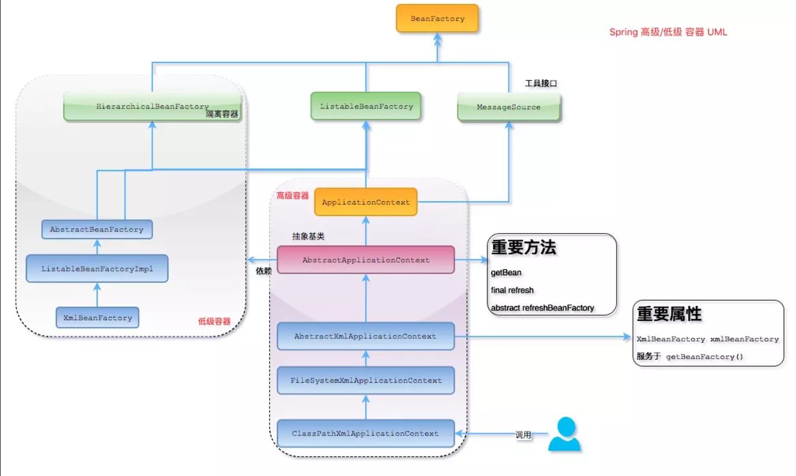
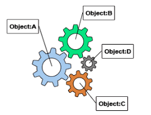
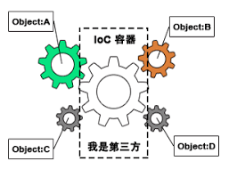
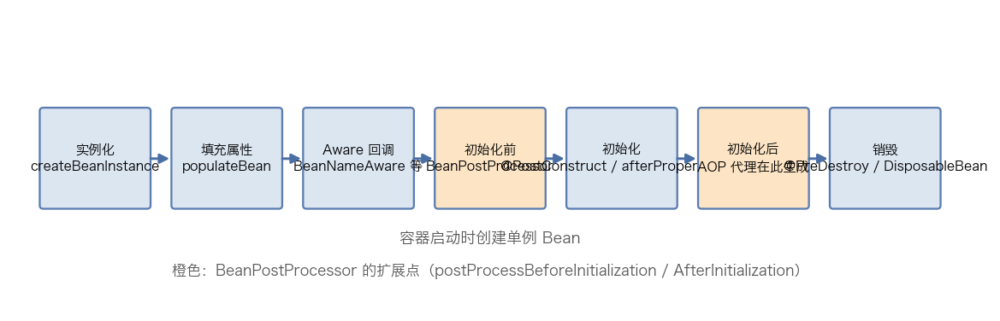
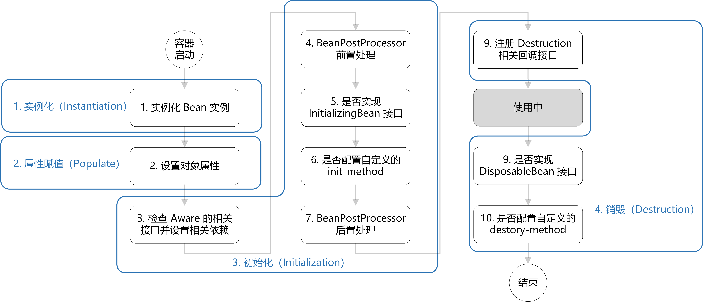
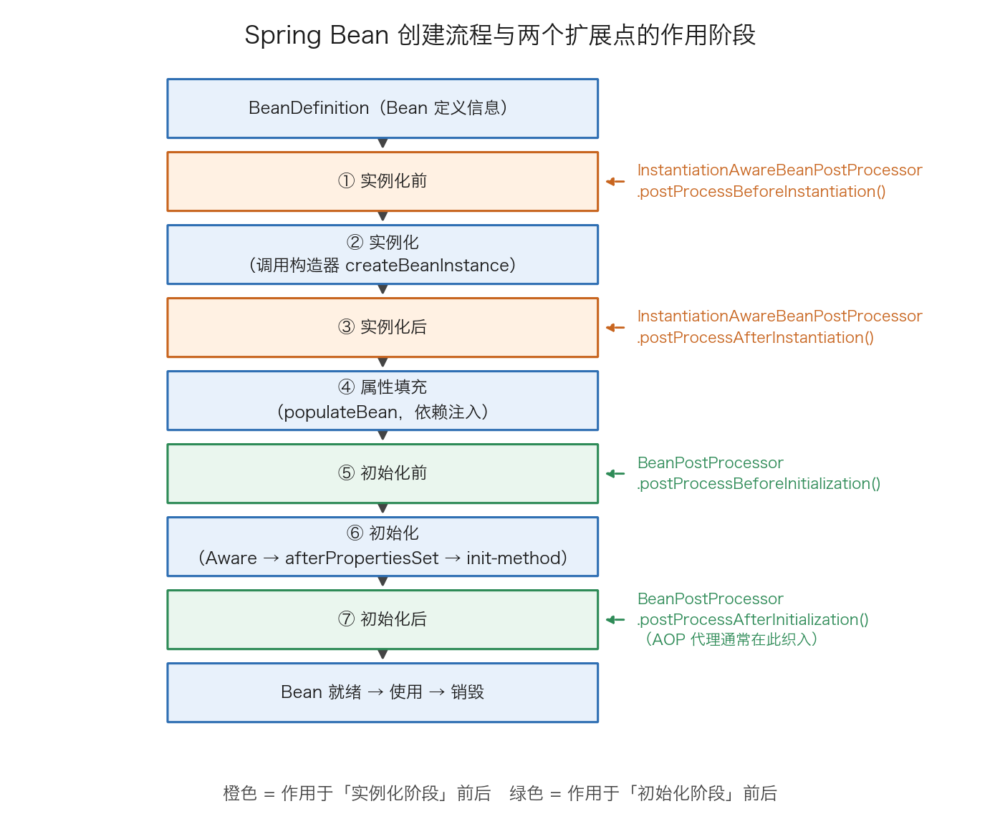

# Spring 核心容器与 Bean

> 合并自：`Spring.md`、`BeanFactory和FactoryBean.md`、`Spring Bean的生命周期.md`、`手动向Spring容器中注入Bean.md`、`BeanFactory.md`。原文未删改（仅修正已知错误、调整格式）。

## 一、BeanFactory 与 ApplicationContext

> 来源：`Spring/Spring.md`

BeanFactory和ApplicationContext是Spring的两大核心接口，都可以当做Spring的容器。其中ApplicationContext是BeanFactory的子接口。

（1）BeanFactory：是Spring里面最底层的接口，包含了各种Bean的定义，读取bean配置文档，管理bean的加载、实例化，控制bean的生命周期，维护bean之间的依赖关系。ApplicationContext接口作为BeanFactory的派生，除了提供BeanFactory所具有的功能外，还提供了更完整的框架功能：

> ①继承MessageSource，因此支持国际化。
> ②统一的资源文件访问方式。
> ③提供在监听器中注册bean的事件。
> ④同时加载多个配置文件。
> ⑤载入多个（有继承关系）上下文 ，使得每一个上下文都专注于一个特定的层次，比如应用的web层。

（2）①BeanFactroy采用的是延迟加载形式来注入Bean的，即只有在使用到某个Bean时(调用getBean())，才对该Bean进行加载实例化。这样，我们就不能发现一些存在的Spring的配置问题。如果Bean的某一个属性没有注入，BeanFacotry加载后，直至第一次使用调用getBean方法才会抛出异常

②ApplicationContext，它是在容器启动时，一次性创建了所有的Bean。这样，在容器启动时，我们就可以发现Spring中存在的配置错误，这样有利于检查所依赖属性是否注入。 ApplicationContext启动后预载入所有的单实例Bean，通过预载入单实例bean ,确保当你需要的时候，你就不用等待，因为它们已经创建好了。

③相对于基本的BeanFactory，ApplicationContext 唯一的不足是占用内存空间。当应用程序配置Bean较多时，程序启动较慢。

（3）BeanFactory通常以编程的方式被创建，ApplicationContext还能以声明的方式创建，如使用ContextLoader。

（4）BeanFactory和ApplicationContext都支持BeanPostProcessor、BeanFactoryPostProcessor的使用，但两者之间的区别是：BeanFactory需要手动注册，而ApplicationContext则是自动注册。

BeanFactory简单粗暴，可以理解为就是一个HashMap，key是BeanName，value是Bean实例，通常只提供注册（put）、获取（get）、这两个功能。一般称为低级容器

ApplicationContext称为高级容器，因为他比BeanFactory多了更多功能。继承多个接口。



**IOC和DI的理解**

IOC是一种解耦的设计思想，不是具体的技术，所谓的控制反转就是把对象的创建和查找依赖对象的控制权交给容器，由容器进行注入组合对象，所以对象和对象之间是松散耦合的，这样利于功能的复用同时程序更加灵活。实现IOC的技术手段有DI（依赖注入）和DL（依赖查找）

DI依赖注入就是将自身对象中的内置对象通过注入的方式进行创建，所谓的依赖注入就是组件之间的依赖关系由容器在应用系统运行期间来决定，也就是由容器动态的将某种依赖关系的目标对象实例注入到应用系统的各个关联的组件中

依赖查找(Dependency Lookup)：容器中的受控对象通过容器的API来查找自己所依赖的资源和协作对象。这种方式虽然降低了对象间的依赖，但是同时也使用到了容器的API，造成了我们无法在容器外使用和测试对象。 依赖查找是一种更加传统的IoC实现方式。

依赖注入(Dependency Injection)：依赖注入就是将服务注入到使用它的地方。对象只提供普通的方法让容器去决定依赖关系，容器全权负责组件的装配，它会把符合依赖关系的对象通过属性（JavaBean中的setter）或者是构造子传递给需要的对象。

依赖注入的优势在于：

1. 查找定位操作与应用代码完全无关
2. 不依赖于容器的API，可以很容易地在任何容器以外使用应用对象
3. 不需要特殊的接口，绝大多数对象可以完全不必依赖容器

IOC思想最大的优势就是解耦，将对象之间的依赖关系转换成用配置文件来管理，由Spring IOC Container来管理





依赖注入目前主要依靠setter方法和构造器注入

**Spring的bean作用域：**

- **singleton :** bean在每个Spring ioc 容器中只有一个实例。
- **prototype**：一个bean的定义可以有多个实例。
- **request**：每次http请求都会创建一个bean，该作用域仅在基于web的Spring ApplicationContext情形下有效。
- **session**：在一个HTTP Session中，一个bean定义对应一个实例。该作用域仅在基于web的Spring ApplicationContext情形下有效。
- **global-session**：在一个全局的HTTP Session中，一个bean定义对应一个实例。该作用域仅在基于web的Spring ApplicationContext情形下有效

**Spring中bean线程安全问题**

Spring中的bean默认是单例模式，Spring并没有对单例bean进行多线程的封装处理。实际上大部分时候Spring bean是无状态的（如dao类），所以某种程度上bean是线程安全的，但如果bean有状态（如model view对象）需要开发者自己保证线程安全，最简单的方式就是改变bean的作用域，将singleton变为prototype，这样请求bean相当于new Bean()了，所以就可以保证线程安全

- 有状态就是有数据存储功能
- 无状态就是不会保存数据

**Spring如何处理线程并发问题**

在一般情况下，只有无状态的Bean才可以在多线程环境下共享，在Spring中，绝大部分Bean都可以声明为singleton作用域，因为Spring对一些Bean中非线程安全状态采用ThreadLocal进行处理，解决线程安全问题。

ThreadLocal和线程同步机制都是为了解决多线程中相同变量的访问冲突问题。同步机制采用了“时间换空间”的方式，仅提供一份变量，不同的线程在访问前需要获取锁，没获得锁的线程则需要排队。而ThreadLocal采用了“空间换时间”的方式。ThreadLocal会为每一个线程提供一个独立的变量副本，从而隔离了多个线程对数据的访问冲突。因为每一个线程都拥有自己的变量副本，从而也就没有必要对该变量进行同步了。ThreadLocal提供了线程安全的共享对象，在编写多线程代码时，可以把不安全的变量封装进ThreadLocal。

**Spring中bean的生命周期**

在传统的Java应用中，bean的生命周期很简单。使用Java关键字new进行bean实例化，然后该bean就可以使用了。一旦该bean不再被使用，则由Java自动进行垃圾回收。相比之下，Spring容器中的bean的生命周期就显得相对复杂多了。正确理解Spring bean的生命周期非常重要，因为你或许要利用Spring提供的扩展点来自定义bean的创建过程。下图展示了bean装载到Spring应用上下文中的一个典型的生命周期过程。



Bean 的生命周期概括起来就是 **4 个阶段**：

1. 实例化（Instantiation）
2. 属性赋值（Populate）
3. 初始化（Initialization）
4. 销毁（Destruction）



Aware、BeanPostProcessor、InitializingBean、init-method  这些都是 Spring 提供的扩展点

拓展点的作用

**aware接口**

若 Spring 检测到 bean 实现了 Aware 接口，则会为其注入相应的依赖。所以

通过让bean 实现 Aware 接口，则能在 bean 中获得相应的 Spring 容器资源

。

Spring 中提供的 Aware 接口有：

1. BeanNameAware：注入当前 bean 对应 beanName；
2. BeanClassLoaderAware：注入加载当前 bean 的 ClassLoader；
3. BeanFactoryAware：注入 当前BeanFactory容器 的引用。

以上是针对 BeanFactory 类型的容器，而对于 ApplicationContext 类型的容器，也提供了 Aware 接口，只不过这些 Aware 接口的注入实现，是通过 BeanPostProcessor 的方式注入的，但其作用仍是注入依赖。

1. EnvironmentAware：注入 Enviroment，一般用于获取配置属性；
2. EmbeddedValueResolverAware：注入 EmbeddedValueResolver（Spring EL解析器），一般用于参数解析；
3. ApplicationContextAware（ResourceLoader、ApplicationEventPublisherAware、MessageSourceAware）：注入 ApplicationContext 容器本身。

**BeanPostProcessor**

BeanPostProcessor 是 Spring 为**修改 bean**提供的强大扩展点，其可作用于容器中所有 bean，其定义如下：

```java
public interface BeanPostProcessor {

	// 初始化前置处理
	default Object postProcessBeforeInitialization(Object bean, String beanName) throws BeansException {
		return bean;
	}

	// 初始化后置处理
	default Object postProcessAfterInitialization(Object bean, String beanName) throws BeansException {
		return bean;
	}

}
```

常用场景有：

1. 对于标记接口的实现类，进行自定义处理。例如3.1节中所说的ApplicationContextAwareProcessor，为其注入相应依赖；再举个例子，自定义对实现解密接口的类，将对其属性进行解密处理；
2. 为当前对象提供代理实现。例如 Spring AOP 功能，生成对象的代理类，然后返回。

**InitializingBean 和 init-method**

InitializingBean 和 init-method 是 Spring 为 **bean 初始化**提供的扩展点。

InitializingBean接口 的定义如下：

```java
public interface InitializingBean {
	void afterPropertiesSet() throws Exception;
}
```

在 afterPropertiesSet() 方法写初始化逻辑。

指定 init-method 方法，指定初始化方法：

```java
<?xml version="1.0" encoding="UTF-8"?>
<beans xmlns="http://www.springframework.org/schema/beans"
       xmlns:xsi="http://www.w3.org/2001/XMLSchema-instance"
       xsi:schemaLocation="http://www.springframework.org/schema/beans http://www.springframework.org/schema/beans/spring-beans.xsd">

    <bean id="demo" class="com.chaycao.Demo" init-method="init()"/>

</beans>
```

DisposableBean 和 destory-method 与上述类似

## 二、BeanFactory 与 FactoryBean 的区别

> 来源：`Spring/BeanFactory和FactoryBean.md`

BeanFactory

BeanFactory是一个接口，它是Spring中工厂的顶层规范，是SpringIoc容器的核心接口，它定义了getBean()、containsBean()等管理Bean的通用方法。也是一个容器，Spring的容器都是它的具体实现如：

- DefaultListableBeanFactory
- XmlBeanFactory
- ApplicationContext

源码

```java
public interface BeanFactory {

	//对FactoryBean的转义定义，因为如果使用bean的名字检索FactoryBean得到的对象是工厂生成的对象，
	//如果需要得到工厂本身，需要转义
	String FACTORY_BEAN_PREFIX = "&";

	//根据bean的名字，获取在IOC容器中得到bean实例
	Object getBean(String name) throws BeansException;

	//根据bean的名字和Class类型来得到bean实例，增加了类型安全验证机制。
	<T> T getBean(String name, @Nullable Class<T> requiredType) throws BeansException;

	Object getBean(String name, Object... args) throws BeansException;

	<T> T getBean(Class<T> requiredType) throws BeansException;

	<T> T getBean(Class<T> requiredType, Object... args) throws BeansException;

	//提供对bean的检索，看看是否在IOC容器有这个名字的bean
	boolean containsBean(String name);

	//根据bean名字得到bean实例，并同时判断这个bean是不是单例
	boolean isSingleton(String name) throws NoSuchBeanDefinitionException;

	boolean isPrototype(String name) throws NoSuchBeanDefinitionException;

	boolean isTypeMatch(String name, ResolvableType typeToMatch) throws NoSuchBeanDefinitionException;

	boolean isTypeMatch(String name, @Nullable Class<?> typeToMatch) throws NoSuchBeanDefinitionException;

	//得到bean实例的Class类型
	@Nullable
	Class<?> getType(String name) throws NoSuchBeanDefinitionException;

	//得到bean的别名，如果根据别名检索，那么其原名也会被检索出来
	String[] getAliases(String name);
}
```

使用场景

1. 从Ioc容器中获取Bean(byName or byType)
2. 检索Ioc容器中是否包含指定的Bean
3. 判断Bean是否为单例

FactoryBean

首先它是一个Bean，但又不仅仅是一个Bean。它是一个能生产或修饰对象生成的工厂Bean，类似于设计模式中的工厂模式和装饰器模式。它能在需要的时候生产一个对象，且不仅仅限于它自身，它能返回任何Bean的实例。

```java
public interface FactoryBean<T> {

	//从工厂中获取bean
	@Nullable
	T getObject() throws Exception;

	//获取Bean工厂创建的对象的类型
	@Nullable
	Class<?> getObjectType();

	//Bean工厂创建的对象是否是单例模式
	default boolean isSingleton() {
		return true;
	}
}
```

从它定义的接口可以看出，FactoryBean表现的是一个工厂的职责。   即一个Bean A如果实现了FactoryBean接口，那么A就变成了一个工厂，根据A的名称获取到的实际上是工厂调用getObject()返回的对象，而不是A本身，如果要获取工厂A自身的实例，那么需要在名称前面加上'&'符号。

- getObject('name')返回工厂中的实例
- getObject('&name')返回工厂本身的实例

通常情况下，bean 无须自己实现工厂模式，Spring 容器担任了工厂的 角色；但少数情况下，容器中的 bean 本身就是工厂，作用是产生其他 bean 实例。由工厂 bean 产生的其他 bean 实例，不再由 Spring 容器产生，因此与普通 bean 的配置不同，不再需要提供 class 元素。

总结

- 他们两个都是个工厂，但FactoryBean本质上还是一个Bean，也归BeanFactory管理
- BeanFactory是Spring容器的顶层接口，FactoryBean更类似于用户自定义的工厂接口。

## 三、Bean 的生命周期

> 来源：`Spring/Spring Bean的生命周期.md`

Spring中Bean的生命周期有四个阶段

1. 实例化 Instantiation
2. 属性赋值 Populate
3. 初始化 Initialization
4. 销毁 Destruction

实例化->属性赋值->初始化->销毁

主要的逻辑在 `doCreateBean()` 中，这个方法里依次调用下面三个方法，这三个方法与三个生命周期都是一一对应的

1. createBeanInstance() ->实例化
2. populateBean()->属性赋值
3. initializeBean()->初始化
4. registerDisposableBeanIfNecessary() → 注册销毁逻辑（容器关闭时由 destroyBeans() 触发销毁）

具体代码如下

```java
// 忽略了无关代码
protected Object doCreateBean(final String beanName, final RootBeanDefinition mbd, final @Nullable Object[] args)
      throws BeanCreationException {

   // Instantiate the bean.
   BeanWrapper instanceWrapper = null;
   if (instanceWrapper == null) {
       // 实例化阶段！
      instanceWrapper = createBeanInstance(beanName, mbd, args);
   }

   // Initialize the bean instance.
   Object exposedObject = bean;
   try {
       // 属性赋值阶段！
      populateBean(beanName, mbd, instanceWrapper);
       // 初始化阶段！
      exposedObject = initializeBean(beanName, exposedObject, mbd);
   }
}
```

Spring生命周期中最重要的两个接口是InstantiationAwareBeanPostProcessor和BeanPostProcessor（InstantiationAwareBeanPostProcessor实际上继承了BeanPostProcessor接口），InstantiationAwareBeanPostProcessor是作用于实例化阶段的前后，BeanPostProcessor作用于初始化阶段的前后。



InstantiationAwareBeanPostProcess源码分析

postProcessBeforeInstantiation调用点，忽略无关代码：

```java
@Override
    protected Object createBean(String beanName, RootBeanDefinition mbd, @Nullable Object[] args)
            throws BeanCreationException {

        try {
            // Give BeanPostProcessors a chance to return a proxy instead of the target bean instance.
            // postProcessBeforeInstantiation方法调用点，这里就不跟进了，
            // 有兴趣的同学可以自己看下，就是for循环调用所有的InstantiationAwareBeanPostProcessor
            Object bean = resolveBeforeInstantiation(beanName, mbdToUse);
            if (bean != null) {
                return bean;
            }
        }

        try {
            // 上文提到的doCreateBean方法，可以看到
            // postProcessBeforeInstantiation方法在创建Bean之前调用
            Object beanInstance = doCreateBean(beanName, mbdToUse, args);
            if (logger.isTraceEnabled()) {
                logger.trace("Finished creating instance of bean '" + beanName + "'");
            }
            return beanInstance;
        }
    }
```

postProcessBeforeInstantiation在doCreateBean之前调用，也就是在bean实例化之前调用的，英文源码注释解释道该方法的返回值会替换原本的Bean作为代理，这也是Aop等功能实现的关键点

postProcessAfterInstantiation调用点，忽略无关代码：

```java
protected void populateBean(String beanName, RootBeanDefinition mbd, @Nullable BeanWrapper bw) {

   // Give any InstantiationAwareBeanPostProcessors the opportunity to modify the
   // state of the bean before properties are set. This can be used, for example,
   // to support styles of field injection.
   boolean continueWithPropertyPopulation = true;
    // InstantiationAwareBeanPostProcessor#postProcessAfterInstantiation()
    // 方法作为属性赋值的前置检查条件，在属性赋值之前执行，能够影响是否进行属性赋值！
   if (!mbd.isSynthetic() && hasInstantiationAwareBeanPostProcessors()) {
      for (BeanPostProcessor bp : getBeanPostProcessors()) {
         if (bp instanceof InstantiationAwareBeanPostProcessor) {
            InstantiationAwareBeanPostProcessor ibp = (InstantiationAwareBeanPostProcessor) bp;
            if (!ibp.postProcessAfterInstantiation(bw.getWrappedInstance(), beanName)) {
               continueWithPropertyPopulation = false;
               break;
            }
         }
      }
   }

   // 忽略后续的属性赋值操作代码
}
```

可以看到该方法在属性赋值方法内，但是在真正执行赋值操作之前。其返回值为boolean，返回false时可以阻断属性赋值阶段

## 四、手动向容器注册 Bean

> 来源：`Spring/手动向Spring容器中注入Bean.md`

在一此场景下，如果需要动态的将某个类注册spring容器中，利用BeanDefinitionBuilder就可以达到这个目的。做个简单的demo实验，定义一个类Person：

```java
@Setter
@Getter
public class Person {

    private String name;

    private String age;
}
```

手动注册bean的示例类`PersonBeanRegiser`，它实现了`BeanFactoryAware`接口，能够获取到Spring工厂类，因`BeanFactory`是一个接口，通过调试可知，Spring窗口注入的工厂实现类是`DefaultListableBeanFactory`，通过其源码可以看到，这个Bean工厂类实现了`BeanDefinitionRegistry`接口，通过这个接口的`registerBeanDefinition`方法，就可以将bean注册到Spring容器了。

```java
@Component
public class PersonBeanRegiser implements BeanFactoryAware {

    private BeanFactory beanFactory;

    @PostConstruct
    public void register(){
        BeanDefinitionBuilder builder = BeanDefinitionBuilder.genericBeanDefinition(Person.class);
        builder.addPropertyValue("name", "张三");
        builder.addPropertyValue("age", 20);
        //重点
        BeanDefinitionRegistry registry = (BeanDefinitionRegistry) this.beanFactory;
        registry.registerBeanDefinition("person", builder.getBeanDefinition());
    }

    /**
     *
     */
    @Override
    public void setBeanFactory(BeanFactory beanFactory) throws BeansException {
        this.beanFactory = beanFactory;
    }

    public static void main(String[] args) {
        AnnotationConfigApplicationContext ctx = new AnnotationConfigApplicationContext(PersonBeanRegiser.class);
        Person person = ctx.getBean(Person.class);
        System.out.println(person.getName());
    }
}
```

通过执行main方法，可以正常打印出name值：张三

## 五、补充：BeanFactory 的定位

> 来源：`Spring解析/BeanFactory.md`

BeanFactory 作为最核心的容器接口，最常用的是 `getBean()`，但它并不只有这一个方法——还定义了 `containsBean()`、`isSingleton()`、`isPrototype()`、`getType()`、`getAliases()` 等，但是实际上控制反转、依赖注入，直至bean的生命周期的各种功能都是它的实现类完成的
