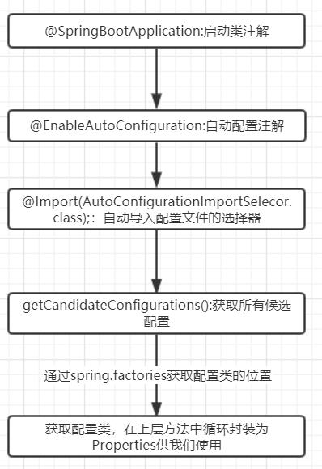
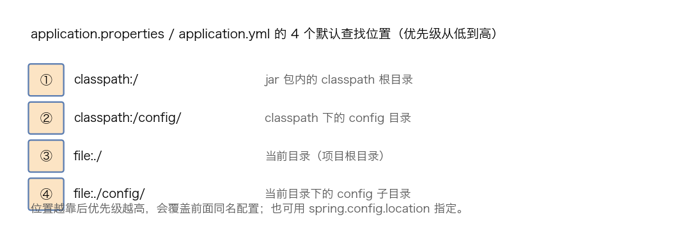

# SpringBoot

> 合并自：`SpringBoot.md`、`SpringBoot基础.md`、`SpringBoot面试.md`。原文未删改（仅修正已知错误、调整格式）。

## 一、SpringBoot 基础

> 来源：`SpringBoot/SpringBoot.md`

SpringBoot特点主要是开箱即用和约定大于配置

开箱即用：在开发过程中，通过maven项目的pom文件中添加相关依赖包，然后通过相应的注解来代替繁琐的XML配置以管理对象的生命周期。

约定大于配置：由SpringBoot本身来配置目标结构，由开发者在结构中添加信息的软件设计范式。这一特点虽降低了部分灵活性，增加了BUG定位的复杂性，但减少了开发人员需要做出决定的数量，同时减少了大量的XML配置，并且可以将代码编译、测试和打包等工作自动化。

SpringBoot自动装配主要是@SpringBootApplication完成

@SpringBootApplication其实是一个组合注解，它包含了@EnableAutoConfiguration和@SpringBootConfiguration、@Component

@SpringBootConfiguration其实是@Configuration的一个封装，与@Configuration功能相同

@EnableAutoConfiguration主要是下面两个注解

```java
@AutoConfigurationPackage
@Import({AutoConfigurationImportSelector.class})
public @interface EnableAutoConfiguration {
    String ENABLED_OVERRIDE_PROPERTY = "spring.boot.enableautoconfiguration";

    Class<?>[] exclude() default {};

    String[] excludeName() default {};
}
```

@Import(AutoConfigurationImportSelector.class)帮我们导入了AutoConfigurationImportSelector，这个类中存在一个方法可以帮我们获取所有的配置，代码如下

```java
/*
  所有的配置都存放在configurations中，
  而这些配置都从getCandidateConfiguration中获取，
  这个方法是用来获取候选的配置。
*/
List<String> configurations = getCandidateConfigurations(annotationMetadata, attributes);
```

getCandidateConfigurations()这个方法可以用来获取所有候选的配置

```java
/*获取候选的配置*/
protected List<String> getCandidateConfigurations(AnnotationMetadata metadata, AnnotationAttributes attributes) {
		List<String> configurations = SpringFactoriesLoader.loadFactoryNames(getSpringFactoriesLoaderFactoryClass(),
				getBeanClassLoader());
		Assert.notEmpty(configurations, "No auto configuration classes found in META-INF/spring.factories. If you "
				+ "are using a custom packaging, make sure that file is correct.");
		return configurations;
	}
```

实际上它返回了一个List，这个List是由loadFactoryNames()方法返回的,其中传入了一个getSpringFactoriesLoaderFactoryClass()，我们可以看看这个方法的内容。

```java
protected Class<?> getSpringFactoriesLoaderFactoryClass() {
	return EnableAutoConfiguration.class;
}
```

它实际上返回的就是标注了这个类的所有包。标注了这个类的包就是@SpringBootApplication，所以我们可以得出结论：它兜兜转转饶了这么多地方，就是为了**将启动类所需的所有资源导入**。

在加载中必须加载一个spring.factories,它包含了很多自动配置的属性

因此SpringBoot项目加载流程是：当我们的SpringBoot项目启动的时候，会先导入AutoConfigurationImportSelector，这个类会帮我们选择所有候选的配置，我们需要导入的配置都是SpringBoot帮我们写好的一个一个的配置类，那么这些配置类的位置，存在与META-INF/spring.factories文件中，通过这个文件，Spring可以找到这些配置类的位置，于是去加载其中的配置（还会通过@Conditional注解去决定加载哪些bean）。



SpringBoot配置文件加载顺序

在编写SpringBoot主配置文件时，文件名可以是application-{profile}.properties或者application-{profile}.yml，但默认使用application-{profile}.properties的配置。当SpringBoot启动时，会依次扫描以下位置的application.properties或者application.yml文件，来作为SpringBoot的默认配置文件

1. 第一个位置：当前项目的根文件夹下的config文件夹
–file:./config/
2. 第二个位置：当前项目的根文件夹下
–file:./
3. 第三个位置：类路径下的config文件夹下
–classpath:/config/
4. 第四个位置：类路径下

```java
–classpath:/
```



注意：

1. 四个位置的优先级由高到底，高优先级的配置会覆盖低优先级的配置
2. SpringBoot会从这四个位置全部加载主配置文件；互补配置；（即有相同的配置，采用高优先级的配置文件，没有相同的配置，都生效）
3. 可以通过spring.config.location配置项来改变默认的配置文件位置，该作用主要用于：项目打包好以后，可以使用命令行参数的形式，启动项目的时候来指定配置文件的新位置，指定配置文件和默认加载的这些配置文件共同起作用形成互补配置

例子如下：如采用F盘下的application.properties文件作为SpringBoot的配置文件
java -jar spring-boot-helloworld-quick-SNAPSHOT.jar --spring.config.location=F:/application.properties

在同一个目录下同时存在application.properties和application.yml文件时会优先读取application.properties

## 二、内嵌容器与配置文件

> 来源：`SpringBoot/SpringBoot基础.md`

SpringBoot中内嵌tomcat的原理是将Tomcat服务器作为对象运行，并将对象交给Spring容器管理

SpringBoot配置文件支持properties、yml、yaml三种文件格式，当这三种文件共存时，优先级依次：properties>yml>yaml   注意如果多种配置文件共存相同的配置会覆盖，不同的配置会共存

mybatis plus当使用eq查询，当我们的查询条件为null时，拼接的sql是select * from xx where x = null，这个null不是字符串。如果使用的是like，那么这个null就会被转换成string

SpringBoot配置文件可以包含多个子配置文件，如果有相同的配置后加载的配置会优先覆盖前面的配置，主体配置最后加载，优先级最高,之前使用includes来包含多个配置，最新版本使用group进行分组包含配置

## 三、常见面试题

> 来源：`SpringBoot/SpringBoot面试.md`

SpringBoot自动配置的原理：

1.通过@EnableAutoConfiguration注解开启自动配置（@SpringBootApplication注解默认已包含）

2.自动加载类路径下META-INF/spring.factories文件，读取以EnableAutoConfiguration的全限定类名对应的值，作为候选配置类。这里默认给出了很多组件的自动配置类。

3.自动配置类可能会再导入一些依赖（比如@Import），或者给出一些配置条件，并且会通过@Bean注解把该组件所包含的组件注入到spring容器中以供使用。

4.自动配置类还可能会绑定xxxProperties配置文件类，该类又会和应用程序中的application.properties中的指定前缀绑定。第3步注入组件的时候，组件可能还会获取配置文件类中的内容，所以用户可以在application.properties修改指定配置，来制定自己的个性化服务。

自定义SpringBoot-Starter相关

SpringBoot-Starter主要有两个模块：一个`autoconfigure`，提供自动配置代码，一个`starter`，会加载 `autoconfigure`，并提供启动所需的所有依赖

命名：非官方命名规范是xxx-spring-boot-starter

自定义Starter步骤：新建project，其中需要建立两个model分别是autoconfigure模块和starter模块（父模块是spring-boot-starter-parent）

在autoconfigure模块中新建我们自己的配置类，最后一定要新建一个自动配置类，绑定我们的配置文件、并将我们的服务注入到spring容器（XXXAutoConfiguration），还需要再resources/META-INF下新建spring.factories将刚才写的配置类的全路径写入到文件中如

```java
org.springframework.boot.autoconfigure.EnableAutoConfiguration=com.wjx.XXXAutoConfiguration
```

打包构建即可
