# SpringCloud 核心组件

> 合并自：`Eureka.md`、`Hystrix.md`、`Ribbon和Feign.md`、`Zuul.md`、`feign最新依赖.md`。原文未删改（仅修正已知错误、调整格式）。

## 一、Eureka 注册中心

> 来源：`SpringCloud/Eureka.md`

在传统服务架构中，服务规模较小可以使用静态配置的方式实现服务信息的设定，但是在微服务中，服务的数量和网络地址都是动态变化的，注册中心的功能网就是对这些分散的服务进行汇总，汇总的信息可以是服务器的名称、地址、数量等，并且注册中心还拥有监听功能（服务发现）

- 服务注册：
服务实例将自身服务信息注册到注册中心。这部分服务信息包括服务所在主机IP和提供服务的Port，以及暴露服务自身状态以及访问协议等信息
- 服务发现：
服务实例请求注册中心获取所依赖服务信息。服务实例通过注册中心，获取到注册到其中的服务实例的信息，通过这些信息去请求它们提供的服务。除此之外，服务注册与发现需要关注监控服务实例运行状态等问题
- 监控：
微服务应用中，服务处于动态变化的情况，需要一定机制处理无效的服务实例。一般来讲，服务实例与注册中心在注册后通过心跳的方式维系联系，一旦心跳缺少，对应的服务实例会被注册中心剔除

关系调用说明：

1. 服务生产者启动时，向服务注册中心注册自己提供的服务
2. 服务消费者启动时，在服务注册中心订阅自己所需要的服务
3. 注册中心返回服务提供者的地址信息个消费者
4. 消费者从提供者中调用服务

eureka服务管理

服务需要有一个统一的名称（或服务ID）并且是唯一标识，以便于接口调用时各个接口的区分。并且需要将其注册到Eureka Server中，其他服务调用该接口时，也是根据这个唯一标识来获取

服务下有多个实例，每个实例也有一个自己的唯一实例ID。因为它们各自有自己的基础信息如：不同的IP。所以它们的信息也需要注册到Eureka Server中，其他服务调用它们的服务接口时，可以查看到多个该服务的实例信息，根据负载策略提供某个实例的调用信息后，调用者根据信息直接调用该实例

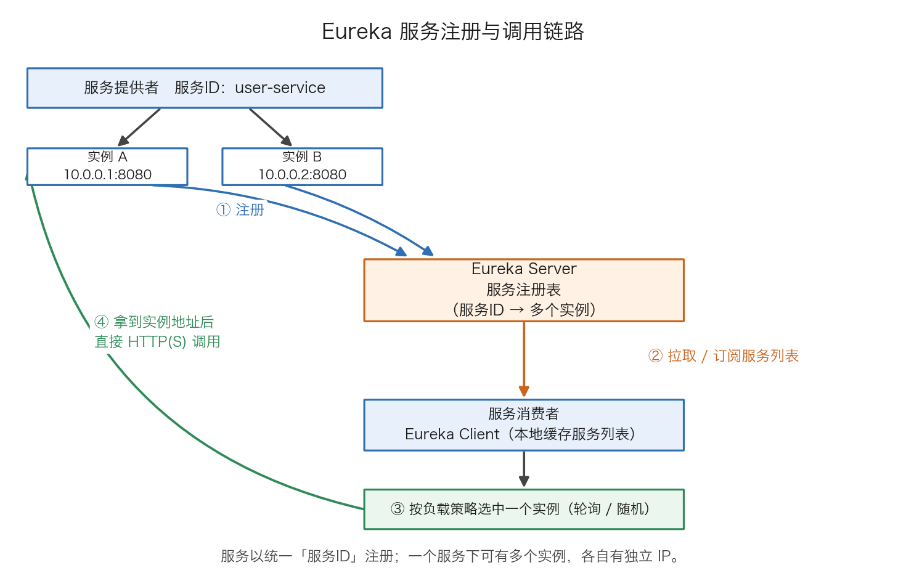

从CAP理论看，Eureka是一个AP系统，优先保证可用性(A)和分区容错性(P)，不保证强一致性(C)，只保证最终一致性，因此在架构中设计了较多缓存。

- 弱一致性：弱一致性是相对于强一致性而言，它不保证总能得到最新的值；
- 最终一致性(eventual consistency)：放宽对时间的要求，在被调完成操作响应后的某个时间点，被调多个节点的数据最终达成一致

在Eureka Client启动的时候，将自身的服务的信息发送到Eureka Server。然后进行2调用当前服务器节点中的其他服务信息，保存到Eureka Client中。当服务间相互调用其它服务时，在Eureka Client中获取服务信息（如服务地址，端口等）后，进行第3步，根据信息直接调用服务。（注：服务的调用通过http(s)调用）

当某个服务仅需要调用其他服务，自身不提供服务调用时。在Eureka Client启动后会拉取Eureka Server的其他服务信息，需要调用时，在Eureka Client的本地缓存中获取信息，调用服务

Eureka Client通过向Eureka Serve发送心跳（默认每30秒）来续约服务的。 如果客户端持续不能续约，那么，它将在大约90秒内从服务器注册表中删除。 注册信息和续订被复制到集群中的Eureka Serve所有节点。 以此来确保当前服务还“活着”，可以被调用

Eureka Server：

- 提供服务注册：各个微服务启动时，会通过Eureka Client向Eureka Server进行注册自己的信息（例如服务信息和网络信息），Eureka Server会存储该服务的信息。
- 提供服务信息提供：服务消费者在调用服务时，本地Eureka Client没有的情况下，会到Eureka Server拉取信息。
- 提供服务管理：通过Eureka Client的Cancel、心跳监控、renew等方式来维护该服务提供的信息以确保该服务可用以及服务的更新。
- 信息同步：每个Eureka Server同时也是Eureka Client，多个Eureka Server之间通过P2P复制的方式完成服务注册表的同步。同步时，被同步信息不会同步出去。也就是说有3个Eureka Server，Server1有新的服务信息时，同步到Server2后，Server2和Server3同步时，Server2不会把从Server1那里同步到的信息同步给Server3，只能由Server1自己同步给Server3

Eureka Client：

Eureka Client是一个Java客户端，用于简化与Eureka Server的交互。并且管理当前微服务，同时为当前的微服务提供服务提供者信息。Eureka Client会拉取、更新和缓存Eureka Server中的信息。即使所有的Eureka Server节点都宕掉，服务消费者依然可以使用缓存中的信息找到服务提供者。

Eureka Client在微服务启动后，会周期性地向Eureka Server发送心跳（默认周期为30秒）以续约自己的信息。如果Eureka Server在一定时间内没有接收到某个微服务节点的心跳，Eureka Server将会注销该微服务节点（默认90秒）。

Eureka Client包含服务提供者Applicaton Service和服务消费者Application Client。往往大多数服务本身既是服务提供者，也是服务消费者。

- Register（服务注册）：
当Eureka客户端向Eureka Server注册时，它提供自身的元数据，比如IP地址、端口，运行状况指示符URL，主页等。
- Renew（服务续约）：
Eureka Client会每隔30秒发送一次心跳来续约。 通过续约来告知Eureka Server该Eureka客户仍然存在，没有出现问题。 正常情况下，如果Eureka Server在90秒没有收到Eureka客户的续约，它会将实例从其注册表中删除。 建议不要更改续约间隔。

- Fetch Registries（获取注册列表信息）：
Eureka客户端从服务器获取注册表信息，并将其缓存在本地。客户端会使用该信息查找其他服务，从而进行远程调用。该注册列表信息定期（每30秒钟）更新一次。每次返回注册列表信息可能与Eureka客户端的缓存信息不同， Eureka客户端自动处理。如果由于某种原因导致注册列表信息不能及时匹配，Eureka客户端则会重新获取整个注册表信息。 Eureka服务器缓存注册列表信息，整个注册表以及每个应用程序的信息进行了压缩，压缩内容和没有压缩的内容完全相同。Eureka客户端和Eureka 服务器可以使用JSON / XML格式进行通讯。在默认的情况下Eureka客户端使用压缩JSON格式来获取注册列表的信息。
- Cancel（服务下线）：
Eureka客户端在程序关闭时向Eureka服务器发送取消请求。 发送请求后，该客户端实例信息将从服务器的实例注册表中删除。该下线请求不会自动完成，它需要调用以下内容：DiscoveryManager.getInstance().shutdownComponent()；
- Eviction （服务剔除）：
在默认的情况下，当Eureka客户端连续90秒没有向Eureka服务器发送服务续约，即心跳，Eureka服务器会将该服务实例从服务注册列表删除，即服务剔除。

Eureka缓存机制

Eureka Server存在三个变量：(registry、readWriteCacheMap、readOnlyCacheMap)保存服务注册信息，默认情况下定时任务每30s将readWriteCacheMap同步至readOnlyCacheMap，每60s清理超过90s未续约的节点，Eureka Client每30s从readOnlyCacheMap更新服务注册信息，而UI则从registry更新服务注册信息

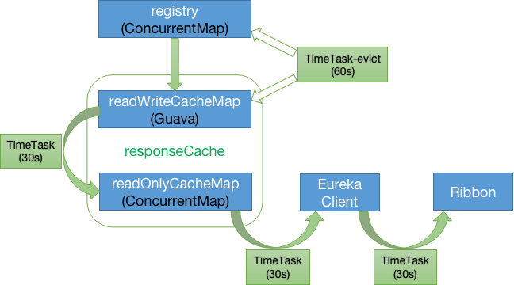

**三级缓存**

| 缓存 | 类型 | 说明 |
| --- | --- | --- |
| **registry** | ConcurrentHashMap | **实时更新**，类AbstractInstanceRegistry成员变量，UI端请求的是这里的服务注册信息 |
| **readWriteCacheMap** | Guava Cache/LoadingCache | **实时更新**，类ResponseCacheImpl成员变量，缓存时间180秒 |
| **readOnlyCacheMap** | ConcurrentHashMap | **周期更新**，类ResponseCacheImpl成员变量，默认每**30s**从readWriteCacheMap更新，Eureka client默认从这里更新服务注册信息，可配置直接从readWriteCacheMap更新 |

Eureka Client存在两种角色：服务提供者和服务消费者，作为服务消费者一般配合Ribbon或Feign（Feign内部使用Ribbon）使用。Eureka Client启动后，作为服务提供者立即向Server注册，默认情况下每30s续约(renew)；作为服务消费者立即向Server全量更新服务注册信息，默认情况下每30s增量更新服务注册信息；Ribbon延时1s向Client获取使用的服务注册信息，默认每30s更新使用的服务注册信息，只保存状态为UP的服务

**二级缓存**

| 缓存 | 类型 | 说明 |
| --- | --- | --- |
| localRegionApps | AtomicReference | **周期更新**，类DiscoveryClient成员变量，Eureka Client保存服务注册信息，启动后立即向Server全量更新，默认每**30s**增量更新 |
| upServerListZoneMap | ConcurrentHashMap | **周期更新**，类LoadBalancerStats成员变量，Ribbon保存使用且状态为**UP**的服务注册信息，启动后延时1s向Client更新，默认每**30s**更新 |

1、一致性（Consistency，C）：在分布式系统中的所有数据备份，在同一时刻是否同样的值。（等同于所有节点访问同一份最新的数据副本）。

2、可用性（Availability，A）：在一个分布式系统的集群中一部分节点故障后，该集群是否还能够正常响应客户端的读写请求。（对数据更新具备高可用性）。

3、分区容错性（Partition tolerance，P）：大多数的分布式系统都分布在多个子网络中，而每个子网络就叫做一个区（partition）。分区容错的意思是，区间通信可能失败。在一个分布式系统中一般分区容错是无法避免的，因此可以认为 CAP 中的 P 总是成立的。CAP 理论告诉我们，在 C 和 A 之间是无法同时做到。

分布式的系统会有很多的节点，这些节点都是通过网络进行通信。而网络是不可靠的，当节点和节点之间的通信出现了问题，此时，就称当前的分布式系统出现了分区。但是，值得一提的是，分区并不一定是由网络故障引起的，也可能是因为机器故障。比如，我们的分布式存储系统有 A、B 两个节点。那么，当 A、B 之间由于可能路由器、交换机等底层网络设备出现了故障，A 和 B 通信出现了问题，但是 A、B 依然都在运行，都在对外提供服务。这时候，就说 A 和 B 发生了分区。

分区容错性就是说如果发生了分区问题分布式系统仍然要对外提供服务，不能因为分区问题而使整个系统无法提供服务

Eureka和Zookeeper区别

著名的CAP理论指出，一个分布式系统不可能同时满足C(一致性)、A(可用性)和P(分区容错性)。由于分区容错性在是分布式系统中必须要保证的，因此我们只能在A和C之间进行权衡。在此Zookeeper保证的是CP, 而Eureka则是AP。

Zookeeper是主从结构、Eureka是平级

**Zookeeper保证CP**

当向注册中心查询服务列表时，我们可以容忍注册中心返回的是几分钟以前的注册信息，但不能接受服务直接down掉不可用。也就是说，服务注册功能对可用性的要求要高于一致性。但是zk会出现这样一种情况，当master节点因为网络故障与其他节点失去联系时，剩余节点会重新进行leader选举。问题在于，选举leader的时间太长，30 ~ 120s, 且选举期间整个zk集群都是不可用的，这就导致在选举期间注册服务瘫痪。在云部署的环境下，因网络问题使得zk集群失去master节点是较大概率会发生的事，虽然服务能够最终恢复，但是漫长的选举时间导致的注册长期不可用是不能容忍的。

**Eureka保证AP**

Eureka看明白了这一点，因此在设计时就优先保证可用性。Eureka各个节点都是平等的，几个节点挂掉不会影响正常节点的工作，剩余的节点依然可以提供注册和查询服务。而Eureka的客户端在向某个Eureka注册或时如果发现连接失败，则会自动切换至其它节点，只要有一台Eureka还在，就能保证注册服务可用(保证可用性)，只不过查到的信息可能不是最新的(不保证强一致性)。除此之外，Eureka还有一种自我保护机制，如果在15分钟内超过85%的节点都没有正常的心跳，那么Eureka就认为客户端与注册中心出现了网络故障，此时会出现以下几种情况：

1. Eureka不再从注册列表中移除因为长时间没收到心跳而应该过期的服务
2. Eureka仍然能够接受新服务的注册和查询请求，但是不会被同步到其它节点上(即保证当前节点依然可用)
3. 当网络稳定时，当前实例新的注册信息会被同步到其它节点中

Eureka自我保护机制

在默认配置中，Eureka Server在默认90s没有得到客户端的心跳，则注销该实例，但是往往因为微服务跨进程调用，网络通信往往会面临着各种问题，比如微服务状态正常，但是因为网络分区故障时，Eureka Server注销服务实例则会让大部分微服务不可用，这很危险，因为服务明明没有问题。为了解决这个问题，Eureka 有自我保护机制。如果在15分钟内超过85%的节点都没有正常的心跳，那么Eureka就认为客户端与注册中心出现了网络故障，此时会出现以下几种情况：

1. Eureka不再从注册列表中移除因为长时间没收到心跳而应该过期的服务
2. Eureka仍然能够接受新服务的注册和查询请求，但是不会被同步到其它节点上(即保证当前节点依然可用)
3. 当网络稳定时，当前实例新的注册信息会被同步到其它节点中

它的原理是，当Eureka Server节点在短时间内丢失过多的客户端时（可能发送了网络故障），那么这个节点将进入自我保护模式，不再注销任何微服务，当网络故障恢复后，该节点会自动退出自我保护模式。

eureka客户端启动时如何注册到服务端

Eureka客户端在启动时，首先会创建一个心跳的定时任务，定时向服务端发送心跳信息，服务端会对客户端心跳做出响应，如果响应状态码为404时，表示服务端没有该客户端的服务信息，那么客户端则会向服务端发送注册请求，注册信息包括服务名、ip、端口、唯一实例ID等信息

服务端如何保存客户端的信息

客户端通过Jersey框架（亚马逊的一个http框架）将服务实例信息发送到服务端，服务端将客户端信息放在一个ConcurrentHashMap对象中（三级缓存）

客户端如何拉取服务端已保存的服务信息

客服端有一个拉取服务端的定时任务，每次拉取后刷新本地已保存的信息，需要使用时直接从本地直接获取

**什么是多级缓存机制**

Eureka Server 为了避免同时读取内存数据造成的并发冲突问题，采用了多级缓存机制提升服务请求的响应速度。

Eureka Server的缓存是通过一个只读，一个读写缓存来实现的。

一级缓存：concurrentHashMap<key,value>readOnlyCacheMap本质是HashMap，无过期时间，保存数据信息对外输出。

readOnlyCacheMap依赖于定时器的更新，通过与readWriteCacheMap的值做对比，以readWriteCacheMap为准。

responseCacheUpdateIntervalMs：readOnlyCacheMap缓存更新间隔，默认30s

二级缓存：LoaDing<key,value>readWriteCacheMap本质是Guava缓存，包含失效机制，保护数据信息对外输出。

responseCacheAutoExpirationInSeconds：readWriteCacheMap 缓存过期时间，默认180s。

**当服务节点发生注册，下线，过期，状态变更等变化时**

1.在内存中更新注册表信息

2.同时过期掉readWriteCacheMap缓存，缓存清除只是会去清除readWriteCacheMap这个缓存， readOnlyCacheMap 只读 缓存并没有更新，也就说当客户端的信息发生变化之后， 只读缓存不是第一时间感知到的。只读缓存的更新只能依赖那个30秒的定时任务来更新。

3.一段时间后（默认30s），后台线程发现readWriteCacheMap缓存为空，于是也将readOnlyCacheMap中的缓存清空

4.当有服务消费者拉取注册表信息时，会调用ClassLoader的load方法，将内存中的注册表信息加载到各级缓存中，并返回注册表信息。

在Eureka Server 中会有两个线程，一个是定时同步两个缓存的数据，默认30s，一个是定时检测心跳故障，默认90s。

服务发现模式有两种：客户端发现（client-side discovery）与服务端发现（server-side discovery）

当使用客户端发现模式时，客户端负责确定可用服务实例的网络位置和请求负载均衡。客户端查询服务注册中心（service registry），它是可用服务实例的数据库。之后，客户端利用负载均衡算法选择一个可用的服务实例并发出请求

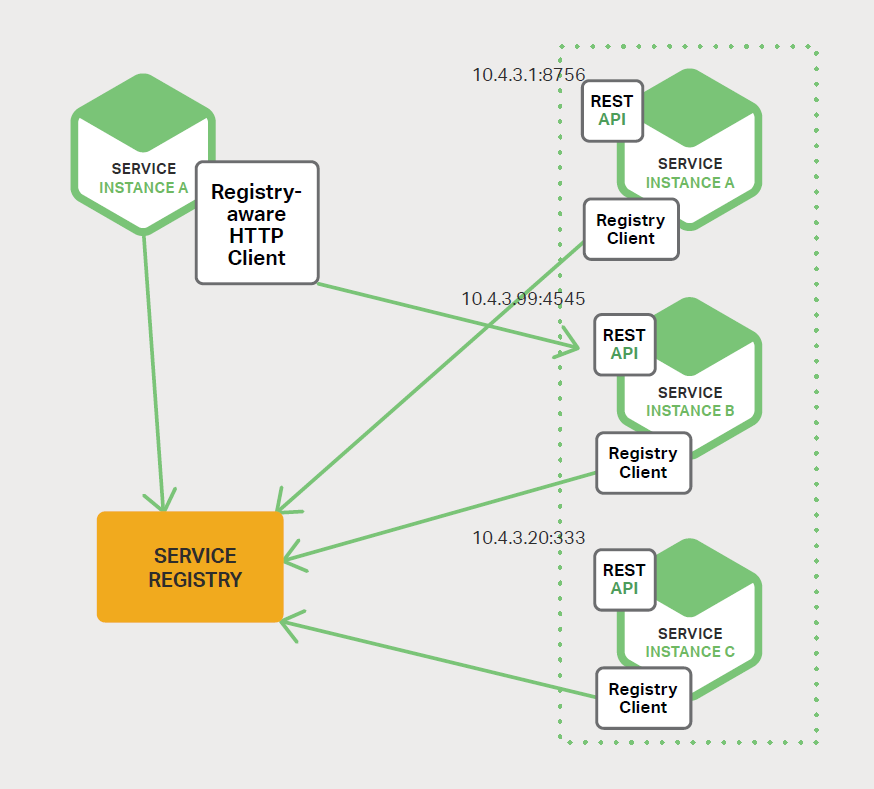

客户端通过负载均衡器向服务发出请求。负载均衡器查询服务注册中心并将每个请求路由到可用的服务实例

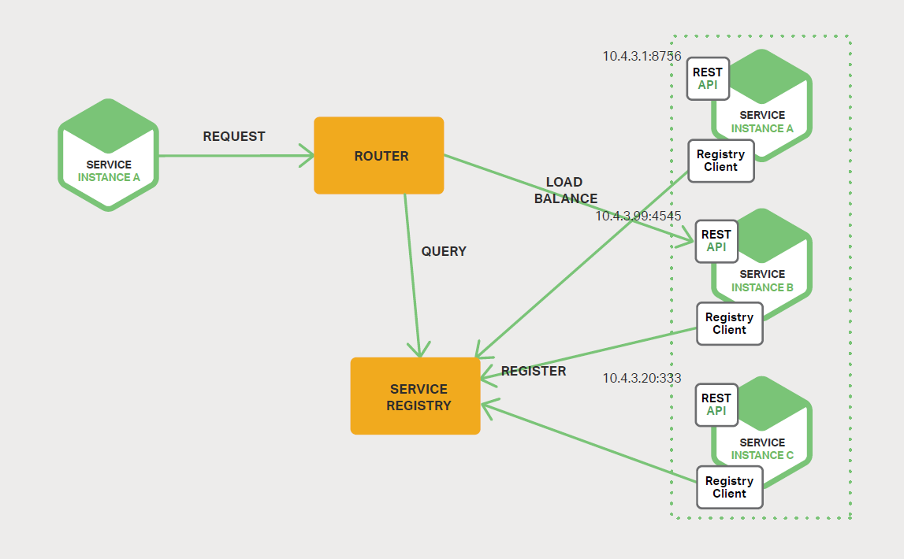

分布式系统的数据在多个副本之间的复制方式，主要有：

- 主从复制

就是 **Master-Slave** 模式，有一个主副本，其他为从副本，所有写操作都提交到主副本，再由主副本更新到其他从副本。

写压力都集中在主副本上，是系统的瓶颈，从副本可以分担读请求。

- 对等复制

就是 **Peer to Peer** 模式，副本间不分主从，任何副本都可以接收写操作，然后每个副本间互相进行数据更新。

对等复制模式，任何副本都可以接收写请求，不存在写压力瓶颈，但各个副本间数据同步时可能产生数据冲突。

Eureka 采用的就是 **Peer to Peer** 模式

Eureka Server 本身依赖了 Eureka Client，也就是每个 Eureka Server 是作为其他 Eureka Server 的 Client。

Eureka Server 启动后，会通过 Eureka Client 请求其他 Eureka Server 节点中的一个节点，获取注册的服务信息，然后复制到其他 peer 节点。

Eureka Server 每当自己的信息变更后，例如 Client 向自己发起*注册、续约、注销*请求， 就会把自己的最新信息通知给其他 Eureka Server，保持数据同步。

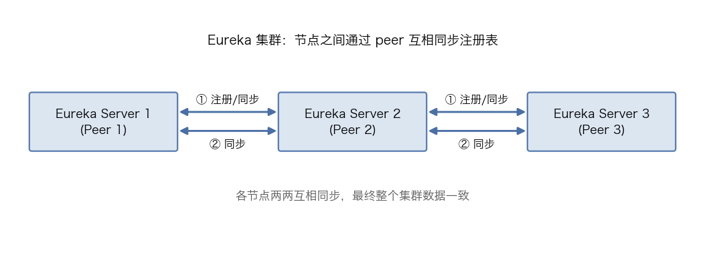

如果自己的信息变更是另一个Eureka Server同步过来的，这是再同步回去的话就出现**数据同步死循环**了。

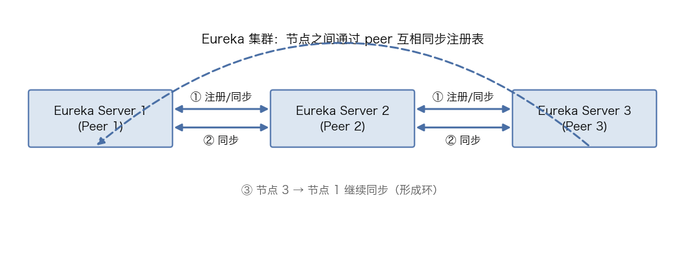

Eureka Server 在执行复制操作的时候，使用 `HEADER_REPLICATION` 这个 http header 来区分普通应用实例的正常请求，说明这是一个复制请求，这样其他 peer 节点收到请求时，就不会再对其进行复制操作，从而避免死循环。

还有一个问题，就是**数据冲突**，比如 server A 向 server B 发起同步请求，如果 A 的数据比 B 的还旧，B 不可能接受 A 的数据，那么 B 是如何知道 A 的数据是旧的呢？这时 A 又应该怎么办呢？

数据的新旧一般是通过*版本号*来定义的，Eureka 是通过 `lastDirtyTimestamp` 这个类似版本号的属性来实现的。

还有一个重要的机制：**hearbeat 心跳**，即续约操作，来进行数据的最终修复，因为节点间的复制可能会出错，通过心跳就可以发现错误，进行弥补

## 二、Hystrix 熔断降级

> 来源：`SpringCloud/Hystrix.md`

1.超时

为每次请求设置超时时间，一旦超时就会释放资源防止耗尽下游资源

2.限流

估计每次服务的最大承载量，设置该服务的最大请求数

3.舱壁模式

**舱壁模式**（Bulkhead）隔离了每个工作负载或服务的关键资源，如连接池、内存和 CPU。使用舱壁避免了单个工作负载（或服务）消耗掉所有资源，从而导致其他服务出现故障的场景。这种模式主要是通过防止由一个服务引起的级联故障来增加系统的弹性。

**Hystrix**则使用该模式实现线程池的隔离。通过将每个依赖服务分配独立的线程池进行资源隔离，从而避免服务雪崩。

**Hystrix**会为每一个Hystrix命令（@HystrixCommand来将某个函数包装成了Hystrix命令，Hystrix框架就会自动的为这个函数实现调用的隔离）创建一个独立的线程池，这样就算某个在Hystrix命令包装下的依赖服务出现延迟过高的情况，也只是对该依赖服务的调用产生影响，而不会拖慢其他的服务。

4.断路器模式

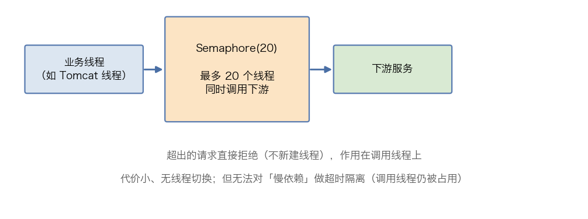

断路器很好理解, 当Hystrix Command请求后端服务失败数量超过一定比例(默认50%), 断路器会切换到开路状态(Open). 这时所有请求会直接失败而不会发送到后端服务. 断路器保持在开路状态一段时间后(默认5秒), 自动切换到半开路状态(HALF-OPEN). 这时会判断下一次请求的返回情况, 如果请求成功, 断路器切回闭路状态(CLOSED), 否则重新切换到开路状态(OPEN).

服务熔断

服务熔断是应对雪崩效应的一种微服务链路保护机制，当链路中的某个微服务不可用或者响应时间太长时，会进行服务的降级，进而熔断改节点微服务的调用，快速返回“错误”的响应信息。当检测出该节点微服务调用响应正常后恢复调用链路。在SpringCloud框架里熔断机制通过Hystrix实现。Hystrix会监控微服务间调用的状况，当失败的调用到一定阈值，缺省是5秒内20次调用失败就会启动熔断机制。熔断机制的注解是@HystrixCommand。

Hystrix服务降级

其实就是线程池中单个线程故障处理，防止单个线程请求时间太长，导致资源长期被占有而得不到释放，从而导致线程池被快速占用完，导致服务崩溃。Hystrix请求超时降级、线程资源不足降级，降级之后可以返回自定义数据

hystrix线程隔离和信号量隔离

信号量隔离：每次调用线程，当前请求通过计数信号量进行限制，当信号大于了最大请求数（maxConcurrentRequests）时，进行限制，调用fallback接口快速返回。信号量的调用是同步的，也就是说，每次调用都得阻塞调用方的线程，直到结果返回。这样就导致了无法对访问做超时（只能依靠调用协议超时，无法主动释放）

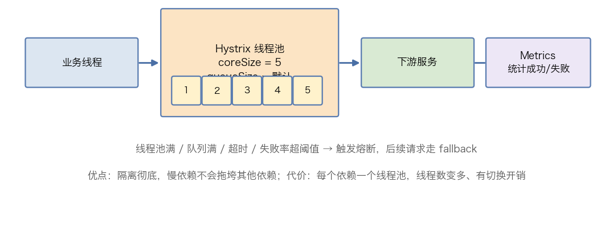

信号量隔离：

- 隔离的细粒度太高，数百个实例需要隔离，此时用线程池做隔离开销过大
- 通常这种都是非网络调用的情况下

线程池隔离：通过每次都开启一个单独线程运行。它的隔离是通过线程池，即每个隔离粒度都是个线程池，互相不干扰。线程池隔离方式，等于多了一层的保护措施，可以通过hytrix直接设置超时，超时后直接返回。

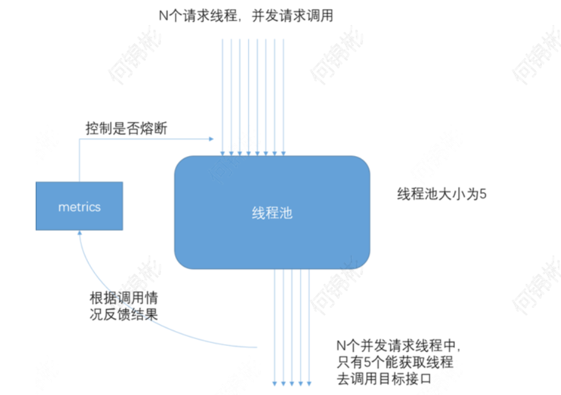

| 隔离方式 | 是否支持超时 | 是否支持熔断 | 隔离原理 | 是否是异步调用 | 资源消耗 |
| --- | --- | --- | --- | --- | --- |
| 线程池隔离 | 支持,可直接返回 | 支持,当线程池到达maxSize后,再请求会触发fallback接口进行熔断 | 每个服务单独用线程池 | 可以是异步,也可以是同步。看调用的方法 | 大,大量线程的上下文切换，容易造成机器负载高 |
| 信号量隔离 | 不支持,如果阻塞，只能通过调用协议（如:socket超时才能返回） | 支持，当信号量达到maxConcurrentRequests后。再请求会触发fallback | 通过信号量的计数器 | 同步调用,不支持异步 | 小,只是个计数器 |

## 三、Ribbon 与 Feign

> 来源：`SpringCloud/Ribbon和Feign.md`

Ribbon提供在服务消费端实现负载均衡调用服务提供者，从注册中心读取所有可用的服务提供者，在客户端每次调用接口时采用如轮询负载均衡算法选出一个服务提供者调用，因此，Ribbon是一个客户端负载均衡器。

Ribbon提供多种负载均衡算法的实现、提供重试支持。Feign也提供重试支持，在SynchronousMethodHandler的invoke方法中实现，但Feign的重试比较简单，只是向同一个服务节点发送请求，而Ribbon的失败重试是重新选择一个服务节点调用的，在服务提供者部署多个节点的情况下，显然Feign的重试机制是没有多大意义的。

Ribbon负载均衡流程

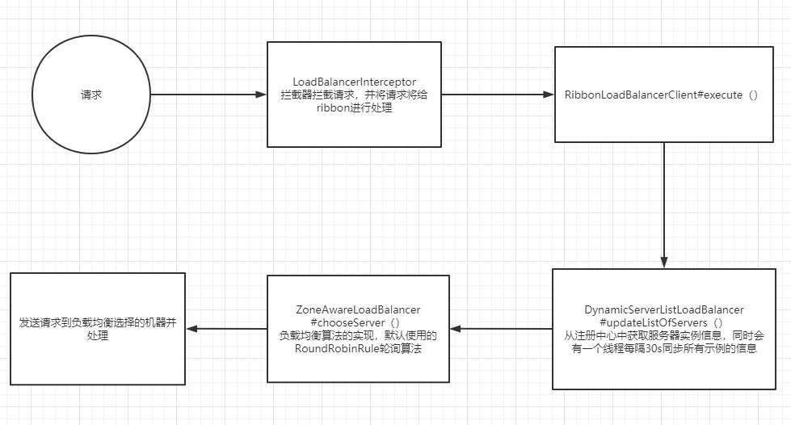

1. 发送请求，被LoadBalancerInterceptor拦截器拦截，请求被交给ribbon来处理
2. 拦截器拦截请求，交给了RibbonLoadBalancerClient的execute方法（下面的逻辑都是包含在这个方法中）
3. 在进行负载均衡之前首先得知道有哪些服务实例信息，所以通过DynamicServerListLoadBalancer的updateListOfServers方法从注册中心（Eureka）那里获取到了所有的服务实例信息，并且会定时更新
4. 使用负载均衡算法（默认轮询算法，也可以是随机）从所有的服务实例信息中选择一台机器出来
5. 将请求发送给负载均衡选择出来的服务实例上去

Ribbon重试机制

Ribbon提供了RetryHandler接口，并且默认使用DefaultLoadBalancerRetryHandler。LoadBalancerCommand的submit方法中（在FeignLoadBalancer的executeWithLoadBalancer方法中调用），如果配置重试次数大于0，则会调用RxJava的API支持重试。

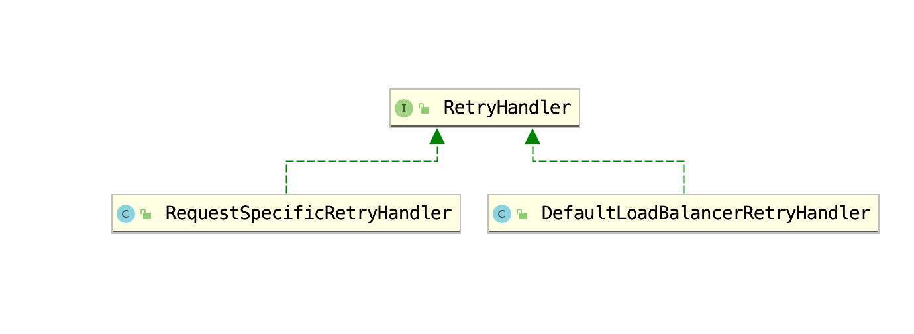OpenFeign整合Ribbon时，真正使用的RetryHandler是RequestSpecificRetryHandler

Feign

openfeign通过包扫描将所有被@FeignClient注解注释的接口扫描出来，并为每个接口注册一个FeignClientFactoryBean\<T\>实例。FeignClientFactoryBean\<T\>是一个FactoryBean\<T\>，当Spring调用FeignClientFactoryBean\<T\>的getObject方法时，openfeign返回一个Feign生成的动态代理对象，拦截接口的方法执行。

feign会为代理的接口的每个方法Method都生成一个MethodHandler。

当为接口上的@FeignClient注解的url属性配置服务提供者的url时，其实就是不与Ribbon整合，此时由SynchronousMethodHandler实现接口方法远程同步调用，使用默认的Client实现类Default实例发起http请求。

当接口上的@FeignClient注解的url属性不配置时，且会走负载均衡逻辑，也就是需要与Ribbon整合使用。这时候不再是使用默认的Client（Default）调用接口，而是使用LoadBalancerFeignClient调用接口，由LoadBalancerFeignClient实现与Ribbon的整合。

openfeign则是spring cloud在feign的基础上支持了spring mvc的注解，如@RequesMapping、@GetMapping、@PostMapping等。openfeign还实现与Ribbon的整合。服务提供者只需要提供API接口，而不需要像dubbo那样需要强制使用implements实现接口，使用fegin不要求服务提供者在Controller使用implements关键字实现接口。

默认超时时间为1秒

feign远程调用流程

Feign远程调用，核心就是通过一系列的封装和处理，将以JAVA注解的方式定义的远程调用API接口，最终转换成HTTP的请求形式，然后将HTTP的请求的响应结果，解码成JAVA Bean，放回给调用者。Feign远程调用的基本流程，大致如下图所示

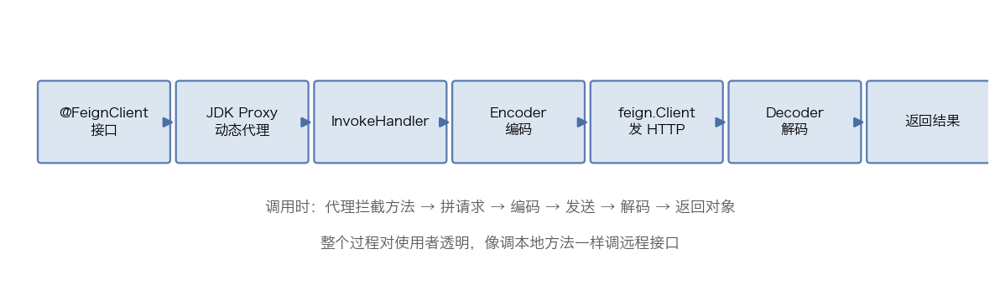

## 四、Zuul 网关

> 来源：`SpringCloud/Zuul.md`

Zuul一般被springcloud用于网关，一般功能包含：鉴权、验证、动态路由、负载均衡等，Zuul不包含服务发现客户端，为了实现基于serviceId的路由开发，必须在项目中引入服务发现（如Eureka）

Zuul 的路由引擎可处理任何基于 JVM 语言的路由规则和过滤器。Zuul 提供了 ZuulServlet 类，ZuulServlet 作为整个框架的入口，其 service() 方法执行各种 **Zuul 过滤器（Zuul 的核心）**。

Zuul Filter 的四个特性：

1. 类型；
2. 执行顺序；
3. 判断条件：判断某个请求是否会被这个过滤器执行；
4. 判断条件满足时执行的动作；

**各个 Filter 不直接交互，取而代之的是通过每次请求中唯一存在的 RequestContext 来共享状态。**

Filter 的类型：（参考 PreDecorationFilter 类）

- **PRE Filters：** FilterConstants.PRE_TYPE，可用于校验请求权限等前置逻辑，在路由到具体服务之前执行
- **ROUTING Filter：** 在这里创建 HTTP Request，使用 HttpClient 或者 Ribbon 实现对目标服务的调用逻辑
- **POST Filter：** 实现收尾逻辑，常用来向响应体中添加 Header、收集相关信息等
- **ERROR Filter：** 当前三个阶段出现异常时执行

pre 或 routing 发生异常，执行 error 后会执行 post

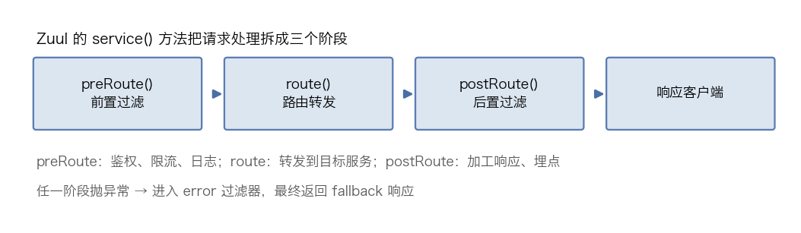

Zuul包含了对请求的路由和过滤两个最主要的功能：

其中路由功能负责将外部请求转发到具体的微服务实例上，是实现外部访问统一入口的基础，而过滤器功能则负责对请求的处理过程进行干预，是实现请求校验、服务聚合等功能的基础，然而实际上，路由功能在真正运行时，它的路由映射和请求转发都是由几个不同的过滤器完成的。其中，路由映射主要通过pre类型的过滤器完成，它将请求路径与配置的路由规则进行匹配，以找到需要转发的目标地址；而请求转发的部分则是由route类型的过滤器来完成，对pre类型过滤器获得的路由地址进行转发

Spring Cloud Zuul默认集成了Hystrix和Ribbon，自然就拥有线程隔离和断路器，以及对服务调用的客户端负载均衡功能。    需要注意的是，当使用path与url的映射关系来配置路由规则的时候，对于路由转发的请求不会采用hystrixCommand来包装，所以这类请求没有线程隔离和断路器的保护，并且也不会有负载均衡的能力。因此，我们在使用zuul的时候尽量使用path和serviceId的组合来进行配置，这样不仅可以保证api网关的健壮和稳定，也能用到ribbon的客户端负载均衡功能

所有路由的默认Hystrix隔离模式（ExecutionIsolationStrategy）为SEMAPHORE

计数器（滑动窗口）：维护一个counter，每个时间段清零，对时间段内的请求进行计数，计数前判断counter是否达到阙值，如果没有就加一，达到则拒绝漏斗算法：一个固定容量的桶，当桶为空的时候，不会漏出水滴，流入桶的水的速率是任意的，漏出水的速率是固定的，如果流入桶的水超出桶的容量，进行拒绝
 一般的实现方法是队列，队列模拟漏斗，空的时候不再出队，满的时候拒绝令牌桶算法：和漏斗算法很类似，不过除了一个队列以外，还加入了一个中间人，它会以一定的速率发放令牌（token）到桶内，队列中的的等待着只有拿到token才能通过漏斗限制了传输速率，而令牌桶在限制的同时，还允许突然的大流量，即：在大流量到来的时候，有足够空间的情况下（足够的队列和桶内有足够的令牌），就允许进入

## 五、Feign 最新依赖

> 来源：`SpringCloud/feign最新依赖.md`

当我们使用最新的feign版本open-feign必须引入一个新的依赖

```xml
<dependency>
            <groupId>org.springframework.cloud</groupId>
            <artifactId>spring-cloud-starter-loadbalancer</artifactId>
        </dependency>
```
