# Kafka

> 合并自：`kafka.md`、`kafka重消费.md`、`kafka零拷贝详解.md`。原文未删改（仅修正已知错误、调整格式）。

## 一、Kafka 核心概念与架构

> 来源：`MQ/kafka.md`

Kafka 将生产者发布的消息发送到 Topic（主题） 中，需要这些消息的消费者可以订阅这些 Topic（主题），如下图所示：

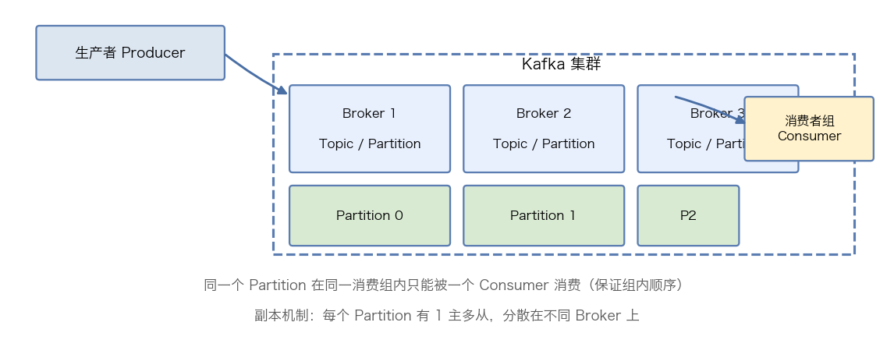

Producer（生产者） : 产生消息的一方。

Consumer（消费者） : 消费消息的一方。

Broker（代理） : 可以看作是一个独立的 Kafka 实例。多个 Kafka Broker 组成一个 Kafka Cluster。

Topic（主题） : Producer 将消息发送到特定的主题，Consumer 通过订阅特定的 Topic(主题) 来消费消息。

Partition（分区） : Partition 属于 Topic 的一部分。一个 Topic 可以有多个 Partition ，并且同一 Topic 下的 Partition 可以分布在不同的 Broker 上，这也就表明一个 Topic 可以横跨多个 Broker 。（Kafka 中的 Partition（分区） 实际上可以对应成为消息队列中的队列）

Kafka 的多副本机制

Kafka 为分区（Partition）引入了多副本（Replica）机制。每个分区有多个副本。

副本有两种类型：lead和follower

    lead副本：每个分区都有一个lead副本。为了保证一致性，所有生产者请求和消费请求都会经过lead副本

    follower副本：lead副本之外的都是follower副本。follower副本不处理来自客户端的请求，他们唯一的任务就是从lead副本中复制消息，保持与lead副本一直的状态。如果lead副本发生崩溃，其中的一个follower会被提升为新的lead

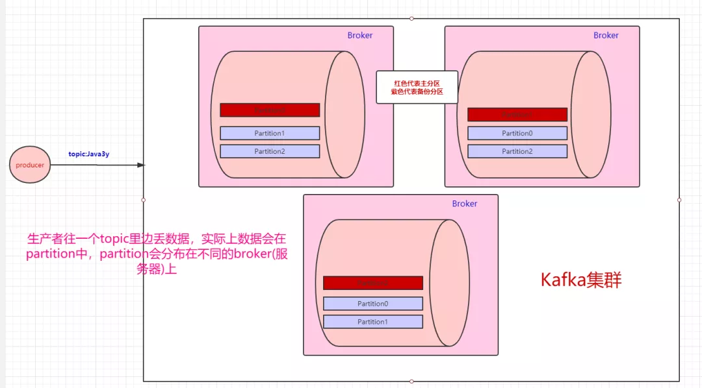

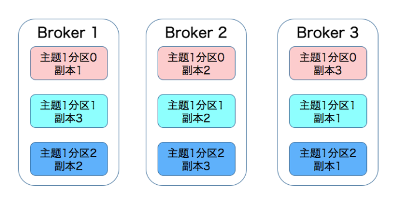

### leader副本挂掉后，如何选举新副本？

如果你对zookeeper选举机制有所了解，就知道zookeeper每次leader节点挂掉时，都会通过内置id，来选举处理了最新事务的那个follower节点。

从结果上来说，kafka分区副本的选举也是类似的，都是选择最新的那个follower副本，但它是通过一个In-sync（ISR）副本集合实现。

kafka会将与leader副本保持同步的副本放到ISR副本集合中。当然，leader副本是一直存在于ISR副本集合中的，在某些特殊情况下，ISR副本中甚至只有leader一个副本。

当leader挂掉时，kakfa通过zookeeper感知到这一情况，在ISR副本中选取新的副本成为leader，对外提供服务。

**分区数只能增加，不能减少，如果减少会报错The number of partitions for a topic can only be increased**

### In-sync Replicas（ISR)

kafka引入了ISR，副本集合。ISR中的副本都是与Leader同步的副本，相反，不在ISR中的追随者副本被认为是与Leader不同步的。那么进入ISR到底需要满足什么条件才能进入呢。

**首先需要明确一点。ISR不只是追随者副本集合，它必然包括Leader副本。甚至在某些情况下，ISR只有Leader这一个副本。**

**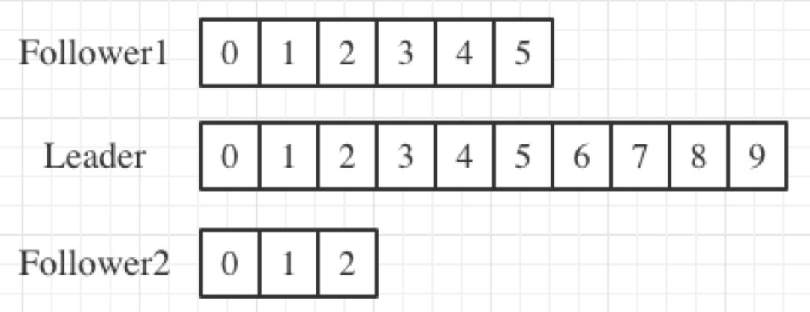**

> 图中有3个副本：1个领导者副本，2个追随者副本。领导者副本写入了10条消息，F1同步了6条，F3同步了3条。那么哪个追随者副本与Leader不同步呢？
> 事实上，这两个副本都有可能与Leader副本不同步，但也可能同步。它实际上不是依靠与消息条数来进行判断的。**而是根据Broker端参数replica.lag.time.max.ms参数值**。这个参数的含义就是Follower副本能够落后Leader副本的最长时间间隔，当前默认值是10秒。
> 这就是说，只要一个 Follower 副本落后 Leader 副本的时间不连续超过 10 秒，那么 Kafka 就认为该 Follower 副本与 Leader 是同步的，即使此时 Follower 副本中保存的消息明显少于 Leader 副本中的消息。若是同步过程的速度持续慢于Leadr副本的写入速度，那么在replica.lag.time.max.ms时间后，kafka就会自动收缩ISR集合，将改副本踢出集合。

**值得注意的是，若改副本后面慢慢追上了Leader的进度。那么它是可以被重新放入ISR集合中的。这也表明ISR是一个动态调整的集合，而非静态不变的。**

### Unclean 领导者选举

既然ISR可以动态调整，那么就会出现ISR为空的情况。ISR为空的情况就代表Leader副本也挂掉了。那么kafka就需要重新选举新的Leader。
那么该怎么选举Leader呢？

> -   **kafka把所有不在ISR的存活副本都成为非同步副本。**
> -   通常来说，非同步副本落后Leader太多，因此，如果选择这些副本为新的Leader，就可能出现数据的丢失。在kafka，选举Leader这种过程被成为Unclean。由Broker端参数unclean.leader.election.enable控制是否允许Unclean领导者选举。
> -   开启 Unclean 领导者选举可能会造成数据丢失，但好处是，它使得分区 Leader 副本一直存在，不至于停止对外提供服务，因此提升了高可用性。反之，禁止 Unclean 领导者选举的好处在于维护了数据的一致性，避免了消息丢失，但牺牲了高可用性。

可以根据你的实际业务场景决定是否开启 Unclean 领导者选举。不过并**不建议开启**它，毕竟我们还可以通过其他的方式来提升高可用性。如果为了这点儿高可用性的改善，牺牲了数据一致性，那就非常不值当了。

Kafka 如何保证消息的消费顺序

我们在使用消息队列的过程中经常有业务场景需要严格保证消息的消费顺序，比如我们同时发了 2 个消息，这 2 个消息对应的操作分别对应的数据库操作是：更改用户会员等级、根据会员等级计算订单价格。假如这两条消息的消费顺序不一样造成的最终结果就会截然不同。

我们知道 Kafka 中 Partition(分区)是真正保存消息的地方，我们发送的消息都被放在了这里。而我们的 Partition(分区) 又存在于 Topic(主题) 这个概念中，并且我们可以给特定 Topic 指定多个 Partition。

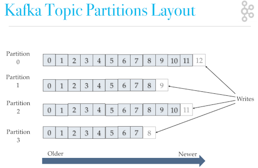

每次添加消息到 Partition(分区) 的时候都会采用尾加法，如上图所示。Kafka 只能为我们保证 Partition(分区) 中的消息有序，而不能保证 Topic(主题) 中的 Partition(分区) 的有序。（消息在被追加到 Partition(分区)的时候都会分配一个特定的偏移量（offset）。Kafka 通过偏移量（offset）来保证消息在分区内的顺序性。）

保证 Kafka 中消息消费的顺序，有了下面两种方法：

1.1 个 Topic 只对应一个 Partition。

2.（推荐）发送消息的时候指定 key/Partition。

kafka为什么快

1.顺序写入

kafka每个partition都是一个文件，收到消息之后会将kafka数据写到文件末尾，这样避免了磁盘的寻址过程。但是这个方法的缺陷是无法删除数据。所以kafka不会删除数据，他会将所有数据都保留下来，每个消费者对每个topic都有一个offset用来表示读取到第几条数据（一般情况下 Offset 由客户端 SDK 负责保存 ，会保存到 Zookeeper 里面 。关于存在硬盘中的消息，Kafka 也有它的解决方法，可以基于时间和 Partition 文件的大小，正常 Kafka 是默认七天的保存，也可以通过命令来修改）

2.mmf（Memory Mapped Files）

生产者生产和消费者消费的数据都存放在PageCache中，不需要进行磁盘交互。PageCache的数据会异步写入磁盘

3.零拷贝

Kafka Consumer 消费存储在 Broker 磁盘的数据，从读取 Broker 磁盘到网络传输给 Consumer经历了四步。

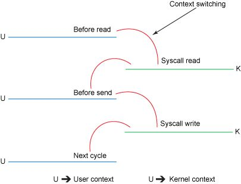

1.  第一次：读取磁盘文件到操作系统内核缓冲区；

2.  第二次：将内核缓冲区的数据，copy 到应用程序的 buffer；

3.  第三步：将应用程序 buffer 中的数据，copy 到 socket 网络发送缓冲区；

4.  第四次：将 socket buffer 的数据，copy 到网卡，由网卡进行网络传输。

Kafka 使用到了 mmap 和 sendfile 的方式来实现零拷贝。

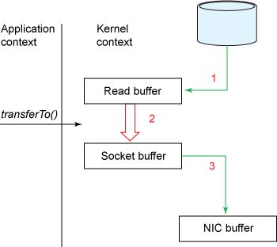

在此模型下，上下文切换的数量减少到一个。具体而言，`transferTo()`方法指示块设备通过 DMA 引擎将数据读取到读取缓冲区中。然后，将该缓冲区复制到另一个内核缓冲区以暂存到套接字。最后，套接字缓冲区通过 DMA 复制到 NIC 缓冲区。

4.批量发送

Kafka允许进行批量发送消息，producter发送消息的时候，可以将消息缓存在本地，等到了固定条件发送到 Kafka 。

-   等消息条数到固定条数。

-   一段时间发送一次。

5.数据压缩

Kafka还支持对消息集合进行压缩，Producer可以通过GZIP或Snappy格式对消息集合进行压缩。压缩的好处就是减少传输的数据量，减轻对网络传输的压力。

6.分区并发

Kafka 的 Topic 可以分成多个 Partition，每个 Paritition 类似于一个队列，保证数据有序。同一个 Group 下的不同 Consumer 并发消费 Paritition，分区实际上是调优 Kafka 并行度的最小单元，因此，可以说，每增加一个 Paritition 就增加了一个消费并发。

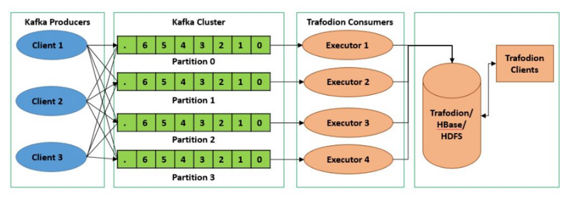

7.网络io使用多路复用

Kafka不保存消息的状态，即消息是否被“消费”。一般的消息系统需要保存消息的状态，并且还需要以随机访问的形式更新消息的状态。而Kafka 的做法是保存Consumer在Topic分区中的位置offset，在offset之前的消息是已被“消费”的，在offset之后则为未“消费”的，并且offset是可以任意移动的，这样就消除了大部分的随机IO。

kafka的ack机制

Kafka的ack机制，指的是producer的消息发送确认机制，这直接影响到Kafka集群的吞吐量和消息可靠性。而吞吐量和可靠性就像硬币的两面，两者不可兼得，只能平衡。

ack有3个可选值，分别是1，0，-1。

-   acks=0，表示生产者在成功写入消息之前不会等待任何来自服务器的响应. 换句话说，一旦出现了问题导致服务器没有收到消息，那么生产者就无从得知，消息也就丢失了. 改配置由于不需要等到服务器的响应，所以可以以网络支持的最大速度发送消息，从而达到很高的吞吐量。
-   acks=1，表示只要集群的leader分区副本接收到了消息，就会向生产者发送一个成功响应的ack，此时生产者接收到ack之后就可以认为该消息是写入成功的. 一旦消息无法写入leader分区副本(比如网络原因、leader节点崩溃),生产者会收到一个错误响应，当生产者接收到该错误响应之后，为了避免数据丢失，会重新发送数据.这种方式的吞吐量取决于使用的是异步发送还是同步发送.（如果生产者收到了错误响应，即便是重新发消息，还是会有可能出现丢数据的现象. 比如，如果一个没有收到消息的节点成为了新的Leader，消息就会丢失.）
-   acks =-1，表示只有所有参与复制的节点(ISR列表的副本)全部收到消息时，生产者才会接收到来自服务器的响应. 这种模式是最高级别的，也是最安全的，可以确保不止一个Broker接收到了消息. 该模式的延迟会很高.

kafka自带的消息机制：kafka有个offset的概念，当每个消息被写进去后，都有一个offset，代表他的序号，然后consumer消费该数据之后，隔一段时间，会把自己消费过的消息的offset提交一下，代表我已经消费过了。下次我要是重启，就会继续从上次消费到的offset来继续消费。但是当我们直接kill进程了，再重启。这会导致consumer有些消息处理了，但是没来得及提交offset。等重启之后，少数消息就会再次消费一次。

推拉模式

kafka和rocketmq的消费者消费消息的策略都是使用拉模式从broke中读取消息，因为在推模式在kafka的架构中存在问题。比如一个broker有多个消费者，它们的消费速率不同，一昧的push只会给消费者带来拒绝服务以及网络拥塞等风险。而kafka显然不可能去放弃速率低的消费者，因此kafka采用了pull的模式，可以根据消费者的消费能力以适当的速率消费broker里的消息。

kafka以及rocketmq都是利用长轮询来实现拉模式，Kafka 在拉请求中有参数，可以使得消费者请求在 “长轮询” 中阻塞等待。简单的说就是消费者去 Broker 拉消息，定义了一个超时时间，也就是说消费者去请求消息，如果有的话马上返回消息，如果没有的话消费者等着直到超时，然后再次发起拉消息请求。并且 Broker 也得配合，如果消费者请求过来，有消息肯定马上返回，没有消息那就建立一个延迟操作，等条件满足了再返回。

kafka的分区策略

1.轮询：按照分区的顺序挨个写入

2.随机：从分区中随机选择一个写入

3.key：相同的key的消息写入固定的分区中（计算hashcode）

Kafka数据一致性

kafka的副本采用的是异步拉取机制，也没有开放follower的读能力，其读操作仍然由该分区的Leader提供，因而一致性保证机制相对算简单。

kafka的一致性指分区的leader发生切换前后，读取的消息是一致的。这个通过HighWatermark实现，高水位取分区的ISR副本中最小的LEO，消费者只能读取到HW的上一条记录，这里LEO表示LogEndOffset，指该副本中当前日志的下一条。

如图所示，只能读到消息Message2

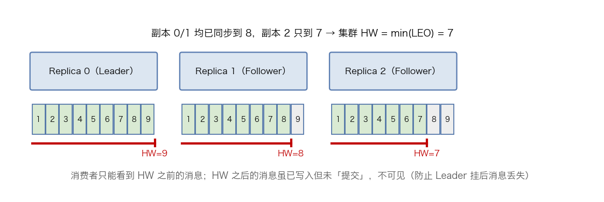

Kafka创建Topic时如何将分区放置到不同的Broker中

副本因子不能大于 Broker 的个数；

第一个分区（编号为0）的第一个副本放置位置是随机从 brokerList 选择的；

其他分区的第一个副本放置位置相对于第0个分区依次往后移。也就是如果我们有5个 Broker，5个分区，假设第一个分区放在第四个 Broker 上，那么第二个分区将会放在第五个 Broker 上；第三个分区将会放在第一个 Broker 上；第四个分区将会放在第二个 Broker 上，依次类推；

剩余的副本相对于第一个副本放置位置其实是由 nextReplicaShift 决定的，而这个数也是随机产生的

kafka丢失消息的三种情况

### 1.生产者发送消息时丢失

先介绍一下生产者发送消息的一般流程（部分流程与具体配置项强相关，这里先忽略）：

1.  生产者是与 leader 直接交互，所以先从集群获取 topic 对应分区的 leader 元数据；
2.  获取到 leader 分区元数据后直接将消息发给过去；
3.  Kafka Broker 对应的 leader 分区收到消息后写入文件持久化；
4.  Follower 拉取 Leader 消息与 Leader 的数据保持一致；
5.  Follower 消息拉取完毕需要给 Leader 回复 ACK 确认消息；
6.  Kafka Leader 和 Follower 分区同步完，Leader 分区会给生产者回复 ACK 确认消息。

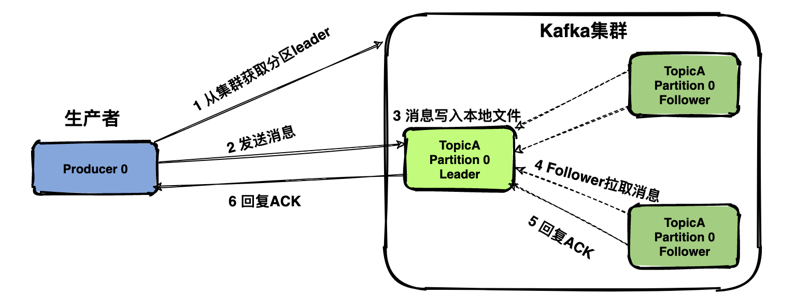

生产者采用 push 模式将数据发布到 broker，每条消息追加到分区中，顺序写入磁盘。消息写入 Leader 后，Follower 是主动与 Leader 进行同步。

Kafka 消息发送有两种方式：同步（sync）和异步（async），默认是同步方式，可通过 producer.type 属性进行配置。

Kafka 通过配置 request.required.acks 属性来确认消息的生产：

-   0 表示不进行消息接收是否成功的确认；不能保证消息是否发送成功，生成环境基本不会用。
-   1 表示当 Leader 接收成功时确认；只要 Leader 存活就可以保证不丢失，保证了吞吐量。
-   \-1 或者 all 表示 Leader 和 Follower 都接收成功时确认；可以最大限度保证消息不丢失，但是吞吐量低。

kafka producer 的参数 acks 的默认值为 1，所以默认的 producer 级别是 at least once，并不能 exactly once。

**敲黑板了，这里可能会丢消息的！**

-   如果 acks 配置为 0，发生网络抖动消息丢了，生产者不校验 ACK 自然就不知道丢了。
-   如果 acks 配置为 1 保证 leader 不丢，但是如果 leader 挂了，恰好选了一个没有 ACK 的 follower，那也丢了。
-   all：保证 leader 和 follower 不丢，但是如果网络拥塞，没有收到 ACK，会有重复发的问题。

### 2.Kafka Broker 丢失消息

Kafka Broker 接收到数据后会将数据进行持久化存储，你以为是下面这样的：

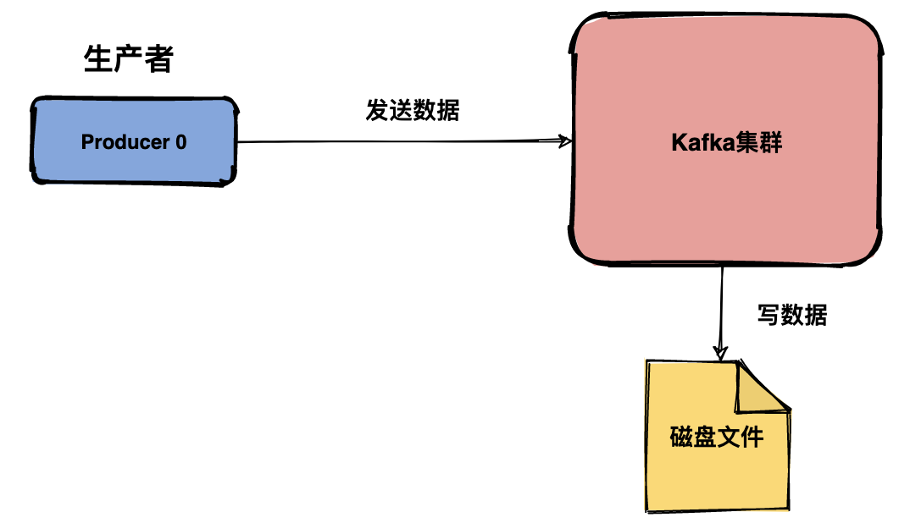

没想到是这样的：

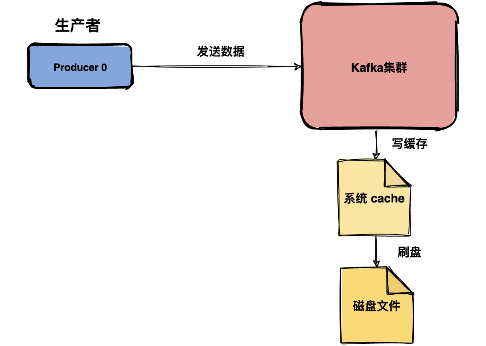

操作系统本身有一层缓存，叫做 Page Cache，当往磁盘文件写入的时候，系统会先将数据流写入缓存中，至于什么时候将缓存的数据写入文件中是由操作系统自行决定。

Kafka 提供了一个参数 producer.type 来控制是不是主动 flush，如果 Kafka 写入到 mmap 之后就立即 flush 然后再返回 Producer 叫同步 (sync)；写入 mmap 之后立即返回 Producer 不调用 flush 叫异步 (async)。

**敲黑板了，这里可能会丢消息的！**

Kafka 通过多分区多副本机制中已经能最大限度保证数据不会丢失，如果数据已经写入系统 cache 中但是还没来得及刷入磁盘，此时突然机器宕机或者掉电那就丢了，当然这种情况很极端。

### 消费者丢失消息

消费者通过 pull 模式主动的去 kafka 集群拉取消息，与 producer 相同的是，消费者在拉取消息的时候也是找 leader 分区去拉取。

多个消费者可以组成一个消费者组（consumer group），每个消费者组都有一个组 id。同一个消费组者的消费者可以消费同一 topic 下不同分区的数据，但是不会出现多个消费者消费同一分区的数据。

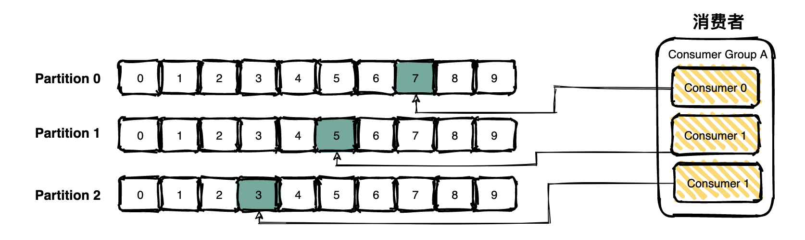

消费者消费的进度通过 offset 保存在 kafka 集群的\_\_consumer\_offsets 这个 topic 中。

消费消息的时候主要分为两个阶段：

1、标识消息已被消费，commit offset 坐标；

2、处理消息。

**敲黑板了，这里可能会丢消息的！**

场景一：先 commit 再处理消息。如果在处理消息的时候异常了，但是 offset 已经提交了，这条消息对于该消费者来说就是丢失了，再也不会消费到了。

场景二：先处理消息再 commit。如果在 commit 之前发生异常，下次还会消费到该消息，重复消费的问题可以通过业务保证消息幂等性来解决。

---

kafka消息格式

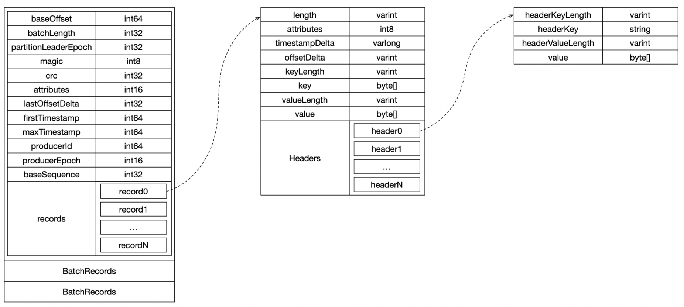

包含三个部分：BatchRecords、Record，以及Header的编码格式。

BatchRecords是Kafka数据的存储单元，一个BatchRecords中包含多个Record（即我们通常说的一条消息），而每条消息又可以包含多个Header信息，Header是Key-Value形式的

## 二、重复消费问题

> 来源：`MQ/kafka重消费.md`

消费组

Consumer Group为kafka提供了可扩展、高容错特性的消费者机制。简单介绍下，大致有以下特点：

-   一个Consumer Group内可以有多个Consumer实例，该实例可以是一个进程，也可以是进程下的多线程
-   每个Consumer Group有一个唯一标识的Group ID
-   不同Consumer Group之间相互独立，互不影响

-   Consumer Group内实例，与订阅的topic分区关系是一对一，或一对多的关系，Consumer Group会通过Coordinator尽量保持公平分配

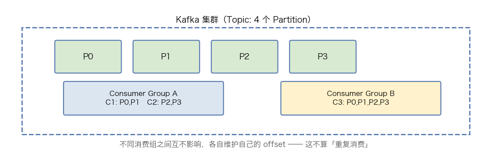

理想情况下，我们应该设置Consumer实例的数量等于该Group订阅topic的分区总数，可以最大发挥消费性能。若设置的Consumer实例数少于订阅的分区数，则会为每个Consumer实例分配多个分区，消费性能会有所下降。若设置的Consumer实例数大于订阅的分区数，则会为每个Consumer实例分配 1 个分区进行消费，多余的Consumer实例则会闲置，只会浪费资源。

重平衡

重平衡（Rebalance）就是让一个Consumer Group下所有的Consumer实例,合理分配消费订阅topic的所有分区的过程。有 3 种情况会触发Consumer Group的Rebalance：

-   Group下实例数发生变化。有新的Consumer实例加入或者离开组。
-   订阅的topic数发生变化。Consumer Group可以使用正则的方式订阅topic，比如 consumer.subscribe(Pattern.compile(“public.\*log”))，该Group订阅所有以 public 开头，log 结尾的topic。这期间，新建了一个满足这样条件的topic，那么该Group也会发生Rebalance。
-   topic分区数发生变化。比如topic扩分区的时候，也会触发Rebalance。

    单看上面任一触发条件，都没啥毛病。问题在于Rebalance过程中会出现以下问题：

-   Rebalance过程的表现有些类似JVM FGC的情况，期间整个应用都会夯住，所有Consumer实例都会停止消费，等待Rebalance完成。
-   Rebalance过程中，所有Consumer实例都会参与重新分配。即便Consumer Group中部分Consumer实例分配合理，也需要打散重新分配，会导致TCP重新建立连接，是一个比较重的操作，较为浪费资源。
-   Rebalance的耗时取决于Consumer Group下的实例数量，一旦实例数过多，耗时极长，会造成大量消费延迟。

### 避免重平衡

    对于上述Rebalance带来的一些弊端，从目前的社区版来看，暂时还没有很好的解决办法，我们只能尽量避免Rebalance的发生。在生产业务场景中，很多Rebalance都是预期外或者不必要的。我们应用的TPS大多是被这类Rebalance拖慢的。

    从上述的 3 个Rebalance触发条件抓手，后两条topic数量及分区数变化，一般都是主动运维的相关操作，这种操作带来的Rebalance一般是必然发生，难以避免的，我们组要来讨论下Consumer Group组成员变化引发的Rebalance。

    Consumer Group实例增加的情况比较单一，当新启动一个Consumer的group.id已经存在，Coordinator会接管这个新实例，将其加入group.id相同的组，并重分配分区。这种操作场景，一般都还是预期内的，可能是通过扩容来提高TPS的操作。Consumer Group实例数减少的情况就比较复杂了。除了正常停止下线某些Consumer实例，还会出现Coordinator误判实例为已停止状态，从而主动踢出Group。导致Rebalance发生。每个Consumer会定期向Coordinator发心跳包，保持keepalive。如果因为某些特殊原因，如网络抖动时，某个Consumer实例没有及时发送心跳请求，Coordinator会将其判定为离线，并从Group中移除，并开启新一轮Rebalance。针对这个问题，可以通过设置Consumer端一下几个参数来进行优化调整：

-       session.timeout.ms即Consumer Group内实例的心跳超时时间，默认值是 10s
-       heartbeat.interval.ms即心跳请求频率，频繁发送心跳请求会额外消耗带宽资源，但是能够更及时的触发Rebalance，默认值为 3s

-       max.poll.interval.ms调用poll方法的时间间隔，默认值为 5min。期间没消费完poll回的消息，Coordinator会开启新一轮Rebalance

## 三、零拷贝

> 来源：`MQ/kafka零拷贝详解.md`

在实际应用中，如果我们需要把磁盘中的某个文件内容发送到远程服务器上需要经历四步：

1.  第一次：读取磁盘文件到操作系统内核缓冲区；

2.  第二次：将内核缓冲区的数据，copy 到应用程序的 buffer；

3.  第三步：将应用程序 buffer 中的数据，copy 到 socket 网络发送缓冲区；

4.  第四次：将 socket buffer 的数据，copy 到网卡，由网卡进行网络传输。

如图所示：

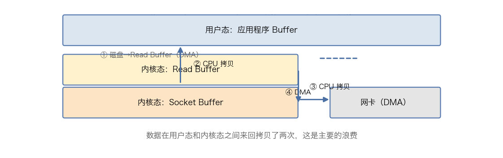

在这个过程中我们可以发现，数据从磁盘到最终发送出去，要经历 4 次拷贝，而 在这四次拷贝过程中，有两次拷贝是浪费的，分别是:

2.从内核空间复制到用户空间，3.从用户空间再次复制到内核空间。除此之外由于内核态和用户态的切换会导致CPU的上下文切换对于cpu来说造成性能影响

而零拷贝，就是把这两次多于的拷贝省略掉，应用程序可以直接把磁盘中的数据 从内核中直接传输给 Socket，而不需要再经过应用程序所在的用户空间，如下 图所示

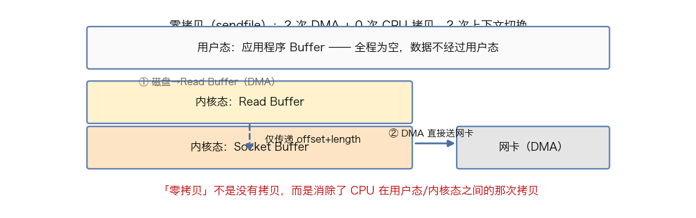

零拷贝通过 DMA(Direct Memory Access)技术把文件内容复制到内核空间中 的 Read Buffer，

接着把包含数据位置和长度信息的文件描述符加载到 Socket Buffer 中，DMA 引 擎直接可以把数据从内核空间中传递给网卡设备。

在这个流程中，数据只经历了两次拷贝就发送到了网卡中，并且减少了 2 次 cpu 的上下文切换，对于效率有非常大的提高。所以，所谓零拷贝，并不是完全没有数据赋值，只是相对于用户空间来说，不再 需要进行数据拷贝。对于前面说的整个流程来说，零拷贝只是减少了不必要的拷贝次数而已。

Kafka 使用到了 mmap 和 sendfile 的方式来实现零拷贝。

在 Linux 中，零拷贝技术依赖于底层的 sendfile()方法实现

在 Java 中，FileChannal.transferTo()方法的底层实现就是 sendfile()方法。

mmap 的文件映射机制它的原理是:将磁盘文件映射到内存,用户通过修改内存就能修改磁盘文件。使 用这种方式可以获取很大的 I/O 提升，省去了用户空间到内核空间复制的开销。

`mmap`主要实现方式是将读缓冲区的地址和用户缓冲区的地址进行映射，内核缓冲区和应用缓冲区共享，从而减少了从读缓冲区到用户缓冲区的一次CPU拷贝。由于用户进程中的内存是虚拟的，只是映射到内核的读缓冲区，所以可以节省一半的内存空间，比较适合大文件的传输

`sendfile直接在内核空间进行传输，`同样减少了一次CPU拷贝，而且还减少了2次上下文切换。Linux2.4内核版本之后对`sendfile`做了进一步优化，通过引入新的硬件支持，这个方式叫做DMA Scatter/Gather 分散/收集功能。

`mmap+write`方式则产生2次DMA拷贝+1次CPU拷贝，4次上下文切换，通过内存映射减少了一次CPU拷贝，可以减少内存使用，适合大文件的传输

`sendfile`方式是新增的一个系统调用函数，产生2次DMA拷贝+1次CPU拷贝，但是只有2次上下文切换。因为只有一次调用，减少了上下文的切换，但是用户空间对IO数据不可见，适用于静态文件服务器
