# RabbitMQ 与消息队列

> 合并自：`MQ.md`、`Rabbit MQ.md`。原文未删改（仅修正已知错误、调整格式）。

## 一、消息队列基础

> 来源：`MQ/MQ.md`

为什么使用MQ？MQ的优点

-   异步处理 - 相比于传统的串行、并行方式，提高了系统吞吐量。
-   应用解耦 - 系统间通过消息通信，不用关心其他系统的处理。
-   流量削锋 - 可以通过消息队列长度控制请求量；可以缓解短时间内的高并发请求。
-   日志处理 - 解决大量日志传输。
-   消息通讯 - 消息队列一般都内置了高效的通信机制，因此也可以用在纯的消息通讯。比如实现点对点消息队列，或者聊天室等

MQ主要优点是：解耦、异步、流量削锋

-   解耦：
    A 系统发送数据到 BCD 三个系统，通过接口调用发送。如果 E 系统也要这个数据呢？那如果 C 系统现在不需要了呢？A 系统负责人几乎崩溃…A 系统跟其它各种乱七八糟的系统严重耦合，A 系统产生一条比较关键的数据，很多系统都需要 A 系统将这个数据发送过来。如果使用 MQ，A 系统产生一条数据，发送到 MQ 里面去，哪个系统需要数据自己去 MQ 里面消费。如果新系统需要数据，直接从 MQ 里消费即可；如果某个系统不需要这条数据了，就取消对 MQ 消息的消费即可。这样下来，A 系统压根儿不需要去考虑要给谁发送数据，不需要维护这个代码，也不需要考虑人家是否调用成功、失败超时等情况。
    就是一个系统或者一个模块，调用了多个系统或者模块，互相之间的调用很复杂，维护起来很麻烦。但是其实这个调用是不需要直接同步调用接口的，如果用 MQ 给它异步化解耦。
-   异步
    A 系统接收一个请求，需要在自己本地写库，还需要在 BCD 三个系统写库，自己本地写库要 3ms，BCD 三个系统分别写库要 300ms、450ms、200ms。最终请求总延时是 3 + 300 + 450 + 200 = 953ms，接近 1s，用户感觉搞个什么东西，慢死了慢死了。用户通过浏览器发起请求。如果使用 MQ，那么 A 系统连续发送 3 条消息到 MQ 队列中，假如耗时 5ms，A 系统从接受一个请求到返回响应给用户，总时长是 3 + 5 = 8ms。
-   流量削锋
    减少高峰时期对服务器的压力

MQ的一些缺点

-   系统可用性降低
    消息队列如果发生故障会导致系统奔溃，因此系统可用性会降低
-   系统复杂度提高
    保证消息不被重复消费、保证消息可靠性传输，提高了系统复杂度
-   一致性问题
    A 系统处理完了直接返回成功了，人都以为你这个请求就成功了；但是问题是，要是 BCD 三个系统那里，BD 两个系统写库成功了，结果 C 系统写库失败了，咋整？你这数据就不一致了。

MQ异步消息发送如何保证消息的可靠性

    消息丢失可能发生在生产者发送消息、MQ本身丢失消息、消费者丢失消息3个方面。

    生产者丢失：生产者丢失消息的可能点在于程序发送失败抛异常了没有重试处理，或者发送的过程成功但是过程中网络闪断MQ没收到，消息就丢失了。我们可以通过异步消息发送+回调通知+本地消息表解决。对于一个下单的场景举例：

1.  下单后先保存本地数据和MQ消息表，这时候消息的状态是发送中，如果本地事务失败，那么下单失败，事务回滚。

2.  下单成功，直接返回客户端成功，异步发送MQ消息

3.  MQ回调通知消息发送结果，对应更新数据库MQ发送状态

4.  JOB轮询超过一定时间（时间根据业务配置）还未发送成功的消息去重试

5.  在监控平台配置或者JOB程序处理超过一定次数一直发送不成功的消息，告警，人工介入。

MQ丢失：如果生产者保证消息发送到MQ，而MQ收到消息后还在内存中，这时候宕机了又没来得及同步给从节点，就有可能导致消息丢失

    RabbitMQ有confirm机制，在收到消息之后给生产者一个确认、RocketMQ则可以同步刷盘将消息存放到磁盘中

消费者丢失：消费者刚收到消息，此时服务器宕机，MQ认为消费者已经消费，不会重复发送消息，消息丢失。

    消费者成功消费消息之后进行ack确认，如果MQ没有返回ack确认，重发的机制根据MQ类型的不同发送时间间隔、次数都不尽相同，如果重试超过次数之后会进入死信队列，需要手工来处理了。

消息的重复消费

   AMQP 定义了消费者确认机制（message ack），如果一个消费者应用崩溃掉（此时连接会断掉，broker 会得知），但是 broker 尚未获得 ack，那么消息会被重新放入队列。所以 AMQP 提供的是“至少一次交付”（at-least-once delivery），异常情况下，消息会被重复消费，这时候需要消费者实现幂等性来解决消息重复性消费问题。例如对消息进行数据库的落库，使用主键唯一来确保消息不会被重复消费。或者使用redis原子性来进行幂等

## 二、RabbitMQ

> 来源：`MQ/Rabbit MQ.md`

MQ是消息通信的模型，实现MQ的两种主流方式是：AMQP、JMS

AMQP：高级消息队列协议，是一个进程间传递异步消息的网络协议，更准确的来说是一种链接协议，这是和JMS的本质差别，AMQP不从API层进行限定，而是直接定义网络交换的数据格式

JMS：java消息服务应用程序接口，是一个java平台中关于面向消息中间件的API，用于在两个应用程序之间，或是分布式系统中发送消息进行异步通信

AMQP定义了和JMS区别：

1.JMS是统一的接口来对消息操作进行统一

2.JMS限定了必须使用java语言，AMQP只是协议，不规定实现方式，因此是跨语言的

3.JMS规定了两种消息模式（点对点、发布/订阅）；AMQP的消息模式有种（简单模式、work模式、发布订阅模式、路由键模式、匹配模式、RPC模式）

rabbitmq生产者发送消息需要执行exchange，如果没有指定exchange那么会走默认的exchange（AMQP default），这个exchange的路由规则是根据routingKey和queue名称进行路由

exchange：交换机，负责接收消息，并根据路由键转发消息所绑定的队列

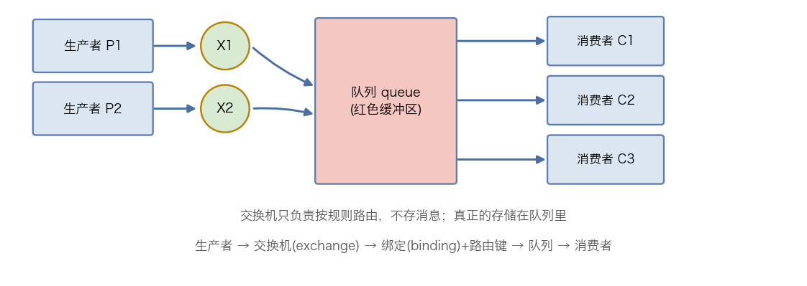

exchange的属性：

                    name：交换机名称

                    type：交换机类型，主要有direct、topic、fanout、headers

                    durability：是否需要持久化，true为持久化

                    auto delete：当最后一个绑定在exchange上的队列删除后，自动删除该exchange

                    internal：当前exchange是否用于rabbitmq内部使用，默认是false

                    arguments：拓展参数，用于拓展AMQP协议定制化使用

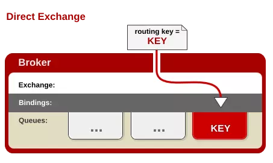

Direct Exchange – 处理路由键。需要将一个队列绑定到交换机上，要求该消息与一个特定的路由键完全匹配。这是一个完整的匹配。如果一个队列绑定到该交换机上要求路由键 “dog”，则只有被标记为“dog”的消息才被转发，不会转发dog.puppy，也不会转发dog.guard，只会转发dog。

注意：Direct模式可以使用Rabbit Mq自带的Exchange：default Exchange，所以不需要将Exchange进行任何绑定（binding）操作，消息传递时，RouteKey必须完全匹配才会被队列接受，否则该消息会被抛弃

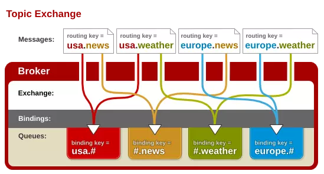

Topic Exchange：所有发送到Topic Exchange的消息被转发到所有关心RouteKey中指定Topic的Queue上，Exchange将RouteKey和某个Topic进行模糊匹配，此时队列需要绑定一个topic（模糊匹配可以使用通配符）

        "#"匹配一个或多个词

        "\*"匹配不多不少一个词

            例如："log.#"能够匹配到"log.info.oa"、"log.\*"只能匹配到"log.error"

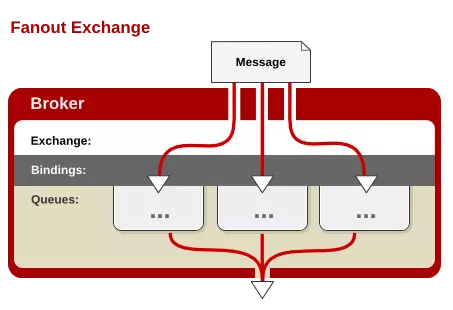

Fanout Exchange – 不处理路由键。你只需要简单的将队列绑定到交换机上。一个发送到交换机的消息都会被转发到与该交换机绑定的所有队列上。很像子网广播，每台子网内的主机都获得了一份复制的消息。Fanout交换机转发消息是最快的。

Bingding：Exchange和Exchange、Queue之间的连接关系，Binding中可以包含RoutingKey或者参数

Queue：消息队列，实际存储消息数据

        durability：是否持久化，durable：是，transient：否

        auto delete：当最后一个监听被移除之后，该queue会自动被删除

Message：服务器和应用程序之间传送的数据，本质上就是一段数据，由properties和body组成

Virtual Host：虚拟地址，用于进行逻辑隔离，最上层的消息路由，一个virtual host里面可以有若干个exchange和queue，同一个virtual host里面不能有相同名称的exchange、queue

生产端可靠性投递的解决方法：

1.消息落库，对消息状态进行打标

    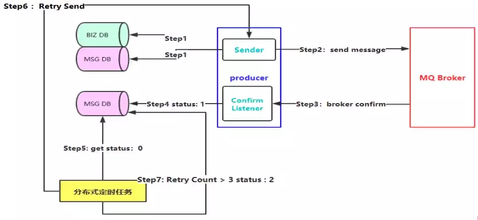

流程的示意图如上所示，比如我下单成功了，这是进行 step1，对我的业务数据进行入库，业务数据入库完毕（这里要特别注意一定要保证业务数据入库）再对要发送的消息进行入库，图中采用了两个数据库，可以根据实际业务场景来确定是否采用两个数据库，如果采用了两个数据库，有人可能就像到了采用分布式事务来保证数据的一致性，但是在大型互联网中，基本很少采用事务，都是采用补偿机制。

对业务数据和消息入库完毕就进入 setp2，发送消息到 MQ 服务上，按照正常的流程就是消费者监听到该消息，就根据唯一 id 修改该消息的状态为已消费，并给一个确认应答 ack 到 Listener。如果出现意外情况，消费者未接收到或者 Listener 接收确认时发生网络闪断，接收不到，这时候就需要用到我们的分布式定时任务来从 msg 数据库抓取那些超时了还未被消费的消息，重新发送一遍。重试机制里面要设置重试次数限制，因为一些外部的原因导致一直发送失败的，不能重试太多次，要不然会拖垮整个服务。例如重试三次还是失败的，就把消息的 status 设置成 2，然后通过补偿机制，人工去处理。实际生产中，这种情况还是比较少的，但是你不能没有这个补偿机制，要不然就做不到可靠性了。

2.消息的延迟投递，做二次确认，回调检查

回想第一种方案，生产端既要对业务数据入库，又要对消息数据入库，这种设计在高并发场景下，真的合适吗？在核心链路上，每一次持久化都是需要很精心考量的，持久化一次就花费 100 - 200 毫秒，这在高并发场景下是忍受不了的。这时候需要我们的第二种方案了，流程图如下。

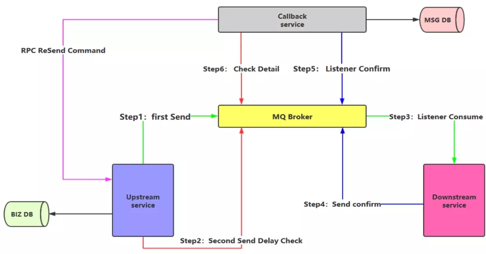

upstream Server 就是我们的上游服务，也就是生产者，生产者将业务数据入库成功后，生成两条消息，一条是立即发送出去给到下游服务 downstream Server的，一条是延迟消息给到 补偿服务 callback Server的。

正常情况下，下游服务监听到这个即时的消息，会发送一条消息给到 callback Server，注意这里不是采用第一种方案里面的返回 ack 方式，而是发送了一条消息给回去。

callback Server 监听到这个消息，知道了刚才有一条消息消费成功了，然后把这个持久化到数据库中，当上游服务发送的延迟消息到达 callback Server 时，callback Server 就会去数据库查询，刚才下游服务是否有处理过这个对应的消息，如果其 msg DB 里面有这个记录就说明这条消息是已经被消费了，如果不存在这个记录，那么 callback Server 就会发起一个 RPC 请求给到上游服务，告诉上游服务，你刚才这个消息没发送成功，需要重新发送一遍，上游服务就重新发送即时和延迟的两条消息出去，按照之前的流程继续走一遍。

虽然第二种方案也是无法做到 100% 的可靠传递，在特别极端的情况，还是需要定时任务和补偿机制进行辅助的。但是第二种方案的核心是减少数据库操作，这个点很重要！

在高并发场景下，我考虑的不是百分百的可靠性了，而是考虑可用性，性能能否扛得住这个流量，所以我能减少一次数据库操作就减少一次。我上游服务减少了一次数据库操作，我的服务性能相对而言就提高了一些，而且又能把异步 callback Server 补偿服务解耦出来。

业界主流的幂等性操作方法：

1.唯一ID+指纹码机制，利用数据库主键进行去重

    指纹码（业务规则、时间戳或其他）

    好处：实现简单

    坏处：高并发下有数据库写入瓶颈

    解决方法：利用id进行分库分表进行算法路由

2.利用redis的原子性进行去重

     问题：1是否要进行数据库落库，如果落库的话，关键解决的问题是数据库和缓存如何做到原子性

                2.如果不进行落库，那么都存储到缓存中如何设置定时同步策略

Confirm确认机制：这是消息的确认，是指生产者投递消息后，如果Broker收到消息，则会给我们生产者一个应答，生产者进行接收应答，用来确定这条消息是否正常的发送到Broker，这种方式也是消息的可靠性投递的核心保障。

Return消息机制：这种Return Listener用于处理一些不可路由的消息，我们的生产者通过指定一个Exchange和RoutingKey，把消息送达到某一个队列中去，然后我们的消费者监听队列，进行消费处理操作，但是在某种情况下，如果我们在发送消息的时候，当前的exchange不存在或者指定的routingkey路由不到，这个时候如果我们需要监听这种不可达的消息，就需要使用Return Listener

消费端限流：RabbitMQ提供了一种qos（服务质量保证）功能，即在非自动确认消息的前提下，如果一定数目的消息（通过基于consume或者channel设置Qos的值）未被确认前，不进行消费新的消息。

### 3.RabbitMQ的5种模式与实例

### 3.1 简单模式Hello World

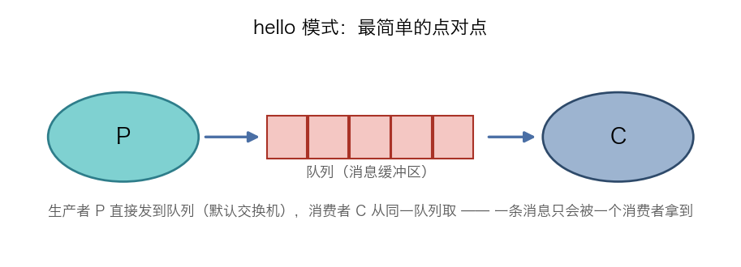

功能：一个生产者P发送消息到队列Q,一个消费者C接收

**生产者实现思路：**

创建连接工厂ConnectionFactory，设置服务地址127.0.0.1，端口号5672，设置用户名、密码、virtual host，从连接工厂中获取连接connection，使用连接创建通道channel，使用通道channel创建队列queue，使用通道channel向队列中发送消息，关闭通道和连接。

 ```java
private final static String QUEUE_NAME = "test_queue";

public static void main(String[] argv) throws Exception {
    // 获取到连接以及mq通道
    Connection connection = ConnectionUtil.getConnection();
    // 从连接中创建通道
    Channel channel = connection.createChannel();

    // 声明（创建）队列
    channel.queueDeclare(QUEUE_NAME, false, false, false, null);

    // 消息内容
    String message = "Hello World!";
    channel.basicPublish("", QUEUE_NAME, null, message.getBytes());
    System.out.println(" [x] Sent '" + message + "'");

    //关闭通道和连接
    channel.close();
    connection.close();
}
```

**消费者实现思路**

创建连接工厂ConnectionFactory，设置服务地址127.0.0.1，端口号5672，设置用户名、密码、virtual host，从连接工厂中获取连接connection，使用连接创建通道channel，使用通道channel创建队列queue, 创建消费者并监听队列，从队列中读取消息。

```java
public static void main(String[] argv) throws Exception {

    // 获取到连接以及mq通道
    Connection connection = ConnectionUtil.getConnection();
    Channel channel = connection.createChannel();

    // 声明队列
    channel.queueDeclare(QUEUE_NAME, false, false, false, null);

    // 定义队列的消费者
    QueueingConsumer consumer = new QueueingConsumer(channel);
    // 监听队列
    channel.basicConsume(QUEUE_NAME, true, consumer);

    // 获取消息
    while (true) {
        QueueingConsumer.Delivery delivery = consumer.nextDelivery();
        String message = new String(delivery.getBody());
        System.out.println(" [x] Received '" + message + "'");
    }
}
```

### 3.2 工作队列模式Work Queue

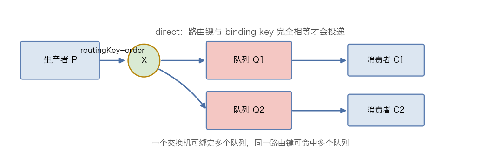

**功能**：一个生产者，多个消费者，每个消费者获取到的消息唯一，多个消费者只有一个队列

**任务队列**：避免立即做一个资源密集型任务，必须等待它完成，而是把这个任务安排到稍后再做。我们将任务封装为消息并将其发送给队列。后台运行的工作进程将弹出任务并最终执行作业。当有多个worker同时运行时，任务将在它们之间共享。

**生产者实现思路：**

创建连接工厂ConnectionFactory，设置服务地址127.0.0.1，端口号5672，设置用户名、密码、virtual host，从连接工厂中获取连接connection，使用连接创建通道channel，使用通道channel创建队列queue，使用通道channel向队列中发送消息，2条消息之间间隔一定时间，关闭通道和连接。

```java
private final static String QUEUE_NAME = "test_queue_work";

public static void main(String[] argv) throws Exception {
    // 获取到连接以及mq通道
    Connection connection = ConnectionUtil.getConnection();
    Channel channel = connection.createChannel();

    // 声明队列
    channel.queueDeclare(QUEUE_NAME, false, false, false, null);

    for (int i = 0; i < 100; i++) {
        // 消息内容
        String message = "" + i;
        channel.basicPublish("", QUEUE_NAME, null, message.getBytes());
        System.out.println(" [x] Sent '" + message + "'");

        Thread.sleep(i * 10);
    }

    channel.close();
    connection.close();
}
```

**消费者实现思路：**

创建连接工厂ConnectionFactory，设置服务地址127.0.0.1，端口号5672，设置用户名、密码、virtual host，从连接工厂中获取连接connection，使用连接创建通道channel，使用通道channel创建队列queue，创建消费者C1并监听队列，获取消息并暂停10ms，另外一个消费者C2暂停1000ms，由于消费者C1消费速度快，所以C1可以执行更多的任务。

```java
private final static String QUEUE_NAME = "test_queue_work";

public static void main(String[] argv) throws Exception {

    // 获取到连接以及mq通道
    Connection connection = ConnectionUtil.getConnection();
    Channel channel = connection.createChannel();

    // 声明队列
    channel.queueDeclare(QUEUE_NAME, false, false, false, null);

    // 同一时刻服务器只会发一条消息给消费者，来保证资源的合理利用
    channel.basicQos(1);

    // 定义队列的消费者
    QueueingConsumer consumer = new QueueingConsumer(channel);
    // 监听队列，手动返回完成
    channel.basicConsume(QUEUE_NAME, false, consumer);

    // 获取消息
    while (true) {
        QueueingConsumer.Delivery delivery = consumer.nextDelivery();
        String message = new String(delivery.getBody());
        System.out.println(" [x] Received '" + message + "'");
        //休眠
        Thread.sleep(10);
        // 返回确认状态
        channel.basicAck(delivery.getEnvelope().getDeliveryTag(), false);
    }
}
```

### 3.3 发布/订阅模式Publish/Subscribe

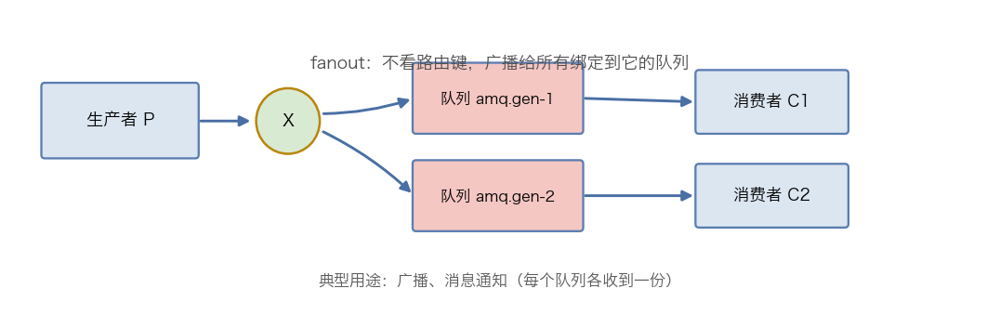

**功能**：一个生产者发送的消息会被多个消费者获取。一个生产者、一个交换机、多个队列、多个消费者

生产者：可以将消息发送到队列或者是交换机。

消费者：只能从队列中获取消息。

如果消息发送到没有队列绑定的交换机上，那么消息将丢失。

交换机不能存储消息，消息存储在队列中

**生产者实现思路：**

创建连接工厂ConnectionFactory，设置服务地址127.0.0.1，端口号5672，设置用户名、密码、virtual host，从连接工厂中获取连接connection，使用连接创建通道channel，使用通道channel创建队列queue，使用通道channel创建交换机并指定交换机类型为fanout，使用通道向交换机发送消息，关闭通道和连接。

```java
private final static String EXCHANGE_NAME = "test_exchange_fanout";

public static void main(String[] argv) throws Exception {
    // 获取到连接以及mq通道
    Connection connection = ConnectionUtil.getConnection();
    Channel channel = connection.createChannel();

    // 声明exchange 交换机  name, type
    //交换机类型有4种：direct, topic, headers and fanout.
    channel.exchangeDeclare(EXCHANGE_NAME, "fanout");

    // 消息内容
    String message = "Hello World!";
    //发布消息到交换机
    channel.basicPublish(EXCHANGE_NAME, "", null, message.getBytes());
    System.out.println(" [x] Sent '" + message + "'");

    channel.close();
    connection.close();
}
```

**消费者实现思路：**

创建连接工厂ConnectionFactory，设置服务地址127.0.0.1，端口号5672，设置用户名、密码、virtual host，从连接工厂中获取连接connection，使用连接创建通道channel，使用通道channel创建队列queue，绑定队列到交换机，设置Qos=1，创建消费者并监听队列，使用手动方式返回完成。可以有多个队列绑定到交换机，多个消费者进行监听。

```java
private final static String QUEUE_NAME = "test_queue_exchange_1";

private final static String EXCHANGE_NAME = "test_exchange_fanout";

public static void main(String[] argv) throws Exception {

    // 获取到连接以及mq通道
    Connection connection = ConnectionUtil.getConnection();
    Channel channel = connection.createChannel();

    // 声明队列1
    channel.queueDeclare(QUEUE_NAME, false, false, false, null);

    // 绑定队列到交换机
    channel.queueBind(QUEUE_NAME, EXCHANGE_NAME, "");

    // 同一时刻服务器只会发一条消息给消费者
    channel.basicQos(1);

    // 定义队列的消费者
    QueueingConsumer consumer = new QueueingConsumer(channel);
    // 监听队列，手动返回完成
    channel.basicConsume(QUEUE_NAME, false, consumer);

    // 获取消息
    while (true) {
        QueueingConsumer.Delivery delivery = consumer.nextDelivery();
        String message = new String(delivery.getBody());
        System.out.println(" [x] Received '" + message + "'");
        Thread.sleep(10);
        //手动确认收到消息
        channel.basicAck(delivery.getEnvelope().getDeliveryTag(), false);
    }
}
```

### 3.4 路由模式Routing

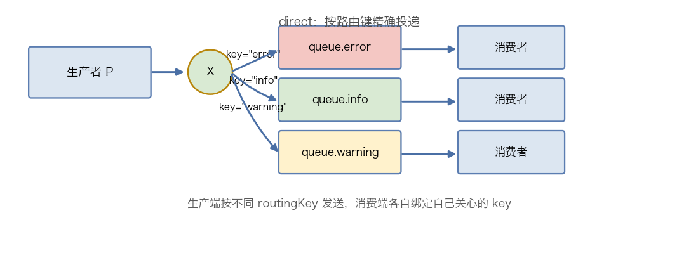

说明：生产者发送消息到交换机并且要指定路由key，消费者将队列绑定到交换机时需要指定路由key

**生产者实现思路：**

创建连接工厂ConnectionFactory，设置服务地址127.0.0.1，端口号5672，设置用户名、密码、virtual host，从连接工厂中获取连接connection，使用连接创建通道channel，使用通道channel创建队列queue，使用通道channel创建交换机并指定交换机类型为direct，使用通道向交换机发送消息并指定key=b，关闭通道和连接。

```java
private final static String EXCHANGE_NAME = "test_exchange_direct";

public static void main(String[] argv) throws Exception {
    // 获取到连接以及mq通道
    Connection connection = ConnectionUtil.getConnection();
    Channel channel = connection.createChannel();

    // 声明exchange type=direct 路由模式
    channel.exchangeDeclare(EXCHANGE_NAME, "direct");

    // 消息内容
    String message = "Hello World!";
    //发布消息到交换机，并指定key
    channel.basicPublish(EXCHANGE_NAME, "b", null, message.getBytes());
    System.out.println(" [x] Sent '" + message + "'");

    channel.close();
    connection.close();
}
```

**消费者实现思路：**

创建连接工厂ConnectionFactory，设置服务地址127.0.0.1，端口号5672，设置用户名、密码、virtual host，从连接工厂中获取连接connection，使用连接创建通道channel，使用通道channel创建队列queue，绑定队列到交换机，设置Qos=1，创建消费者并监听队列，使用手动方式返回完成。可以有多个队列绑定到交换机,但只要绑定key=b的队列key接收到消息，多个消费者进行监听。

```java
private final static String QUEUE_NAME = "test_queue_direct_2";

private final static String EXCHANGE_NAME = "test_exchange_direct";

public static void main(String[] argv) throws Exception {

    // 获取到连接以及mq通道
    Connection connection = ConnectionUtil.getConnection();
    Channel channel = connection.createChannel();

    // 声明队列
    channel.queueDeclare(QUEUE_NAME, false, false, false, null);

    // 绑定队列到交换机
    channel.queueBind(QUEUE_NAME, EXCHANGE_NAME, "b");

    // 同一时刻服务器只会发一条消息给消费者
    channel.basicQos(1);

    // 定义队列的消费者
    QueueingConsumer consumer = new QueueingConsumer(channel);
    // 监听队列，手动返回完成
    channel.basicConsume(QUEUE_NAME, false, consumer);

    // ……（原图截图在此处被截断，后续 while 循环与结尾大括号未包含在图中）
```

### 3.5 通配符模式Topics

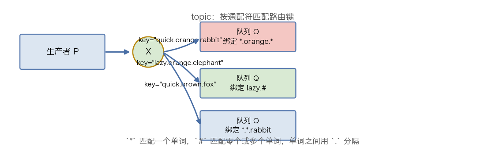

说明：生产者P发送消息到交换机X，type=topic，交换机根据绑定队列的routing key的值进行通配符匹配；符号#：匹配一个或者多个词lazy.# 可以匹配lazy.irs或者lazy.irs.cor

符号\*：只能匹配一个词lazy.\* 可以匹配lazy.irs或者lazy.cor

**生产者实现思路：**

创建连接工厂ConnectionFactory，设置服务地址127.0.0.1，端口号5672，设置用户名、密码、virtual host，从连接工厂中获取连接connection，使用连接创建通道channel，使用通道channel创建队列queue，使用通道channel创建交换机并指定交换机类型为topic，使用通道向交换机发送消息并指定key=key.1，关闭通道和连接。

 ```java
private final static String EXCHANGE_NAME = "test_exchange_topic";

public static void main(String[] argv) throws Exception {
    // 获取到连接以及mq通道
    Connection connection = ConnectionUtil.getConnection();
    Channel channel = connection.createChannel();

    // 声明exchange
    channel.exchangeDeclare(EXCHANGE_NAME, "topic");

    // 消息内容
    String message = "Hello Topic!";
    channel.basicPublish(EXCHANGE_NAME, "key.1", null, message.getBytes());
    System.out.println(" [x] Sent '" + message + "'");

    channel.close();
    connection.close();
}
```

**消费者实现思路：**

创建连接工厂ConnectionFactory，设置服务地址127.0.0.1，端口号5672，设置用户名、密码、virtual host，从连接工厂中获取连接connection，使用连接创建通道channel，使用通道channel创建队列queue，绑定队列到交换机，设置Qos=1，创建消费者并监听队列，使用手动方式返回完成。可以有多个队列绑定到交换机,凡是绑定规则符合通配符规则的队列均可以接收到消息，比如key.\*,key.#，多个消费者进行监听。

### 4.spring集成rabbitmq配置

[spring](http://lib.csdn.net/base/javaee)提供了AMQP的一个实现，并且spring-rabbit是RabbitMQ的一个实现，下面给出订阅者模式的事例配置如下：

```xml
<!-- 定义RabbitMQ的连接工厂 -->
<rabbit:connection-factory id="connectionFactory"
    host="127.0.0.1" port="5672" username="gseem" password="gseem"
    virtual-host="/gseem" />

<!-- 定义Rabbit模板，指定连接工厂以及定义exchange -->
<rabbit:template id="amqpTemplate" connection-factory="connectionFactory" exchange="fanoutExchange" />

<!-- MQ的管理，包括队列、交换器等 -->
<rabbit:admin connection-factory="connectionFactory" />

<!-- 定义交换器，自动声明 -->
<rabbit:fanout-exchange name="fanoutExchange" auto-declare="true">
    <!-- 交换机绑定队列 -->
    <rabbit:bindings>
        <rabbit:binding queue="myQueue"/>
    </rabbit:bindings>
</rabbit:fanout-exchange>

<!-- 队列监听 一旦队列中收到消息，自动执行Foo.listen方法-->
<rabbit:listener-container connection-factory="connectionFactory">
    <rabbit:listener ref="foo" method="listen" queue-names="myQueue" />
</rabbit:listener-container>

<bean id="foo" class="com.gseem.rabbitmq.spring.Foo" />
```
