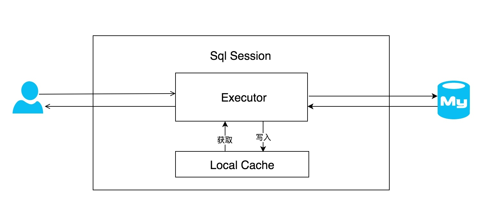
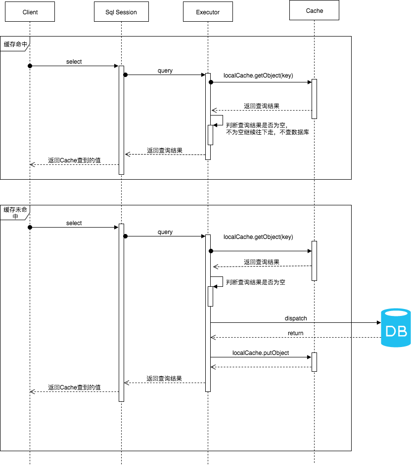
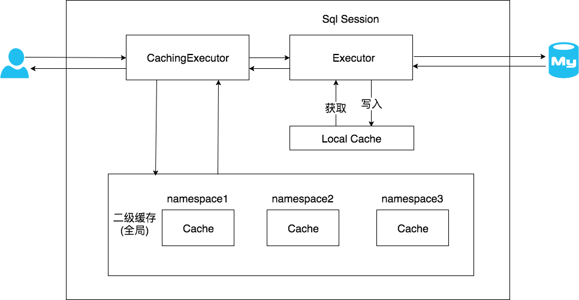

# MyBatis

> 来源：`MyBatis/Mybatis.md`

## 映射器

### #{}和${}的区别

-   #{}是占位符，预编译处理；${}是拼接符，字符串替换，没有预编译处理。
-   Mybatis在处理#{}时，#{}传入参数是以字符串传入，会将SQL中的#{}替换为?号，调用PreparedStatement的set方法来赋值。
-   Mybatis在处理时 ， 是 原 值 传 入 ， 就 是 把 {}时，是原值传入，就是把时，是原值传入，就是把{}替换成变量的值，相当于JDBC中的Statement编译
-   变量替换后，#{} 对应的变量自动加上单引号 ‘’；变量替换后，${} 对应的变量不会加上单引号 ‘’
-   #{} 可以有效的防止SQL注入，提高系统安全性；${} 不能防止SQL 注入
-   #{} 的变量替换是在DBMS 中；${} 的变量替换是在 DBMS 外

### 模糊查询like语句该怎么写

（1）’%${question}%’ 可能引起SQL注入，不推荐

（2）"%"#{question}"%" 注意：因为#{…}解析成sql语句时候，会在变量外侧自动加单引号’ '，所以这里 % 需要使用双引号" "，不能使用单引号 ’ '，不然会查不到任何结果。

（3）CONCAT(’%’,#{question},’%’) 使用CONCAT()函数，推荐

（4）使用bind标签

```java
<select id="listUserLikeUsername" resultType="com.jourwon.pojo.User">
　　<bind name="pattern" value="'%' + username + '%'" />
　　select id,sex,age,username,password from person where username LIKE #{pattern}
</select>
```

一级缓存

在应用运行过程中，我们有可能在一次数据库会话中，执行多次查询条件完全相同的SQL，MyBatis提供了一级缓存的方案优化这部分场景，如果是相同的SQL语句，会优先命中一级缓存，避免直接对数据库进行查询，提高性能。具体执行过程如下图所示。



Mybatis缓存共有两种级别：SESSION、STATEMENT，默认是SESSION级别，即在一个Mybatis会话中执行的所有语句，都会共享这一个缓存。另一个是STATEMENT级别，可以理解为缓存只对当前执行的这一个Statement有效

一级缓存执行的时序图如图：



只要两条SQL的下列五个值相同，即可以认为是相同的SQL。

Statement Id + Offset + Limmit + Sql + Params

如果我们的SQL语句是insert/delete/update Mybatis一级缓存就会刷新

总结：

1.  MyBatis一级缓存的生命周期和SqlSession一致。
2.  MyBatis一级缓存内部设计简单，只是一个没有容量限定的HashMap，在缓存的功能性上有所欠缺。
3.  MyBatis的一级缓存最大范围是SqlSession内部，有多个SqlSession或者分布式的环境下，数据库写操作会引起脏数据，建议设定缓存级别为Statement。

二级缓存

一级缓存中，其最大的共享范围就是一个SqlSession内部，如果多个SqlSession之间需要共享缓存，则需要使用到二级缓存。开启二级缓存后，会使用CachingExecutor装饰Executor，进入一级缓存的查询流程前，先在CachingExecutor进行二级缓存的查询，具体的工作流程如下所示。



二级缓存开启后，同一个namespace下的所有操作语句，都影响着同一个Cache，即二级缓存被多个SqlSession共享，是一个全局的变量。当开启缓存后，数据的查询执行的流程就是 二级缓存 -> 一级缓存 -> 数据库。

二级缓存的sqlsession没有commit时，二级缓存不会起作用

总结：

1.  MyBatis的二级缓存相对于一级缓存来说，实现了`SqlSession`之间缓存数据的共享，同时粒度更加的细，能够到`namespace`级别，通过Cache接口实现类不同的组合，对Cache的可控性也更强。
2.  MyBatis在多表查询时，极大可能会出现脏数据，有设计上的缺陷，安全使用二级缓存的条件比较苛刻。
3.  在分布式环境下，由于默认的MyBatis Cache实现都是基于本地的，分布式环境下必然会出现读取到脏数据，需要使用集中式缓存将MyBatis的Cache接口实现，有一定的开发成本，直接使用Redis、Memcached等分布式缓存可能成本更低，安全性也更高。

SqlSession:简单来说，SqlSession是Mybatis工作的最顶层API会话接口，所有的数据库操作都经由它来实现，由于它就是一个会话，即一个SqlSession应该仅存活于一个业务请求中，也可以说一个SqlSession对应这一次数据库会话，它不是永久存活的，每次访问数据库时都需要创建它。

因此，SqlSession并不是线程安全，每个线程都应该有它自己的 SqlSession 实例，千万不能将一个SqlSession搞成单例形式，或者静态域和实例变量的形式都会导致SqlSession出现事务问题，这也就是为什么多个请求同一个事务中会共用一个SqlSession会话的原因，我们从SqlSession的创建过程来说明这点：

从Configuration配置类中拿到Environment数据源；

1.  从数据源中获取TransactionFactory和DataSource，并创建一个Transaction连接管理对象；
2.  创建Executor对象（SqlSession只是所有操作的门面，真正要干活的是Executor，它封装了底层JDBC所有的操作细节）；

3.  创建SqlSession会话。

每次创建一个SqlSession会话，都会伴随创建一个专属SqlSession的连接管理对象，如果SqlSession共享，就会出现事务问题。
