# Redis 持久化与高可用

> 合并自：`redis持久化.md`、`Redis高可用.md`、`Redis脑裂.md`、`Redis单线程高并发.md`。原文未删改（仅修正已知错误、调整格式）。

## 一、持久化：RDB 与 AOF

> 来源：`Redis/redis持久化.md`

Redis为持久化提供了两种方式：

-   RDB：在指定的时间间隔能对你的数据进行快照存储。
-   AOF：记录每次对服务器写的操作,当服务器重启的时候会重新执行这些命令来恢复原始的数据。

rdb持久化配置：

-   `save 900 1` 表示900s内如果有1条是写入命令，就触发产生一次快照，可以理解为就进行一次备份
-   `save 300 10` 表示300s内有10条写入，就产生快照

aof配置：

\# 是否开启aof appendonly yes

\# 同步方式 appendfsync everysec

appendfsync everysec 它其实有三种模式:

always：把每个写命令都立即同步到aof，很慢，但是很安全

everysec：每秒同步一次，是折中方案

no：redis不处理交给OS来处理，非常快，但是也最不安全

一般情况下都采用 everysec 配置，这样可以兼顾速度与安全，最多损失1s的数据。

RDB原理

在Redis中RDB持久化的触发分为两种：自己手动触发与Redis定时触发。

**针对RDB方式的持久化，手动触发可以使用：**

-   save：会阻塞当前Redis服务器，直到持久化完成，线上应该禁止使用。
-   bgsave：该触发方式会fork一个子进程，由子进程负责持久化过程，因此阻塞只会发生在fork子进程的时候。

**而自动触发的场景主要是有以下几点：**

-   根据我们的 `save m n` 配置规则自动触发；
-   从节点全量复制时，主节点发送rdb文件给从节点完成复制操作，主节点会触发 `bgsave`；
-   执行 `debug reload` 时；
-   执行 `shutdown`时，如果没有开启aof，也会触发。

由于 `save` 基本不会被使用到，我们重点看看 `bgsave` 这个命令是如何完成RDB的持久化的。

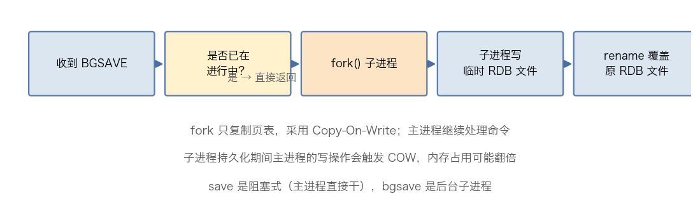

-   Redis调用fork()，产生一个子进程。
-   子进程把数据写到一个临时的RDB文件。
-   当子进程写完新的RDB文件后，重命名之后覆盖原文件。

AOF原理

AOF的整个流程大体来看可以分为两步，一步是命令的实时写入（如果是 `appendfsync everysec` 配置，会有1s损耗），第二步是对aof文件的重写。

对于增量追加到文件这一步主要的流程是：命令写入=》追加到aof\_buf =》同步到aof磁盘。那么这里为什么要先写入buf在同步到磁盘呢？如果实时写入磁盘会带来非常高的磁盘IO，影响整体性能。

aof重写是为了减少aof文件的大小，可以手动或者自动触发，关于自动触发的规则请看上面配置部分。fork的操作也是发生在重写这一步，也是这里会对主进程产生阻塞。

**手动触发：** `bgrewriteaof`，**自动触发** 就是根据配置规则来触发，当然自动触发的整体时间还跟Redis的定时任务频率有关系。

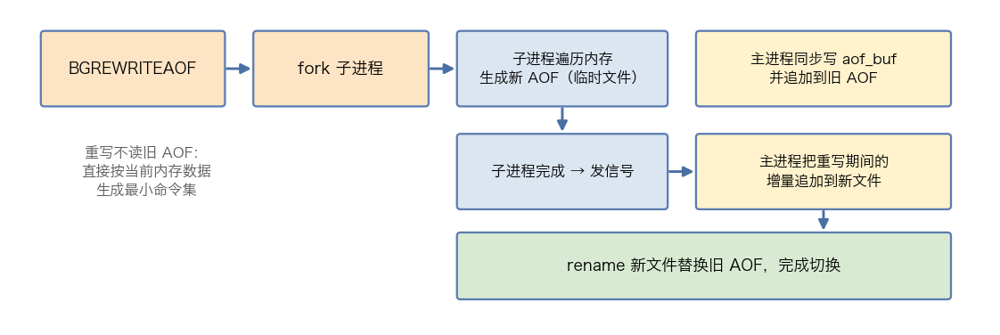

-   在重写期间，由于主进程依然在响应命令，为了保证最终备份的完整性；因此它依然会写入旧的AOF file中，如果重写失败，能够保证数据不丢失。
-   为了把重写期间响应的写入信息也写入到新的文件中，因此也会为子进程保留一个buf，防止新写的file丢失数据。
-   重写是直接把当前内存的数据生成对应命令，并不需要读取老的AOF文件进行分析、命令合并。
-   AOF文件直接采用的文本协议，主要是兼容性好、追加方便、可读性高可认为修改修复。

> 不能是RDB还是AOF都是先写入一个临时文件，然后通过 `rename` 完成文件的替换工作。

从持久化中恢复数据

数据的备份、持久化做完了，我们如何从这些持久化文件中恢复数据呢？如果一台服务器上有既有RDB文件，又有AOF文件，该加载谁呢？

其实想要从这些文件中恢复数据，只需要重新启动Redis即可。我们还是通过图来了解这个流程：

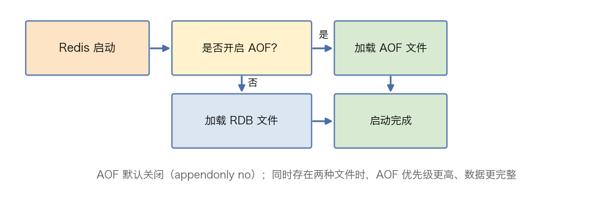

RDB与AOF比较

### 优点

-   RDB文件是一个很简洁的单文件，它保存了某个时间点的Redis数据，很适合用于做备份。你可以设定一个时间点对RDB文件进行归档，这样就能在需要的时候很轻易的把数据恢复到不同的版本。
-   基于上面所描述的特性，RDB很适合用于灾备。单文件很方便就能传输到远程的服务器上。
-   RDB的性能很好，需要进行持久化时，主进程会fork一个子进程出来，然后把持久化的工作交给子进程，自己不会有相关的I/O操作。
-   比起AOF，在数据量比较大的情况下，RDB的启动速度更快。

#### 缺点

-   RDB容易造成数据的丢失。假设每5分钟保存一次快照，如果Redis因为某些原因不能正常工作，那么从上次产生快照到Redis出现问题这段时间的数据就会丢失了。
-   RDB使用`fork()`产生子进程进行数据的持久化，如果数据比较大的话可能就会花费点时间，造成Redis停止服务几毫秒。如果数据量很大且CPU性能不是很好的时候，停止服务的时间甚至会到1秒。

#### 优点

-   比RDB可靠。你可以制定不同的fsync策略：不进行fsync、每秒fsync一次和每次查询进行fsync。默认是每秒fsync一次。这意味着你最多丢失一秒钟的数据。
-   AOF日志文件是一个纯追加的文件。就算是遇到突然停电的情况，也不会出现日志的定位或者损坏问题。甚至如果因为某些原因（例如磁盘满了）命令只写了一半到日志文件里，我们也可以用`redis-check-aof`这个工具很简单的进行修复。
-   当AOF文件太大时，Redis会自动在后台进行重写。重写很安全，因为重写是在一个新的文件上进行，同时Redis会继续往旧的文件追加数据。新文件上会写入能重建当前数据集的最小操作命令的集合。当新文件重写完，Redis会把新旧文件进行切换，然后开始把数据写到新文件上。
-   AOF把操作命令以简单易懂的格式一条接一条的保存在文件里，很容易导出来用于恢复数据。例如我们不小心用`FLUSHALL`命令把所有数据刷掉了，只要文件没有被重写，我们可以把服务停掉，把最后那条命令删掉，然后重启服务，这样就能把被刷掉的数据恢复回来。

#### 缺点

-   在相同的数据集下，AOF文件的大小一般会比RDB文件大。
-   在某些fsync策略下，AOF的速度会比RDB慢。通常fsync设置为每秒一次就能获得比较高的性能，而在禁止fsync的情况下速度可以达到RDB的水平。
-   在过去曾经发现一些很罕见的BUG导致使用AOF重建的数据跟原数据不一致的问题。

AOF是通过将用户的所有操作命令已append追加的方式写入文件，这样会导致文件越来越大，当影响到服务器重启还原数据库时会通过rewrite来重写aof文件

rewrite就是将redis中所有数据转为写命令，然后同步到新的aof文件中。在这个过程中服务器会创建一个新的aof文件来替换。新旧的两个aof文件所保存的数据库状态相同，但是新的aof文件不会包含冗余命令。aof文件重写不会对旧的aof文件进行读取，通过读取服务器当前状态状态实现

aof的rewrite有两种触发方式：

1.执行bgrewrite命令触发

2.通过自动触发 AOF 文件重写是通过设置 Redis 配置文件中 auto-aof-rewrite-percentage 和 auto-aof-rewrite-min-size 参数的值，以及 aof\_current\_size 和 aof\_base\_size 状态来确定何时触发的。

auto-aof-rewrite-percentage 参数是在执行 AOF 文件重写时，当前 AOF 文件的大小（aof\_current\_size）和上一次 AOF 文件重写时的大小（aof\_base\_size）的比值，默认为 100。

auto-aof-rewrite-min-size 参数设置了执行 AOF 文件重写时的最小体积，默认为 64MB。

rewrite重写之后会修改新的aof文件的文件名，新生成的aof文件会覆盖就的aof文件，完成新、旧aof文件的互换

工作原理如下：

-   Redis调用fork()，产生一个子进程。
-   子进程把新的AOF写到一个临时文件里。
-   主进程持续把新的变动写到内存里的buffer，同时也会把这些新的变动写到旧的AOF里，这样即使重写失败也能保证数据的安全。
-   当子进程完成文件的重写后，主进程会获得一个信号，然后把内存里的buffer追加到子进程生成的那个新AOF里。
-   Redis对临时文件进行重命名替换旧文件完成aof重写

主从复制

你启动一台slave 的时候，他会发送一个psync命令给master ，如果是这个slave第一次连接到master，他会触发一个全量复制。master就会启动一个线程，生成RDB快照，还会把新的写请求都缓存在内存中，RDB文件生成后，master会将这个RDB发送给slave的，slave拿到之后做的第一件事情就是写进本地的磁盘，然后加载进内存，然后master会把内存里面缓存的那些新命令都发给slave。

## 二、哨兵与集群

> 来源：`Redis/Redis高可用.md`

`Redis` 的 主从复制 模式下，一旦 主节点 由于故障不能提供服务，需要手动将 从节点 晋升为 主节点，同时还要通知 客户端 更新 主节点地址，这种故障处理方式从一定程度上是无法接受的。

`Redis 2.8` 以后提供了 `Redis Sentinel` 哨兵机制 来解决这个问题。

在 `Redis` 中，实现 高可用 的技术主要包括 持久化、复制、哨兵 和 集群，下面简单说明它们的作用，以及解决了什么样的问题：

-   持久化：持久化是 最简单的 高可用方法。它的主要作用是 数据备份，即将数据存储在 硬盘，保证数据不会因进程退出而丢失。
-   复制：复制是高可用 `Redis` 的基础，哨兵 和 集群 都是在 复制基础 上实现高可用的。复制主要实现了数据的多机备份以及对于读操作的负载均衡和简单的故障恢复。缺陷是故障恢复无法自动化、写操作无法负载均衡、存储能力受到单机的限制。
-   哨兵：在复制的基础上，哨兵实现了 自动化 的 故障恢复。缺陷是 写操作 无法 负载均衡，存储能力 受到 单机 的限制。
-   集群：通过集群，`Redis` 解决了 写操作 无法 负载均衡 以及 存储能力 受到 单机限制 的问题，实现了较为 完善 的 高可用方案。

`Redis Sentinel` 是 `Redis` 高可用 的实现方案。`Sentinel` 是一个管理多个 `Redis` 实例的工具，它可以实现对 `Redis` 的 监控、通知、自动故障转移

`Redis` 的 主从复制模式 和 `Sentinel` 高可用架构 的示意图：

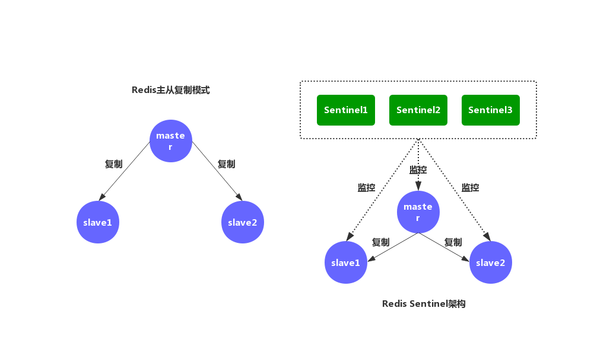

### Redis主从复制的问题

`Redis` 主从复制 可将 主节点 数据同步给 从节点，从节点此时有两个作用：

1.  一旦 主节点宕机，从节点 作为 主节点 的 备份 可以随时顶上来。
2.  扩展 主节点 的 读能力，分担主节点读压力。

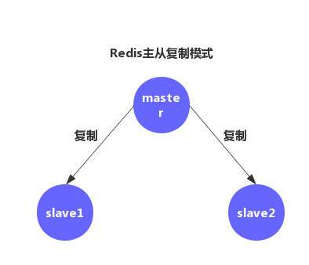

主从复制 同时存在以下几个问题：

1.  一旦 主节点宕机，从节点 晋升成 主节点，同时需要修改 应用方 的 主节点地址，还需要命令所有 从节点 去 复制 新的主节点，整个过程需要 人工干预。
2.  主节点 的 写能力 受到 单机的限制。
3.  主节点 的 存储能力 受到 单机的限制。
4.  原生复制 的弊端在早期的版本中也会比较突出，比如：`Redis` 复制中断 后，从节点 会发起 `psync`。此时如果 同步不成功，则会进行 全量同步，主库 执行 全量备份 的同时，可能会造成毫秒或秒级的 卡顿。

#### Redis Sentinel的架构

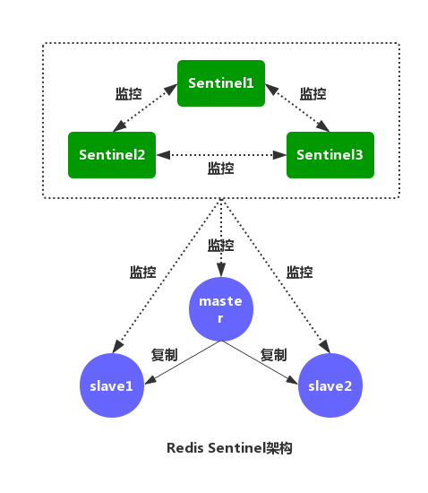

#### Redis Sentinel的主要功能

`Sentinel` 的主要功能包括 主节点存活检测、主从运行情况检测、自动故障转移 （`failover`）、主从切换。`Redis` 的 `Sentinel` 最小配置是 一主一从。

`Redis` 的 `Sentinel` 系统可以用来管理多个 `Redis` 服务器，该系统可以执行以下四个任务：

-   监控

`Sentinel` 会不断的检查 主服务器 和 从服务器 是否正常运行。

-   通知

当被监控的某个 `Redis` 服务器出现问题，`Sentinel` 通过 `API` 脚本 向 管理员 或者其他的 应用程序 发送通知。

-   自动故障转移

当 主节点 不能正常工作时，`Sentinel` 会开始一次 自动的 故障转移操作，它会将与 失效主节点 是 主从关系 的其中一个 从节点 升级为新的 主节点，并且将其他的 从节点 指向 新的主节点。

-   配置提供者

在 `Redis Sentinel` 模式下，客户端应用 在初始化时连接的是 `Sentinel` 节点集合，从中获取 主节点 的信息。

#### 主观下线和客观下线

默认情况下，每个 `Sentinel` 节点会以 每秒一次 的频率对 `Redis` 节点和 其它 的 `Sentinel` 节点发送 `PING` 命令，并通过节点的 回复 来判断节点是否在线。

-   主观下线

主观下线 适用于所有 主节点 和 从节点。如果在 `down-after-milliseconds` 毫秒内，`Sentinel` 没有收到 目标节点 的有效回复，则会判定 该节点 为 主观下线。

-   客观下线

客观下线 只适用于 主节点。如果 主节点 出现故障，`Sentinel` 节点会通过 `sentinel is-master-down-by-addr` 命令，向其它 `Sentinel` 节点询问对该节点的 状态判断。如果超过 `<quorum>` 个数的节点判定 主节点 不可达，则该 `Sentinel` 节点会判断 主节点 为 客观下线。

#### Redis Sentinel的工作原理

每个 `Sentinel` 节点都需要 定期执行 以下任务：

-   每个 `Sentinel` 以 每秒钟 一次的频率，向它所知的 主服务器、从服务器 以及其他 `Sentinel` 实例 发送一个 `PING` 命令。

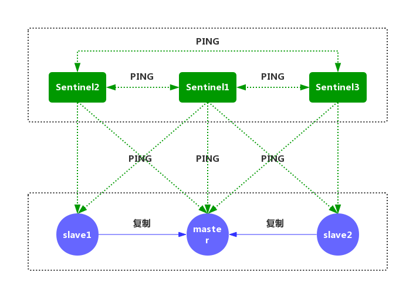

-   如果一个 实例（`instance`）距离 最后一次 有效回复 `PING` 命令的时间超过 `down-after-milliseconds` 所指定的值，那么这个实例会被 `Sentinel` 标记为 主观下线。

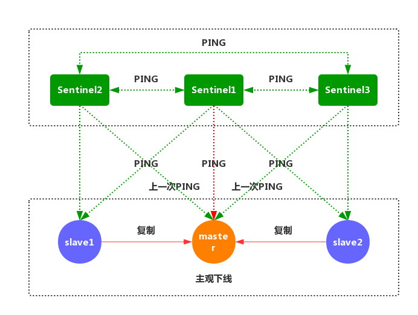

-   如果一个 主服务器 被标记为 主观下线，那么正在 监视 这个 主服务器 的所有 `Sentinel` 节点，要以 每秒一次 的频率确认 主服务器 的确进入了 主观下线 状态。

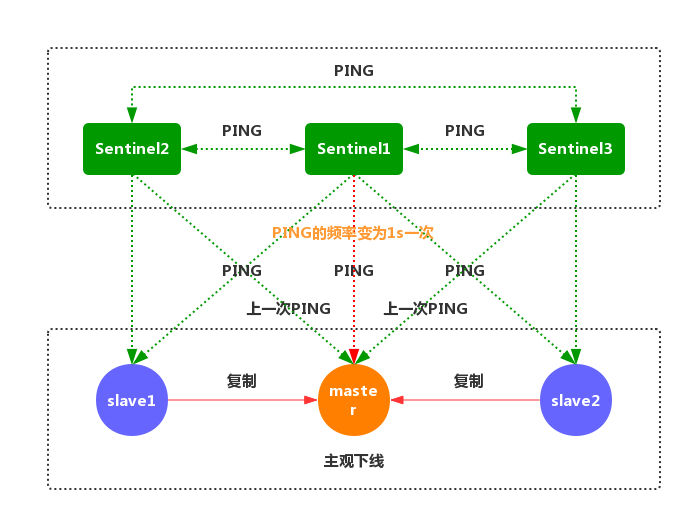

-   如果一个 主服务器 被标记为 主观下线，并且有 足够数量 的 `Sentinel`（至少要达到 配置文件 指定的数量）在指定的 时间范围 内同意这一判断，那么这个 主服务器 被标记为 客观下线。

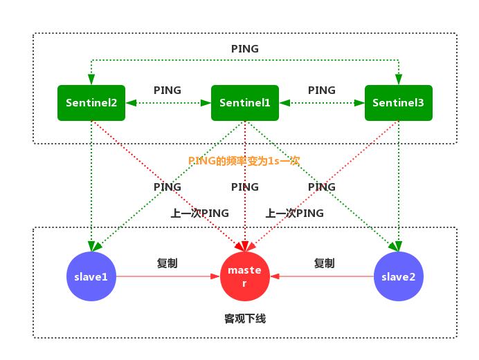

-   在一般情况下， 每个 `Sentinel` 会以每 `10` 秒一次的频率，向它已知的所有 主服务器 和 从服务器 发送 `INFO` 命令。当一个 主服务器 被 `Sentinel` 标记为 客观下线 时，`Sentinel` 向 下线主服务器 的所有 从服务器 发送 `INFO` 命令的频率，会从 `10` 秒一次改为 每秒一次。

-   `Sentinel` 和其他 `Sentinel` 协商 主节点 的状态，如果 主节点 处于 `SDOWN` 状态，则投票自动选出新的 主节点。将剩余的 从节点 指向 新的主节点 进行 数据复制。

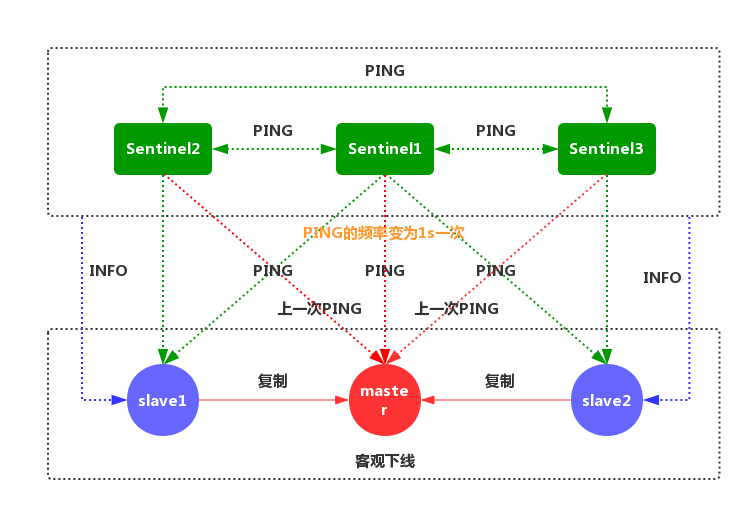

-   当没有足够数量的 `Sentinel` 同意 主服务器 下线时， 主服务器 的 客观下线状态 就会被移除。当 主服务器 重新向 `Sentinel` 的 `PING` 命令返回 有效回复 时，主服务器 的 主观下线状态 就会被移除。

    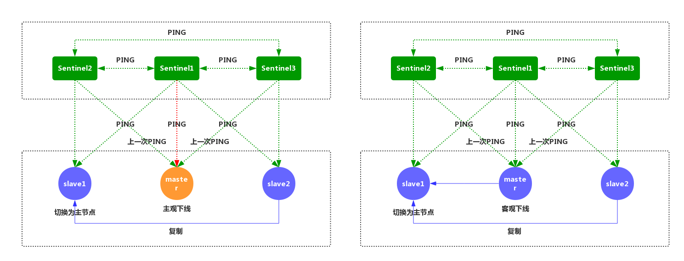

## 三、脑裂与数据丢失

> 来源：`Redis/Redis脑裂.md`

所谓的脑裂，就是指在主从集群中，同时有两个主节点，它们都能接收写请求。而脑裂最直接的影响，就是客户端不知道应该往哪个主节点写入数据，结果就是不同的客户端会往不同的主节点上写入数据。而且，严重的话，脑裂会进一步导致数据丢失

### 为什么会发生脑裂？

#### 1.确认是不是数据同步出现了问题

在主从集群中发生数据丢失，最常见的原因就是主库的数据还没有同步到从库，结果主库发生了故障，等从库升级为主库后，未同步的数据就丢失了。

如果是这种情况的数据丢失，我们可以通过比对主从库上的复制进度差值来进行判断，也就是计算 master\_repl\_offset 和 slave\_repl\_offset 的差值。如果从库上的 slave\_repl\_offset 小于原主库的 master\_repl\_offset，那么，我们就可以认定数据丢失是由数据同步未完成导致的。

#### 2.排查客户端的操作日志，发现脑裂现象

在排查客户端的操作日志时，我们发现，在主从切换后的一段时间内，有一个客户端仍然在和原主库通信，并没有和升级的新主库进行交互。这就相当于主从集群中同时有了两个主库。根据这个迹象，我们就想到了在分布式主从集群发生故障时会出现的一个问题：脑裂。

但是，不同客户端给两个主库发送数据写操作，按道理来说，只会导致新数据会分布在不同的主库上，并不会造成数据丢失。那么，为什么我们的数据仍然丢失了呢？

#### 3.发现是原主库假故障导致的脑裂

我们是采用哨兵机制进行主从切换的，当主从切换发生时，一定是有超过预设数量（quorum 配置项）的哨兵实例和主库的心跳都超时了，才会把主库判断为客观下线，然后，哨兵开始执行切换操作。哨兵切换完成后，客户端会和新主库进行通信，发送请求操作。

但是，在切换过程中，既然客户端仍然和原主库通信，这就表明，原主库并没有真的发生故障（例如主库进程挂掉）。

### 如何应对脑裂问题？

Redis 已经提供了两个配置项来限制主库的请求处理，分别是 min-slaves-to-write 和 min-slaves-max-lag。

min-slaves-to-write：这个配置项设置了主库能进行数据同步的最少从库数量； min-slaves-max-lag：这个配置项设置了主从库间进行数据复制时，从库给主库发送 ACK 消息的最大延迟（以秒为单位）。 我们可以把 min-slaves-to-write 和 min-slaves-max-lag 这两个配置项搭配起来使用，分别给它们设置一定的阈值，假设为 N 和 T。这两个配置项组合后的要求是，主库连接的从库中至少有 N 个从库，和主库进行数据复制时的 ACK 消息延迟不能超过 T 秒，否则，主库就不会再接收客户端的请求了。

即使原主库是假故障，它在假故障期间也无法响应哨兵心跳，也不能和从库进行同步，自然也就无法和从库进行 ACK 确认了。这样一来，min-slaves-to-write 和 min-slaves-max-lag 的组合要求就无法得到满足，原主库就会被限制接收客户端请求，客户端也就不能在原主库中写入新数据了。

## 四、为什么单线程还这么快

> 来源：`Redis/Redis单线程高并发.md`

Redis单线程模型高效率的原因有下面几点

-   纯内存操作
-   核心是基于非阻塞的IO多路复用机制
-   单线程避免了多线程的频繁上下文切换以及加锁问题
-   数据结构简单，Redis对数据结构进行了重新设计
-   使用更高效的底层数据结构与自定义协议（RESP），避免了通用协议解析的开销

> 注：早期 Redis 2.4 曾提供过 VM（虚拟内存）机制，但在 2.6 版本已被**移除**，它与"单线程为何高效"没有关系，是常见的过时说法。

redis的线程模型

    redis内部使用文件事件处理器，这个文件事件处理是单线程的，所以redis才叫做单线程的模型。他采用IO多路复用机制同时监听多个socket，根据socket的上的事件来选择对应的事件处理器进行处理。

文件处理器的结构包含4个部分

-   多个socket
-   IO多路复用程序
-    文件事件分派器
-   事件处理器（连接应答处理器、命令请求处理器、命令回复处理器）

多个socket可能会并发产生不同的操作，每个操作对应不同的文件事件，但是 IO 多路复用程序会监听多个 socket，会将 socket 产生的事件放入队列中排队，事件分派器每次从队列中取出一个事件，把该事件交给对应的事件处理器进行处理。

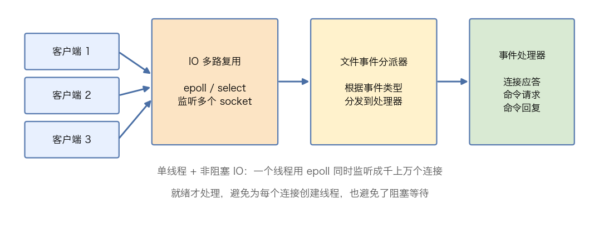

客户端 socket01 向 redis 的 server socket 请求建立连接，此时 server socket 会产生一个 AE\_READABLE 事件，IO 多路复用程序监听到 server socket 产生的事件后，将该事件压入队列中。文件事件分派器从队列中获取该事件，交给连接应答处理器。连接应答处理器会创建一个能与客户端通信的 socket01，并将该 socket01 的 AE\_READABLE 事件与命令请求处理器关联。

假设此时客户端发送了一个 set key value 请求，此时 redis 中的 socket01 会产生 AE\_READABLE 事件，IO 多路复用程序将事件压入队列，此时事件分派器从队列中获取到该事件，由于前面 socket01 的 AE\_READABLE 事件已经与命令请求处理器关联，因此事件分派器将事件交给命令请求处理器来处理。命令请求处理器读取 socket01 的 key value 并在自己内存中完成 key value 的设置。操作完成后，它会将 socket01 的 AE\_WRITABLE 事件与命令回复处理器关联。

如果此时客户端准备好接收返回结果了，那么 redis 中的 socket01 会产生一个 AE\_WRITABLE 事件，同样压入队列中，事件分派器找到相关联的命令回复处理器，由命令回复处理器对 socket01 输入本次操作的一个结果，比如 ok，之后解除 socket01 的 AE\_WRITABLE 事件与命令回复处理器的关联。
