# Redis 数据类型与底层结构

> 合并自：`Redis.md`、`Redis数据类型操作.md`、`Redis底层数据结构实现.md`。原文未删改（仅修正已知错误、调整格式）。

## 一、Redis 概览

> 来源：`Redis/Redis.md`

Redis应用场景

1.  缓存
    Redis使用k-v形式存储数据，适合作为缓存，并且Redis提供了键过期功能，也提供了灵活的键淘汰策略，所以，现在Redis用在缓存的场合非常多。
2.  排行榜
    可以利用Redis提供的有序集合来实现各种复杂的排行榜应用
3.  计数器
    什么是计数器，如电商网站商品的浏览量、视频网站视频的播放数等。为了保证数据实时效，每次浏览都得给+1，并发量高时如果每次都请求数据库操作无疑是种挑战和压力。Redis提供的incr命令来实现计数器功能，内存操作，性能非常好，非常适用于这些计数场景。

4.  分布式会话
    集群模式下，在应用不多的情况下一般使用容器自带的session复制功能就能满足（Tomcat集群可以利用session复制来大道集群会话的效果），当应用增多相对复杂的系统中，一般都会搭建以Redis等内存数据库为中心的session服务，session不再由容器管理，而是由session服务及内存数据库管理。

5.  分布式锁
    在很多互联网公司中都使用了分布式技术，分布式技术带来的技术挑战是对同一个资源的并发访问，如全局ID、减库存、秒杀等场景，并发量不大的场景可以使用数据库的悲观锁、乐观锁来实现，但在并发量高的场合中，利用数据库锁来控制资源的并发访问是不太理想的，大大影响了数据库的性能。可以利用Redis的setnx功能来编写分布式的锁，如果设置返回1说明获取锁成功，否则获取锁失败，实际应用中要考虑的细节要更多。

6.  社交网络
    点赞、踩、关注/被关注、共同好友等是社交网站的基本功能，社交网站的访问量通常来说比较大，而且传统的关系数据库类型不适合存储这种类型的数据，Redis提供的哈希、集合等数据结构能很方便的的实现这些功能。

7.  消息系统
    消息队列是大型网站必用中间件，如ActiveMQ、RabbitMQ、Kafka等流行的消息队列中间件，主要用于业务解耦、流量削峰及异步处理实时性低的业务。Redis提供了发布/订阅及阻塞队列功能，能实现一个简单的消息队列系统。另外，这个不能和专业的消息中间件相比

多线程Redis

    Redis6中加入多线程，不过Redis在处理客户端请求时，还是使用单线程进行处理，只是使用多线程来处理数据的读写和协议解析，执行命令还是使用单线程。之所以这样是因为不希望Redis因为多线程变得复杂，需要去控制key、lua、事务、LPUSH/LPOP等等并发问题

Redis处理命令流程

要处理命令，则redis必须完整地接收客户端的请求，并将命令解析出来，再将结果读出来，通过网络回写到客户端。整个工序分为以下几个部分：

-   接收。通过TCP接收到命令，可能会历经多次TCP包、ack、IO操作
-   解析。将命令取出来
-   执行。到对应的地方将value读出来
-   返回。将value通过TCP返回给客户端，如果value较大，则IO负荷会更重

其中解析和执行是纯cpu/内存操作，而接收和返回主要是IO操作，这是我们要关注的重点。以接收为例，redis要完整接收客户端命令，有两种策略：

-   接收客户端命令时一直等，直到接收到完整的命令，然后执行，再将结果返回，直到客户端收到完整结果， 然后才处理下一个命令。 这叫**同步**。 同步的过程中有很多等待的时间，例如有个客户端网络不好，那等它完整的命令就会更耗时。
-   客户端的TCP包来一个才处理一个，将数据追加到缓冲区，处理完了就去立即找其他事做，不等待，下一个TCP包来了再继续处理。命令的接收过程是穿插的，不连续。一会儿接收这个命令，一会儿又在接收另一个。 这叫做*异步*，过程中没有额外的空闲等待时间。

很显然异步的效率更高，要实现高并发必须要异步，因为同步有太多时间浪费在等待上了，遇到网络不好的客户端直接就被拖垮。异步的策略简单可总结如下：

-   网络包有数据了，就去读一下放到缓冲区，读完立马切到其他事情上，不等下一个包
-   解析下缓冲区数据是否完整。如完整则执行命令，不完整切到其他事情上
-   数据完整了，立即执行命令，将执行结果放到缓冲区
-   将数据给客户端，如果一次给不完，就等`下次能给时`再给，不等，直到全部给完

事件驱动：异步没有零散的等待，但有个问题是，如果redis不一直阻塞等命令来，咋个知道“网络包有数据了”、“下次能给时”这两个时机？ 如果一直去轮训问肯定效率很低，要有个高效的机制，来通知redis这两个时刻，由这些时刻来触发动作。

    `一个新TCP包来了`、`可以再次发给客户端数据`这两个时机都是事件。与之对应的就是redis和客户端之间socket的可读、可写事件 ，就像微信聊天中新消息提醒一样。 linux中的epoll就是干这个事的，redis基于epoll等机制抽象出了一套事件驱动框架，整个server完全由事件驱动，有事件发生就处理，没有就空闲等待。

单线程IO处理过程

    redis启动后会进入一个死循环aeMain，在这个循环里一直等待事件发生，事件分为IO事件和timer事件，timer事件是一些定时执行的任务，如expire key等，本文只聊IO事件。

    epoll处理的是socket的可读、可写事件，当事件发生后提供一种高效的通知方式， 当想要异步监听某个socket的读写事件时，需要去事件驱动框架中注册要监听事件的socket，以及对应事件的回调function。然后死循环中可以通过epoll\_wait不断地去拿发生了可读写事件的socket，依次处理即可。

    可读可以简单理解为，对应的socket中有新的tcp数据包到来。

    可写可以简单理解为，对应的socket写缓冲区已经空了(数据通过网络已经发给了客户端)

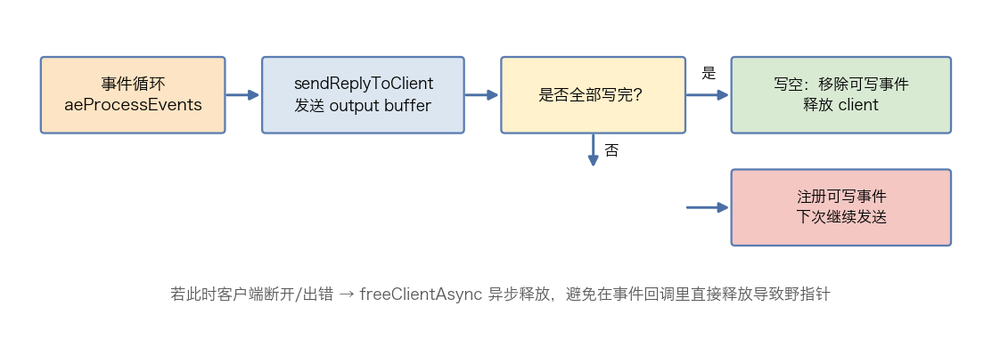

-   aeMain() 内部是一个死循环，会在epoll\_wait处短暂休眠
-   epoll\_wait返回的是当前可读、可写的socket列表
-   beforeSleep是进入休眠前执行的逻辑，核心是回写数据到socket
-   核心逻辑都是由IO事件触发，要么可读，要么可写，否则执行timer定时任务
-   第一次的IO可读事件，是监听socket(如监听6379的socket)，当有握手请求时，会执行accept调用，得到一个连接socket，注册可读回调createClient，往后客户端和redis的数据都通过这个socket进行
-   一个完整的命令，可能会通过多次readQueryFromClient才能从socket读完，这意味这多次可读IO事件
-   命令执行的结果会写，也是这样，大概率会通过多次可写回调才能写完
-   当命令被执行完后，对应的连接会被追加到 clients\_pending\_write，beforeSleep会尝试回写到socket，写不完会注册可写事件，下次继续写
-   整个过程IO全部都是同步非阻塞，没有浪费等待时间
-   注册事件的函数叫aeCreateFileEvent

单线程IO的瓶颈

上面详细梳理了单线程IO的处理过程，IO都是非阻塞，没有浪费一丁点时间，虽然是单线程，但动辄能上10W QPS。不过也就这水平了，难以提供更多的自行车。

同时这个模型有几个缺陷：

-   只能用一个cpu核(忽略后台线程)
-   如果value比较大，redis的QPS会下降得很厉害，有时一个大key就可以拖垮
-   QPS难以更上一层楼

redis主线程的时间消耗主要在两个方面：

-   逻辑计算的消耗
-   同步IO读写，拷贝数据导致的消耗

当value比较大时，瓶颈会先出现在同步IO上(假设带宽和内存足够)，这部分消耗在于两部分：

-   从socket中读取请求数据，会从内核态将数据拷贝到用户态 （read调用）
-   将数据回写到socket，会将数据从用户态拷贝到内核态 （write调用）

这部分数据读写会占用大量的cpu时间，也直接导致了瓶颈。 如果能有多个线程来分担这部分消耗，那redis的吞吐量还能更上一层楼，这也是redis引入多线程IO的目的。

多线程IO

上面已经梳理了单线程IO的处理流程，以及多线程IO要解决的问题，接下来将目光放到： 如何用多线程分担IO的负荷。其做法用简单的话来说就是：

-   用一组单独的线程专门进行 read/write socket读写调用 （同步IO）
-   读回调函数中不再读数据，而是将对应的连接追加到可读clients\_pending\_read的链表
-   主线程在beforeSleep中将IO读任务分给IO线程组
-   主线程自己也处理一个IO读任务，并自旋式等IO线程组处理完，再继续往下
-   主线程在beforeSleep中将IO写任务分给IO线程组
-   主线程自己也处理一个IO写任务，并自旋式等IO线程组处理完，再继续往下
-   IO线程组要么同时在读，要么同时在写
-   命令的执行由主线程串行执行(保持单线程)
-   IO线程数量可配置

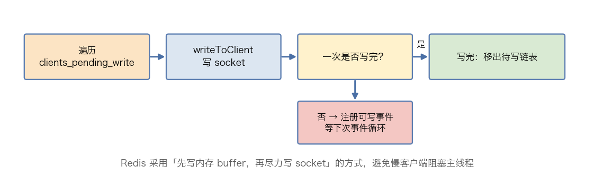

beforesleep中，先让IO线程读数据，然后再让IO线程写数据。 读写时，多线程能并发执行，利用多核。

1.  将读任务均匀分发到各个IO线程的任务链表io\_threads\_list\[i\]，将io\_threads\_pending\[i\] 设置为对应的任务数，此时IO线程将从死循环中被激活，开始执行任务，执行完毕后，会将 io\_threads\_pending\[i\]清零。 函数名为： handleClientsWithPendingReadsUsingThreads
2.  将写任务均匀分发到各个IO线程的任务链表io\_threads\_list\[i\]，将io\_threads\_pending\[i\] 设置为对应的任务数，此时IO线程将从死循环中被激活，开始执行任务，执行完毕后，会将 io\_threads\_pending\[i\]清零。 函数名为： handleClientsWithPendingWritesUsingThreads
3.  beforeSleep中主线程也会执行其中一个任务(图中忽略了)，执行完后自旋等待IO线程处理完。
4.  读任务要么在beforeSleep中被执行，要么在IO线程被执行，不会再在读回调中执行
5.  写任务会分散到 beforeSleep、IO线程、写回调中执行
6.  主线程和IO线程交互是无锁的，通过标志位设置进行，不会同时写任务链表

### Redis事务相关命令

Redis事务功能是通过MULTI、EXEC、DISCARD和WATCH 四个原语实现的

Redis会将一个事务中的所有命令序列化，然后按顺序执行。

1.  redis 不支持回滚，“Redis 在事务失败时不进行回滚，而是继续执行余下的命令”， 所以 Redis 的内部可以保持简单且快速。
2.  如果在一个事务中的命令出现错误，那么所有的命令都不会执行；
3.  如果在一个事务中出现运行错误，那么正确的命令会被执行。

-   WATCH 命令是一个乐观锁，可以为 Redis 事务提供 check-and-set （CAS）行为。 可以监控一个或多个键，一旦其中有一个键被修改（或删除），之后的事务就不会执行，监控一直持续到EXEC命令。
-   MULTI命令用于开启一个事务，它总是返回OK。 MULTI执行之后，客户端可以继续向服务器发送任意多条命令，这些命令不会立即被执行，而是被放到一个队列中，当EXEC命令被调用时，所有队列中的命令才会被执行。
-   EXEC：执行所有事务块内的命令。返回事务块内所有命令的返回值，按命令执行的先后顺序排列。 当操作被打断时，返回空值 nil 。
-   通过调用DISCARD，客户端可以清空事务队列，并放弃执行事务， 并且客户端会从事务状态中退出。
-   UNWATCH命令可以取消watch对所有key的监控。

Redis热key以及热key问题怎么解决

所谓热key问题就是，突然有几十万的请求去访问redis上的某个特定key，那么这样会造成流量过于集中，达到物理网卡上限，从而导致这台redis的服务器宕机引发雪崩。

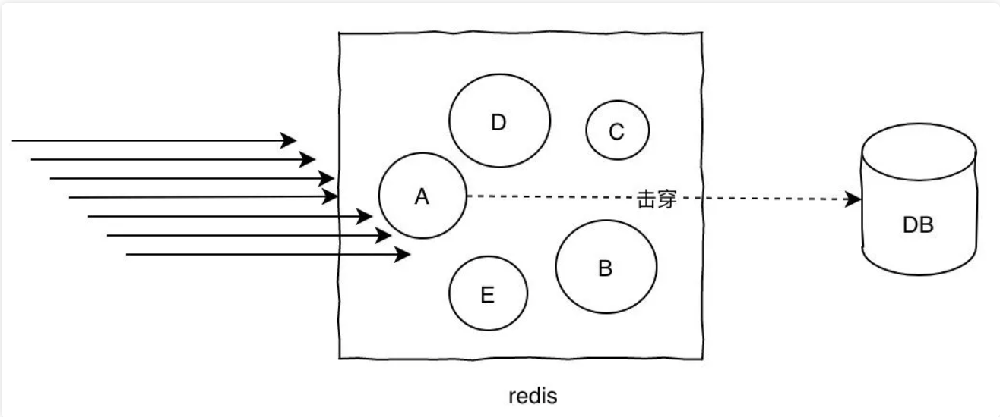

针对热key的解决方案：

1.  提前把热key打散到不同的服务器，降低压力

2.  加入二级缓存，提前加载热key数据到内存中，如果redis宕机，走内存查询

## 二、五种数据类型的常用操作

> 来源：`Redis/Redis数据类型操作.md`

一、操作String

1\. set key vlaue：设定key持有特定的字符串value，如果该key已经存在则进行覆盖操作。总是返回“OK”

2.get key：获取key的value。如果与该key关联的value不是String类型，redis将返回错误信息，因为get命令只能用于获取String类型的value，如果该key不存在则返回null

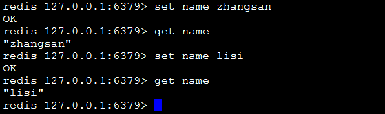

3.getset key value：先获取该key的值，然后再设置该key的值

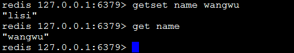

4.incr key：将指定的key的value原子性的递增1。如果该key不存在，其初始值为0，在incr之后其值为1。如果value的值不能转换成整形，如"hello"，该操作将执行失败并返回相应的错误信息

5.decr key：将指定的key的value原子性的递减1。如果该key不存在，其初始值为0，在decr之后其值为-1。如果value的值不能转换成整形，如"hello"，该操作将执行失败并返回相应的错误信息

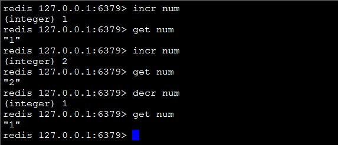

6.incrby key increment：将指定的key的value原子性增加increment，如果key不存在，其初始化值为0，在incrby之后，改值为increment。如果该值不能转换成整形，如"hello"则失败并返回错误信息

7.decrby key decrement：将指定的key的value原子性减少decrement，如果key不存在，其初始值为0，在decrby之后，该值为-decrement。如果该值不能转换成整型，如"hello"则失败并返回错误信息

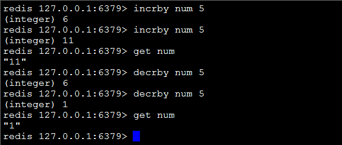

8.append key value：如果该key存在，则在原有的value后追加该值，如果该键不存在，则重新创建一个key/value

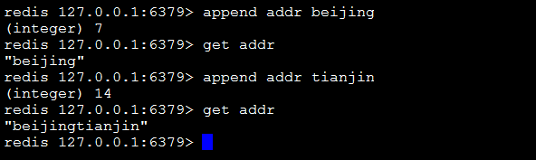

---

二、操作List

1.lpush key value1 value2 ...：在指定的key所关联的list的头部插入所有的values，如果该key不存在，该命令在插入之前创建一个与该key关联的空链表，之后再向该链表的头部插入数据。插入成功返回元素的个数

2.rpush key value1 value2：在该list尾部插入values

3.lrange key start end：获取链表中从start到end中的元素的值，start、end可为负数，若为-1则表示链表尾部的元素，-2表示倒数第二个，依次类推

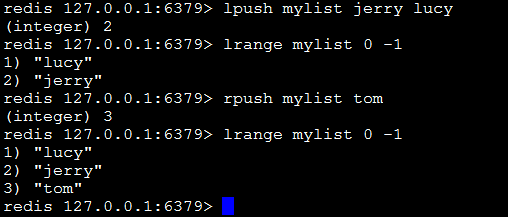

4.lpushx key value：当可以存在时他的功能和lpush key value相同都是从头部插入数据到list，不同之处在于当key不存在时，他不会自动创建list，返回0

5.rpushx key value：当可以存在时他的功能和lpush key value相同都是从尾部插入数据到list，不同之处在于当key不存在时，他不会自动创建list，返回0

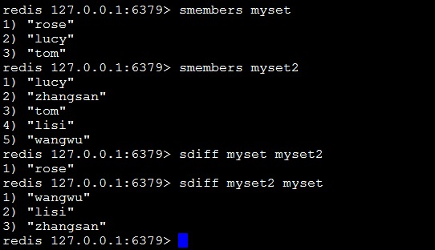

6.lpop key：返回并弹出指定的key关联的链表中的第一个元素，即头部元素，如果key不存在返回null

7.rpop key：从key对应的list尾部弹出元素，如果key不存在返回null

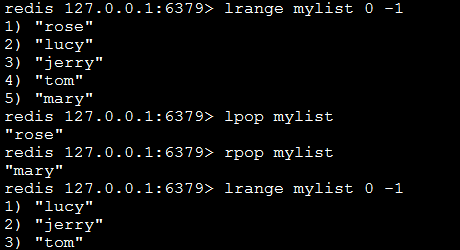

8.rpoplpush resource destination ：弹出resource中尾部元素并添加到destination中

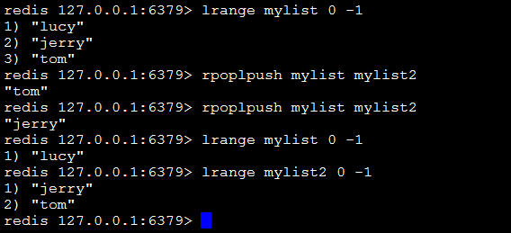

9.llen key：返回指定的key关联的list中的元素的数量，如果list不存在返回0

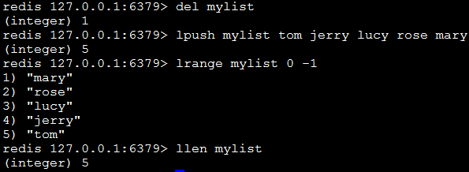

10.lset key index value ：将链表中的index索引的元素的值设置为value，0代表链表的头元素，-1代表链表的尾元素。

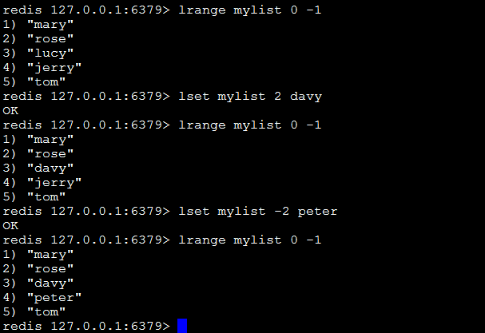

11.lrem key count value ：删除count个值为value的元素，如果count大于0，从头向尾遍历并删除count个值为value的元素，如果count小于0，则从尾向头遍历并删除。如果count等于0，则删除链表中所有等于value的元素。

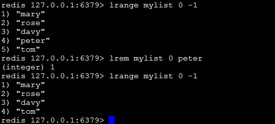

12.linsert key before pivot value ：在pivot元素前插入value

13.linsert key after pivot value ：在pivot元素后插入value

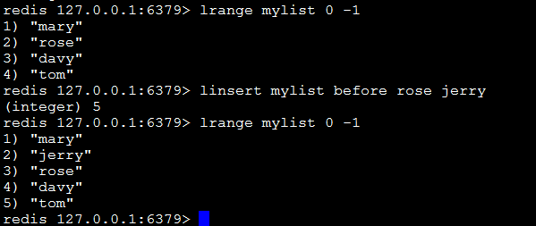

---

三、操作Set

1.sadd key value1、value2… ：向set中添加数据，如果该key的值已有则不会重复添加

2.smembers key ：获取set中所有的成员

3.scard key ：获取set中成员的数量

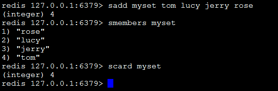

4.sismember key member ：判断参数中指定的成员是否在该set中，1表示存在，0表示不存在或者该key本身就不存在

5.srem key member1、member2… ：删除set中指定的成员

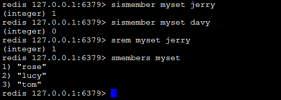

6.srandmember key ：随机返回set中的一个成员

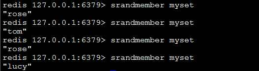

7.sdiff sdiff key1 key2 ：返回key1中存在key2不存在的元素，交换key1和key2的顺序会得到不同的结果


8.sdiffstore destination key1 key2 ：将key1中存在key2不存在的元素存储在destination上

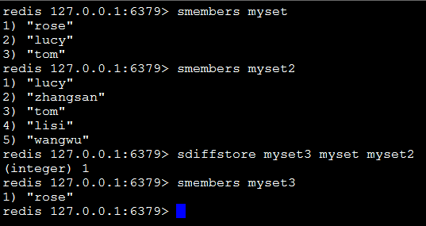

9.sinterstore destination key1 key2 ：将返回的交集存储在destination上

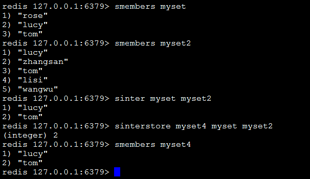

10.sunion key1、key2：返回并集

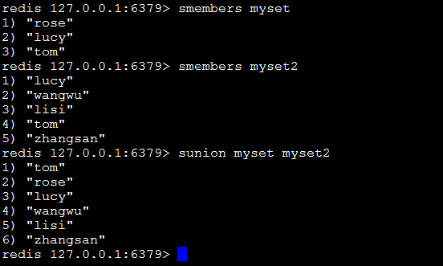

11.sunionstore destination key1 key2：将返回的并集存储在destination上

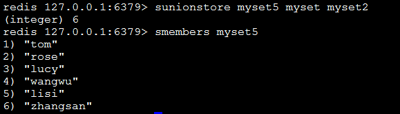

---

四、Sorted Set操作

1.zadd key score member score2 member2 … ：将所有成员以及该成员的分数存放到sorted-set中

2.zcard key：获取集合中的成员数量

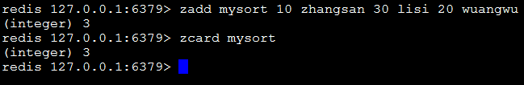

3.zcount key min max：获取分数在\[min,max\]之间的成员数量

4.zincrby key increment member ： 设置指定成员增加指定的分数，返回增加后的分数

5.zrange sset 0 -1：获取sorted set中索引值为start 到 end

6.zrange sset 0 -1 withscores：获取sorted set中索引值为start 到 end，将对应的分数也返回

7.zrangebyscore key min max ：返回分数在min到max的成员

8.zrangebyscore key min max withscores : 返回分数在min到max的成员并显示分数

9.zrangebyscore key min max limit offset count : 返回分数在min到max中间的成员从offset索引开始count个

10.zrank key member：返回成员在集合中的位置。

11.zrem key member\[member…\]：移除集合中指定的成员，可以指定多个成员。

12.zscore key member：返回指定成员的分数

---

五、Hash操作命令

1.hset key field value：为指定的key设定field/value对（键值对）

2.hgetall key：获取key中的所有filed-vaule

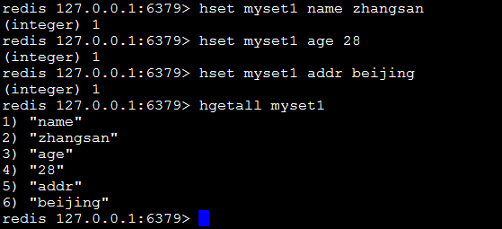

3.hget key field：返回指定的key中的field的值

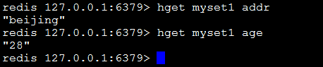

4.hmset key field1 value1 field2 value2 ... ：设置key中的多个filed/value

5.hmget key field1 field2 ... ： 获取key中多个field对应的value

6.hexists key field：判断指定的key中的filed是否存在

7.hlen key：获取key所包含的field的数量

8.hincrby key field increment：设置key中filed的值增加increment，如：age 增加20

---

对于redis的key有以下注意点：

1.key不要太长，最好不要操作1024个字节，这不仅会消耗内存还会降低查找效率

2.key不要太短，如果太短会降低key的可读性

3.在项目中，key最好有一个统一的命名规范

String类型在redis中是二进制安全的，这意味着该类型存入和获取的数据相同，在redis中字符串类型的value最多可以容纳的数据长度是512M

redis中list类型是按照插入顺序排序的字符串链表，我们可以在头部（left）和尾部（right）添加新的元素，插入时如果键不存在，redis会为该键创建一个新的链表，相反如果链表中所有元素都被移除那么该键会从数据库中删除，list中可以包含的最大的元素的数量是4294967295，从元素插入和删除的角度来看，如果我们在链表两头插入和删除元素效率会比较高，这个和链表数据结构相关

在redis中我们可以将set类型看成没有排序的字符集合，在set中执行添加、删除、判断元素存在操作的时间复杂度都是O（1），即都是在常量时间里完成操作，set存放的最大元素数量是4294967295，与list不同的是set集合中不允许出现重复的元素，如果多次添加相同的元素，set只会保留该元素的一份拷贝

sorted set和set相似，他们都是字符串的集合，都不允许出现重复值，区别是sorted set中每一个元素都有以一个分数与之对应，redis通过分数来为集合中的成员进行从小到大的排序，注意尽管sorted set中元素是唯一的，但是分数是可以重复的，sorted set中的添加、删除等操作时间复杂度是集合中成员数量的对数。由于sorted set中的成员在集合中位置是有序的，因此，即使访问位于集合中部的成员的效率也是很高的

一个redis实例最多提供了16个数据库，下标分别从0到15，客户端默认连接的是第0号数据库，可以通过select 加上下标来选择对应的数据库

---

redis的事务特征

1.在事务中的所有的命令都会被串行化的顺序执行，事物执行期间，redis不会再为其他的客户端的请求提供任何的服务，从而保证事物中所有命令被原子的执行

2.和关系型数据库相比，在redis事物中如果有一条命令执行失败后面的命令仍会被继续执行，一个事物中可以存在部分成功部分失败的情况

3.Redis中multi是开启事物，相当于begin transaction，exec是提交事物，相当于commit，discard是事物回滚，相当于rollback

4.在事物开启之前，如果客户端与服务器之间出现通讯故障并导致网络断开，后面的待执行的命令都不会被服务器执行，如果在网络中断发生在客户端执行exec命令之后，那么该命令都会被服务器执行

---

redis持久化

redis支持RDB和AOF两种持久化的方式

RDB（默认方式）：指定时间间隔内将内存中的数据集快照写进磁盘

AOF：该机制是以日志的方式记录服务器处理的每一个写操作，在redis服务器启动之初会读取该文件来重构数据库以保证启动后数据是完整的

RDB的优势

1.整个redis只包含一个文件，有利于备份

2.容灾性好，一个文件容易处理

3.性能最大化，对于redis服务进程而言在开始持久化时唯一要做的只是fork（分叉）出子进程，由子进程完成持久化操作，这样可以避免服务进程执行IO操作

4.相对于AOF而言数据集很大的话RDB效率会更高

RDB的劣势

1.RDB都是快照文件，都是默认五分钟甚至更久的时间才会生成一次，这意味着你这次同步到下次同步这中间五分钟的数据都很可能全部丢失掉。

2.由于RDB是通过fork子进程来协助完成持久化工作，当数据集较大时可能会导致整个服务器停止服务几百毫秒甚至一秒

AOF的优势

1.AOF的数据安全性更好，redis中提供3中同步方式，分别是每秒同步、每修改同步和不同步，每秒同步其实也是异步完成的，效率很高，只是宕机 时这一秒修改的数据会丢失，修改同步可以视为同步持久化，即每次发生的数据变化都会被立即记录到磁盘中，效率较低，不同步就是不进行持久化

2.该机制对日志文件的写入操作是append模式，因此写入过程发生宕机也不会破坏已经存在的内容

3.如果日志过大，redis会自动采用rewrite机制，就是redis以append模式将不断的修改数据写入到老的磁盘文件中，并且创建新的文件记录此期间有哪些修改命令被执行，安全性更好

4.AOF包含一个格式清晰、易于理解的日志文件系统用于记录所有的修改操作，事实上，我们可以通过该文件进行数据的重建

AOF的劣势

1.对于相同数量的数据集而言，AOF的文件通常要大于RDB文件

2.根据同步策略的不同，AOF在运行效率上往往会慢于RDB。总之每秒同步的效率是比较高的，禁用同步策略和RDB一样

当两种方式同时开启时，数据恢复Redis会优先选择AOF恢复。

## 三、底层数据结构实现

> 来源：`Redis/Redis底层数据结构实现.md`

Redis主要有5种数据结构类型：字符串（String）、哈希（hash）、列表（list）、集合（set）、有序集合（sorted set）

它的底层实现有8种数据结构：

    SDS（simple synamic string）简单静态字符串：支持自动平滑扩容的字节数组

    list：链表

    dict：使用双哈希表实现的，支持平滑扩容的字典

    zskiplist：附加了后向指针的跳跃表

    intset：用于存储整数数值集合的自有结构

    ziplist：一种实现上类似TLV，但比TLV复杂的，用于存储任意数据的有序序列的数据结构

    quicklist：一种以ziplist作为结点的双链表结构

    zipmap：一种用于在小规模场合使用的轻量级字典结构

5种存储类型和8种数据结构的桥梁是redisObject

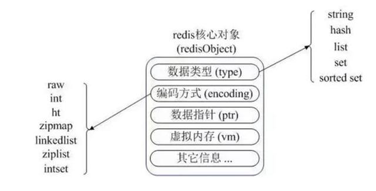

Redis中的key和value在表层都是一个redisObject实例，所以该结构有所谓的“类型”，即是valuetype，对于每一种valuetype的redisObject，其底层至少支持两种不同的底层数据结构来实现

SDS结构图

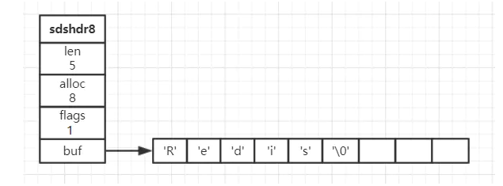

-   `len`：记录当前已使用的字节数（不包括`'\0'`），获取SDS长度的复杂度为O(1)
-   `alloc`：记录当前字节数组总共分配的字节数量（不包括`'\0'`）
-   `flags`：标记当前字节数组的属性，是`sdshdr8`还是`sdshdr16`等，flags值的定义可以看下面代码
-   `buf`：字节数组，用于保存字符串，包括结尾空白字符`'\0'`

```java
// flags值定义
#define SDS_TYPE_5  0
#define SDS_TYPE_8  1
#define SDS_TYPE_16 2
#define SDS_TYPE_32 3
#define SDS_TYPE_64 4
```

链表结构图

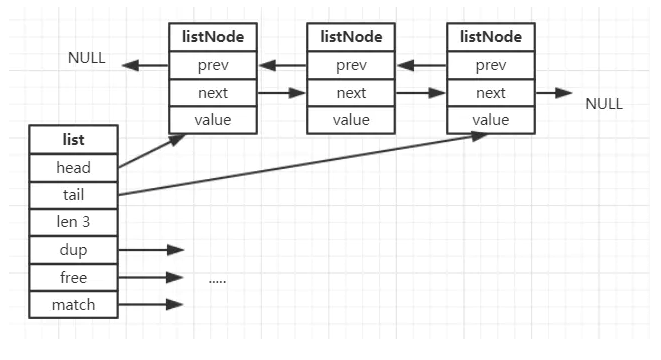

-   `dup`：用于复制链表节点所保存的值
-   `free`：用于释放链表节点所保存的值
-   `match`：用于对比链表节点所保存的值和另一个输入值是否相等

字典结构图

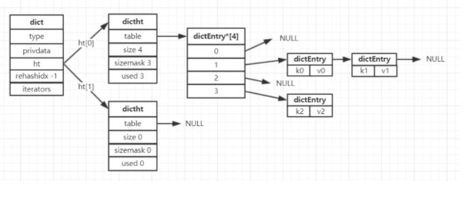

`dict`的`ht`属性是两个元素的数组，包含两个`dictht`哈希表，一般字典只使用`ht[0]`哈希表，`ht[1]`哈希表会在对`ht[0]`哈希表进行`rehash`（重哈希）的时候使用，即当哈希表的键值对数量超过负载数量过多的时候，会将键值对迁移到`ht[1]`上

`rehashidx`也是跟rehash相关的，rehash的操作不是瞬间完成的，`rehashidx`记录着rehash的进度，如果目前没有在进行rehash，它的值为-1

跳跃表

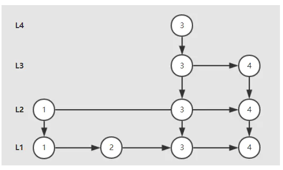

代码结构

```java
/* ZSETs use a specialized version of Skiplists */
typedef struct zskiplistNode {
    // 成员对象 （robj *obj;）
    sds ele;
    // 分值
    double score;
    // 后退指针
    struct zskiplistNode *backward;
    // 层
    struct zskiplistLevel {
        // 前进指针
        struct zskiplistNode *forward;
        // 跨度
        // 跨度实际上是用来计算元素排名(rank)的，在查找某个节点的过程中，将沿途访过的所有层的跨度累积起来，得到的结果就是目标节点在跳跃表中的排位
        unsigned long span;
    } level[];
} zskiplistNode;

typedef struct zskiplist {
    // 表头节点和表尾节点
    struct zskiplistNode *header, *tail;
    // 表中节点的数量
    unsigned long length;
    // 表中层数最大的节点的层数
    int level;
} zskiplist;
```

`zskiplistNode`结构

-   `level`数组（层）：每次创建一个新的跳表节点都会根据幂次定律计算出level数组的大小，也就是次层的高度，每一层带有两个属性-**前进指针**和**跨度**，前进指针用于访问表尾方向的其他指针；跨度用于记录当前节点与前进指针所指节点的距离（指向的为NULL，阔度为0）
-   `backward`（后退指针）：指向当前节点的前一个节点
-   `score`（分值）：用来排序，如果分值相同看成员变量在字典序大小排序
-   `obj`或`ele`：成员对象是一个指针，指向一个字符串对象，里面保存着一个sds；在跳表中各个节点的成员对象必须唯一，分值可以相同

`zskiplist`结构

-   `header`、`tail`表头节点和表尾节点
-   `length`表中节点的数量
-   `level`表中层数最大的节点的层数

整数的代码定义

```java
typedef struct intset {
    // 编码方式
    uint32_t encoding;
    // 集合包含的元素数量
    uint32_t length;
    // 保存元素的数组
    int8_t contents[];
} intset;
```

-   `contents`数组：整数集合的每个元素在数组中按值的大小从小到大排序，且不包含重复项
-   `length`记录整数集合的元素数量，即contents数组长度
-   `encoding`决定contents数组的真正类型，如INTSET\_ENC\_INT16、INTSET\_ENC\_INT32、INTSET\_ENC\_INT64

整数集合结构图

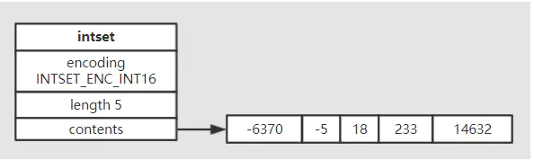

压缩列表结构图

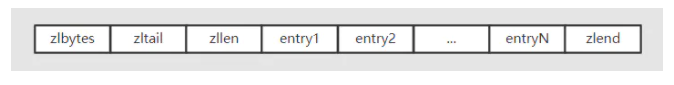

一个压缩列表可以包含多个节点（entry），每个节点可以保存一个字节数组或者一个整数值

-   `zlbytes`：记录整个压缩列表占用的内存字节数，在压缩列表内存重分配，或者计算`zlend`的位置时使用
-   `zltail`：记录压缩列表表尾节点距离压缩列表的起始地址有多少字节，通过该偏移量，可以不用遍历整个压缩列表就可以确定表尾节点的地址
-   `zllen`：记录压缩列表包含的节点数量，但该属性值小于UINT16\_MAX（65535）时，该值就是压缩列表的节点数量，否则需要遍历整个压缩列表才能计算出真实的节点数量
-   `entryX`：压缩列表的节点
-   `zlend`：特殊值0xFF（十进制255），用于标记压缩列表的末端

压缩列表节点构成


-   `previous_entry_ength`：记录压缩列表前一个字节的长度
-   `encoding`：节点的encoding保存的是节点的content的内容类型
-   `content`：content区域用于保存节点的内容，节点内容类型和长度由encoding决定
