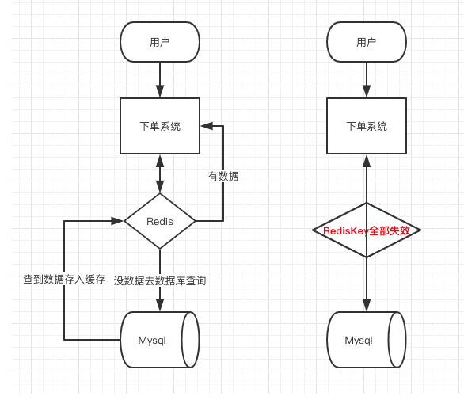
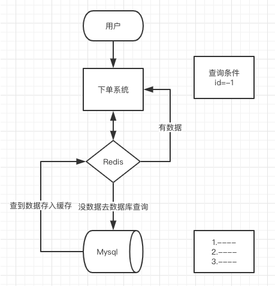
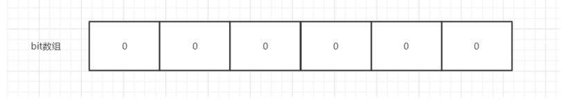
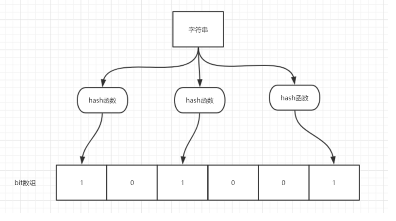
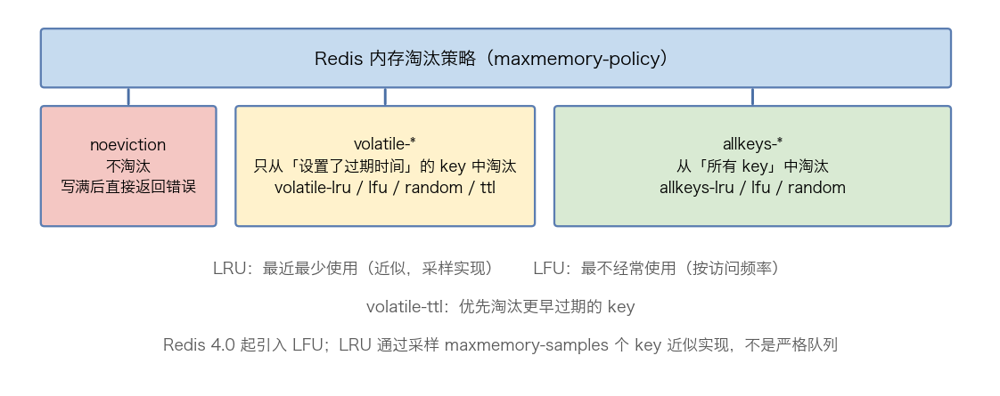
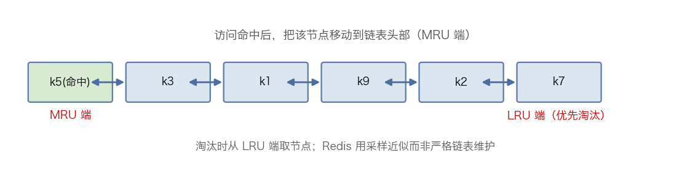
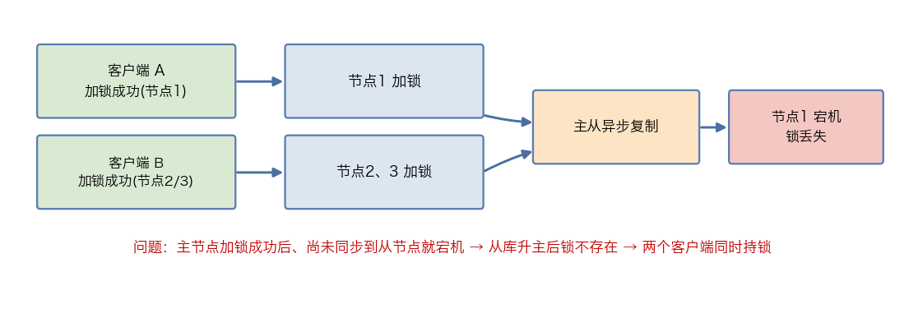
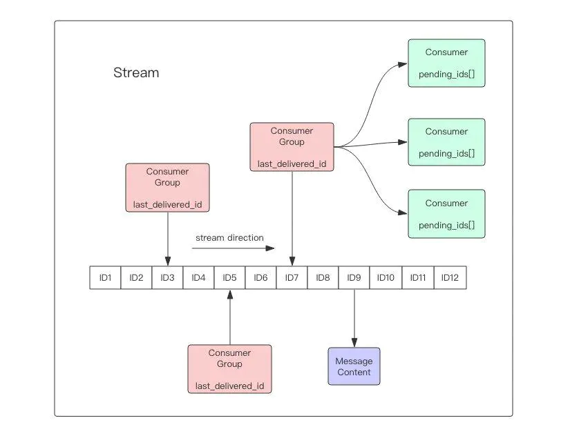

# Redis 缓存问题与分布式锁

> 合并自：`Redis缓存击穿、缓存雪崩、缓存穿透.md`、`Redis缓存过期与淘汰.md`、`Redis红锁.md`、`利用redis实现消息队列.md`。原文未删改（仅修正已知错误、调整格式）。

## 一、缓存雪崩、穿透、击穿与布隆过滤器

> 来源：`Redis/Redis缓存击穿、缓存雪崩、缓存穿透.md`

**缓存雪崩**

对于缓存的用法是先查询缓存，缓存不命中在查询数据库，这样有效缓解数据库访问压力



我们一般会设置缓存key的一个有效时间，在同一时间如果大面积的key失效，那么这一瞬间redis就跟没有一样，如果此时高并发请求过来，直接查询数据库那么很容易使数据库崩溃从而导致其他依赖的接口全部报错，并且如果没有熔断机制，即使是重启数据库也会很快挂掉

对于缓存雪崩的处理方式可以是

1、为每个key的失效时间设置一个随机值，这样可以保证数据不会在同一时间大面积失效，这样数据库的压力就会降低不少

2、如果是集群部署，将热点数据均匀分布在不同的Redis库中也能避免全部失效的问题

3、对于热点数据不要设置过期，需要更新时主动刷新一下 Redis 缓存即可

**缓存穿透**

    缓存穿透是指对于缓存和数据库中都没有的数据，而用户不断发起请求，这时就会直接访问数据库



对于缓存穿透如果是请求数据问题可以再接口层增加校验直接拦截请求、也可以对于那种缓存中取不到的值以及数据库中取不到的值设置一个key，对应的value为null、稍后重试等提示信息，redis还有一个布隆过滤器可以防止缓存穿透的发生，它的原理是利用高效的数据结构和算法快速判断出这个key是否在数据库中存在，不存在就直接return，存在的话去查db之后刷新redis在return

**缓存击穿**

    缓存击穿与缓存雪崩有点类似，缓存雪崩是大面积缓存失效导致直接访问db，而缓存击穿是指一个key非常热点，在不停的扛着大并发，大并发集中对这一个点进行访问，当这个key在失效的瞬间，持续的大并发就穿破缓存直接请求数据库，就像是在一个完好无损的桶上凿开了一个洞

    对于缓存击穿处理方式可以设置热点数据永远不过期或者加上互斥锁

**布隆过滤器**

    布隆过滤器可以看成由一个二进制向量（位数组）和一系列随机映射函数两部分组成的数据结构。相对于我们平时常用的List、Map、Set等数据结构，它占用空间更少并且效率更高，但是缺点是返回的结果是概率性的，而不

是非常准确。理论上添加到集合中的元素越多，误报的可能性就越大。并且存放在布隆过滤器的数据不容易删除



位数组中的每个元素都只占1bit，并且每个元素只能是0或者1

    **原理：**

**当一个元素加入布隆过滤器中的时候，会进行如下操作：**

1.  使用布隆过滤器中的哈希函数对元素值进行计算，得到哈希值（有几个哈希函数得到几个哈希值）。
2.  根据得到的哈希值，在位数组中把对应下标的值置为 1。

**当我们需要判断一个元素是否存在于布隆过滤器的时候，会进行如下操作：**

1.  对给定元素再次进行相同的哈希计算；
2.  得到值之后判断位数组中的每个元素是否都为 1，如果值都为 1，那么说明这个值在布隆过滤器中，如果存在一个值不为 1，说明该元素不在布隆过滤器中。



如图所示，当字符串存储要加入到布隆过滤器中时，该字符串首先由多个哈希函数生成不同的哈希值，然后在对应的位数组的下表的元素设置为 1（当位数组初始化时 ，所有位置均为0）。当第二次存储相同字符串时，因为先前的对应位置已设置为 1，所以很容易知道此值已经存在（去重非常方便）。

如果我们需要判断某个字符串是否在布隆过滤器中时，只需要对给定字符串再次进行相同的哈希计算，得到值之后判断位数组中的每个元素是否都为 1，如果值都为 1，那么说明这个值在布隆过滤器中，如果存在一个值不为 1，说明该元素不在布隆过滤器中。

**不同的字符串可能哈希出来的位置相同，这种情况我们可以适当增加位数组大小或者调整我们的哈希函数。**

综上，我们可以得出：**布隆过滤器说某个元素存在，小概率会误判。布隆过滤器说某个元素不在，那么这个元素一定不在。**

布隆过滤器可以解决缓存穿透问题

**缓存预热**就是系统上线后，将相关的缓存数据直接加载到缓存系统。这样就可以避免在用户请求的时候，先查询数据库，然后再将数据缓存的问题！用户直接查询事先被预热的缓存数据！

## 二、缓存过期与淘汰策略

> 来源：`Redis/Redis缓存过期与淘汰.md`

Redis过期键删除策略

Redis是key-value数据库，我们可以设置Redis中缓存的key的过期时间。Redis的过期策略就是指当Redis中缓存的key过期了，Redis如何处理

过期策略通常有以下三种：

-   定时过期：每个设置过期时间的key都需要创建一个定时器，到过期时间就会立即清除。该策略可以立即清除过期的数据，对内存很友好；但是会占用大量的CPU资源去处理过期的数据，从而影响缓存的响应时间和吞吐量。
-   惰性过期：只有当访问一个key时，才会判断该key是否已过期，过期则清除。该策略可以最大化地节省CPU资源，却对内存非常不友好。极端情况可能出现大量的过期key没有再次被访问，从而不会被清除，占用大量内存。
-   定期过期：每隔一定的时间，会扫描一定数量的数据库的expires字典中一定数量的key，并清除其中已过期的key。该策略是前两者的一个折中方案。通过调整定时扫描的时间间隔和每次扫描的限定耗时，可以在不同情况下使得CPU和内存资源达到最优的平衡效果。
    (expires字典会保存所有设置了过期时间的key的过期时间数据，其中，key是指向键空间中的某个键的指针，value是该键的毫秒精度的UNIX时间戳表示的过期时间。键空间是指该Redis集群中保存的所有键。)

如果redis过期策略没有成功删除key，会导致redis内存越来越高需要Redis的内存淘汰策略

Redis共提供了8中缓存淘汰策略，其中 [volatile](https://so.csdn.net/so/search?q=volatile&spm=1001.2101.3001.7020)\-lfu 和 allkeys-lfu 是Redis 4.0版本新增的



1、noeviction：不进行淘汰数据。一旦缓存被写满，再有写请求进来，Redis就不再提供服务，而是直接返回错误。Redis 用作缓存时，实际的数据集通常都是大于缓存容量的，总会有新的数据要写入缓存，这个策略本身不淘汰数据，也就不会腾出新的缓存空间，我们不把它用在 Redis 缓存中。

2、volatile-ttl：在设置了过期时间的键值对中，移除即将过期的键值对。

3、volatile-random：在设置了过期时间的键值对中，随机移除某个键值对。

4、volatile-lru：在设置了过期时间的键值对中，移除最近最少使用的键值对。

5、volatile-lfu：在设置了过期时间的键值对中，移除最近最不频繁使用的键值对

6、allkeys-random：在所有键值对中，随机移除某个key。

7、allkeys-lru：在所有的键值对中，移除最近最少使用的键值对。

8、allkeys-lfu：在所有的键值对中，移除最近最不频繁使用的键值对

### Redis中的LRU和LFU算法：

    1、LRU算法：

    LRU 算法的全称是 Least Recently Uses，按照最近最少使用的原则来筛选数据，最不常用的数据会被筛选出来。LRU 会把所有的数据组织成一个链表，链表的头和尾分别表示 MRU 端和 LRU 端，分别代表最近最常使用的数据和最近最不常用的数据。我们看一个例子。



如果有一个新数据 45 要被写入缓存，但此时已经没有缓存空间了，也就是链表没有空余位置了，那么LRU 算法做两件事：数据 45 是刚被访问的，所以它会被放到 MRU 端；算法把 LRU 端的数据 5 从缓存中删除，相应的链表中就没有数据 5 的记录了。LRU认为刚刚被访问的数据，肯定还会被再次访问，所以就把它放在 MRU 端；长久不访问的数据，肯定就不会再被访问了，所以就让它逐渐后移到 LRU 端，在缓存满时，就优先删除它。

LRU 算法在实际实现时，需要用链表管理所有的缓存数据，移除元素时直接从链表队尾移除，增加时加到头部就可以了，但这会带来额外的空间开销。而且，当有数据被访问时，需要在链表上把该数据移动到 MRU 端，如果有大量数据被访问，就会带来很多链表移动操作，会很耗时，进而会降低 Redis 缓存性能。

所以，在 Redis 中，LRU 算法被做了简化，以减轻数据淘汰对缓存性能的影响。具体来说：Redis 默认会记录每个数据的最近一次访问的时间戳（由键值对数据结构 RedisObject 中的 lru 字段记录）。然后，Redis 在决定淘汰的数据时，第一次会随机选出 N 个数据，把它们作为一个候选集合。接下来，Redis 会比较这 N 个数据的 lru 字段，把 lru 字段值最小的数据从缓存中淘汰出去。当需要再次淘汰数据时，Redis 需要挑选数据进入第一次淘汰时创建的候选集合。这里的挑选标准是：能进入候选集合的数据的 lru 字段值必须小于候选集合中最小的 lru 值。当有新数据进入候选数据集后，如果候选数据集中的数据个数达到了 N 个，Redis 就把候选数据集中 lru 字段值最小的数据淘汰出去。这样一来，Redis 缓存不用为所有的数据维护一个大链表，也不用在每次数据访问时都移动链表项，提升了缓存的性能。

Redis 提供了一个配置参数 maxmemory-samples，这个参数就是 Redis 选出的数据个数 N。例如，我们执行如下命令，可以让 Redis 选出 100 个数据作为候选数据集：

```java
CONFIG SET maxmemory-samples 100
```

**2、LFU算法：**

    LFU是在Redis4.0后出现的，它的核心思想是根据key的最近被访问的频率进行淘汰，很少被访问的优先被淘汰，被访问的多的则被留下来。LFU算法能更好的表示一个key被访问的热度。假如你使用的是LRU算法，一个key很久没有被访问到，只刚刚是偶尔被访问了一次，那么它就被认为是热点数据，不会被淘汰，而有些key将来是很有可能被访问到的则被淘汰了。如果使用LFU算法则不会出现这种情况，因为使用一次并不会使一个key成为热点数据。它的使用与LRU有所区别：

LFU (Least Frequently Used) ：最近最不频繁使用，跟使用的次数有关，淘汰使用次数最少的。

LRU (Least Recently Used)：最近最少使用，跟使用的最后一次时间有关，淘汰最近使用时间离现在最久的。

## 三、Redlock（红锁）

> 来源：`Redis/Redis红锁.md`

红锁是redis实现分布式锁的一种算法

分布式锁要保证以下三点：

1.互斥性，在任何时刻只有一个客户端可以持有一个锁

2.无死锁：最终总是有获得一个锁，即使锁定资源的客户端崩溃或被分区

3.容错性：只要大部分redis节点都是正常的，客户端就可以获取和释放锁

单机模式下使用redis实现分布式锁比较简单，使用setnx、守护进程即可

但是在主从和哨兵模式下存在下面的问题

1.  客户端 1 在主库上执行 SET 命令，加锁成功
2.  此时，主库异常宕机，SET 命令还未同步到从库上（主从复制是异步的）
3.  从库被哨兵提升为新主库，这个锁在新的主库上，丢失了！



为了解决主从切换时，锁丢失的问题，**Redis** 的作者提出一种叫 **Redlock（红锁）** 的解决方案

**Redis** 作者提出的 **Redlock（红锁）** 的解决方案基于 2 个前提：

1.  只用的到主库，用不上从库和哨兵实例
2.  主库要部署多个，官方推荐至少 5 个实例

也就是说，想用使用 **Redlock**，你至少要部署 5 个 **Redis** 实例，而且都是主库，它们之间没有任何关系，都是一个个互不相关的实例。

在看具体如何实现 **Redlock**, 整个流程如下

1.  客户端先获取「当前时间戳 T1」
2.  客户端依次向这 5 个 **Redis** 实例发起加锁请求（用前面讲到的 SET 命令），并设置超时时间（毫秒级），如果某一个实例加锁失败（包括网络超时、锁被其它人持有等各种异常情况），就立即向下一个 **Redis** 实例申请加锁
3.  如果客户端从 >=3 个（大多数）以上 **Redis** 实例加锁成功，则再次获取「当前时间戳 T2」，如果锁的租期 > T2 - T1 ，此时，认为客户端加锁成功，否则认为加锁失败
4.  加锁成功，去操作共享资源
5.  加锁失败或操作结束，向「全部节点」发起释放锁请求（前面讲到的 Lua 脚本释放锁）

整个逻辑说白了就是大家都去抢注锁，谁抢注的多谁就拥有锁

这里面有几个重点

1.  客户端必须在多个 Redis 实例上申请加锁
2.  必须保证大多数节点加锁成功
3.  大多数节点加锁的总耗时，要小于锁设置的过期时间(租期不要设置的过短，防止锁还没抢到手，就失效了)
4.  释放锁，要向全部节点发起释放锁请求，防止锁残留(锁残留指定是，实际加锁成功但返回结果时由于网络等原因客户端以为加锁失败。)

**Redlock（红锁）** 通过向当前存活的多个主库抢注锁，实现了即使部分节点不可用，也不会影响到分布式锁系统，解决主从切换时，锁丢失的问题

## 四、用 Redis 实现消息队列

> 来源：`Redis/利用redis实现消息队列.md`

1.基于List的 LPUSH+BRPOP 的实现

使用**rpush**和**lpush**操作入队列，**lpop**和**rpop**操作出队列。

**List支持多个生产者和消费者并发进出消息**，每个消费者拿到都是**不同**的列表元素。

但是当队列为空时，lpop和rpop会一直空轮训，消耗资源；所以引入阻塞读blpop和brpop（b代表blocking），阻塞读在队列没有数据的时候进入休眠状态，

一旦数据到来则立刻醒过来，消息延迟几乎为零。

**注意**

你以为上面的方案很完美？还有个问题需要解决：空闲连接的问题。

如果线程一直阻塞在那里，Redis客户端的连接就成了闲置连接，闲置过久，服务器一般会主动断开连接，减少闲置资源占用，这个时候blpop和brpop或抛出异常，

所以在编写客户端消费者的时候要小心，如果捕获到异常，还有重试。

**缺点：**

做消费者确认ACK麻烦，不能保证消费者消费消息后是否成功处理的问题（宕机或处理异常等），通常需要维护一个Pending列表，保证消息处理确认。

不能做广播模式，如pub/sub，消息发布/订阅模型

不能重复消费，一旦消费就会被删除

不支持分组消费

2.[PUB/SUB,订阅/发布模式](https://links.jianshu.com/go?to=app%3A%2F%2F.%2Findex.html%23PUB-SUB-%25E8%25AE%25A2%25E9%2598%2585-%25E5%258F%2591%25E5%25B8%2583%25E6%25A8%25A1%25E5%25BC%258F)

SUBSCRIBE，用于订阅信道

PUBLISH，向信道发送消息

UNSUBSCRIBE，取消订阅

此模式允许生产者只生产一次消息，由中间件负责将消息复制到多个消息队列，每个消息队列由对应的消费组消费。

**优点**

典型的广播模式，一个消息可以发布到多个消费者

多信道订阅，消费者可以同时订阅多个信道，从而接收多类消息

消息即时发送，消息不用等待消费者读取，消费者会自动接收到信道发布的消息

**缺点**

消息一旦发布，不能接收。换句话就是发布时若客户端不在线，则消息丢失，不能寻回

不能保证每个消费者接收的时间是一致的

若消费者客户端出现消息积压，到一定程度，会被强制断开，导致消息意外丢失。通常发生在消息的生产远大于消费速度时

***可见，Pub/Sub 模式不适合做消息存储，消息积压类的业务，而是擅长处理广播，即时通讯，即时反馈的业务。***

3.[基于Sorted-Set的实](https://links.jianshu.com/go?to=app%3A%2F%2F.%2Findex.html%23%25E5%259F%25BA%25E4%25BA%258ESorted-Set%25E7%259A%2584%25E5%25AE%259E%25E7%258E%25B0).

Sortes Set(有序列表)，类似于java的SortedSet和HashMap的结合体，一方面她是一个set，保证内部value的唯一性，另一方面它可以给每个value赋予一个score，代表这个value的

排序权重。内部实现是“跳跃表”。

有序集合的方案是在自己确定消息顺ID时比较常用，使用集合成员的Score来作为消息ID，保证顺序，还可以保证消息ID的单调递增。通常可以使用时间戳+序号的方案。确保了消息ID的单调递增，利用SortedSet的依据

Score排序的特征，就可以制作一个有序的消息队列了。

**优点**

就是可以自定义消息ID，在消息ID有意义时，比较重要。

**缺点**

缺点也明显，不允许重复消息（因为是集合），同时消息ID确定有错误会导致消息的顺序出错。

4.[基于Stream类型的实现](https://links.jianshu.com/go?to=app%3A%2F%2F.%2Findex.html%23%25E5%259F%25BA%25E4%25BA%258EStream%25E7%25B1%25BB%25E5%259E%258B%25E7%259A%2584%25E5%25AE%259E%25E7%258E%25B0)



Stream为redis 5.0后新增的数据结构。支持多播的可持久化消息队列，实现借鉴了Kafka设计。

Redis Stream的结构如上图所示，**它有一个消息链表，将所有加入的消息都串起来，每个消息都有一个唯一的ID和对应的内容**。**消息是持久化的**，Redis重启后，内容还在。

每个Stream都有唯一的名称，它就是Redis的key，在我们**首次使用xadd指令追加消息时自动创建**。

**每个Stream都可以挂多个消费组，每个消费组会有个游标last\_delivered\_id在Stream数组之上往前移动，表示当前消费组已经消费到哪条消息了**。每个消费组都有一个Stream内唯一的名称，消费组不会自动创建，它需要单独的指令xgroup create进行创建，需要指定从Stream的某个消息ID开始消费，这个ID用来初始化last\_delivered\_id变量。

每个消费组(Consumer Group)的状态都是独立的，相互不受影响。也就是说**同一份Stream内部的消息会被每个消费组都消费到**。

**同一个消费组(Consumer Group)可以挂接多个消费者(Consumer)，这些消费者之间是竞争关系**，任意一个消费者读取了消息都会使游标last\_delivered\_id往前移动。每个消费者者有一个组内唯一名称。

消费者(Consumer)内部会有个状态变量**pending\_ids**，它记录了当前已经被客户端读取的消息，但是还没有ack。如果客户端没有ack，这个变量里面的消息ID会越来越多，一旦某个消息被ack，它就开始减少。这个pending\_ids变量在Redis官方被称之为PEL，也就是Pending Entries List，这是一个很核心的数据结构，它用来确保客户端至少消费了消息一次，而不会在网络传输的中途丢失了没处理。
