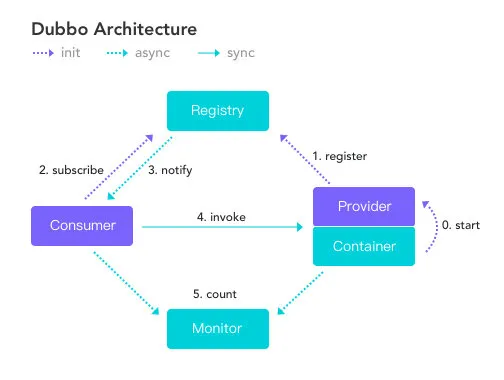
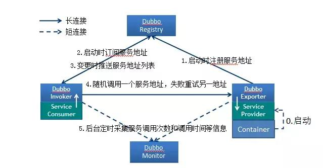
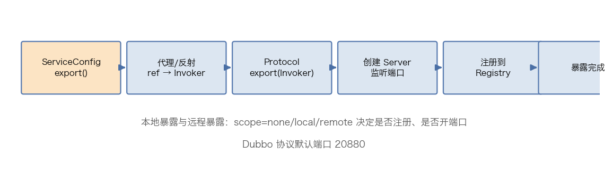
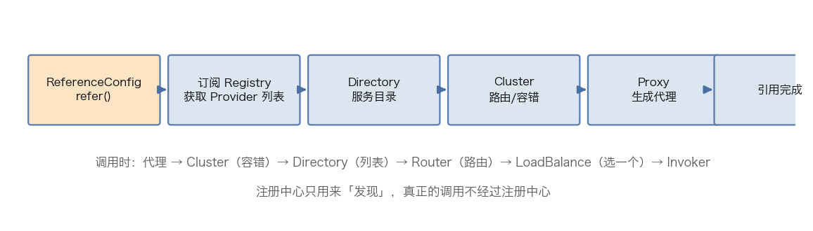
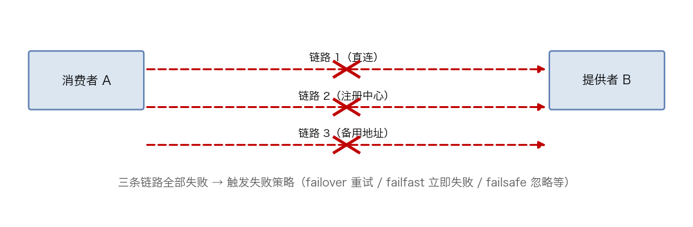
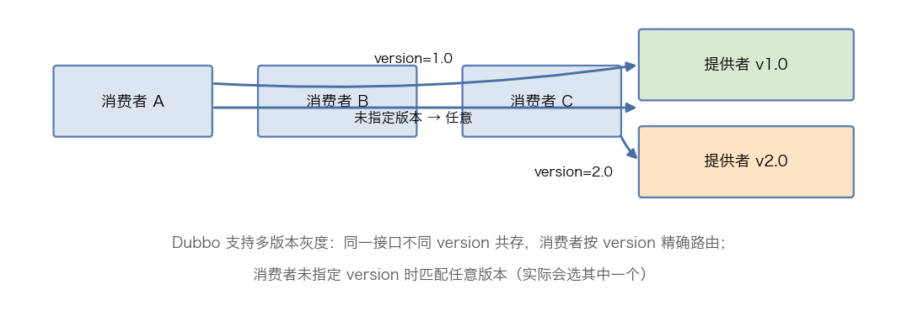

# Dubbo

> 合并自：`Dubbo架构.md`、`Dubbo高级特性.md`、`RPC.md`。原文未删改（仅修正已知错误、调整格式）。

## 一、Dubbo 架构

> 来源：`dubbo/Dubbo架构.md`



| 节点 | 角色说明 |
| --- | --- |
| Consumer | 需要调用远程服务的服务消费方 |
| Registry | 注册中心 |
| Provider | 服务提供方 |
| Container | 服务运行的容器 |
| Monitor |
监控中心

 |

首先服务提供者 Provider 启动然后向注册中心注册自己所能提供的服务。

服务消费者 Consumer 启动向注册中心订阅自己所需的服务。然后注册中心将提供者元信息通知给 Consumer， 之后 Consumer 因为已经从注册中心获取提供者的地址，因此可以通过负载均衡选择一个 Provider 直接调用 。

之后服务提供方元数据变更的话注册中心会把变更推送给服务消费者。

服务提供者和消费者都会在内存中记录着调用的次数和时间，然后定时的发送统计数据到监控中心。

dubbo服务注册与发现的流程



**Dubbo集群提供了哪些负载均衡策略？**

-    **Random LoadBalance:** 随机选取提供者策略，有利于动态调整提供者权重。截面碰撞率高，调用次数越多，分布越均匀；
-    **RoundRobin LoadBalance:** 轮循选取提供者策略，平均分布，但是存在请求累积的问题；
-    **LeastActive LoadBalance:** 最少活跃调用策略，解决慢提供者接收更少的请求；
-    **ConstantHash LoadBalance:** 一致性Hash策略，使相同参数请求总是发到同一提供者，一台机器宕机，可以基于虚拟节点，分摊至其他提供者，避免引起提供者的剧烈变动；

**Dubbo的集群容错方案有哪些？**

-    **Failover Cluster**
-    失败自动切换，当出现失败，重试其它服务器。通常用于读操作，但重试会带来更长延迟。

-    **Failfast Cluster**
-    快速失败，只发起一次调用，失败立即报错。通常用于非幂等性的写操作，比如新增记录。
-    **Failsafe Cluster**
-    失败安全，出现异常时，直接忽略。通常用于写入审计日志等操作。
-    **Failback Cluster**
-    失败自动恢复，后台记录失败请求，定时重发。通常用于消息通知操作。
-    **Forking Cluster**
-    并行调用多个服务器，只要一个成功即返回。通常用于实时性要求较高的读操作，但需要浪费更多服务资源。可通过 forks=”2″ 来设置最大并行数。
-    **Broadcast Cluster**
-    广播调用所有提供者，逐个调用，任意一台报错则报错 。通常用于通知所有提供者更新缓存或日志等本地资源信息。

Dubbo核心的配置有哪些？

配置    配置说明

dubbo:service    服务配置

dubbo:reference    引用配置

dubbo:protocol    协议配置

dubbo:application    应用配置

dubbo:module    模块配置

dubbo:registry    注册中心配置

dubbo:monitor    监控中心配置

dubbo:provider    提供方配置

dubbo:consumer    消费方配置

dubbo:method    方法配置

dubbo:argument    参数配置

Dubbo 服务降级，失败重试怎么做？

可以通过 dubbo:reference 中设置 mock=“return null”。mock 的值也可以修 改为 true，然后再跟接口同一个路径下实现一个 Mock 类，命名规则是 “接口 名称+Mock” 后缀。然后在 Mock 类里实现自己的降级逻辑

**分层介绍**

**1.Business 业务逻辑层**

> service 业务层 包括我们的业务代码，比如接口实现类 直接面向开发者

**2.RPC层 远程过程调用层**

> **config 配置层**：对外提供配置以ServiceConfig和ReferenceConfig 为核心，可以直接初始化配置类，也可以解析配置文件生成。
> **proxy 服务代理层** ：无论是生产者 还是消费者 框架都会产生一个代理类 整个过程对上层透明 就是业务层对远程调用无感。
> **registry 注册中心层**：封装服务地址的注册与发现 以服务的URL为中心 。
> **cluster 路由层 (集群容错层)**：提供了多个提供者的路由和负载均衡，并且它桥接注册中心，以 Invoker为核心 。
> **monitor 监控层**：RPC调用相关的信息 如调用次数，，成功失败的情况 调用时间等。
> **protocol 远程调用层**：封装RPC调用，无论是服务的暴露还是服务的引用，都是在Protocol中作为主。功能入口负责Invoker的整个生命周期。

**3.Remoting层 远程数据传输层**

> **exchange 信息交换层**：封装请求和响应的模式，如把请求由同步，转换成异步。
> **transport 网络传输层**：统一网络传输的接口，比如netty 和mina统一为一个网络传输接口。
> **serialize 数据序列化层**：负责管理整个框架中的数据传输的序列化和反序列化。

服务暴露流程：



首先，`ServiceConfig`类引用对外提供服务的实现类ref (如`DubboUserServiceImpl`) ， 然后通过`ProxyFactoty`接口的扩展实现类的`getInvoker()`方法使用ref生成一个`AbstractProxyInvoker`实例，到此就完成了具体服务到`Invoker`的转化。接下来，通过Dubbo协议的`export()`方法，将`Invoker`转化为`Exporter`。那么在这里，就会先启动`Netty Server`的监听，然后将服务注册到服务注册中心。

服务调用流程：



`Reference`注解标注的`Dubbo`接口，会被注册成`FactoryBean`，并最终返回一个代理对象。在创建代理的过程中，会调用其他方法构建以及合并 `Invoker` 实例。

首先，调用`DubboProtocol`的refer方法，返回`DubboInvoker`对象。在这里，比较重要的是获取客户端实例。比如`NettyClient`，`Dubbo`要依靠它来进行网络通信。然后，还需要将多个服务提供者实例合并成一个，这是集群容错机制的实现。最后，通过`JavassistProxyFactory`创建代理并返回。在这里，它的处理器是`InvokerInvocationHandler` ，这就意味着，当我们在消费者端调用一个`Dubbo`接口的时候，实际上会调用`InvokerInvocationHandler.invoke()`方法，在这里面`Dubbo`完成了譬如集群容错、负载均衡、调用远程方法的一系列动作。

## 二、高级特性

> 来源：`dubbo/Dubbo高级特性.md`

地址缓存：dubbo服务消费者在第一次调用时，会将服务提供方地址缓存到本地，以后在调用则不会访问注册中心。当服务提供者地址发生变化时，注册中心会通知服务消费者



Dubbo超时机制：

服务消费者在调用服务提供者的时候发生了阻塞、等待的情形,这个时候,服务消费者会直等待下去。在某个峰值时刻，大量的请求都在同时请求服务消费者,会造成线程的大量堆积，势必会造成雪崩。

dubbo利用超时机制来解决这个问题，设置-个超时时间, 在这个时间段内，无法完成服务访问,则自动断开连接。

使用timeout属性配置超时时间，默认值1000，单位毫秒

```java
//timeout 超时时间 单位毫秒  retries 重试次数
@Service(timeout = 3000,retries=0)
```

dubbo的超时是争对生产者的，由于是一种NIO模式，消费者发起请求后得到一个ResponseFuture，然后消费者一直轮询这个ResponseFuture直至超时或者收到生产者的返回结果。虽然超时了，但仅仅是消费者不再等待生产者的反馈并不代表此时生产者端也停止了执行

注意：dubbo的超时时间配置既可以配置在生产者也可以配置在消费者并且消费者上的超时配置可以覆盖生产者上的超时配置

超时机制的实现原理：

dubbo默认采用了netty做为网络组件，它属于一种NIO的模式。消费者发起远程请求后，线程不会阻塞等待生产者的返回，而是马上得到一个ResponseFuture，消费者通过不断的[轮询](https://so.csdn.net/so/search?q=%E8%BD%AE%E8%AF%A2&spm=1001.2101.3001.7020)机制判断结果是否有返回。因为是通过轮询，轮询有个需要特别注要的就是避免死循环，所以为了解决这个问题就引入了超时机制，只在一定时间范围内做轮询，如果超时时间就返回超时异常

重连机制：

dubbo在调用服务不成功时，默认会重试2次。
Dubbo的路由机制，会把超时的请求路由到其他机器上，而不是本机尝试，所以 dubbo的重试机制也能一定程度的保证服务的质量。但是如果不合理的配置重试次数，当失败时会进行重试多次，这样在某个时间点出现性能问题，调用方再连续重复调用，系统请求变为正常值的retries倍，系统压力会大增，容易引起服务雪崩，需要根据业务情况规划好如何进行异常处理，何时进行重试

多版本



\*\*灰度发布:\*\*当出现新功能时,会让一部分用户先使用新功能，用户反馈没问题时，再将所有用户迁移到新功能。

dubbo中使用version属性来设置和调用同一个接口的不同版本

生产者配置

```java
@Service(version="v2.0")
public class UserServiceImp12 implements UserService {...}
```

消费者配置

```java
@Reference(version = "v2.0")//远程注入
private UserService userService;
```

负载均衡

dubbo支持4中负载均衡策略分别是：（核心AbstractLoadBalance）

      RandomLoadBalance:随机负载均衡。随机的选择一个。是Dubbo的默认负载均衡策略。

　　RoundRobinLoadBalance:轮询负载均衡。轮询选择一个。

　　LeastActiveLoadBalance:最少活跃调用数，相同活跃数的随机。活跃数指调用前后计数差。使慢的 Provider 收到更少请求，因为越慢的 Provider 的调用前后计数差会越大。

　　ConsistentHashLoadBalance:一致性哈希负载均衡。相同参数的请求总是落在同一台机器上。

同时dubbo的负载均衡配置可以支持 生产者服务/方法级别、消费者服务/方法级别

多个配置是有覆盖关系的, 配置的优先级是:

　　　　1. 消费者方法级别配置;(最优先)
　　　　2. 消费者接口级别配置;
　　　　3. 生产者方法级别配置;
　　　　4. 生产者接口级别配置;(最后使用)

Dubbo集群容错：

(1)Failover Cluster:失败自动切换，当出现失败，重试其它服务器。通常用于读操作，但重试会带来更长延迟。（默认方案）

(2)Failfast Cluster:快速失败，只发起一次调用，失败立即报错。通常用于非[幂等性](https://so.csdn.net/so/search?q=%E5%B9%82%E7%AD%89%E6%80%A7&spm=1001.2101.3001.7020)的写 操作，比如新增记录。

(3)Failsafe Cluster:失败安全，出现异常时，直接忽略。通常用于写入审计日志等操作。

(4)Failback Cluster:失败自动恢复，后台记录失败请求，定时重发。通常用于消息通知操 作。

(5)Forking Cluster:并行调用多个服务器，只要一个成功即返回。通常用于实时性要求较 高的读操作，但需要浪费更多服务资源。可通过 forks="2" 来设置最大并行数。

(6)Broadcast Cluster:广播调用所有提供者，逐个调用，任意一台报错则报错 。通常用于通 知所有提供者更新缓存或日志等本地资源信息。

## 三、RPC 用到的关键技术

> 来源：`dubbo/RPC.md`

RPC使用了哪些关键技术？

动态代理;

    生成Client Stub（客户端存根）和Server Stub（服务端存根）的时候需要用到Java动态代理技术，可以使用JDK提供的原生的动态代理机制，也可以使用开源的：CGLib代理，Javassist字节码生成技术。

序列化和反序列化

    在网络中，所有的数据都将会被转化为字节进行传送，所以为了能够使参数对象在网络中进行传输，需要对这些参数进行序列化和反序列化操作。

    序列化：

        把对象转换为字节序列的过程称为对象的序列化，也就是编码的过程。

    反序列化：

        把字节序列恢复为对象的过程称为对象的反序列化，也就是解码的过程。

        目前比较高效的开源序列化框架：如Kryo、FastJson和Protobuf等。

NIO通信

    出于并发性能的考虑，传统的阻塞式 IO 显然不太合适，因此我们需要异步的 IO，即 NIO。Java 提供了 NIO 的解决方案，Java 7 也提供了更优秀的 NIO.2 支持。可以选择Netty或者MINA来解决NIO数据传输的问题。

服务注册中心

    可选：Nacos、Redis、Zookeeper、Consul 、Etcd。一般使用ZooKeeper提供服务注册与发现功能，解决单点故障以及分布式部署的问题(注册中心)。
