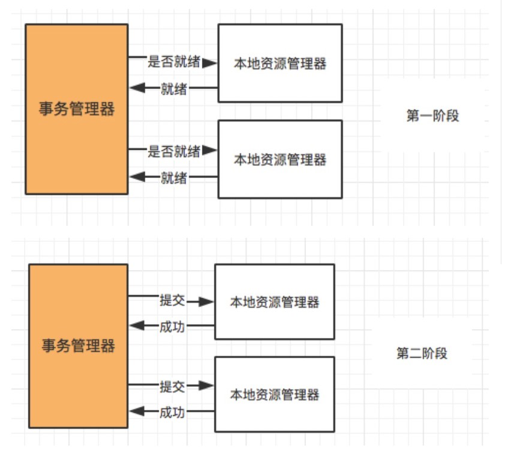
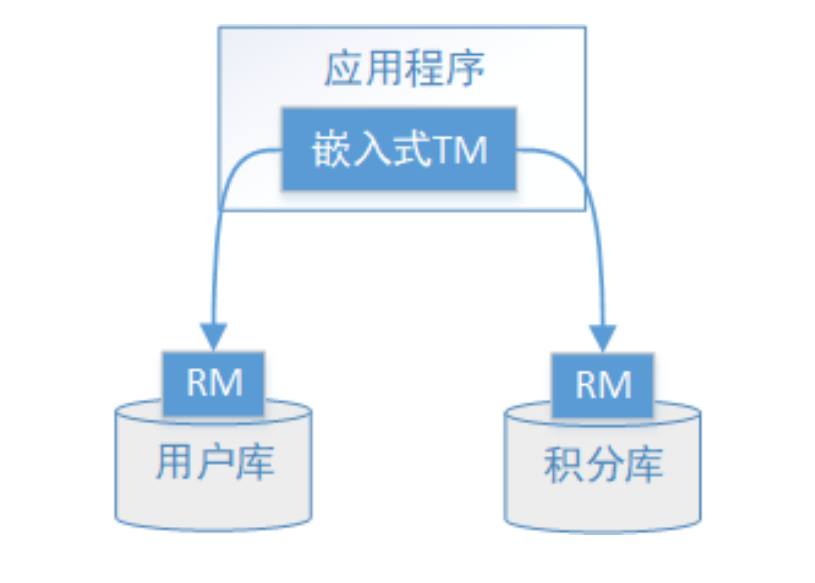
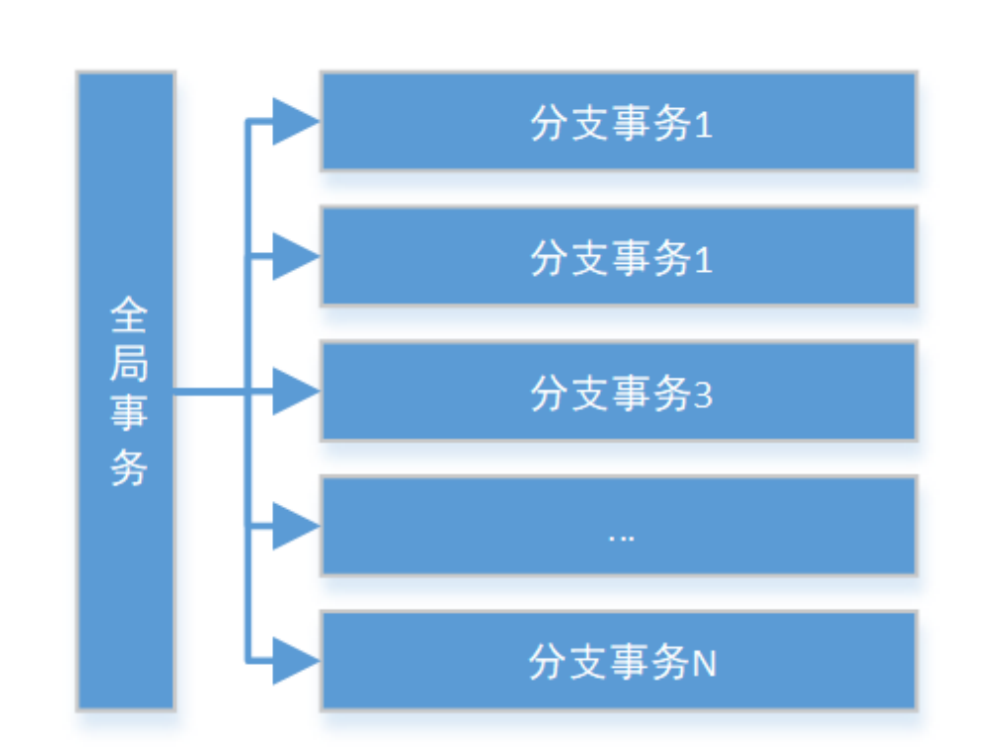
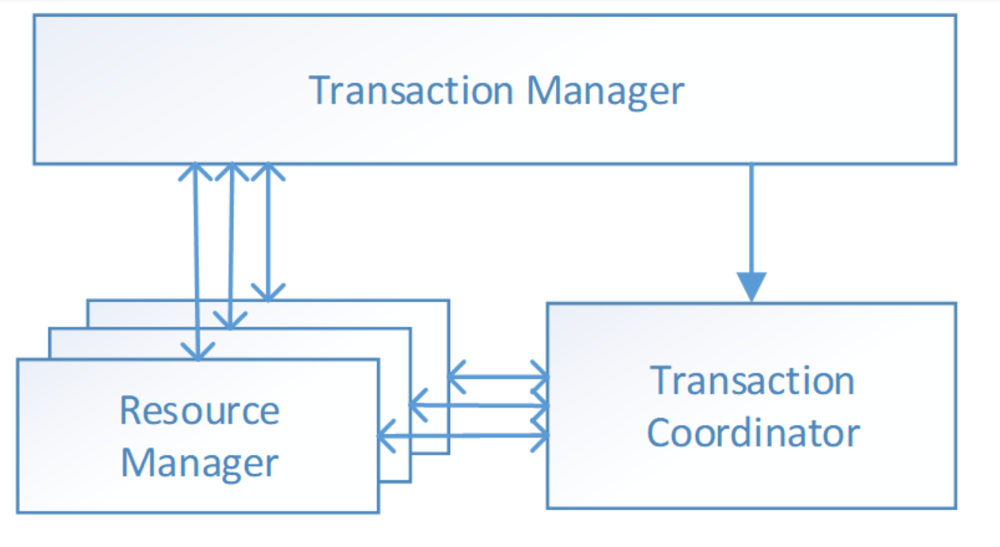
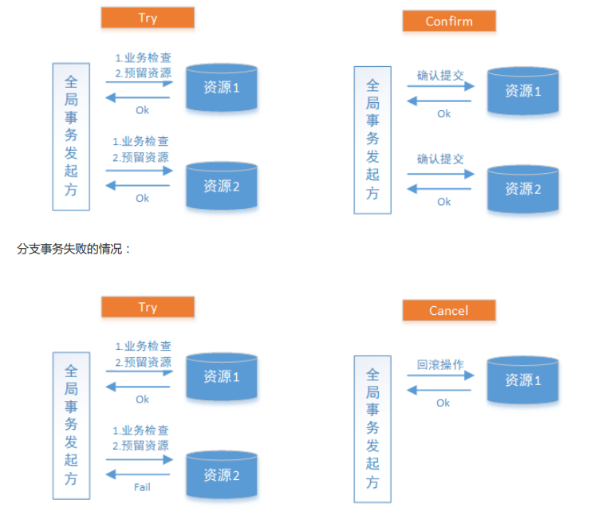
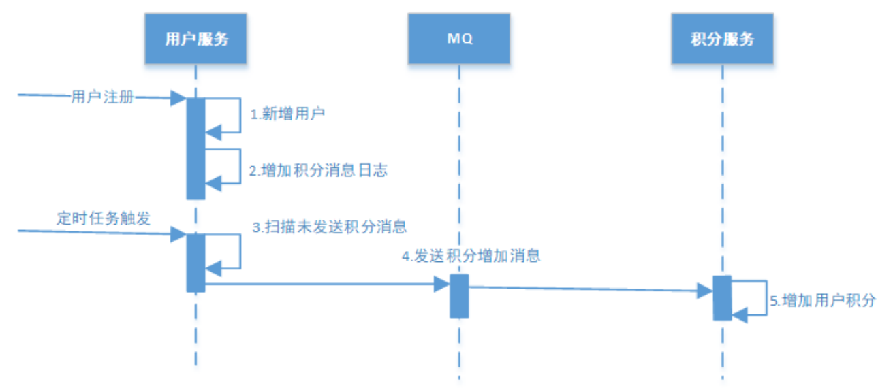
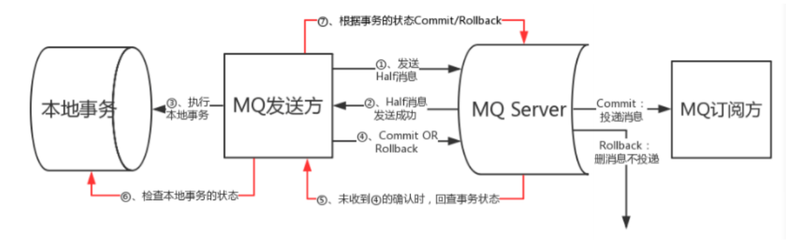
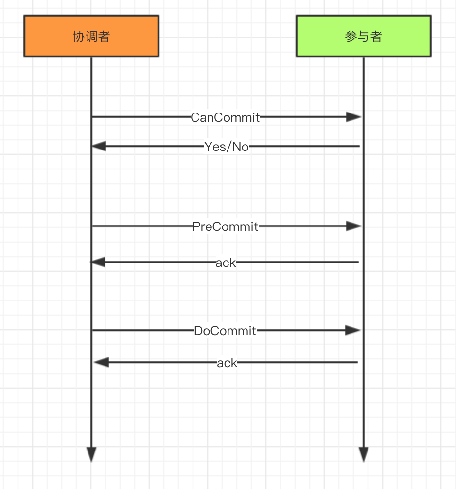

# 分布式事务

> 合并自：`分布式事务解决方式.md`、`两阶段提交的问题与三阶段提交.md`。原文未删改（仅调整格式）。

## 一、分布式事务的解决方式

> 来源：`技术方案/分布式事务解决方式.md`

BASE 是 Basically Available(基本可用)、Soft state(软状态)和 Eventually consistent (最终一致性)三个短语的缩写。是对CAP中AP的一个扩展

1. 基本可用:分布式系统在出现故障时，允许损失部分可用功能，保证核心功能可用。

2. 软状态:允许系统中存在中间状态，这个状态不影响系统可用性，如订单的支付中等。

3. 最终一致:最终一致是指经过一段时间后，所有节点数据都将会达到一致。

BASE解决了CAP中理论没有网络延迟，在BASE中用软状态和最终一致，保证了延迟后的一致性。BASE和 ACID 是相反的，它完全不同于ACID的强一致性模型，而是通过牺牲强一致性来获得可用性，并允许数据在一段时间内是不一致的，但最终达到一致状态。

### 两阶段提交

两阶段提交，顾名思义就是要分两步提交。存在一个负责协调各个本地资源管理器的事务管理器，本地资源管理器一般是由数据库实现，事务管理器在第一阶段的时候询问各个资源管理器是否都就绪？如果收到每个资源的回复都是 yes，则在第二阶段提交事务，如果其中任意一个资源的回复是 no, 则回滚事务。



大致的流程：

第一阶段（prepare）准备阶段：事务管理器向所有参与者发送prepare消息，每个数据库参与者在本地执行事务，并在本地的undo/redo日志，此时事务没有提交

第二阶段 (commit/rollback)提交阶段：如果事务管理器收到了参与者的执行失败或者超时消息时，直接给每个参与者发动回滚消息，否则发送提交消息，参与者根据事务管理器的指令执行提交或者回滚操作，并释放事务处理过程中使用的锁资源（必须最后阶段释放资源）

存在的问题：

1.单点故障：一旦事务管理器出现故障，整个系统不可用

2.数据不一致：在阶段二，如果事务管理器只发送了部分 commit 消息，此时网络发生异常，那么只有部分参与者接收到 commit 消息，也就是说只有部分参与者提交了事务，使得系统数据不一致。

对于两阶段提交有两种实际解决方案一种是XA方案、另一个是Seata方案

XA方案



分布式事务处理模型DTP（Distributed Transaction Processing Reference Model）

DTP模型定义如下

AP（Application Program）：应用程序，可以理解为使用DTP分布式事务的程序

RM（Resource Manager）：资源管理器，可以理解为事务的参与者，一般情况下是指一个数据库实例，通过资源管理器对该数据库进行管理，资源管理器控制着分支事务

TM（Transaction Manager）：事务管理器，负责协调和管理事务，事务管理器控制着全局事务，管理事务生命周期，并协调各个RM。全局事务是指分布式事务处理环境中，需要操作多个数据库共同完成一个工作，这个工作即是一个全局模型

DTP模型定义TM和RM之间通讯的接口规范交XA，简单理解为数据库提供的2PC接口协议，基于数据库的XA协议来实现2PC又称为XA方案

以上三个角色之间的交互方式如下

1.TM向AP提供应用程序编程接口，AP通过TM提交及回滚事务

2.TM交易中间件通过XA接口来通知RM数据库事务的开始、结束以及提交、回滚

整个2PC的事务流程涉及到三个角色AP、RM、TM。AP指的是使用2PC分布式事务的应用程序；RM指的是资
源管理器，它控制着分支事务；TM指的是事务管理器，它控制着整个全局事务。

1.在准备阶段RM执行实际的业务操作，但不提交事务，资源锁定

2.在提交阶段TM会接受RM在准备阶段的执行回复，只要有任一个RM执行失败，TM会通知所有RM执行回滚操作，否则，TM将会通知所有RM提交该事务。提交阶段结束资源锁释放。

XA方案的问题

1.需要本地数据库支持XA协议

2.资源锁需要等到两个阶段结束才释放，性能较差

Seata方案

Seata方案通过对本地关系数据库的分支事务的协调来驱动完成全局事务，是工作在应用层的中间件。主要优点是性能好，且不长时间占用连接资源，它以高效并且对业务0侵入的方式解决微服务场景下面临的分布式事务问题

Seata把一个分布式事务理解成一个包含了若干分支事务的全局事务。全局事务的职责是协调其下管辖的分支事务
达成一致，要么一起成功提交，要么一起失败回滚。此外，通常分支事务本身就是一个关系数据库的本地事务，下
图是全局事务与分支事务的关系图：



与 传统2PC 的模型类似，Seata定义了3个组件来协议分布式事务的处理过程：



Transaction Coordinator (TC)： 事务协调器，它是独立的中间件，需要独立部署运行，它维护全局事务的运
行状态，接收TM指令发起全局事务的提交与回滚，负责与RM通信协调各各分支事务的提交或回滚。

Transaction Manager (TM)： 事务管理器，TM需要嵌入应用程序中工作，它负责开启一个全局事务，并最终
向TC发起全局提交或全局回滚的指令。

Resource Manager (RM)： 控制分支事务，负责分支注册、状态汇报，并接收事务协调器TC的指令，驱动分
支（本地）事务的提交和回滚。

Seata实现2PC与传统2PC的差别：

架构层次方面，传统2PC方案的 RM 实际上是在数据库层，RM 本质上就是数据库自身，通过 XA 协议实现，而
Seata的 RM 是以jar包的形式作为中间件层部署在应用程序这一侧的。

两阶段提交方面，传统2PC无论第二阶段的决议是commit还是rollback，事务性资源的锁都要保持到Phase2完成
才释放。而Seata的做法是在Phase1 就将本地事务提交，这样就可以省去Phase2持锁的时间，整体提高效率。

### 补偿事务TCC（Try-Confirm-Cancel）

TCC是Try、Confirm、Cancel三个词语的缩写，TCC要求每个分支事务实现三个操作：预处理Try、确认Confirm、撤销Cancel。Try操作做业务检查及资源预留，Confirm做业务确认操作，Cancel实现一个与Try相反的操作即回滚操作。TM首先发起所有的分支事务的try操作，任何一个分支事务的try操作执行失败，TM将会发起所有分支事务的Cancel操作，若try操作全部成功，TM将会发起所有分支事务的Confirm操作，其中Confirm/Cancel操作若执行失败，TM会进行重试。



TCC 其实就是采用的补偿机制，其核心思想是：针对每个操作，都要注册一个与其对应的确认和补偿（撤销）操作。它分为三个阶段：

- Try 阶段主要是对业务系统做检测及资源预留（资源隔离），此阶段仅是一个初级操作，它和后续的Confirm一起才能真正构成一个完整的业务逻辑

- Confirm 阶段主要是对业务系统做确认提交，Try阶段执行成功并开始执行 Confirm阶段时，默认 Confirm阶段是不会出错的。即：只要Try成功，Confirm一定成功。若是Confirm阶段真的出错了需要引入重试机制或人工处理

- Cancel 阶段主要是在业务执行错误，需要回滚的状态下执行的业务取消，预留资源释放。

TCC解决了下面的问题

1. 解决了协调者单点，由主业务方发起并完成这个业务活动。业务活动管理器也变成多点，引入集群。

2. 同步阻塞：引入超时，超时后进行补偿，并且不会锁定整个资源，将资源转换为业务逻辑形式，粒度变小。

3. 数据一致性，有了补偿机制之后，由业务活动管理器控制一致性

TCC一般使用Hmily（高性能分布式事务TCC框架）解决

TCC需要注意的三种异常处理是空回滚、幂等、悬挂

空回滚：在没有调用TCC资源Try方法的情况下，调用了二阶段的Cancel方法，Cancel方法需要识别出这是一个空回滚，然后直接返回成功

出现的原因是当一个分支事务所在服务宕机或网络异常，分支事务调用记录为失败。这个时候其实是没有执行Try阶段，当故障恢复后，分布式事务进行回滚则会调用二阶段的Cancel方法，从而形成空回滚。

解决思路是关键就是要识别出这个空回滚。思路很简单就是需要知道一阶段是否执行，如果执行了，那就是正常回滚；如果没执行，那就是空回滚。前面已经说过TM在发起全局事务时生成全局事务记录，全局事务ID贯穿整个分布式事务调用链条。再额外增加一张分支事务记录表，其中有全局事务 ID 和分支事务 ID，第一阶段 Try 方法里会插入一条记录，表示一阶段执行了。Cancel 接口里读取该记录，如果该记录存在，则正常回滚；如果该记录不存在，则是空回滚。

幂等：通过前面介绍已经了解到，为了保证TCC二阶段提交重试机制不会引发数据不一致，要求 TCC 的二阶段 Try、Confirm 和 Cancel 接口保证幂等，这样不会重复使用或者释放资源。如果幂等控制没有做好，很有可能导致数据不一致等严重问题。

解决思路在上述分支事务记录中增加执行状态，每次执行前都查询这个状态

悬挂：悬挂就是对于一个分布式事务，其二阶段Cancel接口比Try接口先执行

出现原因是在 RPC 调用分支事务try时，先注册分支事务，再执行RPC调用，如果此时 RPC 调用的网络发生拥堵，通常 RPC 调用是有超时时间的，RPC 超时以后，TM就会通知RM回滚该分布式事务，可能回滚完成后，RPC 请求才到达参与者真正执行，而一个 Try 方法预留的业务资源，只有该分布式事务才能使用，该分布式事务第一阶段预留的业务资源就再也没有人能够处理了，对于这种情况，我们就称为悬挂，即业务资源预留后没法继续处理。

解决思路是如果二阶段执行完成，那一阶段就不能再继续执行。在执行一阶段事务时判断在该全局事务下，“分支事务记录”表中是否已经有二阶段事务记录，如果有则不执行Try。

### 可靠消息最终一致性

可靠消息最终一致性方案是指当事务发起方执行完成本地事务后并发出一条消息，事务参与方（消息消费者）一定能够接收消息并处理事务成功，此方案强调的是只要消息发给事务参与方最终事务要达到一致。

此方案利用中间件完成如图


事务发起方（消息生产方）将消息发给消息中间件，事务参与方从消息中间件接收消息，事务发起方和消息中间件之间，事务参与方（消息消费方）和消息中间件之间都是通过网络通信，由于网络通信的不确定性会导致分布式事务问题。

消息最终一致性方案需要解决下面几个问题

1.本地事务与消息发送的原子性问题

本地事务与消息发送的原子性问题即：事务发起方在本地事务执行成功后消息必须发出去，否则就丢弃消息。即实现本地事务和消息发送的原子性，要么都成功，要么都失败。本地事务与消息发送的原子性问题是实现可靠消息最终一致性方案的关键问题。

先尝试下面这种操作，先发消息，再操作数据库

```
begin transaction；
//1.发送MQ
//2.数据库操作
commit transation;
```

这种情况下无法保证数据库操作与发送消息的一致性，因为可能发送消息成功，数据库操作失败

第二种操作：先操作数据库，再发送消息

```
begin transaction；
//1.数据库操作
//2.发送MQ
commit transation;
```

这个方案的问题在于如果发送MQ消息失败就会抛出异常，导致数据库事务回滚。但如果是超时异常，数据库回滚，但MQ其实已经正常发送了，同样会导致不一致

2.事务参与方接收消息的可靠性

事务参与方必须能够从消息队列中收到消息，如果接收消息失败可以重复接收消息

3.消息重复消费的问题

由于上图网络2的存在，若某一个消费节点超时但是消费成功，此时中间件会重复投递此消息，就导致了消息的重复消费。要解决消息重复消费的问题就要实现幂等

对于上面几个问题主要解决方案有本地消息表和RocketMQ两种方法来解决

#### 本地消息表方案

此方案的核心是通过本地事务保证数据业务操作和消息的一致性，然后通过定时任务将消息发送至消息中间件，待确认消息发送给消费方成功再将消息删除。



交互流程如下：

1、用户注册

用户服务在本地事务新增用户和增加 ”积分消息日志“。（用户表和消息表通过本地事务保证一致）

下边是伪代码

```
begin transaction；
//1.新增用户
//2.存储积分消息日志
commit transation;
```

这种情况下，本地数据库操作与存储积分消息日志处于同一个事务中，本地数据库操作与记录消息日志操作具备原子性。

2、定时任务扫描日志

如何保证将消息发送给消息队列呢？

经过第一步消息已经写到消息日志表中，可以启动独立的线程，定时对消息日志表中的消息进行扫描并发送至消息中间件，在消息中间件反馈发送成功后删除该消息日志，否则等待定时任务下一周期重试。

3、消费消息

如何保证消费者一定能消费到消息呢？

这里可以使用MQ的ack（即消息确认）机制，消费者监听MQ，如果消费者接收到消息并且业务处理完成后向MQ发送ack（即消息确认），此时说明消费者正常消费消息完成，MQ将不再向消费者推送消息，否则消费者会不断重试向消费者来发送消息。积分服务接收到”增加积分“消息，开始增加积分，积分增加成功后向消息中间件回应ack，否则消息中间件将重复投递此消息。由于消息会重复投递，积分服务的”增加积分“功能需要实现幂等性。

#### RocketMQ解决方案

RocketMQ 事务消息设计则主要是为了解决 Producer 端的消息发送与本地事务执行的原子性问题，RocketMQ的设计中 broker 与 producer 端的双向通信能力，使得 broker 天生可以作为一个事务协调者存在；而 RocketMQ本身提供的存储机制为事务消息提供了持久化能力；RocketMQ 的高可用机制以及可靠消息设计则为事务消息在系统发生异常时依然能够保证达成事务的最终一致性。

在RocketMQ 4.3后实现了完整的事务消息，实际上其实是对本地消息表的一个封装，将本地消息表移动到了MQ内部，解决 Producer 端的消息发送与本地事务执行的原子性问题。



执行流程如下：

为方便理解我们还以注册送积分的例子来描述整个流程。

Producer 即MQ发送方，本例中是用户服务，负责新增用户。MQ订阅方即消息消费方，本例中是积分服务，负责新增积分。

1、Producer 发送事务消息

Producer （MQ发送方）发送事务消息至MQ Server，MQ Server将消息状态标记为Prepared（预备状态），注意此时这条消息消费者（MQ订阅方）是无法消费到的。

本例中，Producer 发送 ”增加积分消息“ 到MQ Server。

2、MQ Server回应消息发送成功

MQ Server接收到Producer 发送给的消息则回应发送成功表示MQ已接收到消息。

3、Producer 执行本地事务

Producer 端执行业务代码逻辑，通过本地数据库事务控制。

本例中，Producer 执行添加用户操作。

4、消息投递

若Producer 本地事务执行成功则自动向MQServer发送commit消息，MQ Server接收到commit消息后将”增加积分消息“ 状态标记为可消费，此时MQ订阅方（积分服务）即正常消费消息；若Producer 本地事务执行失败则自动向MQServer发送rollback消息，MQ Server接收到rollback消息后 将删除”增加积分消息“ 。MQ订阅方（积分服务）消费消息，消费成功则向MQ回应ack，否则将重复接收消息。这里ack默认自动回应，即程序执行正常则自动回应ack。

5、事务回查

如果执行Producer端本地事务过程中，执行端挂掉，或者超时，MQ Server将会不停的询问同组的其他 Producer来获取事务执行状态，这个过程叫事务回查。MQ Server会根据事务回查结果来决定是否投递消息。以上主干流程已由RocketMQ实现，对用户侧来说，用户需要分别实现本地事务执行以及本地事务回查方法，因此

只需关注本地事务的执行状态即可。

## 二、两阶段提交的问题与三阶段提交

> 来源：`技术方案/两阶段提交的问题与三阶段提交.md`

两阶段提交有下面的缺点：

1. 单点问题 协调者在整个两阶段提交过程中扮演着举足轻重的作用，一旦协调者所在服务器宕机，就会影响整个数据库集群的正常运行。比如在第二阶段中，如果协调者因为故障不能正常发送事务提交或回滚通知，那么参与者们将一直处于阻塞状态，整个数据库集群将无法提供服务。

2. 同步阻塞 两阶段提交执行过程中，所有的参与者都需要听从协调者的统一调度，期间处于阻塞状态而不能从事其他操作，这样效率极其低下。

3. 数据不一致性 两阶段提交协议虽然是分布式数据强一致性所设计，但仍然存在数据不一致性的可能性。比如在第二阶段中，假设协调者发出了事务 commit 通知，但是因为网络问题该通知仅被一部分参与者所收到并执行了commit 操作，其余的参与者则因为没有收到通知一直处于阻塞状态，这时候就产生了数据的不一致性。

针对上述问题可以引入 超时机制 和 互询机制 在很大程度上予以解决。

对于协调者来说如果在指定时间内没有收到所有参与者的应答，则可以自动退出 WAIT 状态，并向所有参与者发送 rollback 通知。对于参与者来说如果位于 READY 状态，但是在指定时间内没有收到协调者的第二阶段通知，则不能武断地执行 rollback 操作，因为协调者可能发送的是 commit 通知，这个时候执行 rollback 就会导致数据不一致。

此时，我们可以介入互询机制，让参与者 A 去询问其他参与者 B 的执行情况。如果 B 执行了 rollback 或 commit 操作，则 A 可以大胆的与 B 执行相同的操作；如果 B 此时还没有到达 READY 状态，则可以推断出协调者发出的肯定是 rollback 通知；如果 B 同样位于 READY 状态，则 A 可以继续询问另外的参与者。只有当所有的参与者都位于 READY 状态时，此时两阶段提交协议无法处理，将陷入长时间的阻塞状态。

三阶段提交（3PC：Three-Phase Commit）

针对两阶段提交存在的问题，三阶段提交协议通过引入一个 预询盘 阶段，以及超时策略来减少整个集群的阻塞时间，提升系统性能。三阶段提交的三个阶段分别为：预询盘（can_commit）、预提交（pre_commit），以及事务提交（do_commit）。

三段提交（3PC）是对两段提交（2PC）的一种升级优化，`3PC`在`2PC`的第一阶段和第二阶段中插入一个准备阶段。保证了在最后提交阶段之前，各参与者节点的状态都一致。同时在协调者和参与者中都引入超时机制，当`参与者`各种原因未收到`协调者`的commit请求后，会对本地事务进行commit，不会一直阻塞等待，解决了`2PC`的单点故障问题，但`3PC` 还是没能从根本上解决数据一致性的问题。



第一阶段：预询盘

该阶段协调者会去询问各个参与者是否能够正常执行事务，参与者根据自身情况回复一个预估值，相对于真正的执行事务，这个过程是轻量的，具体步骤如下：

1.协调者向各个参与者发送事务询问通知，询问是否可以执行事务操作，并等待回复；

2.各个参与者依据自身状况回复一个预估值，如果预估自己能够正常执行事务就返回确定信息，并进入预备状态，否则返回否定信息。

第二阶段：预提交

本阶段协调者会根据第一阶段的询盘结果采取相应操作，询盘结果主要有 3 种：

1.所有的参与者都返回确定信息。

2.一个或多个参与者返回否定信息。

3.协调者等待超时。

针对第 1 种情况，协调者会向所有参与者发送事务执行请求，具体步骤如下：

1.协调者向所有的事务参与者发送事务执行通知；

2.参与者收到通知后执行事务但不提交；

3.参与者将事务执行情况返回给客户端。

在上述步骤中，如果参与者等待超时，则会中断事务。 针对第 2 和第 3 种情况，协调者认为事务无法正常执行，于是向各个参与者发出 abort 通知，请求退出预备状态，具体步骤如下：

1.协调者向所有事务参与者发送 abort 通知；

2.参与者收到通知后中断事务。

第三阶段：事务提交

如果第二阶段事务未中断，那么本阶段协调者将会依据事务执行返回的结果来决定提交或回滚事务，分为 3 种情况：

1.所有的参与者都能正常执行事务。

2.一个或多个参与者执行事务失败。

3.协调者等待超时。

针对第 1 种情况，协调者向各个参与者发起事务提交请求，具体步骤如下：

1.协调者向所有参与者发送事务 commit 通知；

2.所有参与者在收到通知之后执行 commit 操作，并释放占有的资源；

3. 参与者向协调者反馈事务提交结果。

针对第 2 和第 3 种情况，协调者认为事务无法成功执行，于是向各个参与者发送事务回滚请求，具体步骤如下：

1.协调者向所有参与者发送事务 rollback 通知；

2.所有参与者在收到通知之后执行 rollback 操作，并释放占有的资源；

3.参与者向协调者反馈事务回滚结果。

在本阶段如果因为协调者或网络问题，导致参与者迟迟不能收到来自协调者的 commit 或 rollback 请求，那么参与者将不会如两阶段提交中那样陷入阻塞，而是等待超时后继续 commit，相对于两阶段提交虽然降低了同步阻塞，但仍然无法完全避免数据的不一致（某个参与者返回rollback，协调者发出abort命令，但是某个参与者因为网络原因没有接收到命令直接commit导致状态不一致）。
