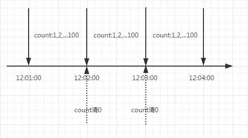
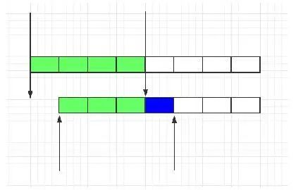
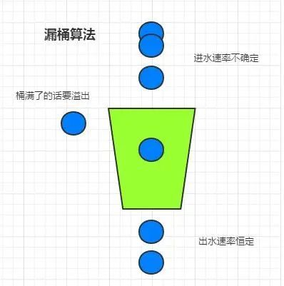
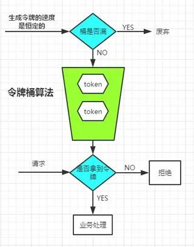

# 限流的算法

> 来源：`技术方案/限流的算法.md`

限流常用的方式为：计数器、滑动窗口、漏桶、令牌桶

## 计数器

计数器是限流里最简单的,简单来说,比如 我限制1分钟内 请求数最多为60个! 当此刻 2018-02-27 16:23:00 到 2018-02-27 16:24:00 时间内,请求最多只能是60个!到了2018-02-27 16:24:00,把计数器归零! 周而复始!

但这种会有问题!比如我在前58s都不请求,而在最后一秒请求60次!这样的效果跟木有啥区别..

## 滑动窗口

其实滑动窗口就是细分之后的计数器

这样假设, 先把一分钟划分成6段! 也就是10s一个段!在第一段里,假如请求61次,那么直接触发了规则!肯定就过不去了!如果只请求了1次!则是正常的! 当时间走到第二个段里,即10s~20s这段范围里,我请求数不能超过总的限定条件,且当前段的请求数量 加上 之前段的总数量也不能超过总限定数量!

当时间到了50s~60s,依然是一样!

如果过了60s,所以请求数都是正常的,则把划分段往右移一段!那么此时的6个分段是 10 ~ 20,20 ~ 30,30 ~ 40,40 ~ 50,50 ~ 60,60 ~ 70

然后统计规则还跟上面一样!

所以,只有划分的越细,请求限制越平滑!

## 漏桶

如图所示,漏桶就是一个固定的桶,桶底有个漏洞,进水速率不用管,有多少水不用管,反正就这个孔里漏出去! 标准来说,就是不管多少请求,最后给服务的请求数量的速率是恒定的!多余的请求将 “抛弃掉”(抛弃并不代表直接丢掉不处理..)

## 令牌桶

其实是这样的!先以一个恒定的速率生成令牌,把令牌放到桶里!然后每进来一个请求,每个请求去桶里找,有没有令牌,如果有令牌,则”拿着”令牌,继续下一步处理!如果桶里没有令牌了,则这个处理可以”抛弃掉”

令牌桶的好处就是,可以允许匀速,也允许范围内的突发处理!

类似于 我桶容量是100! 这时候1s一个请求,令牌速度也是1s一个!那么速率是恒定的, 突然,来了100个请求,发现桶里有100个令牌,那么这100个可以立即处理了!这时速率是100!

漏桶算法非常适用于秒杀系统的限流。漏桶在这种应用场景下可以起到一定的削峰填谷的作用，并且漏桶的设计从根本上能够应对集中访问的问题，同时具备平滑策略。然而，始终恒定的处理速率有时候并不一定是好事情，对于突发的请求洪峰，在保证服务安全的前提下，应该尽最大努力去响应，这个时候漏桶算法显得有些呆滞。令牌桶算法同样具备平滑属性，并且能够通过简单调整令牌的发放频率以应对流量突增，但是如果在流量突增时有大量累积可用的令牌则会导致短暂的限流失效假象（可以设置令牌的有效时间解决）。
